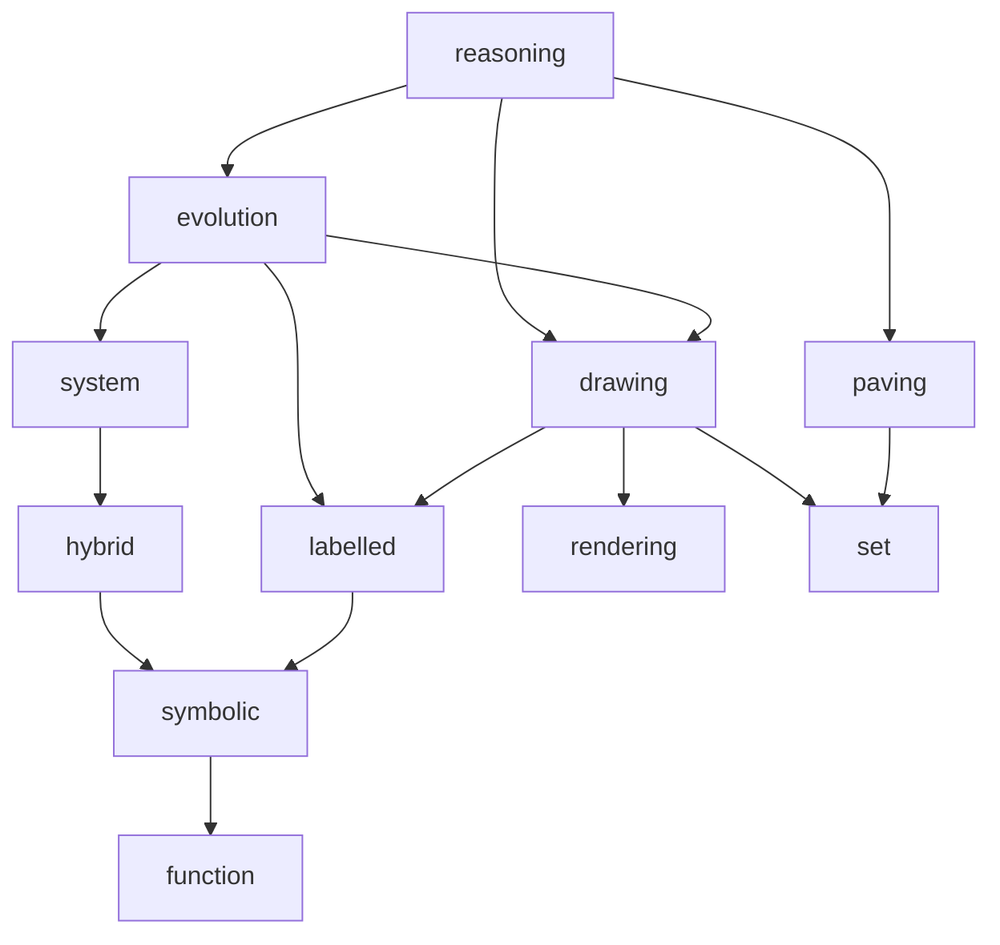

# Ariadne - Decoupling delle estensioni labelled, hybrid e drawing

**Documento di lavoro del decoupling, tracciato dal ramo `decoupling` di `reasoning` in `doc/decoupling-journal.md` (dal v6.85; prima era esterno ai repository)**  
**Versione:** 6.87 (27 novembre 2026)  
**Ramo previsto nei repository interessati:** `decoupling`
**REGOLA DI FORMATTAZIONE v6.81 - richiesta esplicita dell'utente:** eseguire `apply-format` prima di ogni nuovo commit, poi verificare `check-format`. Usare clang-format 23 e la configurazione condivisa del Build pinnato. Questa istruzione sostituisce tutti i divieti storici di eseguire `apply-format` riportati nel documento; quei divieti non sono piu operativi. Restano invariati gli altri confini, incluso il wrapper Ariadne escluso fino al merge finale.
**REGOLA OPERATIVA VINCOLANTE v6.50 - OVERRIDE DI TUTTE LE ISTRUZIONI PRECEDENTI SU ARIADNE:** il repository `ariadne-cps/ariadne` e' **solo un wrapper/superprogetto**: durante il decoupling non deve essere aggiornato, monitorato o validato a ogni modifica dei moduli. **Non modificare il branch `ariadne/decoupling`, i suoi gitlink (`ss/rea` incluso), il documento `ariadne/doc/structure.md`, e non lanciare/controllare CI Ariadne come gate intermedio.** Il riallineamento dei gitlink di Ariadne e la verifica finale si svolgeranno **esclusivamente al termine del lavoro, nel merge finale complessivo**. Le propagazioni Ariadne v6.43/v6.45/v6.48 sono eventi storici, non un workflow da ripetere; non revertire i commit gia' pubblicati senza istruzioni esplicite. Continuare nei moduli effettivi, verificandone CI e semantica. Questa regola sostituisce qualunque riga storica che dica 'propagare ad Ariadne dopo 5/5' e qualunque futura proposta di verifica intermedia su Ariadne. Nessun `main` modificato; nessun `apply-format`.  
**REGOLA DI TEST VINCOLANTE v6.56:** il tutorial Python `tutorial/tutorial_reasoning.py` e' **gia' eseguito nelle CI Release Ubuntu/macOS/Windows come tutorial installato**; non duplicarlo con un secondo `add_test` CTest. Il CTest `test_python_reasoning_import` rimane per i test mirati dei binding, inclusa la verifica HybridReachabilityAnalyser (diversa dal tutorial continuo). In `python/tests/CMakeLists.txt` la registrazione `test_python_reasoning_safety_tutorial` e' stata eliminata nel commit `867aea28`. Questa regola prevale sulle vecchie indicazioni di aggiungere/replicare il tutorial CTest.
**Stato operativo corrente (v6.87, 27 novembre 2026):** `reasoning/decoupling=14b9806` gate: Ubuntu/macOS/Windows/Sanitizers/Format `completed/success` sullo SHA esatto, Coverage con job macOS AppleClang `success` e job Ubuntu `failure` solo per apt 403 su packages.microsoft.com in setup (flake infra, non codice). La configurazione ibrida dell'analyser memorizza ora `Hybrid<Scalings>`/`Hybrid<Grid>` come stato primario, con `grid()` legacy vista derivata (`_sync_views()`); `grid_value()`/`scalings_value()` restituiscono le famiglie memorizzate. Monitoraggio CI ora a polling breve (~60s) con retry su 403. **Aperti:** flip di `AnalysisTraits<HybridAutomatonInterface>::StorageType` nel `.tpl` (DC-12/14/23), poi DC-18/R-COMP-06/07/08.  \n**Stato operativo corrente (v6.86, 26 novembre 2026):** `reasoning/decoupling=35f65fb` validato **6/6** sullo SHA esatto (Ubuntu `45974988224`, macOS `45974987900`, Windows `45974988008`, Coverage `45974988118`, Sanitizers `45974987938`, Format `45974988206`, PR draft #12): nuovo adapter di disegno `PavingDrawing::draw(canvas, locations, axes, HybridAugmentedPavingValue)` in `reasoning/hybrid_augmented_paving_value_drawing.hpp` (flattening per locazione dello state-auxiliary paving, stesso filtro locazioni e proiezione del legacy), con parita' grafica (boundary count) in `test_hybrid_augmented_paving.cpp` — avanza DC-16/R-COMP-09. Da questa tornata il gate CI viene monitorato con polling a intervalli brevi (~60s) con retry su rate-limit, non con sleep fissi. **Aperti:** flip di `AnalysisTraits<HybridAutomatonInterface>::StorageType` nel `.tpl` (DC-12/14/23), poi DC-18/R-COMP-06/07/08.  \n**Stato operativo corrente (v6.85, 26 novembre 2026):** il journal e' ora versionato nel repository (`doc/decoupling-journal.md` su `reasoning/decoupling`, su richiesta esplicita dell'utente); lo stato v6.84 e' invariato (`reasoning/decoupling=9ce5cb0` 6/6 verde, PR draft #12).  \n**Stato operativo corrente (v6.84, 26 novembre 2026):** `reasoning/decoupling=9ce5cb0` validato **6/6** sullo SHA esatto (Ubuntu `45969918569`, macOS `45969918539`, Windows `45969918525`, Coverage `45969918567`, Sanitizers `45969918528`, Format `45969918600`, PR draft #12). Enabler per il cut-over dello storage ibrido (DC-12/14/22/23): `87148d1` aggiunge gli adapter `adjoin_outer_approximation_to(HybridEnclosure, Hybrid<Paving>|HybridAugmentedPavingValue&, fineness, paver)` con materializzazione lazy della locazione e stessa precondizione di spazio delle controparti legacy (test di parita' in `test_enclosure_augmented_paving.cpp`, gate 6/6 su `87148d1`); `9ce5cb0` aggiunge `adjoin_lower_approximation`/`adjoin_outer_approximation` (set compatto e `HybridExactBoxes`)/`restrict_to_extent` su `Hybrid<Paving>` e `HybridAugmentedPavingValue`, con parita' verso le classi legacy in `test_hybrid_paving_value_adapters.cpp`. Gli header generici restano liberi da `hybrid_grid.hpp`/`hybrid_scalings.hpp` (guard `#error` del test pasado). apply-format+check-format verdi (66 file) prima di ogni commit. **Aperti:** il flip effettivo di `AnalysisTraits<HybridAutomatonInterface>::StorageType` e `_storage_factory` nel `.tpl` (ora abilitato dalle operazioni generiche), poi DC-18/R-COMP-06/07/08.  \n**Stato operativo corrente (v6.83, 26 novembre 2026):** `evolution/decoupling=48a0aaa` validato **6/6** sullo SHA esatto (Ubuntu `45960457138`, macOS `45960457081`, Windows `45960457087`, Coverage `45960457169`, Sanitizers `45960457305`, Format `45960457124`); contiene `c62c07d` (apply-format clang-format 23.1.5 su 81 file tracciati, primo commit di formato del ramo) e `48a0aaa` (rimozione dell'include inutilizzato `paving/paver.hpp` da `tests/test_enclosure_operations.cpp`: Evolution non ha piu' alcun include diretto `paving/` — verificato con grep su include/src/tests/benchmarks e compilando il test senza path include di paving, exit 0). `reasoning/decoupling=0e55a1e` validato **6/6** sullo SHA esatto (Ubuntu `45963036574`, macOS `45963036649`, Windows `45963036675`, Coverage `45963036607`, Sanitizers `45963036578`, Format `45963036628`, PR draft #12): aggiorna `ss/evo` a `48a0aaa` e sostituisce nel test l'uso del proxy mutabile `HybridAugmentedPavingElementReference` con `state_paving()[q].clear()` (DC-15). **DC-05 verificato pulito:** zero riferimenti a `GridDrawer` in system/hybrid/labelled/drawing/evolution/reasoning sui rispettivi `decoupling`. apply-format+check-format verdi prima di ogni commit. Wrapper `ariadne` non consultato, `main` invariato. **Aperti:** cut-over `AnalysisTraits<HybridAutomatonInterface>::StorageType` nel `.tpl` (DC-12/14/23), DC-18 (hybrid resta con 5 file che includono `paving/`: `hybrid_grid_cell.hpp`, `hybrid_paving.hpp`, `src/hybrid_paving.cpp`, `src/hybrid_augmented_paving.cpp`, `src/hybrid_grid.cpp` — R-COMP-06/07/08 attivi), labelled resta con `labelled_augmented_paving.hpp` e `labelled_grid.hpp` (R-COMP-01/02 attivi).  \n**Stato operativo corrente (v6.82, 26 novembre 2026):** Gate di `reasoning/decoupling=1937cc85934f0b466302809dc259c19460c7bf19` chiuso 6/6: cinque workflow funzionali `completed/success` sullo SHA esatto (Ubuntu `45903230976`, macOS `45903230920`, Windows `45903230942`, Coverage `45903230930`, Sanitizers `45903230982`) e Format `45903230926`; i check app `codecov/patch`/`codecov/project` falliscono per soglia di copertura (97.01% patch) ma non fanno parte del gate a livello di workflow e sono ignorati su richiesta esplicita dell'utente. Pubblicati tre commit additivi su `reasoning/decoupling` (PR draft #12, head `fdc4ddc34d456ffc5e5e9e73a723fc61ef723de2`): `e3adbf4` snapshot generico `HybridAugmentedPavingValue` (`Hybrid<AugmentedPaving>`) con factory da legacy preservando backend, operazioni di insieme backend-neutral, `chain_reach_value()`/`safe_value()` su `SafetyCertificate<HybridSpace>`, binding Python `HybridAugmentedPavingValue` e metodi `*_value` sull'analiser ibrido, tutorial C++/Python allineati sullo snapshot generico; `b158c05` bridge `make_hybrid_scalings_policy` (da `Hybrid<Scalings>` a policy legacy) e `grid_value()`/`scalings_value()`/`set_grid(const Hybrid<Scalings>&)` su `ReachabilityAnalyserConfiguration<HybridAutomatonInterface>`; `fdc4ddc` spostamento dei metodi `*_value` ibridi dal template primario a `HybridReachabilityAnalyser` per collisione ODR sui nomi mangled diagnosticata da AppleClang (il requires-clause non partecipa al mangling). `apply-format` (clang-format 23.1.5, config `ss/bui/.clang-format` del Build pinnato `5e6444f`) eseguito prima di ogni commit su tutti i 66 file C++ tracciati e `check-format` verde; nota operativa: lo script formatta solo file gia' in `git ls-files --cached`, quindi i file nuovi vanno prima staged, altrimenti il Format CI fallisce sul commit (visto su `e3adbf4`, corretto in `b158c05`). CI su `fdc4ddc`: Ubuntu `45911148760`, macOS `45911148765`, Windows `45911148808`, Sanitizers `45911148809`, Format `45911148785` tutti `completed/success`; Coverage run `45911148767` con job macOS AppleClang 21 Coverage `success` e job Ubuntu GCC 13 Coverage `failure` solo per `Failed to fetch https://packages.microsoft.com/... InRelease 403` in "Set Up Linux Dependencies" (flake infra prima di ogni build; retry non disponibile via API in questa sessione). Verifiche locali `g++ -std=c++20 -fsyntax-only` exit 0 su nuovo sorgente, header degli analyser, bindings pybind11, test e tutorial con la catena include dei gitlink. Nessun gitlink modificato, `main` invariato, wrapper `ariadne` non consultato, test Python lasciati invariati su richiesta dell'utente (il tutorial Python riflette quello C++ tramite `chain_reach_value`). **G5/DC-12/DC-13/DC-14/DC-18 e il cut-over di `AnalysisTraits<HybridAutomatonInterface>::StorageType` restano aperti**; prossimo passo in ordine: cut-over dello storage ibrido nel `.tpl` dell'analyser verso `Hybrid<AugmentedPaving>`, coordinato con factory e firme delle interfacce.  \n**Stato operativo corrente (v6.81, 26 novembre 2026):** Evolution `711c91db` validato 5/5. Reasoning integra il nuovo provider nel commit `bac20dbe`; dopo la richiesta dell'utente e' stato eseguito il target condiviso `apply-format` sui 64 file C++ tracciati e `check-format` e' passato. Pubblicato il commit di formattazione `1937cc85934f0b466302809dc259c19460c7bf19` nella PR draft #12, 32 file C++ e nessun gitlink modificato. Format CI e' `completed/success` sul nuovo SHA; le cinque CI funzionali restano aperte. Non attribuire al nuovo commit gli esiti del parent. Da ora apply-format precede ogni commit.
**Stato operativo corrente (v6.80, 26 novembre 2026):** Evolution `711c91dbab1bec6b802228d97a947517a4a163ed` validato 5/5 sullo SHA esatto. Integrato in Reasoning con `bac20dbee7aad59710e287ddbfaff7c8f4467054`, PR draft #12; cinque CI funzionali e Format avviati solo da `pull_request`, nessuna CI da push su `decoupling`. Gate Reasoning ancora aperto. G5/DC-12/DC-13/DC-14/DC-18 e la migrazione dello storage restano aperti; wrapper Ariadne invariato.
**Stato operativo corrente (v6.79, 26 novembre 2026):** System `9813462f` validato 5/5. Evolution `711c91db` pubblicato nella PR draft #35: corretti gli include dei due benchmark e i letterali esatti del nuovo test; rimossi i trigger push su `decoupling` dai cinque workflow. Cinque CI solo `pull_request` in corso; gate Evolution ancora aperto. Reasoning `c9685717` invariato, integrazione successiva preparata ma non pubblicata. G5/DC-12/DC-13/DC-14/DC-18 ancora aperti.
**Stato operativo corrente (v6.77, 26 novembre 2026):** **Hybrid `dcf5ba768584da5fb9c6537995cd96a80ec3f9a8` validato 5/5** sullo SHA esatto: Ubuntu [45886190933](https://github.com/ariadne-cps/hybrid/actions/runs/45886190933), macOS [45886190934](https://github.com/ariadne-cps/hybrid/actions/runs/45886190934), Windows [45886190977](https://github.com/ariadne-cps/hybrid/actions/runs/45886190977), Coverage [45886190931](https://github.com/ariadne-cps/hybrid/actions/runs/45886190931), Sanitizers [45886190916](https://github.com/ariadne-cps/hybrid/actions/runs/45886190916), tutti `completed/success`. Nessuna ulteriore modifica a Hybrid. **Reasoning `303e62489887735f203e7dc6698324301e99a62b` era 5/5 verde** e HEAD invariato al preflight. Pubblicato sul SOLO `reasoning/decoupling` il commit [`c9685717a35868f8e04db9d8dc1d93e2ea727ec5`](https://github.com/ariadne-cps/reasoning/commit/c9685717a35868f8e04db9d8dc1d93e2ea727ec5), parent `303e6248`, tree `1e874381c8ee9692eba355ffe2a2b1662b632e48`, compare GitHub `ahead_by=1`, `behind_by=0`, **sei file esatti**: `include/reasoning/hybrid_grid_compat.hpp`, `src/hybrid_grid.cpp`, `src/hybrid_paving.cpp`, `tests/test_grid_adapters.cpp`, `tests/test_generic_hybrid_grid_adapters.cpp`, `tests/test_hybrid_paving_value_adapters.cpp`. **Taglio G5/DC-13 consumer reale:** nuovo overload `grid_from_scalings(const HybridScalings&, const DiscreteLocation&, const RealSpace&)` in Reasoning ricrea il `Grid` per dimensione e ordinamento espliciti, leggendo `policy.scaling(location, variable)`; usi residui di `HybridScalings::grid` sostituiti nella factory lazy `make_hybrid_grids(HybridSpace, HybridScalings)` e nell'`extend_auxiliary` legacy. L'overload generico `grid_from_scalings(const Scalings&, const RealSpace&)` resta invariato; la funzione `HybridGrid::make_grid` del provider Hybrid non viene duplicata nel provider. Aggiunti tre test mirati ai test C++ gia registrati: default scaling non unitario, permutation di coordinate e locazione assente; equivalenza generic/legacy dei grigliati; `extend_auxiliary` legacy con scale non unitarie, due locazioni, mancata materializzazione della seconda, backend tree/ROBDD e verifica di spazi e scale delle coordinate ausiliarie. **Le CI Reasoning sul nuovo SHA NON SONO ANCORA VALIDATE**: registrate sullo SHA esatto Ubuntu `45887549111`, macOS `45887549043`, Windows `45887549048`, Coverage `45887549022`, Sanitizers `45887549083` (queued/in_progress all'ultima lettura). Nessuna compilazione locale; test e semantica da validare sulle cinque CI. I gitlink Reasoning e Hybrid non sono stati modificati: l'attuale Reasoning continua a compilare con il provider Hybrid pinnato, ma il nuovo helper non richiede piu `HybridScalings::grid`, eliminato nei commit Hybrid successivi. **G5/DC-12/DC-13/DC-14/DC-18 e R-COMP-06/07/08 rimangono aperti**; questo intervento non costituisce cut-over integrale dei consumer Paving o del grafo. **`ariadne-cps/ariadne` resta wrapper congelato, non consultato, non aggiornato e non validato fino al merge finale**; nessun `main`, nessun `apply-format`, nessuna duplicazione del tutorial Python Reasoning in CTest.  
**Stato operativo corrente (v6.76, 26 novembre 2026):** Verificato il gate del commit `hybrid/decoupling=204b2f00fde3084edfe4d681f3f1dee625835139`: **5/5 `completed/success` sullo SHA corretto**: Ubuntu `45883204019`, macOS `45883204010`, Windows `45883204033`, Coverage `45883203958`, Sanitizers `45883203996`. Il commit `204b2f00`, pubblicato dopo `a4b4470c`, corregge `tests/test_hybrid_header_boundaries.cpp` posizionando le due `static_assert` su `HybridGridCell` e `HybridValidatedConstrainedImageSet` dopo i rispettivi include espliciti: nessuna assert rimossa, nessuna reintegrazione di dipendenze negli header generici. Il gate verde comprende dunque il batch architetturale precedente `344cfebb` e le due correzioni sui test. **Nuovo batch G5/DC-13/DC-18 pubblicato solo su `hybrid/decoupling`:** [`dcf5ba768584da5fb9c6537995cd96a80ec3f9a8`](https://github.com/ariadne-cps/hybrid/commit/dcf5ba768584da5fb9c6537995cd96a80ec3f9a8), parent `204b2f00`, tree `81540b70a2304fad44e0b6b571bcb0b73e536e49`; confronto GitHub `ahead_by=1`, `behind_by=0`, **9 file esatti**: `include/hybrid/hybrid_grid.hpp`, `src/hybrid_grid.cpp`, `include/hybrid/hybrid_paving.hpp`, `src/hybrid_paving.cpp`, `python/bindings/hybrid_submodule.cpp`, `tests/test_hybrid_space.cpp`, `tests/CMakeLists.txt`, `tests/test_hybrid_grid_header.cpp` (nuovo), `tests/test_hybrid_paving_header.cpp` (nuovo). `hybrid_grid.hpp` non include piu `paving/grid.hpp`: espone una forward declaration di `Grid` e la funzione `grid(loc)` ora definita in `src/hybrid_grid.cpp`, dove l'include concreto e esplicito; anche l'operatore stream di `HybridGrid` e stato spostato nello stesso `.cpp`. `hybrid_paving.hpp` non include piu direttamente `hybrid_expression_set.hpp` e `expression-set/expression_set.hpp`; spostate in `src/hybrid_paving.cpp` le definizioni non-template di `with_grid`, dello stream e di `inner_approximation` preservando le firme pubbliche e i corpi. Aggiunto `paving/grid.hpp` esplicito al binding Python che esporta `HybridGrid::grid` e al test concreto dello spazio; esteso il test per l'equivalenza `grid(q)`/`operator[](q)`. Due test standalone verificano che gli header non trascinino indebitamente griglia concreta o backend tree/ROBDD. **Nuova CI NON ancora validata**, sullo SHA esatto `dcf5ba76`: Ubuntu [45886190933](https://github.com/ariadne-cps/hybrid/actions/runs/45886190933) in_progress, macOS [45886190934](https://github.com/ariadne-cps/hybrid/actions/runs/45886190934) in_progress, Windows [45886190977](https://github.com/ariadne-cps/hybrid/actions/runs/45886190977) queued, Coverage [45886190931](https://github.com/ariadne-cps/hybrid/actions/runs/45886190931) in_progress, Sanitizers [45886190916](https://github.com/ariadne-cps/hybrid/actions/runs/45886190916) in_progress. Prima di altri commit controllare tutte le cinque CI e correggere solo regressioni effettive. **G5/DC-12/DC-13/DC-14/DC-18 ancora aperti**: il modulo contiene API e rappresentazioni concrete, e non e ancora disaccoppiato da Paving, Labelled, Drawing, Expression Set. `ariadne-cps/ariadne` e wrapper congelato e non deve essere ne consultato ne modificato o validato prima del merge finale; nessun `main`, nessun `apply-format`, nessun duplicato del tutorial Python Reasoning in CTest.  
**Stato operativo corrente (v6.75, 26 novembre 2026):** **Hybrid `344cfebb7a299b91ea4dfa5334a22accdbd89e6e` NON validato: tutti e cinque i workflow `completed/failure`** sullo SHA esatto. Ubuntu `45877268565`, macOS `45877268426`, Windows `45877268441`, Coverage `45877268400`, Sanitizers `45877268387`. **Distinzione tecnica rilevante:** le configurazioni Release su Ubuntu/macOS/Windows hanno superato la build; le configurazioni Debug sono fallite a `Build Debug tests`, e Coverage/Sanitizers falliti nelle fasi di build dei test. La lettura completa dei log di compilazione dei job non era accessibile tramite GitHub API autorizzata; non dichiarare quindi confermata dal compilatore una causa specifica. Audit dei consumer sul branch `decoupling`: `tests/test_hybrid_set_interface.cpp` costruisce `HybridBoxSet` alle righe circa 140/216 e importava solo `hybrid_set.hpp`, che nel batch `344cfebb` ha correttamente smesso di importare `hybrid_expression_set.hpp` transitivamente. Questo e un difetto di include DIRETTO staticamente dimostrato, coerente con i fallimenti Debug. Pubblicato **fix mirato** sul solo `hybrid/decoupling` commit [`a4b4470c0f9da34792b0b4b1504a122cf80e4531`](https://github.com/ariadne-cps/hybrid/commit/a4b4470c0f9da34792b0b4b1504a122cf80e4531), parent `344cfebb`, tree `c072183fdc19c7c99b84e7e567035d74475e6bce`; compare verificato `ahead_by=1`, `behind_by=0` e un solo file modificato: `tests/test_hybrid_set_interface.cpp` (+ include esplicito `hybrid/hybrid_expression_set.hpp`). Nessuna reintegrazione dell'include nell'header generico, nessuna alterazione di test esistenti, implementazioni o API. **La correzione NON e ancora validata**, i cinque workflow sul nuovo SHA sono stati avviati ed erano `in_progress` al controllo successivo: Ubuntu `45878146148`, macOS `45878146182`, Windows `45878146203`, Coverage `45878146155`, Sanitizers `45878146125`. Ricontrollare cinque workflow completi, diagnosticare ulteriori failure reali, non dichiarare chiuso G5/DC-12/DC-13/DC-14/DC-18. Quando il gate del fix sara chiuso, proseguire con batch architetturali piu ampi, coordinando consumer e test. **Non consultare/aggiornare/validare `ariadne-cps/ariadne` prima del merge finale; nessun `main`, nessun `apply-format`, nessun tutorial Python Reasoning duplicato.**  
**Stato operativo corrente (v6.74, 26 novembre 2026):** **Decisione operativa: commit piu ampi, coerenti e completi di consumer/test anziche micro-commit.** Gate del parent Hybrid `c5c1beaf942ee8a6d39bd76c1dc91948c34ad1cb` **5/5 completed/success** sullo SHA esatto: Ubuntu `45876078562`, macOS `45876078449`, Windows `45876078581`, Coverage `45876078440`, Sanitizers `45876078492`. Pubblicato sul SOLO `ariadne-cps/hybrid` ramo `decoupling` il commit fast-forward [`344cfebb7a299b91ea4dfa5334a22accdbd89e6e`](https://github.com/ariadne-cps/hybrid/commit/344cfebb7a299b91ea4dfa5334a22accdbd89e6e), parent `c5c1beaf`, tree `0287aae0f8f84f426de04f366d0f797ac7458976`; compare GitHub `ahead_by=1`, `behind_by=0`, **esattamente 13 file**. Interventi G5 raggruppati: (1) `HybridGridCell` e ora in un header concreto autonomo `include/hybrid/hybrid_grid_cell.hpp`, non piu in `hybrid_set.hpp`; (2) `HybridValidatedConstrainedImageSet` e stata estratta da `hybrid_set.hpp` in `include/hybrid/hybrid_validated_constrained_image_set.hpp`; (3) `hybrid_set.hpp` ha rimosso include diretti `hybrid/hybrid_grid.hpp`, `paving/grid_cell.hpp`, `hybrid/hybrid_expression_set.hpp` e `expression-set/expression_set.hpp`, mantenendo i template generici; (4) `src/hybrid_set.cpp` trasferisce i costruttori di `HybridSpaceSetConstIterator`, `increment_loc`, `class_name<GridCell>()` e le istanziazioni concrete in `src/hybrid_paving.cpp`, mentre conserva il codice matematico generico e include esplicitamente il nuovo header concrete image; (5) `hybrid_paving.hpp`, l aggregatore `ariadne-hybrid.hpp`, due consumer test e `tests/test_hybrid_header_boundaries.cpp` aggiornati; (6) due nuovi test standalone `test_hybrid_grid_cell_header.cpp` e `test_hybrid_validated_constrained_image_header.cpp` registrati in `tests/CMakeLists.txt`, con verifiche di ereditarieta e divieto di includere indirettamente i backend tree/ROBDD. I blob preparati nella v6.73 sono **superseded** dai 13 file del commit attuale; non pubblicarli come un commit separato. **Il nuovo SHA NON e ancora validato**: cinque workflow avviati e tutti `in_progress` sullo SHA esatto: Ubuntu [45877268565](https://github.com/ariadne-cps/hybrid/actions/runs/45877268565), macOS [45877268426](https://github.com/ariadne-cps/hybrid/actions/runs/45877268426), Windows [45877268441](https://github.com/ariadne-cps/hybrid/actions/runs/45877268441), Coverage [45877268400](https://github.com/ariadne-cps/hybrid/actions/runs/45877268400), Sanitizers [45877268387](https://github.com/ariadne-cps/hybrid/actions/runs/45877268387). Alla verifica individuale i job erano in setup/configurazione, nessun failure osservato. Ricontrollare le cinque CI sullo SHA nuovo e diagnosticare eventuali failure reali senza indebolire i test. **G5, DC-12/DC-13/DC-14/DC-18 ancora aperti**: la dipendenza Hybrid/Paving non e eliminata, e i consumer generici non tutti migrati. Non consultare/aggiornare/validare il wrapper `ariadne-cps/ariadne`, non modificare `main`, non eseguire `apply-format`, non duplicare tutorial Python Reasoning in CTest.
**Stato operativo corrente (v6.73, 26 novembre 2026):** Il commit Hybrid `c5c1beaf942ee8a6d39bd76c1dc91948c34ad1cb` e' tuttora HEAD del solo `hybrid/decoupling`. Il suo gate **NON e' ancora chiuso**: Ubuntu `45876078562`, macOS `45876078449`, Coverage `45876078440`, Sanitizers `45876078492` sono `completed/success` sullo SHA esatto; Windows `45876078581` e' ancora `in_progress` con quattro job MSVC in compilazione/configurazione nell'ultimo controllo. **Nessun nuovo commit pubblicato.** Preparato e caricato su GitHub come cinque blob non committati il successivo batch G5 di segregazione concreta `HybridGridCell`: `include/hybrid/hybrid_set.hpp` -> `7a37a31e0ea4f6012e7efc6e673a2f67ea33c3b0` (base `cfe4aea53635cb6ea20db819a1ff700e91b2caa3`; rimuove gli include `hybrid/hybrid_grid.hpp` e `paving/grid_cell.hpp`, e la definizione concreta di `HybridGridCell`); `include/hybrid/hybrid_paving.hpp` -> `3b1882b2ff473395b30ca5a4af28b42a0a75c190` (base `d262636bc491fd8bb97ec2dd9435edeb63dec7bf`; ospita senza cambio di corpo `HybridGridCell` dopo gli include Paving gia' necessari); `src/hybrid_set.cpp` -> `c1307e63bb62dbae5838b4f5ed48bef1d683fbbe` (base `e88ede145f30732c1b1b986996b54bfe30a90051`; estrae istanziazioni degli iteratori concrete, `class_name<GridCell>()`, e corpi dei due costruttori e di `increment_loc` di `HybridSpaceSetConstIterator`); `src/hybrid_paving.cpp` -> `8175be69301934992c6f151cf2f1348df3593656` (base `cfda0a798f737d399f0a8a863f0ec2409bf7ced9`; riceve definizioni e instanziazioni senza cambi di comportamento); `tests/test_hybrid_header_boundaries.cpp` -> `8aa8a81885efd93ee6aca15f158a711f64dd1fba` (base `b4c029a449718a290104ac3ae3086923979a0288`; rafforza guardia compile-time su HybridGrid, Grid e GridCell dopo l'include del set generico). Le modifiche staged sono verificate come trasformazione testuale e blob ma **NON compilate, committate o validate in CI**. Prima di qualsiasi pubblicazione: attendere e verificare Windows `completed/success` sullo SHA `c5c1beaf`, rileggere HEAD e SHA dei cinque file, ricontrollare semantica e presenza delle istanziazioni, poi un solo commit con quei cinque file e cinque nuove CI. G5, DC-12/DC-13/DC-14/DC-18 ancora aperti; nessun accesso al wrapper `ariadne-cps/ariadne`, nessun `main`, nessun `apply-format`, tutorial Python Reasoning non duplicato.  
**Stato operativo corrente (v6.72, 26 novembre 2026):** **Hybrid `d9dc9a6ea232cde7d28e9fd9e6d4c928e2ae30aa` validato 5/5** sullo SHA esatto: Ubuntu `45875021368`, macOS `45875021318`, Windows `45875021342` (incluso ARM Debug), Coverage `45875021399`, Sanitizers `45875021319` tutti `completed/success`. HEAD `hybrid/decoupling` aggiornato tramite fast-forward con lease al nuovo commit [`c5c1beaf942ee8a6d39bd76c1dc91948c34ad1cb`](https://github.com/ariadne-cps/hybrid/commit/c5c1beaf942ee8a6d39bd76c1dc91948c34ad1cb), parent `d9dc9a6e`, tree `8efae6a3fe02ff32fc091e0a57e77f340e98610a`; compare GitHub verificato `ahead_by=1`, `behind_by=0`, **esattamente otto file**: `include/hybrid/hybrid_set.hpp`, `include/hybrid/hybrid_paving.hpp`, `src/hybrid_set.cpp`, `src/hybrid_paving.cpp`, `src/hybrid_augmented_paving.cpp`, `tests/test_hybrid_set.cpp`, `tests/test_hybrid_paving_operations.cpp`, `tests/test_hybrid_header_boundaries.cpp`. **Taglio G5 mirato:** `hybrid_set.hpp` importa ora `paving/grid_cell.hpp` al posto di `paving/binary_tree_paving.hpp` (mantiene la necessaria definizione di `GridCell`); `hybrid_paving.hpp` non importa piu direttamente i backend concreti `binary_tree_paving.hpp` e `robdd_paving.hpp`, ma usa `paving/paving_interface.hpp` e forward declaration di `RobddManager`; i tre costruttori `HybridPaving` che selezionano tree/ROBDD e factory sono trasferiti senza cambi semantici in `src/hybrid_paving.cpp`. Include espliciti aggiunti ai veri consumer nei `.cpp` e nei test; nuovo controllo di isolamento compile-time degli header per i due backend, preservati i test di scelta backend, griglia incompatibile, manager ROBDD condiviso, copia e lazy location. **NUOVO SHA NON ANCORA VALIDATO**: cinque workflow Actions avviati su `c5c1beaf` e tutti `in_progress` all ultimo controllo: Ubuntu `45876078562`, macOS `45876078449`, Windows `45876078581`, Coverage `45876078440`, Sanitizers `45876078492`. Verificare le cinque conclusioni `completed/success` sullo SHA esatto o diagnosticare eventuali failure reali senza indebolire test. Lo staging e il confronto GitHub dei blob sono verificati; **non e stata eseguita compilazione locale**. **G5/DC-13 ancora aperti**: Hybrid conserva tipi concreti e dipendenza Paving. Il wrapper `ariadne-cps/ariadne` resta totalmente escluso da consultazione/aggiornamento/CI fino al merge finale; nessun `main`, nessun `apply-format`, nessuna duplicazione tutorial Python CTest.  
**Stato operativo corrente (v6.71, 26 novembre 2026):** **Hybrid `795317e90ad9e36c264844507923a7dcbf2c1f69` VERDE 5/5**: Ubuntu `45872209538`, macOS `45872209524`, Windows `45872209621`, Coverage `45872209521`, Sanitizers `45872209527`, tutti `completed/success` sullo SHA corretto. La rimozione di `HybridScalings::grid` e del relativo include concreto `paving/grid.hpp` e' quindi validata, incluso il consumer del prodotto ausiliario ora migrato a `HybridGrid::make_grid`. **Pubblicato un nuovo batch G5 sul solo `hybrid/decoupling`:** [`d9dc9a6ea232cde7d28e9fd9e6d4c928e2ae30aa`](https://github.com/ariadne-cps/hybrid/commit/d9dc9a6ea232cde7d28e9fd9e6d4c928e2ae30aa), parent `795317e9`, tree `9682a8999058306d31faee8811ead8ccd159cab9`, compare GitHub `ahead_by=1`, `behind_by=0`, **esattamente quattro file**: `include/hybrid/hybrid_set_interface.hpp` (- include diretto `expression-set/expression_set.hpp`), `include/hybrid/hybrid_expression_set.hpp` (- include diretti `hybrid/hybrid_grid.hpp` e `paving/binary_tree_paving.hpp`), `tests/CMakeLists.txt` (+ test registrato), nuovo `tests/test_hybrid_header_boundaries.cpp` (57 righe). Il test verifica che gli header astratti non importino `ARIADNE_EXPRESSION_SET_HPP` ne' `ARIADNE_GRID_HPP`, che quello simbolico non importi `ARIADNE_GRID_HPP` ne' `ARIADNE_PAVING_BINARY_TREE_PAVING_HPP`, e controlla il contratto di ereditarieta' delle interfacce. Nessuna semantica dei test preesistenti modificata. **NUOVA CI IN ATTESA DI VALIDAZIONE** sullo SHA `d9dc9a6e`: Ubuntu `45875021368`, macOS `45875021318`, Windows `45875021342`, Coverage `45875021399`, Sanitizers `45875021319`, inizialmente `queued`. Valutare eventuali regressioni di compilazione prima di altri batch; non eliminare altre inclusioni transitive alla cieca. **G5 e DC-13 restano formalmente aperti**, poiche' altri tipi concreti e dipendenze Hybrid/Paving persistono; non sostenere che l'intero modulo sia disaccoppiato. Reasoning `303e6248` resta validato 5/5. Assoluto divieto di consultare, aggiornare o validare `ariadne-cps/ariadne` prima del merge finale; `main` invariato, nessun `apply-format`, nessuna duplicazione del tutorial Python in CTest.  
**Stato operativo corrente (v6.70, 26 novembre 2026):** **CAUSA ESATTA DI BUILD FAILURE DOCUMENTATA DALL'UTENTE:** la compilazione di `hybrid/src/hybrid_augmented_paving.cpp:54` falliva per `no member named 'grid' in 'Ariadne::HybridScalings'` dopo la rimozione di `HybridScalings::grid` (DC-13). Il fix precedente `c2610a0ecaa1d6a46ea4d20468cc2769d287e17b` ha fallito 0/5 workflow (Ubuntu `45870539296`, macOS `45870539142`, Windows `45870539194`, Coverage `45870539122`, Sanitizers `45870539110`), dunque gli include da soli non erano risolutivi. **Pubblicata correzione mirata, NON ANCORA VALIDATA:** su `hybrid/decoupling` HEAD [`795317e90ad9e36c264844507923a7dcbf2c1f69`](https://github.com/ariadne-cps/hybrid/commit/795317e90ad9e36c264844507923a7dcbf2c1f69), parent `c2610a0`, tree `f62b3927074a05323bb1c2f882102fee2b93db94`, compare `ahead_by=1`, `behind_by=0`, solo quattro file: `include/hybrid/hybrid_grid.hpp`, `src/hybrid_grid.cpp`, `src/hybrid_augmented_paving.cpp`, `tests/test_hybrid_space.cpp`. **Design:** `HybridGrid::make_grid(const HybridScalings&, const DiscreteLocation&, const RealSpace&)` ricrea la griglia per un ordinamento di variabili esplicito; `HybridGrid::operator[]` riutilizza questa funzione con lo spazio della locazione e `HybridAugmentedPaving::state_auxiliary_paving` la usa con `mapping.result_space()` al posto del metodo rimosso dalla policy. **Non reintrodurre** `HybridScalings::grid` o il suo include `paving/grid.hpp`. La regressione verifica scale 2/3 in ordine invertito dei nomi delle variabili per la griglia ausiliaria; test precedenti non alterati. **Gate in corso sul nuovo SHA:** Ubuntu `45872209538`, macOS `45872209524`, Windows `45872209621`, Coverage `45872209521`, Sanitizers `45872209527` (queued/in_progress al primo controllo). Attendere e verificare 5/5 `completed/success` o diagnosticare fallimento reale senza indebolire i test. G5 e DC-13 rimangono aperti; `Reasoning/303e6248` 5/5 verde. Ariadne wrapper non va consultato, aggiornato o validato prima del merge finale; nessun `main`, nessun `apply-format`, nessun tutorial Python CTest duplicato.  
**Stato operativo corrente (v6.69, 26 novembre 2026):** `reasoning/decoupling=303e62489887735f203e7dc6698324301e99a62b` ha **5/5 CI completed/success**, validazione non cambiata. Su `hybrid/decoupling`, il batch G5/DC-13 [`4f535080603b0b60223ee89da1b5254151c37295`](https://github.com/ariadne-cps/hybrid/commit/4f535080603b0b60223ee89da1b5254151c37295) ha invece **FALLITO TUTTE E CINQUE** le CI, Ubuntu `45866107146`, macOS `45866107059`, Windows `45866107055`, Coverage `45866107076`, Sanitizers `45866107192`: tutti i job matrix sono falliti nella fase Build/Build Test, prima delle regressioni. I log di compilazione individuali non erano disponibili tramite la GitHub API autorizzata: **causa esatta non dimostrata**; e' sbagliato dichiarare il batch validato. Per correggere possibili mancanze di inclusioni transitive, pubblicato su `hybrid/decoupling` il commit [`c2610a0ecaa1d6a46ea4d20468cc2769d287e17b`](https://github.com/ariadne-cps/hybrid/commit/c2610a0ecaa1d6a46ea4d20468cc2769d287e17b), parent `4f535080`, tree `6dad632166ec012007d0f906e35c4deb0c0e3d4d`, fast-forward 1 commit e precisamente 3 file: `include/hybrid/hybrid_scalings.hpp` (+ `numeric/builtin.hpp`, **senza reintrodurre `paving/grid.hpp`**); `include/hybrid/hybrid_expression_set.hpp` (ripristinati gli include diretti `hybrid/hybrid_grid.hpp` e `paving/binary_tree_paving.hpp` rimossi troppo presto); `src/hybrid_grid.cpp` (include esplicito `algebra/vector.hpp`). Non modificate firme pubbliche, semantica, test o CMake. L'isolamento da Paving della policy `HybridScalings` rimane. **CI di questo fix IN CORSO, NON VALIDATE**: Ubuntu `45870539296`, macOS `45870539142`, Windows `45870539194`, Coverage `45870539122`, Sanitizers `45870539110`, al controllo queued/in_progress. Se fallisce ancora, recuperare un log di compilazione reale o diagnosticare un errore riproducibile, non fare altre correzioni per supposizione e non indebolire i test. DC-13 rimane parziale, G5 non chiuso. Nessun intervento o consultazione del wrapper `ariadne-cps/ariadne` prima del merge finale, nessun `main`, nessun `apply-format`; tutorial Python verificato nelle CI Release, non duplicare in CTest.  
**Stato operativo corrente (v6.68, 26 novembre 2026):** Su `reasoning/decoupling` [`303e62489887735f203e7dc6698324301e99a62b`](https://github.com/ariadne-cps/reasoning/commit/303e62489887735f203e7dc6698324301e99a62b) ha **5/5 CI completed/success**: Ubuntu `45860230975`, macOS `45860231152`, Windows `45860230737`, Coverage `45860230715`, Sanitizers `45860230711`. Nessun ulteriore commit Reasoning in questo intervento. Su `hybrid/decoupling`, partendo da `81b54a8235731e6e8bcb64c4bcf78865bab99a5d` (5/5 CI verde), pubblicato **batch di otto file** [`4f535080603b0b60223ee89da1b5254151c37295`](https://github.com/ariadne-cps/hybrid/commit/4f535080603b0b60223ee89da1b5254151c37295), tree `86cbe1045876ee68beeb0e61152eb651a4bee454`, `ahead_by=1`, `behind_by=0` e compare GitHub verificato. **Taglio G5/DC-13 reale ma parziale:** rimossi dall'header `hybrid/hybrid_scalings.hpp` sia `#include "paving/grid.hpp"` sia il metodo `HybridScalings::grid(loc, space)`; rimosso il vecchio corpo da `src/hybrid_paving.cpp`; `HybridGrid::operator[](loc)` ora materializza la griglia da `HybridScalings::scaling(loc, variable)` nel nuovo `src/hybrid_grid.cpp`, registrato in `src/CMakeLists.txt`; preservato il contratto pubblico concreto `HybridGrid` per i consumer. Rimossi gli include diretti inutilizzati di `hybrid_grid.hpp` e `paving/binary_tree_paving.hpp` da `hybrid_expression_set.hpp` (questo non elimina l'intero accoppiamento Hybrid/Paving). Aggiunte una compile guard nell'autonomo test header di HybridScalings e verifiche della griglia per scaling non unitari e locazione assente nel test dello spazio Hybrid. **Nuova CI Hybrid non ancora validata:** Ubuntu `45866107146`, macOS `45866107059`, Windows `45866107055`, Coverage `45866107076`, Sanitizers `45866107192`, tutti `in_progress` all'ultima verifica; eseguire tutte le cinque verifiche sullo SHA esatto. **DC-13 resta parziale, G5 aperto:** `HybridGrid`, `HybridPaving`, altri header e gitlink persistono; non rivendicare la chiusura di `hybrid -> paving`. Prossimo batch: dopo CI di Hybrid, risolvere eventuali failure senza indebolire test e affrontare ulteriore rimozione di dipendenze concrete da Hybrid e G4 Labelled con aggiornamenti coordinati dei consumer. **Ariadne wrapper congelato fino al merge finale, non consultare/aggiornare/validare**; nessun `main`, nessun `apply-format`, nessuna duplicazione del tutorial Python CTest.  
**Stato operativo corrente (v6.67, 26 novembre 2026):** Su `reasoning/decoupling`, il commit parent `931b8a89230406d573c91f49b046865950220e7a` e' validato **5/5 CI** (`completed/success` su Ubuntu `45855840354`, macOS `45855840176`, Windows `45855840215`, Coverage `45855840186`, Sanitizers `45855840226`). In risposta alla richiesta di accelerare la campagna, pubblicato **un solo batch funzionale di nove file**: [`303e62489887735f203e7dc6698324301e99a62b`](https://github.com/ariadne-cps/reasoning/commit/303e62489887735f203e7dc6698324301e99a62b), parent `931b8a89`, tree `5c6b21df8c7d46d7e7e9f66f21323741caa1af0c`. Compare GitHub verificato `ahead_by=1`, `behind_by=0`, **esattamente 9 file**. **Tre interventi collegati**: (1) `make_labelled_augmented_paving_value(const LabelledAugmentedPaving&)` centralizza in Reasoning la conversione owning da storage legacy, preservando state/auxiliary labels e backend tree/ROBDD; i certificati di sicurezza continui riutilizzano la conversione. (2) `ReachabilityAnalyser<SYS>` espone metodi additivi di lettura generica `lower_evolve_value`, `lower_reach_evolve_values`, `lower_reach_value` (finite/infinite), `upper_evolve_value`, `upper_reach_evolve_values`, `upper_reach_value`, `outer_chain_reach_value`, vincolati compile-time allo storage legacy continuo; firme virtuali legacy e `AnalysisTraits` **non** cambiati. (3) Binding Python dei nuovi metodi e test di disponibilita' API, regressioni C++ ampliate su iterated map tree/ROBDD, copie indipendenti, spazi e certificati VectorField, senza tutorial duplicato. **Gate del batch NON ANCORA VALIDATO**: cinque workflow avviati, Ubuntu `45860230975`, macOS `45860231152`, Windows `45860230737`, Coverage `45860230715`, Sanitizers `45860230711`, tutti `in_progress` all'ultimo controllo. Priorita': diagnosticare eventuali failure vere di compilazione/test senza indebolire le regressioni e poi estendere i batch ad altri moduli/consumer. **DC-07/DC-08/DC-11/DC-23 aperti**: non e' stato completato il cut-over degli storage interni o eliminata la dipendenza `labelled -> paving`. Ariadne e' wrapper congelato fino al merge finale: **non consultarlo, modificarlo o verificarne CI**. Nessun `main`, nessun `apply-format`, tutorial Python gia' verificato nelle Release, non aggiungerlo ai test CTest.  
**Stato operativo corrente (v6.66, 26 novembre 2026):** Reasoning `828b89840c6d20cabb78da28397b1cbf3b082495` e' **validato 5/5** (`completed/success` sullo SHA esatto): Ubuntu `45852125368`, macOS `45852124933`, Windows `45852124568` (incluso Windows 11 ARM Debug), Coverage `45852124689`, Sanitizers `45852124691`. Dopo il preflight di HEAD, blob di base e blob preparati, pubblicato su `reasoning/decoupling` [`931b8a89230406d573c91f49b046865950220e7a`](https://github.com/ariadne-cps/reasoning/commit/931b8a89230406d573c91f49b046865950220e7a), parent `828b89840c6d20cabb78da28397b1cbf3b082495`, tree `7660f503214c4621708e8dfedbcb573a144e3b1c`; compare GitHub `ahead_by=1`, `behind_by=0`, solo `include/reasoning/reachability_analyser.hpp` (+12/-0) e `tests/test_iterated_map_reachability.cpp` (+10/-0). API additive `ReachabilityAnalyserConfiguration::grid_value()` e `set_grid(const LabelledValue<Grid>&)` con vincolo `requires std::is_same_v<GridType, LabelledGrid>`: soltanto configurazione continua, API legacy `grid()/set_grid(GridType)` preservate, Hybrid invariato. Test C++ di round-trip griglia e spazio aggiunto nello scenario dell'iterated map, senza modifiche tutorial. **Nuovo commit ancora NON validato:** workflow sul nuovo SHA avviati Ubuntu `45855840354`, macOS `45855840176`, Windows `45855840215`, Coverage `45855840186`, Sanitizers `45855840226`, inizialmente queued/in_progress; aspettare 5/5 prima di ulteriore commit. DC-07/DC-08/DC-11/DC-23 ancora aperti: nessun cambio a `AnalysisTraits`, factory, storage legacy o algoritmo. **Regola assoluta:** non consultare, aggiornare o validare `ariadne-cps/ariadne`, wrapper congelato fino al merge finale; nessun `main`, nessun `apply-format`, tutorial Python gia' nelle CI Release e non duplicabile in CTest.  
**Stato operativo corrente (v6.65, 26 novembre 2026):** HEAD `reasoning/decoupling=828b89840c6d20cabb78da28397b1cbf3b082495`, commit tree `af2182fce1c46dafb21718dc1bb8b3748b13451d`. Quattro workflow sullo SHA esatto risultano `completed/success`: [Ubuntu 45852125368](https://github.com/ariadne-cps/reasoning/actions/runs/45852125368), [macOS 45852124933](https://github.com/ariadne-cps/reasoning/actions/runs/45852124933), [Coverage 45852124689](https://github.com/ariadne-cps/reasoning/actions/runs/45852124689), [Sanitizers 45852124691](https://github.com/ariadne-cps/reasoning/actions/runs/45852124691). [Windows 45852124568](https://github.com/ariadne-cps/reasoning/actions/runs/45852124568) ancora `in_progress` nell ultimo controllo: Windows 2025 x86 Debug/Release e Windows 11 ARM Release gia `completed/success`, Windows 11 ARM Debug nella fase `Build C++ tests (Debug only)`. **Gate 4/5, non pubblicare il prossimo commit fino a 5/5.** Staging D7/DC-23, preparato in v6.64 e nuovamente controllato: `include/reasoning/reachability_analyser.hpp` blob `4a093a726cc867d3cdf9df3245735e7cc49405be`, `tests/test_iterated_map_reachability.cpp` blob `342571d934e7bdcab0e0f1af3d20def2c22d1600`. Blob originali attesi sul branch `ad2e268fe92bc099d1b50747d42fdb966023c625` e `d9b371822a2b083d40066b0247380bc87678ceeb`; corrispondono all HEAD. I due metodi additivi sulla configurazione delle griglie continue sono `grid_value()` e `set_grid(const LabelledValue<Grid>&)`, vincolati da `requires std::is_same_v<GridType, LabelledGrid>`. Test C++ `test_iterated_map_reachability.cpp` esteso con round-trip di valori/coordinate; API `set_grid(const GridType&)` e caso Hybrid invariati. Controllo statico dei blob e verifica di sintassi C++20 isolata completati; **il codice nuovo non e stato compilato nel repository, testato, committato ne validato**. Non estendere/duplicare il tutorial Python, gia verificato nei workflow Release. DC-07/DC-08/DC-11/DC-23 ancora aperti, cut-over di AnalysisTraits e storage non eseguito. **Ariadne wrapper congelato fino al merge finale:** non consultarlo, modificarlo, monitorarlo o propagare gitlink; nessun `main`, nessun `apply-format`.  
**Stato operativo corrente (v6.64, 26 novembre 2026):** Reasoning `828b89840c6d20cabb78da28397b1cbf3b082495` e ancora HEAD di `decoupling` e **non e validato 5/5**: Ubuntu `45852125368` e macOS `45852124933` `completed/success`; Coverage `45852124689`, Sanitizers `45852124691`, Windows `45852124568` ancora `in_progress` nell ultimo controllo. I workflow aperti non hanno conclusione failure: non anticipare l esito. **Audit DC-07/DC-23**: `ReachabilityAnalyserConfiguration<SYS>` usa ancora `GridType=LabelledGrid` per le analisi continue e `GridType` diverso per quelle ibride; `AnalysisTraits` e i certificati legacy restano invariati. Preparato un bridge additivo con due blob GitHub **non committati** contro `reasoning/828b8984`: `4a093a726cc867d3cdf9df3245735e7cc49405be` per `include/reasoning/reachability_analyser.hpp` (nuovi `grid_value()` e `set_grid(const LabelledValue<Grid>&)`, disponibili solo quando `GridType` e `LabelledGrid` tramite requires; conservato `set_grid(const GridType&)`) e `342571d934e7bdcab0e0f1af3d20def2c22d1600` per `tests/test_iterated_map_reachability.cpp` (round-trip su grid/spazio in test C++ gia esistente; nessuna modifica a tutorial). SHA originali `ad2e268fe92bc099d1b50747d42fdb966023c625` e `d9b371822a2b083d40066b0247380bc87678ceeb`. **Non pubblicare** fino a 5/5 di `828b8984`, poi verificare le API e i blob, commit soltanto questi due file e validare sulle cinque CI. DC-08/DC-11/DC-23 restano aperti: bridge della configurazione non modifica l algoritmo e non elimina la dipendenza Labelled/Paving. Ariadne wrapper congelato fino al merge finale: niente consultazioni, commit, aggiornamenti gitlink o CI Ariadne. Nessun `main`, nessun `apply-format`; tutorial Python gia verificato nelle CI Release, mai duplicarlo in CTest.  
**Stato operativo corrente (v6.63, 26 novembre 2026):** Reasoning `a16bd20b099e81712355b88c7d629332a02cb549` ha superato cinque CI `completed/success`: Ubuntu `45848693080`, macOS `45848693106`, Windows `45848693010`, Coverage `45848693247`, Sanitizers `45848693081`. Il gate della v6.61/v6.62 e' chiuso. Pubblicato su `reasoning/decoupling` il commit [`828b8984`](https://github.com/ariadne-cps/reasoning/commit/828b89840c6d20cabb78da28397b1cbf3b082495), SHA `828b89840c6d20cabb78da28397b1cbf3b082495`, parent `a16bd20b099e81712355b88c7d629332a02cb549`, tree `af2182fce1c46dafb21718dc1bb8b3748b13451d`; compare `ahead_by=1`, `behind_by=0`, solo due file: `python/bindings/reasoning_submodule.cpp` (+33), `python/tests/test_reasoning.py` (+6/-1). Introdotta classe Python `LabelledAugmentedPavingValue` con spazi, size/is_empty, clear e state_paving reference_internal; `SafetyCertificate` continuo espone `chain_reach_value()` e `safe_value()`. Tipi/campi legacy e HybridSafetyCertificate invariati. Test Python di sola disponibilita' API, nessun tutorial duplicato. **Gate nuovo non ancora validato**: cinque workflow attivati, Windows `45852124568`, Coverage `45852124689`, macOS `45852124933`, Ubuntu `45852125368`, Sanitizers `45852124691`; al primo controllo in coda/in_progress e nessun `completed/success`. **DC-08/DC-11/DC-23 aperti:** l'algoritmo usa ancora storage legacy e Labelled dipende da Paving. Ariadne e' solo wrapper congelato fino al merge finale: non consultare, modificare o propagare gitlink/CI; nessun `main`, nessun `apply-format`; tutorial Python gia' esercitato da workflow Release, non duplicare in CTest.  
**Stato operativo corrente (v6.62, 26 novembre 2026):** Reasoning `a16bd20b099e81712355b88c7d629332a02cb549` rimane HEAD di `decoupling`; gate non ancora 5/5: Ubuntu `45848693080` e macOS `45848693106` `completed/success`, Coverage `45848693247`, Sanitizers `45848693081` e Windows `45848693010` ancora `in_progress` all'ultima verifica. Labelled `a80ed6ff6323b736c915c636779cd5c5adb98a61` gia' 5/5. Preflight per migrazione Python dei certificati: Reasoning espone `SafetyCertificate<EuclideanSpace>::chain_reach_value()` e `safe_value()` in C++ ma non ancora in Python. Preparati e verificati due blob GitHub **non committati** contro HEAD `a16bd20b`: `075f1c240b9813211e062977d62f382aff4f7064` per `python/bindings/reasoning_submodule.cpp` (nuova classe Python `LabelledAugmentedPavingValue` con osservazione di spazi, size, is_empty, clear e state_paving; soli certificati continui ricevono i metodi; campi legacy e classe legacy preservati), `2ac83e1962510d3f70a0c52ccd242317c2d1621f` per `python/tests/test_reasoning.py` (controllo di registrazione dei metodi senza tutorial). Blob sorgenti esatti: `ca74beb35684d2fbe685b3d1a4f5100d2cda3b33` e `1e9e5367f190786ef27063f4c5346c73159e3c2d`. **Non pubblicare il nuovo commit prima di 5/5 su `a16bd20b`**; riverificare HEAD e blob, quindi pubblicare solo i due file e controllare nuove CI. Il nuovo test Python verifica presenza API, non equivalenza semantica: l'equivalenza dello snapshot e' esercitata dal C++ `test_iterated_map_reachability`. Restano aperti DC-08/DC-11/DC-23; l'algoritmo usa ancora storage legacy. **Ariadne wrapper congelato fino al merge finale, mai interrogare o propagare; no `main`, no `apply-format`; tutorial Python gia' coperto dalla CI Release, non duplicarlo in CTest.**  
**Stato operativo corrente (v6.61, 26 novembre 2026):** Labelled `a80ed6ff6323b736c915c636779cd5c5adb98a61` ha superato **5/5** CI `completed/success`: Ubuntu `45842934531`, macOS `45842934555`, Windows `45842934532`, Coverage `45842934545`, Sanitizers `45842934764`. Reasoning `677f8c1ccd2d7ee93bc0e2e611de67eccb8912f6` rimane 5/5 validato. Audit DC-08/DC-11/DC-23: `AnalysisTraits` dei sistemi continui e `ReachabilityAnalyser` utilizzano ancora la classe legacy `LabelledAugmentedPaving` per storage; il cut-over algoritmico non e' eseguibile come semplice sostituzione di alias. Pubblicato su `reasoning/decoupling` [`a16bd20b`](https://github.com/ariadne-cps/reasoning/commit/a16bd20b099e81712355b88c7d629332a02cb549), SHA esatto `a16bd20b099e81712355b88c7d629332a02cb549`, parent `677f8c1c`, tree `0151aa2aa925ca030867ef34d0337a2758730027`; confronto fast-forward `ahead_by=1`, `behind_by=0`, soli tre file (`include/reasoning/reachability_analyser.hpp` +6, `src/reachability_analyser.cpp` +13, `tests/test_iterated_map_reachability.cpp` +18). Aggiunti a `SafetyCertificate<EuclideanSpace>` i metodi `chain_reach_value()` e `safe_value()`, che creano snapshot owning `LabelledAugmentedPavingValue` dalle componenti legacy senza cambiare algoritmo, backend o campi pubblici. Il test dell'iterated map verifica state/auxiliary space, dimensioni, inclusione, backend tree e indipendenza dello snapshot dopo `clear()`. **Nuovo commit non validato:** Ubuntu `45848693080`, macOS `45848693106`, Windows `45848693010`, Coverage `45848693247`, Sanitizers `45848693081` tutti avviati e `in_progress` all'ultima lettura; nessuno ancora validato. La dipendenza `labelled -> paving` e i consumer legacy non sono rimossi: DC-08/DC-11/DC-23 aperti. **Vincoli vincolanti:** Ariadne e' solo un wrapper, non consultarlo/aggiornarlo/verificarne CI fino al merge finale; `main` invariato; non eseguire `apply-format`; tutorial Python gia' verificato nelle CI Release, mai duplicato in CTest.  
**Stato operativo corrente (v6.60, 26 novembre 2026):** Verificato 5/5 `completed/success` sullo SHA esatto Reasoning `677f8c1ccd2d7ee93bc0e2e611de67eccb8912f6`: Ubuntu `45839480307`, macOS `45839480335`, Windows `45839480256`, Coverage `45839480269`, Sanitizers `45839480433`; nessun aggiornamento/controllo del wrapper Ariadne. Audit DC-08/DC-11 sulla dipendenza `labelled -> paving`: `labelled/decoupling` era `fd4ab14cbe3b9c9a9c83a8ebe007125a9f16ebc4`, con 5/5 CI `completed/success` (Ubuntu `45644399782`, macOS `45644399672`, Windows `45644400011`, Coverage `45644399927`, Sanitizers `45644399754`). Pubblicato su `labelled/decoupling` il commit [`a80ed6ff`](https://github.com/ariadne-cps/labelled/commit/a80ed6ff6323b736c915c636779cd5c5adb98a61), SHA `a80ed6ff6323b736c915c636779cd5c5adb98a61`, parent `fd4ab14c`, tree `18b6e801ac7d02691f1c5644e21fdca3e77a864b`: fast-forward `ahead_by=1`, `behind_by=0`, solo due file (`include/labelled/labelled_augmented_paving.hpp` +7/-24; `src/labelled_augmented_paving.cpp` +33). Spostati sette corpi non-template legacy: `adjoin`, `restrict`, `remove`, `subset`, `intersect`, `clone` e `operator<<`, senza cambiare API, template o test. **Nuova CI Labelled in_progress (5/5 workflow avviati, nessuno ancora concluso):** [Ubuntu 45842934531](https://github.com/ariadne-cps/labelled/actions/runs/45842934531), [macOS 45842934555](https://github.com/ariadne-cps/labelled/actions/runs/45842934555), [Windows 45842934532](https://github.com/ariadne-cps/labelled/actions/runs/45842934532), [Coverage 45842934545](https://github.com/ariadne-cps/labelled/actions/runs/45842934545), [Sanitizers 45842934764](https://github.com/ariadne-cps/labelled/actions/runs/45842934764). Controllare tutti e cinque sullo SHA esatto prima di un altro commit. **DC-08/DC-11 non chiusi:** `AnalysisTraits` e `SafetyCertificate` di Reasoning, i binding Python, i consumer di `HybridAugmentedPaving` e i test storici usano ancora il tipo legacy; `labelled` importa ancora `paving`. Non cancellare header o gitlink prima della migrazione semantica. **Regole:** Ariadne non consultato, congelato fino al merge finale; tutorial Python eseguito nelle CI Release e non replicato in CTest, nessun `main`, nessun `apply-format`.  
**Stato operativo corrente (v6.59, 26 novembre 2026):** Sullo SHA esatto `609d52106e3caf5d49daace7cee781f81bb0be54` di Reasoning tutte e cinque le CI sono ora `completed/success`: [Ubuntu 45837034581](https://github.com/ariadne-cps/reasoning/actions/runs/45837034581), [macOS 45837034634](https://github.com/ariadne-cps/reasoning/actions/runs/45837034634), [Windows 45837034787](https://github.com/ariadne-cps/reasoning/actions/runs/45837034787), [Coverage 45837034558](https://github.com/ariadne-cps/reasoning/actions/runs/45837034558), [Sanitizers 45837034599](https://github.com/ariadne-cps/reasoning/actions/runs/45837034599). Gate del precedente commit chiuso 5/5. Pubblicato su `reasoning/decoupling` il commit fast-forward [`677f8c1c`](https://github.com/ariadne-cps/reasoning/commit/677f8c1ccd2d7ee93bc0e2e611de67eccb8912f6), SHA completo `677f8c1ccd2d7ee93bc0e2e611de67eccb8912f6`, parent `609d52106e3caf5d49daace7cee781f81bb0be54`, tree `36aaa793266b439abf665cbb335f52de951f5bcf`. Confronto GitHub `ahead_by=1`, `behind_by=0`, diff di soli tre file: `include/reasoning/paving_drawing.hpp` (+25/-56), `src/CMakeLists.txt` (+1) e nuovo `src/paving_drawing.cpp` (+120). Spostate **nove funzioni libere non-template** e **tredici metodi/costruttori** dei tre drawable nel nuovo `.cpp`, registrato in `REASONING_SRC`. Template `draw_coloured_pavings` e `plot` conservati in header, API pubbliche preservate, include legacy Labelled non introdotti; test tree/ROBDD, ownership, figure, rendering colori e ordine invariati. **CI del nuovo `677f8c1c` tutte `in_progress` alla verifica:** [Ubuntu 45839480307](https://github.com/ariadne-cps/reasoning/actions/runs/45839480307), [macOS 45839480335](https://github.com/ariadne-cps/reasoning/actions/runs/45839480335), [Windows 45839480256](https://github.com/ariadne-cps/reasoning/actions/runs/45839480256), [Coverage 45839480269](https://github.com/ariadne-cps/reasoning/actions/runs/45839480269), [Sanitizers 45839480433](https://github.com/ariadne-cps/reasoning/actions/runs/45839480433). Non considerare validato prima del 5/5 `completed/success` sullo SHA esatto. **Regole vincolanti:** `ariadne-cps/ariadne` wrapper congelato fino al merge finale, nessuna consultazione/propagazione/CI; tutorial Python verificato solo dalle CI Release, mai duplicato in CTest; non modificare `main`, non eseguire `apply-format`. DC-08/DC-11 e DC-32 non chiusi.  
**Stato operativo corrente (v6.58, 26 novembre 2026):** Reasoning `decoupling=609d52106e3caf5d49daace7cee781f81bb0be54` invariato all'ultima verifica. Quattro workflow sullo SHA esatto conclusi `completed/success`: [Ubuntu 45837034581](https://github.com/ariadne-cps/reasoning/actions/runs/45837034581), [macOS 45837034634](https://github.com/ariadne-cps/reasoning/actions/runs/45837034634), [Coverage 45837034558](https://github.com/ariadne-cps/reasoning/actions/runs/45837034558), [Sanitizers 45837034599](https://github.com/ariadne-cps/reasoning/actions/runs/45837034599). [Windows 45837034787](https://github.com/ariadne-cps/reasoning/actions/runs/45837034787) ancora `in_progress`, con tre job conclusi `success` (Windows 11 ARM Release, Windows 2025 x86 Debug/Release) e Windows 11 ARM Debug ancora nella fase `Build C++ tests (Debug only)`. **Gate 4/5, non dichiarare 5/5 e non pubblicare ancora il prossimo consolidamento.** Preflight D3/D4 su `include/reasoning/paving_drawing.hpp` (blob di base `b1ea2ec209614520ef4e2a51e2c57f4377411bd9`) e `src/CMakeLists.txt` (`6558c285471d92c78d770bc5b770b38b1139acbd`): preparati su GitHub blob non committati `471f7903814c319ca596f3196e9aca912e352af1` (header dichiarativo, template preservati), `984837b5230ed6174db0af58dbf9061a7ee31e6a` (CMake, aggiunta di `paving_drawing.cpp`), e `ec798ecb11f532bb58e9da6f1fb99df612790bf8` (nuovo `src/paving_drawing.cpp`). La separazione sposta nove free function non-template, inclusa la base `draw_coloured_pavings(Figure&)`, e 13 metodi dei drawable `SubPavingDrawable`, `GridCellDrawable`, `AugmentedPavingDrawable`, per un totale di 22 corpi, senza modificare i template `draw_coloured_pavings` e `plot` o i test esistenti. **Staging verificato staticamente ma non compilato, non pubblicato e non validato**. Prima di pubblicare: attendere esito 5/5 dello SHA `609d5210`, verificare HEAD e SHA base, creare un commit con i soli tre file, verificare diff/CI 5/5. DC-08 e DC-11 non chiusi: la dipendenza `labelled -> paving` e i consumer legacy richiedono ancora una migrazione coordinata; non ridurre il problema a un semplice include removal. **Regole vincolanti:** Ariadne wrapper congelato fino al merge finale; tutorial Python eseguito esclusivamente nella CI Release, senza CTest duplicato; non modificare `main`, non eseguire `apply-format`.  
**Stato operativo corrente (v6.57, 26 novembre 2026):** Reasoning `decoupling=609d52106e3caf5d49daace7cee781f81bb0be54`, parent `867aea28261428a70df2cc97bbb78554a1c7de59` e tree `e8bca6067794c88ae91f197fce1c668bae0c46be`. Gate parent **5/5 `completed/success`** verificato sullo SHA esatto: Ubuntu [45806773616](https://github.com/ariadne-cps/reasoning/actions/runs/45806773616), macOS [45806773649](https://github.com/ariadne-cps/reasoning/actions/runs/45806773649), Windows [45806773642](https://github.com/ariadne-cps/reasoning/actions/runs/45806773642), Coverage [45806773629](https://github.com/ariadne-cps/reasoning/actions/runs/45806773629), Sanitizers [45806773638](https://github.com/ariadne-cps/reasoning/actions/runs/45806773638). Pubblicato [Reasoning `609d5210`](https://github.com/ariadne-cps/reasoning/commit/609d52106e3caf5d49daace7cee781f81bb0be54), fast-forward `ahead_by=1`, `behind_by=0`, diff **esattamente quattro file**: `include/reasoning/labelled_augmented_paving_value_drawing.hpp`, `include/reasoning/labelled_paving_drawing.hpp`, `src/CMakeLists.txt`, nuovo `src/labelled_paving_drawing.cpp`. Consolidate le **tre funzioni di disegno generiche, sette overload/funzioni legacy e sei metodi drawable** (constructor, `labelled_clone`, `draw` per entrambi i tipi) mantenendo corpi, firme pubbliche e separazione generico/legacy. Il nuovo file `.cpp` e registrato nel target `REASONING_SRC`; nessuna modifica a test, binding Python, tutorial o comportamento geometrico. **Nuove CI ancora in coda, non dichiarare 5/5:** [Ubuntu 45837034581](https://github.com/ariadne-cps/reasoning/actions/runs/45837034581), [macOS 45837034634](https://github.com/ariadne-cps/reasoning/actions/runs/45837034634), [Windows 45837034787](https://github.com/ariadne-cps/reasoning/actions/runs/45837034787), [Coverage 45837034558](https://github.com/ariadne-cps/reasoning/actions/runs/45837034558), [Sanitizers 45837034599](https://github.com/ariadne-cps/reasoning/actions/runs/45837034599). DC-32 avanza ma resta aperto; DC-08/DC-11 non chiusi, la rappresentazione legacy e ancora usata. **Ariadne wrapper congelato fino al merge finale**; nessuna sua lettura, propagazione o CI. `main` non modificato; nessun `apply-format`. Il tutorial Python continua a essere eseguito unicamente nella matrice Release senza duplicazioni CTest.  
**Stato operativo corrente (v6.56, 26 novembre 2026):** Reasoning `decoupling=867aea28261428a70df2cc97bbb78554a1c7de59` (parent `fd2878704f5919698503c86240e8933edc17bc81`, tree `e407c9c50ea8df4c268a0fbeae14aa88669a8c7c`). **Bug confermato sul parent:** il test Python `test_generic_labelled_paving_values` catturava erroneamente `ValueError`; `LabelledValue<Grid>` rifiuta correttamente la dimensione non valida ma pybind11 propaga `RuntimeError` per `ARIADNE_PRECONDITION`, come mostrato nel traceback macOS. Il commit [`867aea28`](https://github.com/ariadne-cps/reasoning/commit/867aea28261428a70df2cc97bbb78554a1c7de59) e' fast-forward (`ahead_by=1`, `behind_by=0`) con solo **due file**: `python/tests/test_reasoning.py` (+2/-2), ora cattura `RuntimeError` e controlla le sottostringhe `Precondition` e `dimension` (senza sopprimere l'asserzione per input erronei; l'altro `ValueError` del test neural-symbolic resta invariato); `python/tests/CMakeLists.txt` (-8), rimuove **solo** `test_python_reasoning_safety_tutorial` che duplicava l'esecuzione Release del tutorial, preservando `test_python_reasoning_import`. Confermata nei file `.github/workflows/ubuntu.yml`, `macos.yml`, `win.yml` l'esecuzione diretta di `python tutorial_reasoning.py` in Release, da installazione. Nessun cambio agli algoritmi, ai binding o agli altri test. **CI dello SHA nuovo da validare**, non dichiarare 5/5 prima di `completed/success` sui cinque workflow. Vincolo v6.50: **Ariadne wrapper congelato fino al merge finale**, nessuna consultazione/CI/propagazione. Nessun `main`, nessun `apply-format`.
**Stato operativo corrente (v6.55, 26 novembre 2026):** **VINCOLO v6.50: Ariadne wrapper congelato fino al merge finale; non consultare, monitorare o aggiornare Ariadne, i suoi gitlink o le sue CI.** Reasoning `decoupling=fd2878704f5919698503c86240e8933edc17bc81` pubblicato con commit fast-forward sul precedente `770bfdd5fb63dc03f6d2db03cfc7a25a07201094`. Gate del precedente `770bfdd5` **5/5 `completed/success` verificato esattamente sullo SHA**: [Ubuntu 45803409369](https://github.com/ariadne-cps/reasoning/actions/runs/45803409369), [macOS 45803409347](https://github.com/ariadne-cps/reasoning/actions/runs/45803409347), [Windows 45803409706](https://github.com/ariadne-cps/reasoning/actions/runs/45803409706), [Coverage 45803409668](https://github.com/ariadne-cps/reasoning/actions/runs/45803409668), [Sanitizers 45803409945](https://github.com/ariadne-cps/reasoning/actions/runs/45803409945). Nuovo commit [Reasoning `fd287870`](https://github.com/ariadne-cps/reasoning/commit/fd2878704f5919698503c86240e8933edc17bc81), tree `32d21e58047493160e93258dab3e681422b3bde3`, modifica **solo** `python/bindings/reasoning_submodule.cpp` (33 righe aggiunte) e `python/tests/test_reasoning.py` (44 righe aggiunte), diff `ahead_by=1`, `behind_by=0`. Il primo introduce binding additivi `LabelledGridValue` e `LabelledPavingValue` con factory `make_labelled_grid`/`make_labelled_paving`, metodi `space()`/`value()` con `reference_internal` per gli oggetti interni; resta registrata la classe legacy `LabelledAugmentedPaving`. Il secondo esercita costruzione `Grid`, `Paving` tree/ROBDD, copia/ownership e rifiuto di spazi con dimensione diversa; i test Python preesistenti sono intatti. CI del nuovo `fd287870` **non ancora validate**: [Ubuntu 45805330049](https://github.com/ariadne-cps/reasoning/actions/runs/45805330049), [macOS 45805330059](https://github.com/ariadne-cps/reasoning/actions/runs/45805330059), [Windows 45805330191](https://github.com/ariadne-cps/reasoning/actions/runs/45805330191), [Coverage 45805330215](https://github.com/ariadne-cps/reasoning/actions/runs/45805330215), [Sanitizers 45805330074](https://github.com/ariadne-cps/reasoning/actions/runs/45805330074), tutti `queued` al controllo successivo al commit. **Non segnare DC-08/DC-11 chiusi:** l API legacy resta e i consumer non sono ancora migrati. Prima di nuovi commit verificare tutte e cinque le CI del nuovo SHA, diagnosticando eventuali errori reali senza indebolire i test. Nessuna modifica a `main`, nessun `apply-format`.  
**Stato operativo corrente (v6.54, 26 novembre 2026):** **Ariadne e il suo branch `decoupling` sono congelati fino al merge finale: non monitorare CI Ariadne, non aggiornare gitlink, non consultare o modificare il wrapper (regola vincolante v6.50).** Reasoning `decoupling=770bfdd5fb63dc03f6d2db03cfc7a25a07201094` resta all'ultimo controllo invariato. Sullo SHA esatto, [Ubuntu 45803409369](https://github.com/ariadne-cps/reasoning/actions/runs/45803409369), [macOS 45803409347](https://github.com/ariadne-cps/reasoning/actions/runs/45803409347), [Coverage 45803409668](https://github.com/ariadne-cps/reasoning/actions/runs/45803409668) e [Sanitizers 45803409945](https://github.com/ariadne-cps/reasoning/actions/runs/45803409945) sono **`completed/success`**; [Windows 45803409706](https://github.com/ariadne-cps/reasoning/actions/runs/45803409706) resta **`in_progress`**, solo MSVC ARM Debug ancora in compilazione dei test C++ (tre altri job Windows completed/success). **Gate ancora 4/5; nessun nuovo commit pubblicato in questa iterazione.** Riconfermati i file originali sul branch `python/bindings/reasoning_submodule.cpp=38f1a67f09ea6c97f372184c09532311172d4624`, `python/tests/test_reasoning.py=e969343cbdd89c66a39f73b71ff978145beb862f`; riletti i blob preparati `ca74beb35684d2fbe685b3d1a4f5100d2cda3b33` (binding) e `261e8b272d64f83f40f547a9373d6855278e569c` (test), **non committati, non eseguiti**. L'estensione additiva prevista espone `LabelledGridValue`, `LabelledPavingValue`, `make_labelled_grid` e `make_labelled_paving`, conservando il binding legacy; il test Python usa i backend tree e ROBDD e confronta la proprieta per copia e il rifiuto di spazi incompatibili. Dopo il gate 5/5 di `770bfdd5`, rieseguire preflight HEAD/blob, pubblicare solo i due file e validare 5/5 il nuovo commit prima di eventuali migrazioni ulteriori. DC-08/DC-11 aperti; nessun `main`, nessun `apply-format`.
**Stato operativo corrente (v6.53, 26 novembre 2026):** **VINCOLO v6.50: Ariadne wrapper congelato fino al merge finale; NON leggere, validare, aggiornare o propagare Ariadne in questa fase.** `reasoning/decoupling=770bfdd5fb63dc03f6d2db03cfc7a25a07201094`, test C++ autonomo generic Labelled; cinque workflow sullo SHA esatto: [Ubuntu 45803409369](https://github.com/ariadne-cps/reasoning/actions/runs/45803409369), [macOS 45803409347](https://github.com/ariadne-cps/reasoning/actions/runs/45803409347), [Coverage 45803409668](https://github.com/ariadne-cps/reasoning/actions/runs/45803409668) `completed/success`; [Windows 45803409706](https://github.com/ariadne-cps/reasoning/actions/runs/45803409706) e [Sanitizers 45803409945](https://github.com/ariadne-cps/reasoning/actions/runs/45803409945) ancora `in_progress` all'ultima lettura. **Gate 3/5 e aperto; nessun commit nuovo pubblicato in questo passaggio.** Audit consumatori Python: `reasoning/python/bindings/reasoning_submodule.cpp` registra ancora `LabelledAugmentedPaving` legacy derivata da `AugmentedPaving`, ma i provider Paving espongono `Grid`, `Paving`, `RobddManager`, `GridCell`; individuato percorso di migrazione additiva a `LabelledGridValue` e `LabelledPavingValue`, senza eliminare classi legacy. Preparati, ma **NON ancora integrati nel branch**, blob GitHub `python/bindings/reasoning_submodule.cpp=ca74beb35684d2fbe685b3d1a4f5100d2cda3b33` (origine `38f1a67f09ea6c97f372184c09532311172d4624`) e `python/tests/test_reasoning.py=261e8b272d64f83f40f547a9373d6855278e569c` (origine `e969343cbdd89c66a39f73b71ff978145beb862f`): esportano factory generiche, accessi `space()` e `value()` con `reference_internal` e test reali tree/ROBDD/ownership/dimensioni. **Non considerare i blob una modifica committata ne un test validato.** Verificare prima gate 5/5 di `770bfdd5`; quindi rileggere i file, controllare gli SHA e valutare commit con sole due modifiche, lasciando i consumer legacy invariati; CI 5/5 successivamente. Nessun `main`, nessun `apply-format`.  
**Stato operativo corrente (v6.52, 26 novembre 2026):** **Ariadne resta congelato fino al merge finale (vincolo v6.50, non usare sue CI).** `reasoning/933260fec80731e0f630a94a3710cae6a94fe9d3` e stato validato 5/5 sullo SHA esatto: [Ubuntu 45800877239](https://github.com/ariadne-cps/reasoning/actions/runs/45800877239), [macOS 45800877206](https://github.com/ariadne-cps/reasoning/actions/runs/45800877206), [Windows 45800877219](https://github.com/ariadne-cps/reasoning/actions/runs/45800877219), [Coverage 45800877230](https://github.com/ariadne-cps/reasoning/actions/runs/45800877230), [Sanitizers 45800877220](https://github.com/ariadne-cps/reasoning/actions/runs/45800877220), tutti `completed/success`. Pubblicato il commit [`reasoning/770bfdd5fb63dc03f6d2db03cfc7a25a07201094`](https://github.com/ariadne-cps/reasoning/commit/770bfdd5fb63dc03f6d2db03cfc7a25a07201094) sul solo branch `decoupling`, parent `933260fe`, tree `52b489fda08ffb2e90a0a90e9936e0693bba83af`. Aggiunta regressione **generica e indipendente dal tipo legacy** `tests/test_generic_labelled_paving_value.cpp` (126 righe), registrata in `tests/CMakeLists.txt`; test di set algebra con state labels ordinate identiche ma auxiliary labels differenti, precondizioni per ordine/dimensioni incompatibili, copia del backend ROBDD e conservazione dei metadati. Il test fallisce in compilazione se importa `labelled/labelled_augmented_paving.hpp`. Diff GitHub verificato: `ahead_by=1`, `behind_by=0`, **due file** (solo test e CMake dei test). **CI del nuovo SHA ancora da concludere**: [Ubuntu 45803409369](https://github.com/ariadne-cps/reasoning/actions/runs/45803409369), [macOS 45803409347](https://github.com/ariadne-cps/reasoning/actions/runs/45803409347), [Windows 45803409706](https://github.com/ariadne-cps/reasoning/actions/runs/45803409706), [Coverage 45803409668](https://github.com/ariadne-cps/reasoning/actions/runs/45803409668), [Sanitizers 45803409945](https://github.com/ariadne-cps/reasoning/actions/runs/45803409945), tutti `in_progress` all ultimo controllo; non dichiarare il nuovo commit validato prima di 5/5. DC-08 e DC-11 non sono chiusi: core Labelled e binding Python mantengono ancora rappresentazioni e dipendenze legacy; preservare i consumer prima di rimuoverle. Nessun `main`, `apply-format` o aggiornamento di Ariadne.  
**Stato operativo corrente (v6.51, 26 novembre 2026):** **Ariadne è congelato fino al merge finale (regola vincolante v6.50): nessuna propagazione gitlink o verifica CI intermedia.** `reasoning/acb0aa43fb2a26b8f731e933a4ae65f06c55621e` ha raggiunto **5/5 workflow `completed/success` sullo SHA esatto**: [Ubuntu 45798185710](https://github.com/ariadne-cps/reasoning/actions/runs/45798185710), [macOS 45798185529](https://github.com/ariadne-cps/reasoning/actions/runs/45798185529), [Windows 45798185792](https://github.com/ariadne-cps/reasoning/actions/runs/45798185792), [Coverage 45798185387](https://github.com/ariadne-cps/reasoning/actions/runs/45798185387) e [Sanitizers 45798185726](https://github.com/ariadne-cps/reasoning/actions/runs/45798185726). Pubblicato il successivo commit [`reasoning/933260fec80731e0f630a94a3710cae6a94fe9d3`](https://github.com/ariadne-cps/reasoning/commit/933260fec80731e0f630a94a3710cae6a94fe9d3) su `decoupling`, parent `acb0aa43`, tree `1126b0a907f7d994bd7a3b81eb59b4faa80254a5`: spostate **11 funzioni non-template inline** del dominio `LabelledValue<Grid/Paving/AugmentedPaving>` da `include/reasoning/labelled_paving_value.hpp` a nuovo `src/labelled_paving_value.cpp`, registrato in `src/CMakeLists.txt`; header pubblico conserva firme, alias e commenti, le definizioni conservano corpi/precondizioni e gli adapter generic/legacy restano separati. Confronto GitHub `ahead_by=1`, `behind_by=0`, esattamente tre file; nessuna modifica a test, binding o tutorial. Nuove CI sullo SHA `933260fe` avviate: [Ubuntu 45800877239](https://github.com/ariadne-cps/reasoning/actions/runs/45800877239), [macOS 45800877206](https://github.com/ariadne-cps/reasoning/actions/runs/45800877206), [Windows 45800877219](https://github.com/ariadne-cps/reasoning/actions/runs/45800877219), [Coverage 45800877230](https://github.com/ariadne-cps/reasoning/actions/runs/45800877230), [Sanitizers 45800877220](https://github.com/ariadne-cps/reasoning/actions/runs/45800877220); **non ancora 5/5 validate**. DC-08, DC-11, DC-28, DC-30, DC-32, G3-G7 ancora aperti; nessuna eliminazione prematura delle API legacy Labelled; nessun `main` o `apply-format` modificato.  
**Stato operativo corrente (v6.50, 26 novembre 2026):** decisione esplicita dell'utente: **Ariadne resta fermo fino al merge finale**, non e' una dipendenza di validazione intermedia. `reasoning/decoupling=acb0aa43fb2a26b8f731e933a4ae65f06c55621e` mantiene **4/5 CI `completed/success`** allo stato verificato: Ubuntu [45798185710](https://github.com/ariadne-cps/reasoning/actions/runs/45798185710), macOS [45798185529](https://github.com/ariadne-cps/reasoning/actions/runs/45798185529), Coverage [45798185387](https://github.com/ariadne-cps/reasoning/actions/runs/45798185387), Sanitizers [45798185726](https://github.com/ariadne-cps/reasoning/actions/runs/45798185726); Windows [45798185792](https://github.com/ariadne-cps/reasoning/actions/runs/45798185792) e' `in_progress`, con ARM Debug attivo e gli altri tre job Windows success. Ultimo stato Ariadne osservato prima del blocco operativo: `decoupling=4e20b32079f890cba066d3dcde342ed25891b26b`, pin `ss/rea=reasoning/76ed4aa8daaaeaaf78c678982bebc1524d5dc1f3`; **non sincronizzarlo ora**. Audit DC-08/DC-11: `labelled/ariadne-labelled.hpp` include ancora `labelled/labelled_augmented_paving.hpp` ed esporta componenti Drawing/Expression Set; il CMake Labelled dipende ancora dai moduli `drawing`, `paving`, `expression-set`. In Reasoning restano gli adapter distinti generico `labelled_augmented_paving_value_drawing.hpp` e legacy `labelled_paving_drawing.hpp`, con regressioni rendering tree/ROBDD, canvas, Figure/LabelledFigure e parity set operations. Non rimuovere prematuramente API legacy e non confondere il consolidamento con la chiusura di G4/G7.  
**Stato operativo corrente (v6.49, 26 novembre 2026):** `ariadne/4e20b32079f890cba066d3dcde342ed25891b26b` e stato validato sullo SHA esatto da tre workflow `completed/success`: [Ubuntu 45796997516](https://github.com/ariadne-cps/ariadne/actions/runs/45796997516), [macOS 45796994365](https://github.com/ariadne-cps/ariadne/actions/runs/45796994365), [Windows 45796994313](https://github.com/ariadne-cps/ariadne/actions/runs/45796994313). Pubblicato su `reasoning/decoupling` il commit [`acb0aa43fb2a26b8f731e933a4ae65f06c55621e`](https://github.com/ariadne-cps/reasoning/commit/acb0aa43fb2a26b8f731e933a4ae65f06c55621e), parent `76ed4aa8daaaeaaf78c678982bebc1524d5dc1f3` validato 5/5: spostate sei implementazioni non-template (`make_hybrid_pavings`, `adjoin`, `remove`, `restrict`, `subset`, `intersect`) da `include/reasoning/hybrid_paving_value.hpp` a `src/hybrid_paving.cpp` preesistente, con dichiarazioni pubbliche conservate e corpi invariati, senza modificare test, binding o il livello legacy. Confronto GitHub: `ahead_by=1`, `behind_by=0`, esattamente i due file indicati; HEAD e contenuto riletti dopo il push. Cinque CI Reasoning sul nuovo SHA: [Ubuntu 45798185710](https://github.com/ariadne-cps/reasoning/actions/runs/45798185710) `in_progress`, [macOS 45798185529](https://github.com/ariadne-cps/reasoning/actions/runs/45798185529) `in_progress`, [Windows 45798185792](https://github.com/ariadne-cps/reasoning/actions/runs/45798185792) `in_progress`, [Coverage 45798185387](https://github.com/ariadne-cps/reasoning/actions/runs/45798185387) `queued`, [Sanitizers 45798185726](https://github.com/ariadne-cps/reasoning/actions/runs/45798185726) `in_progress`; non ancora validate 5/5; **non aggiornare `ariadne/ss/rea` fino a cinque `completed/success` sul nuovo commit**. Rimane `ariadne/decoupling=4e20b320` con `ss/rea=reasoning/76ed4aa8`. DC-32 ancora parziale; DC-08/DC-11/DC-28/DC-30 e G3-G7 aperti. Non modificare `main`; nessun `apply-format`.  
**Stato operativo corrente (v6.48, 26 novembre 2026):** `reasoning/76ed4aa8daaaeaaf78c678982bebc1524d5dc1f3` ha superato tutte le cinque CI con `completed/success` sullo SHA esatto: Ubuntu [45793680655](https://github.com/ariadne-cps/reasoning/actions/runs/45793680655), macOS [45793680701](https://github.com/ariadne-cps/reasoning/actions/runs/45793680701), Windows [45793680671](https://github.com/ariadne-cps/reasoning/actions/runs/45793680671), Coverage [45793680666](https://github.com/ariadne-cps/reasoning/actions/runs/45793680666), Sanitizers [45793680668](https://github.com/ariadne-cps/reasoning/actions/runs/45793680668). Dopo preflight di HEAD, tree e gitlink, pubblicato il commit [`ariadne/4e20b32079f890cba066d3dcde342ed25891b26b`](https://github.com/ariadne-cps/ariadne/commit/4e20b32079f890cba066d3dcde342ed25891b26b) sul solo `decoupling`, parent `3dc8d904316501e0163c2697677707eda37b48ff`, con unico cambiamento `ss/rea` da `reasoning/1a557edf` a `reasoning/76ed4aa8`. Compare GitHub: `ahead_by=1`, `behind_by=0`, unico file `ss/rea`; riletti HEAD e pin dopo il push. Workflow Ariadne sul nuovo SHA avviati: Ubuntu [45796997516](https://github.com/ariadne-cps/ariadne/actions/runs/45796997516), macOS [45796994365](https://github.com/ariadne-cps/ariadne/actions/runs/45796994365), Windows [45796994313](https://github.com/ariadne-cps/ariadne/actions/runs/45796994313), **tutti ancora `in_progress` al controllo**. Non dichiarare la nuova radice validata 3/3. Preflight DC-32: sei funzioni non-template inline di `reasoning/hybrid_paving_value.hpp` (`make_hybrid_pavings`, `adjoin`, `remove`, `restrict`, `subset`, `intersect`) candidate a trasferimento senza cambi di corpo/firme in `src/hybrid_paving.cpp` preesistente; conservare l'header generico e tutti i test esistenti, verificare standalone install/export prima di dismettere ulteriore superficie. Nessun secondo commit Reasoning pubblicato in attesa della nuova CI aggregata. G3-G7/DC-08/DC-11/DC-28/DC-30/DC-32 ancora aperti. Nessun `main` o `apply-format` modificato.  
**Stato operativo corrente (v6.47, 26 novembre 2026):** sullo SHA `reasoning/76ed4aa8daaaeaaf78c678982bebc1524d5dc1f3` verificato direttamente su GitHub, Ubuntu [45793680655](https://github.com/ariadne-cps/reasoning/actions/runs/45793680655), macOS [45793680701](https://github.com/ariadne-cps/reasoning/actions/runs/45793680701), Coverage [45793680666](https://github.com/ariadne-cps/reasoning/actions/runs/45793680666) e Sanitizers [45793680668](https://github.com/ariadne-cps/reasoning/actions/runs/45793680668) sono `completed/success`. Windows [45793680671](https://github.com/ariadne-cps/reasoning/actions/runs/45793680671) rimane `in_progress`: gate **4/5, non 5/5**. `reasoning/decoupling` mantiene `76ed4aa8`; `ariadne/decoupling` resta al pin validato `ss/rea=reasoning/1a557edf` sul commit `3dc8d904`. Audit preparatorio DC-32: `reasoning/hybrid_paving_value.hpp` contiene sei funzioni non-template inline (`make_hybrid_pavings`, `adjoin`, `remove`, `restrict`, `subset`, `intersect`) candidate a passare in `src/hybrid_paving.cpp`, senza mutare firme, semantica di locazioni non materializzate, backends tree/ROBDD o copertura. Il test `test_hybrid_paving_value_adapters.cpp` esercita tali API e la parita con il legacy; tutorial C++ include solo `<iostream>` piu `ariadne-reasoning.hpp`. Nessun ulteriore commit sullo SHA in attesa delle cinque CI; nessun `main` o `apply-format` modificato. G3-G7, DC-08, DC-11, DC-28, DC-30 e DC-32 restano aperti.  
**Stato operativo corrente (v6.46, 26 novembre 2026):** Ariadne `3dc8d904316501e0163c2697677707eda37b48ff` ha concluso Ubuntu `45792016333`, macOS `45792016325` e Windows `45792016456` con `completed/success` (3/3) sullo SHA esatto. Dopo verifica del branch `reasoning/decoupling=1a557edf51a214ddb1a7d314f0991d02d0f00ca2` (5/5 CI verdi), pubblicato [`reasoning/76ed4aa8daaaeaaf78c678982bebc1524d5dc1f3`](https://github.com/ariadne-cps/reasoning/commit/76ed4aa8daaaeaaf78c678982bebc1524d5dc1f3) su `decoupling`, parent `1a557edf`: le quattro funzioni non-template `grid_from_scalings`, due overload `make_hybrid_grids` e `make_hybrid_scalings` sono state spostate, con corpi invariati, da `hybrid_grid_value.hpp` e `hybrid_grid_compat.hpp` al nuovo `src/hybrid_grid.cpp`, registrato in `src/CMakeLists.txt`. Le dichiarazioni pubbliche e la distinzione generico/legacy rimangono intatte; `hybrid_grid_value.hpp` continua a non importare `hybrid/hybrid_grid.hpp`. Compare GitHub: un commit fast-forward (`ahead_by=1`, `behind_by=0`), quattro file precisi, nessun test o binding alterato. Cinque CI del nuovo Reasoning avviate (`45793680655` Ubuntu, `45793680701` macOS, `45793680671` Windows, `45793680666` Coverage, `45793680668` Sanitizers), non ancora 5/5 validate: **non propagare Ariadne prima del verde completo**. I gate G3-G7 e DC-08/DC-11/DC-28/DC-30/DC-32 restano aperti. Nessuna modifica a `main`, nessun `apply-format`.  
**Stato operativo corrente (v6.45, 26 novembre 2026):** Il consolidamento di `reasoning/1a557edf51a214ddb1a7d314f0991d02d0f00ca2` e stato confermato **5/5 completed/success**: Ubuntu `45777337987`, macOS `45777337977`, Windows `45777337933`, Coverage `45777337966`, Sanitizers `45777338012`. Con preflight di HEAD, tree e gitlink e con lease, pubblicato [`ariadne/3dc8d904316501e0163c2697677707eda37b48ff`](https://github.com/ariadne-cps/ariadne/commit/3dc8d904316501e0163c2697677707eda37b48ff) sul solo `decoupling`, parent `8040e2c456e8586fbbc2b6d49fdc675c27bcc80d`: esclusivamente `ss/rea` da `reasoning/6356de9e9b486deec5e2c04fc0d15dc5ab190336` al Reasoning validato `1a557edf`. Il diff GitHub conferma `ahead_by=1`, `behind_by=0`, unico file `ss/rea`, branch e pin riletti dopo il push. Le tre CI Ariadne `Ubuntu 45792016333`, `macOS 45792016325`, `Windows 45792016456` sono tutte **in_progress** all'ultima verifica: non considerare ancora validata la nuova radice. G7, DC-28, DC-30 e DC-32 restano aperti; la migrazione dei consumer legacy e l'audit di install/export non sono completati. Nessun `main` modificato, nessun `apply-format`.  
**Stato operativo corrente (v6.44, 26 novembre 2026):** Ariadne `8040e2c456e8586fbbc2b6d49fdc675c27bcc80d` verificato **3/3 completed/success** sui workflow Ubuntu `45776414895`, macOS `45776414816`, Windows `45776414853` (non confondere con 5 workflow dei moduli). Catena di gitlink validata fino alla radice; G7/DC-30 restano aperti per la pulizia architetturale e verifica integrata estesa. Pubblicato [`reasoning/1a557edf51a214ddb1a7d314f0991d02d0f00ca2`](https://github.com/ariadne-cps/reasoning/commit/1a557edf51a214ddb1a7d314f0991d02d0f00ca2) su `decoupling`, parent `6356de9e9b486deec5e2c04fc0d15dc5ab190336`. Consolidamento D3/DC-32: la factory `make_labelled_augmented_slice` passa dall'header pubblico a singola funzione `include/reasoning/hybrid_augmented_paving_slice.hpp` al dominio legacy `include/reasoning/hybrid_paving.hpp`; aggiornati gli include necessari, rimosso il micro-header e tolto soltanto il suo include da `tests/test_hybrid_augmented_paving.cpp`. Diff verificato `ahead_by=1`, `behind_by=0`, tre percorsi (header eliminato, header di dominio, test), nessuna modifica alle asserzioni o alle tre chiamate di regressione. Audit degli includenti nei 58 file C++ pertinenti di Reasoning; solo il test importava l'header eliminato. Il nuovo commit Reasoning ha **5 CI in_progress, non ancora 5/5 success**: non propagare `ss/rea` di Ariadne fino a validazione completa. `main`, altri repository e `apply-format` invariati. G3-G7, DC-08, DC-11 e DC-32 ancora aperti.  
**Stato operativo corrente (v6.43, 26 novembre 2026):** Gate `reasoning/6356de9e9b486deec5e2c04fc0d15dc5ab190336` confermato 5/5 `completed/success` (Ubuntu/macOS/Windows/Coverage/Sanitizers) sugli SHA dei cinque workflow `45693419221`, `45693419066`, `45693418983`, `45693418982`, `45693419021`. Pubblicato [`ariadne/8040e2c456e8586fbbc2b6d49fdc675c27bcc80d`](https://github.com/ariadne-cps/ariadne/commit/8040e2c456e8586fbbc2b6d49fdc675c27bcc80d) su `decoupling`, parent `1edf0361690d42f01dbadc8166a1acd6650256ac`, modificando **solo** `ss/rea` da `bf6b94c089ca8d637205d45776360949c00a63dc` a `6356de9e9b486deec5e2c04fc0d15dc5ab190336`; tree `dc1a9fc776c3e9a971998279438caf6fa181f6c5`. Compare GitHub confermato `ahead_by=1`, `behind_by=0`, unico file gitlink `ss/rea`, ref pubblicata con lease. Le CI Ariadne del nuovo SHA sono state avviate: Ubuntu `45776414895` e macOS `45776414816` `in_progress`, Windows `45776414853` `queued` all ultimo controllo. G7/DC-30 **non** chiusi: le CI Ariadne sono tre workflow e da sole non provano copertura C++/Python, esempi, benchmark e documentazione finale. `main` e gli altri repository non modificati; nessun `apply-format`.
**Stato operativo corrente (v6.42, 25 novembre 2026):** Reasoning `471bbbb4df2277e090b29deb792cc29e0ea3d7de` ha superato 5/5 CI Ubuntu/macOS/Windows/Coverage/Sanitizers (`completed/success`), incluso il job Windows 11 ARM Debug concluso positivamente. Dopo preflight di HEAD e gitlink, pubblicato [`reasoning/6356de9e9b486deec5e2c04fc0d15dc5ab190336`](https://github.com/ariadne-cps/reasoning/commit/6356de9e9b486deec5e2c04fc0d15dc5ab190336) sul solo ramo `decoupling`: esclusivamente `ss/evo` da Evolution `8789fcbe0720840b4988bb207b519533af9f7dd7` a Evolution `b97b66e244a9be4297dc7f71ee34f7d874486f75`, quest'ultimo gia' 5/5. Diff verificato: 1 commit fast-forward, 1 file gitlink, ahead_by=1, behind_by=0. Le cinque nuove CI Reasoning su `6356de9e` sono partite e risultano `in_progress` all'ultimo controllo, quindi **la nuova propagazione non e' ancora validata 5/5**. Ariadne `decoupling` e `main` invariati, nessun `apply-format`, nessuna rimozione legacy e G3-G7/DC-28/DC-32 ancora aperti.
**Stato operativo corrente (v6.41, 25 novembre 2026):** Verificati nuovamente su GitHub `reasoning/decoupling=471bbbb4df2277e090b29deb792cc29e0ea3d7de` e `evolution/decoupling=b97b66e244a9be4297dc7f71ee34f7d874486f75` (Evolution validato 5/5). Le cinque CI di Reasoning sullo SHA effettivo sono presenti ma ancora incomplete (Ubuntu/Windows/Sanitizers in esecuzione, Coverage/macOS in coda all'ultima verifica): **vietato promuovere `reasoning/ss/evo` prima del 5/5**. Il gitlink permane a `8789fcbe0720840b4988bb207b519533af9f7dd7`. Audit D3/D4 del tree dello stesso SHA: 20 file sotto `include/` (umbrella incluso), 3 header privati in `src/`, nessun `.tpl.hpp` pubblico; `src/parallel_reachability.hpp` e `src/reachability_analyser.tpl.hpp` sono gia' privati. I gruppi pubblici `hybrid_grid_{value,compat}.hpp`, `hybrid_paving{,_value}.hpp` e gli adattatori labelled richiedono ancora audit/migrazione consumer prima di consolidamenti D3. Nessuna CI conclusa inferita da job parzialmente verdi, nessun nuovo commit, nessun `main`, Ariadne o `apply-format` modificato.
**Stato operativo corrente (v6.40, 25 novembre 2026):** Corretto il tutorial C++ di Reasoning in base alla decisione finale sugli include: ammessi `#include <iostream>` (libreria standard) e `#include "ariadne-reasoning.hpp"` (unico header Ariadne). Il commit [`reasoning/471bbbb4`](https://github.com/ariadne-cps/reasoning/commit/471bbbb4df2277e090b29deb792cc29e0ea3d7de) sul solo ramo `decoupling` sostituisce `LOGGING_PRINTLN` con `std::cout`/`std::cerr`, conserva il controllo esplicito di `definitely(certificate.is_safe)` e il ritorno `1` quando la sicurezza non e' provata, stampa il numero delle celle chain-reachable in caso di prova. Aggiornati la guardia CMake per autorizzare esattamente i due include e il README. Diff GitHub verificato: un commit fast-forward (parent `5b34cdc`), tre file modificati e nessun altro percorso; HEAD e sorgente riletti su GitHub. Le CI del nuovo SHA sono state avviate, **5/5 non ancora verificato**. Evolution `b97b66e` rimane validato 5/5 e `reasoning/ss/evo` non e' stato modificato in questo intervento. G3-G7, DC-08/11/28/32 rimangono aperti. Nessun `main`, Ariadne o `apply-format` modificato.
**Stato operativo corrente (v6.39, 25 novembre 2026):** Correzione mirata del tutorial C++ su `reasoning/decoupling`: commit [`5b34cdc`](https://github.com/ariadne-cps/reasoning/commit/5b34cdc255f31b3a39c7170947e5958ec32501ba) (parent `e25aed7`), due soli file (`tutorial/tutorial_reasoning.cpp`, `tutorial/README.md`), fast-forward verificato. Ripristinate le stampe tramite `LOGGING_PRINTLN` (prova di sicurezza, numero di celle chain-reachable, errore in caso di prova non riuscita), lasciando solo `#include "ariadne-reasoning.hpp"`; il guard CMake contro include aggiuntivi, introdotto da `e25aed7`, rimane attivo. Il tutorial ritorna 1 se la prova non stabilisce la sicurezza e 0 nel caso di successo; non richiede `<iostream>` ne' include specifici del logger. Il precedente `e25aed7` ha 5 CI in corso, ma **non** sostituiscono la validazione del nuovo `5b34cdc`: 5/5 da ottenere sull'esatto SHA. `evolution/b97b66e244a9be4297dc7f71ee34f7d874486f75` ha 5/5 CI completed/success; `reasoning/ss/evo` resta tuttavia a `8789fcbe0720840b4988bb207b519533af9f7dd7`, in attesa della validazione del tutorial prima del successivo update di gitlink. G3-G7, DC-08/11/28/32 ancora aperti. Nessun `main`, Ariadne o `apply-format` modificato.

**Decisione D2:** `drawing` non dipende da `hybrid`: il filtraggio per locazioni e il flattening precedono la visualizzazione. `HybridFigure` esiste oggi in `hybrid`, ma usa un normale `CanvasInterface` 2D.  
**Decisione D1:** `Grid` e `GridCell` rimangono in `paving`; le API che dipendono da tali tipi sono responsabilita dei consumatori specializzati, non di `system`, `hybrid`, `drawing` o `evolution`.  
**Decisione D4 (vincolante, visibilita degli header):** `include/` contiene soltanto contratti effettivamente pubblici o dichiarazioni necessarie ai loro consumer esterni; gli header che espongono esclusivamente `ReasoningDetail` o altri dettagli implementativi devono stare in `src/`, non essere esportati/installati e non comparire nell'umbrella pubblico. Le implementazioni dei template istanziati solo internamente seguono la stessa regola, previa verifica delle istanziazioni e dell'uso pubblico. Tutti i target di test del modulo ricevono uniformemente `${PROJECT_SOURCE_DIR}/src` con visibilita `PRIVATE` attraverso il ciclo CMake comune; gli header in `src/` rimangono esclusi da install/export e dall'API pubblica. Ogni migrazione richiede audit di tutti i riferimenti, di CMake/install/export e di eventuali dipendenze tra template. Evitare inoltre nuovi micro-header: la granularita segue responsabilita di tipo (D3).  
**Decisione D3 (vincolante, organizzazione header):** niente header separati per singola funzione o singola micro-specializzazione. Aggregare dichiarazioni, factory, operazioni di insieme, trasformazioni e adattatori pertinenti per *classe/tipo di riferimento* in un header di dominio coerente; distinguere soltanto quando necessario il layer generico da quello legacy per evitare dipendenze transitive proibite. Preferire implementazioni non inline nel `.cpp` dello stesso dominio. Le nuove funzioni si aggiungono all'header consolidato, non creano automaticamente un nuovo file. Prima della chiusura del decoupling effettuare inventario dei file `include/` nei moduli interessati, consolidare gli header gia frammentati, migrare gli include dei consumer, eliminare forwarding headers non necessari e validare nuovamente API C++/Python, installazione e 5/5 CI.  
**Stato storico (v3.3):** `paving/db6e9e8`, `reasoning/0fcee34`, `evolution/319f105` e `evolution/3d2a50a` hanno superato ciascuno cinque workflow funzionali. `evolution/9c00f77` isola il campionamento tree in un'unita privata e ha superato Ubuntu e macOS; Windows, Coverage e Sanitizers non erano ancora conclusi alla verifica del 24 novembre. `evolution/23d4d80` aggiunge una regressione di parita delle sequenze di punti continui/ibridi rispetto al percorso legacy `BinaryTreePaving`, con CI ancora aperte. G5/G6/G7 restano aperti; gitlink `reasoning -> evolution` invariato fino al verde completo. Nessun `main` modificato, nessun `apply-format`.
**Stato storico (v3.5):** `evolution/14f5144` sostituisce definitivamente le politiche `Mince`/`Recombine`, `num_subdivisions` e `fineness` del campionamento con conteggi espliciti per asse (`SamplingCounts`); il commit integra codice, test, tutorial C++ e binding Python continuo. Le 5 CI del nuovo commit sono state avviate ma sono ancora in corso all'ultima verifica. Il precedente `bd3b914` falliva la compilazione Debug dei test per range-for su `Ariadne::Vector`, riparati nel nuovo test con indici. `reasoning/ss/evo` resta invariato in attesa del verde.
**Stato (v3.6):** `evolution/14f5144` ha superato tutte e cinque le CI Ubuntu, macOS, Windows, Coverage, Sanitizers. La revisione `evolution/48a756d` propaga nel gitlink `ss/sys` la catena di compatibilita con la correzione `paving/db6e9e8`; la revisione `evolution/a06fac1` aggiunge una regressione che vieta include diretti a `paving` e `hybrid/hybrid_paving.hpp` in `include/evolution` e `src`. CI dei due commit nuovi da confermare. Il gitlink `reasoning/ss/evo` resta invariato fino alla convalida integrata; la dipendenza transitiva via repository legacy rimane distinta dalla presenza di include diretti. Nessun `main` modificato, nessun `apply-format`.
**Stato (v3.8):** `reasoning/decoupling` e avanzato da `0fcee34` a `b6fa044` con una factory additiva `make_labelled_paving(Paving, RealSpace)` e una regressione tree/ROBDD rispetto a `LabelledPaving` legacy, mantenendo il backend selezionato e un controllo di dimensione. Le cinque CI sul nuovo commit sono partite ma non sono ancora concluse. Al controllo, `evolution/a06fac1` ha Ubuntu `success` e macOS/Windows/Coverage/Sanitizers ancora `in_progress`; il gitlink `reasoning/ss/evo` non e stato cambiato. G3/G4/G5/G6/G7 restano aperti; nessun `main` modificato, nessun `apply-format`.
**Stato (v4.0):** `reasoning/be26372` e `reasoning/b6fa044` hanno entrambi superato le cinque CI funzionali Ubuntu/macOS/Windows/Coverage/Sanitizers. Il nuovo `reasoning/bc23b08` introduce, solo in `reasoning`, un adattatore additivo `LabelledValue<AugmentedPaving, pair<RealSpace,RealSpace>>` con precondizioni su stato e ausiliarie e test C++ paralleli al legacy per backend tree/ROBDD, semantica degli insiemi e disegno. Le cinque CI del nuovo SHA sono state avviate ma non concluse alla verifica. Nessun `main` modificato, nessun `apply-format`; G3/G4/G5/G6/G7 aperti.
**Stato (v4.1):** introdotto nel journal il registro permanente R-COMP dei layer legacy, degli adapter transitori e degli snapshot di compatibilita' ancora da eliminare. I sostituti additivi NON rendono i corrispondenti tipi legacy gia' rimovibili: occorrono migrazione degli utilizzatori, parita' semantica e CI sullo SHA aggiornato. `reasoning/bc23b08` ha cinque workflow in esecuzione all'ultima verifica. Nessuna modifica al codice o ai gitlink in questa revisione del documento.  
**Stato (v4.2):** `reasoning/bc23b08` ha superato tutte le cinque CI funzionali. `reasoning/03c43dd` introduce il disegno dell'augmented paving generico su canvas, `Figure` e `LabelledFigure` e migra una chiamata concreta in `tests/test_augmented_paving.cpp`. Il test di parita' e' stato rafforzato con confronto del numero di contorni per legacy/generico/clone/figura, proiezione stato-ausiliaria e preservazione del backend ROBDD. CI del commit nuovo ancora da verificare. Registro R-COMP-02/03/11/12/14 aggiornato nella sezione v4.2; nessuna rimozione definitiva di legacy. `main` invariato, nessun `apply-format`.  
**Stato (v4.3):** `reasoning/03c43dd` ha superato Ubuntu/macOS/Sanitizers e Coverage, con Windows ancora in corso alla verifica. Il commit `reasoning/8b8e108` separa l'adattatore di disegno generico in `reasoning/labelled_augmented_paving_value_drawing.hpp` dall'header di disegno legacy `reasoning/labelled_paving_drawing.hpp`; aggiunge `test_generic_labelled_paving_drawing.cpp` che esercita l'header nuovo senza importare `labelled/labelled_augmented_paving.hpp` e testa backend tree/ROBDD, assi state/auxiliary, clone, Figure e LabelledFigure. Le cinque nuove CI sono avviate ma non concluse. R-COMP-02/03/11/12/14 aggiornati: isolamento parziale ottenuto, nessuna API storica ancora eliminata; `main` e `apply-format` invariati.  
**Stato (v4.4):** `reasoning/8b8e108` ha concluso con successo tutti e cinque i workflow Ubuntu/macOS/Windows/Coverage/Sanitizers. `reasoning/d3b381f` migra i sei plot dei test finite/infinite reachability all'header `reasoning/augmented_paving_plot.hpp`, che accetta `AugmentedPaving` ed e' indipendente dagli header specializzati labelled; il vecchio `reasoning/labelled_paving_drawing.hpp` conserva un include temporaneo di compatibilita' ma non definisce piu' `plot`/`draw_coloured_pavings`. Aggiunto test dedicato di ordine dei colori, backend tree/ROBDD e include indipendente. Cinque CI di `d3b381f` avviate ma ancora in corso alla verifica. Registro R-COMP-02/03/11/12/14/16 aggiornato; nessun `main` modificato, nessun `apply-format`.  
**Stato (v4.5):** il commit `reasoning/d3b381f` ha fallito Ubuntu, macOS, Coverage e Sanitizers durante la compilazione di `tests/test_augmented_paving_plot.cpp` a causa di `-Werror,-Wshadow`: la variabile locale `red` del range-for nascondeva `Ariadne::red`. Windows era ancora in corso al controllo. Il commit correttivo [`reasoning/ac2f0f4`](https://github.com/ariadne-cps/reasoning/commit/ac2f0f478bb982ab18add63702627010de8b0b5c) rinomina esclusivamente quella variabile in `red_component` nei tre punti necessari (dichiarazione e due confronti); diff GitHub: un file, 3 aggiunte/3 eliminazioni. Il commit nuovo ha avviato cinque workflow, tutti ancora in corso alla verifica. Nessuna modifica alle aspettative, alla copertura semantica, ai gitlink, a `main` o esecuzione di `apply-format`. G3/G4/G5/G6/G7 aperti.  
**Stato (v4.6):** inventario diretto dei 54 file C++ di `reasoning/decoupling`, 81 file C++ di `examples/main` e 2 sorgenti C++ di `ariadne/decoupling`; tutti i sei `PavingDrawing::plot` diretti di Reasoning importano gia' `augmented_paving_plot.hpp`. R-COMP-16 e' candidato a una rimozione mirata della sola riga di forwarding include, ma la modifica e' sospesa fino al verde di Windows sul fix `ac2f0f4`. Ubuntu/macOS/Coverage/Sanitizers sono verdi; nessuna ulteriore modifica GitHub compiuta in questo inventario. G3/G4/G5/G6/G7 restano aperti.  
**Stato (v4.7):** `reasoning/ac2f0f4` ha superato Ubuntu, macOS, Windows, Coverage e Sanitizers, chiudendo il gate per la rimozione di R-COMP-16. Il commit [`reasoning/f2f5d30`](https://github.com/ariadne-cps/reasoning/commit/f2f5d3004b1993ce4ea4296fc98894ad62bc717d) rimuove il solo forwarding include `#include "reasoning/augmented_paving_plot.hpp"` da `include/reasoning/labelled_paving_drawing.hpp` (diff GitHub: 1 file, 0 aggiunte, 1 eliminazione). Il vecchio renderer e le API di `LabelledAugmentedPaving` restano intatti; il plotting generico e i test rimangono nel repository. **R-COMP-16: rimosso dal sorgente, CI del nuovo SHA ancora da confermare.** Gli utilizzatori esterni che dipendevano dall'inclusione transitiva devono ora includere esplicitamente il nuovo header. G3/G4/G5/G6/G7 ancora aperti; nessun `main` modificato, nessun `apply-format`.  
**Stato (v4.8):** `reasoning/f2f5d30` ha Ubuntu, macOS e Sanitizers `success`; Coverage e Windows non ancora conclusi alla prima verifica della v4.8. L'audit addizionale mostra che il prossimo candidato R-COMP-14 e' l'esportazione di `reasoning/labelled_paving_drawing.hpp` da `include/ariadne-reasoning.hpp`, ma e' ancora da rimuovere: il test di parita' e `test_augmented_paving.cpp` includono direttamente l'header legacy, mentre i binding Python e il tutorial C++ non invocano direttamente il renderer legacy. R-COMP-02 resta bloccato da `AnalysisTraits`, `ReachabilityAnalyser`, `SafetyCertificate`, dalla conversione `HybridAugmentedPaving::operator[]` e dal binding Python. CI 5/5 di `f2f5d30` richiesta prima di qualsiasi altro cut-over; nessuna modifica a `main`, nessun `apply-format`.  
**Stato (v4.9):** `reasoning/f2f5d30` ha concluso con `success` tutte le cinque CI Ubuntu/macOS/Windows/Coverage/Sanitizers: **R-COMP-16 RIMOSSO (VALIDATO)**. Il commit [`reasoning/e7a70b2`](https://github.com/ariadne-cps/reasoning/commit/e7a70b21cd9fcb54be7ddf254a66a19ff375b97a) rimuove la sola esportazione transitiva `#include "reasoning/labelled_paving_drawing.hpp"` da `include/ariadne-reasoning.hpp` (1 file, 0 aggiunte, 1 eliminazione). Il vecchio header, i suoi overload, i due test di parita e l'API `LabelledAugmentedPaving` restano invariati. **R-COMP-14: EXPORT LEGACY PARZIALMENTE RIMOSSO, CI IN ATTESA DI CONCLUSIONE**; cinque workflow avviati sul nuovo SHA. G3/G4/G5/G6/G7 aperti; nessun `main` modificato, nessun `apply-format`.  
**Stato (v5.0):** `reasoning/e7a70b2` ha superato Ubuntu/macOS/Windows/Coverage/Sanitizers: la rimozione parziale di R-COMP-14 dall'umbrella e validata (non la rimozione dell'intero layer legacy). Nuovo commit [`reasoning/ff33f9e`](https://github.com/ariadne-cps/reasoning/commit/ff33f9e6230e286907ed53e3bf562a775ffb02c7) introduce `make_labelled_augmented_slice(const HybridAugmentedPaving&, const DiscreteLocation&)` nel solo Reasoning e migra la lettura costante di una locazione nel test ibrido al wrapper `LabelledAugmentedPavingValue`, con regressione state/auxiliary, tree/ROBDD e copia. Il proxy mutabile e la conversione legacy restano invariati. Le cinque CI del nuovo SHA sono in corso, quindi la migrazione non e ancora validata. G3/G4/G5/G6/G7 aperti; nessun `main`, gitlink o `apply-format` modificato.  
**Stato (v5.1):** audit mirato delle conversioni `HybridAugmentedPaving::operator[]`, dei consumatori C++/Python e della catena dei gitlink. `reasoning/ff33f9e` ha Ubuntu, macOS, Coverage e Sanitizers `success`, mentre Windows e' ancora `in_progress` all'ultima verifica: **NON** e' stato pubblicato un altro commit. Individuata la prossima migrazione circoscritta nel test di Reasoning: sostituire la sola lettura di dimensione tramite conversione implicita del proxy mutabile con uno snapshot generico, conservando l'operazione `element.clear()` e il test del provider Hybrid. R-COMP-02/08/12/13 restano attivi; R-COMP-16 e l'export parziale R-COMP-14 restano validati. Nessuna modifica a `main`, gitlink o esecuzione di `apply-format`.  
**Registro rimozioni:** [v4.1 - R-COMP](#v41--registro-permanente-dello-smantellamento-dei-layer-di-compatibilita-24-novembre-2026).  
**Riferimento iniziale:** [ariadne/doc/structure.md (main)](https://github.com/ariadne-cps/ariadne/blob/main/doc/structure.md)

**Stato storico (v6.6, 24 novembre 2026):** tutti e cinque i provider Drawing `886a140`, Labelled `cd75375`, Hybrid `8438ed2`, System `b18e6ef`, Evolution `95714a4` sono validati con 5/5 CI sul rispettivo `decoupling`. Reasoning `bf6b94c` ha 3/5 CI verdi (Ubuntu, macOS, Sanitizers); Windows e Coverage in esecuzione. Ariadne `decoupling` e stato aggiornato da `70782290` a [`b177e5c`](https://github.com/ariadne-cps/ariadne/commit/b177e5c18008abd40dd10bc5e4868cbfaa70afc4), esclusivamente gitlink `ss/rea` da `48f518c` a `bf6b94c`; confronto GitHub: 1 file, 1 aggiunta/1 rimozione, avanzamento non forzato con controllo del vecchio HEAD. Le CI Ariadne non risultavano ancora avviate alla prima verifica. **Catena pubblicata e riallineata fino alla radice Ariadne, ma con CI Reasoning e Ariadne ancora da convalidare; 0/5 branch compat eliminati.**

**Stato operativo corrente (v6.7, 24 novembre 2026):** cinque provider `decoupling` validati 5/5. Reasoning `bf6b94c` 3/5 CI verdi (Ubuntu/macOS/Sanitizers), Windows/Coverage ancora in corso. Ariadne aggiornato con `ss/rea=bf6b94c` nel commit `b177e5c`, poi con [`1edf036`](https://github.com/ariadne-cps/ariadne/commit/1edf0361690d42f01dbadc8166a1acd6650256ac), che estende ai push su `decoupling` i tre trigger GitHub Actions (`.github/workflows/ubuntu.yml`, `macos.yml`, `win.yml`), prima limitati a push su `main` e pull request. Diff secondo commit verificato: esattamente tre file, una riga aggiunta ciascuno. Alla verifica successiva sono comparsi tutti e tre i workflow su `1edf036`, Ubuntu, macOS e Windows, tutti `in_progress`. **5/5 provider validati; Ariadne/Reasoning in attesa delle CI complete; nessun ramo compat cancellato.**

**Stato operativo corrente (v6.8, 24 novembre 2026):** **cinque branch `decoupling-paving-compat` candidati alla cancellazione (5/5), ma ancora esistenti e non eliminati (0/5).** Il controllo diretto dei cinque HEAD temporanei dimostra che ciascun branch compat contiene, rispetto al proprio merge-base con `decoupling`, un unico commit esclusivo: in ciascun caso cambia **solo un gitlink** verso la catena temporanea, senza sorgenti, test o API da migrare. I cinque branch `decoupling` sostitutivi hanno 5/5 CI verdi ciascuno; anche `reasoning/bf6b94c` ha 5/5 CI verdi (Ubuntu/macOS/Windows/Coverage/Sanitizers). I gitlink dei branch operativi `decoupling` sono riallineati alla catena nuova; controllati inoltre `main` e gli altri branch principali dei cinque repository, senza riscontrare riferimenti agli SHA di testa dei compat in questi snapshot. Le cinque storie sono *divergenti*: la cancellazione lascia non referenziato il singolo commit temporaneo di ciascun branch, quindi preservare la storia storica richiederebbe prima una ref di archivio, **non** un merge nei rami `decoupling`. Nessun merge proposto. Le CI di Ariadne non sono un gate per la *sola cancellazione dei branch compat*: Ariadne è un aggregatore e non fornisce codice aggiuntivo da migrare, anche se una sua validazione complessiva resta un lavoro separato di G7. Questo journal continua a conservare l'inventario degli SHA temporanei; nessun branch è stato cancellato e nessun `main` alterato.

**Stato operativo corrente (v6.13, 24 novembre 2026):** Reasoning `c7b423bb193bb0b78aa943b87c62c99340715757` ha CI Ubuntu/macOS/Windows/Coverage/Sanitizers tutte `completed/success`: fix `-Wshadow` validato 5/5 sullo SHA effettivo. Pubblicato poi [`reasoning/24095f0`](https://github.com/ariadne-cps/reasoning/commit/24095f0f75a4d429b8059ca6d0084bf2c0c9395b) su `decoupling`: factory additiva `make_hybrid_pavings(HybridSpace, Hybrid<Grid>, std::function<Paving(const Grid&)>)` in `reasoning/hybrid_paving_value_adapters.hpp`, nuovo test `test_hybrid_paving_value_adapters.cpp` e registrazione in `tests/CMakeLists.txt` (diff GitHub: 3 file, 1 commit fast-forward). Materializzazione on demand, confronto tree/ROBDD col legacy, copie, accesso costante, locazioni assenti, precondizioni su factory e griglia. CI del nuovo SHA **avviate ma NON ancora concluse**; non dichiarare DC-14 concluso. G3-G7 ancora aperti, 30 DC attivi; nessun `main`, Ariadne, `apply-format` o branch compat modificato.

**Stato operativo corrente (v6.9, 24 novembre 2026):** eliminazione dei branch temporanei **VERIFICATA SU GITHUB 5/5**: i branch `decoupling-paving-compat` risultano assenti da `drawing`, `labelled`, `hybrid`, `system` ed `evolution` sia tramite richiesta individuale (404 "Branch not found") sia mediante elenco completo delle branch. I rispettivi `decoupling` conservano gli SHA `886a140`, `cd75375`, `8438ed2`, `b18e6ef`, `95714a4`; anche `reasoning/bf6b94c` conserva cinque CI verdi. **Rimangono 30 voci DC aperte e nessuno dei gate G3-G7 complessivamente chiuso.** L'audit di continuita' mostra `labelled/CMakeLists.txt` ancora dipendente da `expression-set`, `drawing` e `paving`; `include/ariadne-labelled.hpp` importa ancora `figure`, `labelled_augmented_paving`, `labelled_augmented_paving_draw`, `labelled_grid`, `set`, `ariadne-drawing.hpp`, `ariadne-expression-set.hpp`. In `hybrid/include/hybrid/hybrid_grid.hpp` rimangono `HybridGrid` e `#include "paving/grid.hpp"`; `hybrid/CMakeLists.txt` dipende ancora da `labelled`; `system/CMakeLists.txt` conserva il controllo del percorso transitivo `hybrid|labelled|paving|bdd|threading`. In `evolution/src/simulator_sampling.cpp` il campionamento usa `domain_bisection_sampling.hpp` senza importare direttamente `paving`; l'indipendenza transitiva resta da dimostrare. Non e' stato pubblicato codice in questa verifica, nessun `main` e' stato cambiato, nessun `apply-format` e' stato eseguito.

**Stato operativo corrente (v6.11, 24 novembre 2026):** `reasoning/decoupling` rimane a `24d69f1265834cf077a8e367585a5e2f991898b1`, ma il commit **NON e validato**: GitHub Actions mostra Ubuntu, macOS e Sanitizers `completed/failure` durante la compilazione Debug dei test, piu un fallimento Debug MSVC x86 e un job macOS Coverage fallito durante build/test; Windows non era ancora interamente concluso; Coverage risulta invece `completed/failure`. Su Ubuntu GCC Debug/Release e Clang Release sono verdi, mentre Clang 16 Debug fallisce su x86 e arm; i due job sanitizer falliscono nel passo Build. Il gate 5/5 resta bloccato; nessun commit correttivo pubblicato senza evidenza del primo errore del compilatore, perche il connettore GitHub espone lo stato dei job ma non il contenuto dei log. L'audit mirato dei provider conferma che `HybridPaving` contiene `HybridGrid`, `HybridAugmentedPaving` contiene `HybridPaving`, e Python esporta le due classi legacy: non rimuoverle prima della migrazione dei consumer. Prossimo step: ottenere errore compilazione e correggere il difetto reale su Reasoning, mantenere i test, poi introdurre la composizione `Hybrid<Paving>` a valle. Nessun `main`, Ariadne o `apply-format` modificato; i cinque branch compat restano eliminati.

**Stato operativo corrente (v6.10, 24 novembre 2026):** i cinque branch `decoupling-paving-compat` rimangono eliminati e i provider `drawing/886a140`, `labelled/cd75375`, `hybrid/8438ed2`, `system/b18e6ef`, `evolution/95714a4` rimangono al baseline validato 5/5. In `reasoning/decoupling` e' stato pubblicato [24d69f1](https://github.com/ariadne-cps/reasoning/commit/24d69f1265834cf077a8e367585a5e2f991898b1), parent `bf6b94c` (precedente 5/5), che separa la costruzione generica lazy di `Hybrid<Grid>` da `Hybrid<Scalings>` in `reasoning/hybrid_grid_value_adapters.hpp`, mantenendo il bridge storico `make_hybrid_grids(HybridSpace, HybridScalings)` in `reasoning/grid_adapters.hpp`. Test aggiunto per include autonomo, locazioni assenti, coordinate riordinate, scalature diverse per locazione, materializzazione lazy e lettura const; test di parita' old/new rafforzato in `test_scaling_adapters.cpp`. Confronto GitHub: esattamente cinque file (due header, due test, tests/CMakeLists.txt), fast-forward. **CI sul nuovo commit: avviate, non ancora 5/5 concluse.** R-COMP-06/07 attivi, DC-12/13/26 parziali, nessun gate chiuso, 30 righe DC ancora aperte. Nessun `main`, Ariadne, `apply-format` o branch compat modificato.

**Stato operativo corrente (v6.14, 24 novembre 2026):** Reasoning `24095f0f75a4d429b8059ca6d0084bf2c0c9395b` ha completato Ubuntu/macOS/Windows/Coverage/Sanitizers con `completed/success` (gate 5/5). Pubblicato poi [`reasoning/f77b9fe`](https://github.com/ariadne-cps/reasoning/commit/f77b9fe5e238c9e91440a3b93a57234946c2c0e8) su `decoupling`: overload non distruttivo `extend_auxiliary(Hybrid<Paving>, Hybrid<Scalings>, backend, automaton)` in Reasoning, regressione tree/ROBDD/locazioni lazy di parita contro `HybridPaving` legacy, e registrazione in `src/CMakeLists.txt`. Diff: quattro file (due nuovi, due modificati); nessun gitlink o provider alterato. CI dello SHA **AVVIATE MA NON ANCORA VALIDATE**, 5/5 in coda/esecuzione. G3-G7 e DC-14 restano aperti. Nessun main/Ariadne/apply-format toccato; cinque branch compat rimangono eliminati.

## Backlog operativo attivo (fonte unica) - versione 6.16

**Unica fonte operativa:** questo journal contiene direttamente l'intero backlog attivo; non esiste più un documento backlog separato da mantenere. Qui compaiono **solo le attività aperte**. Gli ID `DC-xx` sono stabili e non vengono riutilizzati; per ogni attività completata il dettaglio (criterio soddisfatto, SHA, CI, evidenze) viene trasferito nello **storico del journal**, mentre il registro permanente R-COMP conserva anche le voci chiuse. Gli ID DC non sono pesi né percentuali. Le regole di aggiornamento sono nella sezione immediatamente successiva alla tabella.

**Stato storico (v6.5):** **30 attivita aperte** (`DC-01`-`DC-30`) e **1 conclusa** (`DC-31`, storico v5.4). Nessun gate G3-G7 chiuso nel suo complesso. **Tutti e cinque i repository della catena compat hanno superato 5/5 CI sul rispettivo `decoupling`**: Drawing `886a140`, Labelled `cd75375`, Hybrid `8438ed2`, System `b18e6ef`, Evolution `95714a4`. Dopo il verde di Evolution, e stato pubblicato [`reasoning/bf6b94c`](https://github.com/ariadne-cps/reasoning/commit/bf6b94c089ca8d637205d45776360949c00a63dc): esattamente due file modificati, `ss/evo` che ora punta a Evolution `95714a4` e `CMakeLists.txt` che corregge il percorso BDD in `evolution|system|hybrid|labelled|paving|bdd`. Cinque CI Reasoning avviate e ancora in corso all'ultima verifica. Ariadne non e stato ancora aggiornato. **5/5 provider validati, 0/5 branch compat dichiarati dismettibili e 0/5 eliminati.**

**Preflight storico v6.5:** le CI Evolution sul commit `95714a48583fc7d2e7bc8eb9096159499c826cbc` sono [Ubuntu](https://github.com/ariadne-cps/evolution/actions/runs/45441691496), [macOS](https://github.com/ariadne-cps/evolution/actions/runs/45441691541), [Windows](https://github.com/ariadne-cps/evolution/actions/runs/45441691612), [Coverage](https://github.com/ariadne-cps/evolution/actions/runs/45441691515), [Sanitizers](https://github.com/ariadne-cps/evolution/actions/runs/45441692282), tutte `completed/success`. Reasoning HEAD verificato dopo update con lease: `bf6b94c089ca8d637205d45776360949c00a63dc`, parent `de8567d5adc82306a2a056f9d76af9a1a28cdd74`, compare GitHub `ahead_by=1`, due soli file modificati. Le CI del nuovo SHA Reasoning sono [Ubuntu](https://github.com/ariadne-cps/reasoning/actions/runs/45447571236), [macOS](https://github.com/ariadne-cps/reasoning/actions/runs/45447571369), [Windows](https://github.com/ariadne-cps/reasoning/actions/runs/45447571208), [Coverage](https://github.com/ariadne-cps/reasoning/actions/runs/45447571290), [Sanitizers](https://github.com/ariadne-cps/reasoning/actions/runs/45447571268), tutte `in_progress` all'ultima verifica. Ariadne `70782290cba1c584eee6b8463ee85436f10a6ff1` mantiene `ss/rea=48f518cb59b3f78dde82ad6e5d1a9f0cc1cee206`. Non propagare Reasoning prima di 5/5. Nessun `main`, nessun branch compat o `apply-format` modificato.

**SHA GitHub di riferimento (v6.23):** `reasoning/decoupling = ae01094f5fe256248df9f8e55fa78f242eabe305` (kernel di skew product unico, CI nuovo SHA non ancora convalidate); ultimo SHA Reasoning **5/5 verde**: `ba5dddfb7c021bed4cbfafaf7f1621ea3661710a`. Baseline provider `drawing/886a140`, `labelled/cd75375`, `hybrid/8438ed2`, `system/b18e6ef`, `evolution/95714a4`, tutte validate. Nessuna modifica dei loro branch e gitlink. Il vecchio `reasoning/5c5e139` conserva la storica deroga Windows x86 Debug (4/5), distinta dai gate reali successivi.

**Vincoli permanenti:** lavorare esclusivamente sui branch `decoupling`, non su `main`; mai eseguire `apply-format` per conto dell'utente; `Grid`/`GridCell` restano in `paving`; nessuna dipendenza `drawing -> hybrid/paving`; mantenere comportamento, backend tree/ROBDD e copertura C++/Python. **Ariadne e' soltanto un wrapper: nessun aggiornamento, nessun monitoraggio CI, nessun controllo di integrazione durante lo sviluppo. Il suo riallineamento avviene unicamente alla conclusione, nel merge finale. Questa decisione v6.50 prevale sulle istruzioni precedenti di propagazione.**

| ID | Gate | Stato | Attività ancora da completare | Criterio per eliminare la riga |
|---|---|---|---|---|
| DC-01 | G0 | Da verificare | Consolidare baseline, SHA, toolchain, CI e matrice di dipendenze per tutti i repository. | Baseline integrata C++/Python riproducibile e inventario verificato, non solo CI standalone. |
| DC-02 | G1 | Parziale | Chiudere inventario degli usi concreti di Grid/GridCell/Paving/Paver nei provider impropri e loro consumer. | Per ogni API: destinazione, test e assenza di usi impropri documentati; Grid/GridCell restano in paving. |
| DC-03 | G2 | Parziale | Stabilizzare i contratti generici LabelledValue, Located<T>, Hybrid<T> e metadati multipli. | Test con Point/Box/Paving in consumer; spazi eterogenei, lazy, validated e API definitive verificate. |
| DC-04 | G3 | Parziale; labelled/cd75375 e hybrid/8438ed2 validati 5/5 | Migrare il disegno paving ancora presente in labelled e hybrid (R-COMP-03/09/15). Primo step: adattatore `AugmentedPaving` trasferito in `labelled/4a01033` e correttivo Python `cd75375` validato 5/5; `hybrid/e1198e2` sostituisce il renderer rimosso da Drawing, validato 5/5; il cut-over `8af64ee` ha rivelato incompatibilita di compilazione Debug, correzione `8438ed2` validata 5/5 con stesso disegno per cella/box; restano le specializzazioni nel core e i consumer finali. | Nessun include/use di drawing/*paving* rimosso; tutti i disegni necessari passano da reasoning o drawing generico. |
| DC-05 | G3 | Verificato v6.83: zero `GridDrawer` in system/hybrid/labelled/drawing/evolution/reasoning su `decoupling` (grep su include/src/tests/benchmarks/tutorial) | Bonificare gli utilizzatori residui di GridDrawer in evolution/reasoning ed eventuali altri consumer (R-COMP-15). | Scenari grafici equivalenti con AffineDrawer/BoxDrawer dove adeguati; no shim GridDrawer. |
| DC-06 | G3 | Parziale | Validare tutte le proiezioni e i drawable paving tree/ROBDD, Figure e LabelledFigure. | Confronti autonomi su geometria, colore, assi, ordine, clone e manager; integrazione consumer verde. |
| DC-07 | G4 | Parziale | Migrare LabelledPoint/Box/Grid/Paving e classi di griglia etichettata (R-COMP-01). | Consumer C++/Python su wrapper generici; semantica dimensionale, variabili e tree/ROBDD preservata; vecchi header eliminabili. |
| DC-08 | G4/G7 | Parziale | Sostituire LabelledAugmentedPaving ereditaria con LabelledAugmentedPavingValue e adapter (R-COMP-02). | Costruttori, mapping, ausiliarie, clone, set operations, rendering, eccezioni e consumer migrati; .hpp/.cpp legacy rimovibili. |
| DC-09 | G4 | Da fare | Trasferire LabelledFigure, Axes2d, Variables2d, graphics_interface e tensor_drawing nel layer di drawing (R-COMP-04). | Figure e proiezioni funzionanti; labelled non importa più rendering/drawing e nessun ciclo. |
| DC-10 | G4 | Da valutare | Portare conversioni e set specializzati dipendenti da expression-set fuori dal core labelled (R-COMP-05). | Test di equivalenza sulle conversioni; labelled senza expression-set/set concreto. |
| DC-11 | G4 | Parziale; bridge Labelled validato 5/5, migrazione core residua | `labelled/4a01033` punta a `drawing/886a140` e conserva `paving/db6e9e8` diretto; `cd75375` aggiunge `pyariadne-paving` esplicito: cinque workflow verdi compreso Windows; resta da eliminare dal core Labelled la dipendenza diretta e temporanea da paving, poi eliminare da labelled le dipendenze improprie da drawing/paving/expression-set e ripulire header/target/binding. | labelled senza set/drawing/paving/expression-set; eventuale drawing -> labelled senza cicli; CI e installazione. |
| DC-12 | G5 | Parziale; factory Hybrid<Grid> e Hybrid<Paving> validate 5/5 su 24095f0; nuovo consumer extend_auxiliary su f77b9fe con CI in corso | Sostituire HybridGrid/HybridGridCell con Hybrid<Grid> e factory in reasoning (R-COMP-06). | Lazy provider, locazioni assenti, spazi eterogenei, iteratori e backend testati; tipi concreti fuori da hybrid. |
| DC-13 | G5 | Parziale; percorso Hybrid<Scalings> -> Hybrid<Grid> validato 5/5 su c7b423b; v6.82: bridge inverso `make_hybrid_scalings_policy` e `grid_value()`/`scalings_value()`/`set_grid(Hybrid<Scalings>)` su `b158c05`; bridge legacy ancora attivo | Separare HybridScalings e grid() da paving; usare Hybrid<Scalings> e grid_from_scalings (R-COMP-07). | Equivalenza per policy comune/per-locazione, default, lazy, variabili e vecchi costruttori. |
| DC-14 | G5/G7 | Parziale; Hybrid<Paving> e test tree/ROBDD validati 5/5 su 24095f0; primo consumer extend_auxiliary generico f77b9fe, CI in corso; v6.82: snapshot `HybridAugmentedPavingValue` con factory/ops backend-neutral e metodi `*_value` su `HybridReachabilityAnalyser` (e3adbf4/fdc4ddc); v6.84: adapter enclosure e operazioni di approssimazione per-locazione su `Hybrid<Paving>`/`HybridAugmentedPavingValue` con parita' legacy (87148d1/9ce5cb0) | Migrare HybridPaving e HybridAugmentedPaving verso composizione generica in reasoning (R-COMP-08). | Approximation, reachability, iterazione, copie, tree/ROBDD, manager condiviso e provider lazy preservati. |
| DC-15 | G5 | Parziale; v6.83: il test hybrid augmented usa `state_paving()[q].clear()` invece del proxy mutabile (0e55a1e) | Sostituire operator[] const legacy e proxy mutabile HybridAugmentedPavingElementReference (R-COMP-02/08). | Tutti i reader su snapshot; mutazioni clear per locazione equivalenti in Hybrid/tests ed examples/heating; binding verificati. |
| DC-16 | G3/G5 | Parziale | Migrare HybridFigure, HybridDrawableInterface, HybridAugmentedPavingDrawable e grafica ibrida (R-COMP-09). | Selezione/flattening nel consumer; rendering euclideo in drawing; esempi e test verdi; nessun drawing -> hybrid. |
| DC-17 | G5 | Da valutare | Sostituire HybridBasicSet/DenotableSet/Point/Box/ConstraintSet e interfacce effective/validated (R-COMP-10). | Contratti di clone, predicati Kleene, type-erasure se necessario, Python e geometria preservati. |
| DC-18 | G5 | Parziale | Rimuovere dipendenze concrete dal core hybrid e verificare system senza paving. | hybrid senza labelled/drawing/paving/expression-set; system senza API paving; CMake, CI, gitlink e test coerenti. |
| DC-19 | G6 | Da fare | Adeguare LabelledEnclosure/HybridEnclosure senza perdere operazioni specializzate. | apply_map/reset, tempo/eventi, ausiliarie, split, product, disegno e test equivalenti. |
| DC-20 | G6 | Da fare | Migrare Orbit, LabelledInterpolatedCurve, HybridPoint e interfacce di orbita/disegno. | Orbite continue/discrete/ibride e interfacce Python/C++ equivalenti, senza dipendenza paving. |
| DC-21 | G6 | Parziale; v6.83: rimosso l'ultimo include `paving/` diretto di evolution (`paver.hpp` in test_enclosure_operations, 48a0aaa); nessun uso di Grid in include/src | Eliminare usi Grid e campionamento paving-specifico dai simulatori evolution. | SamplingCounts e logica indipendente da Grid; nessun include diretto o catena transitiva verso paving. |
| DC-22 | G6/G7 | Parziale; v6.84: approssimazioni outer/lower su valori ibridi generici in reasoning con parita' legacy (87148d1/9ce5cb0) | Spostare le approssimazioni e trasformazioni Paving/Augmented/HybridPaving da evolution a reasoning. | Factory/adattatori nel consumatore; commenti e doc aggiornati; suite evoluzione/reset/test Python preservate. |
| DC-23 | G7 | Parziale; v6.82: `chain_reach_value()`/`safe_value()` anche su `SafetyCertificate<HybridSpace>` (e3adbf4/fdc4ddc), gate `fdc4ddc` 5/5+Format verdi | Migrare AnalysisTraits, ReachabilityAnalyser, SafetyCertificate e factory al nuovo storage (R-COMP-02). | Tre famiglie continue, risultati e certificati C++/Python, precondizioni e algoritmi senza classe legacy. |
| DC-24 | G7 | Parziale | Verificare backend tree/ROBDD in tutte le factory, copie, transform e analisi ibride. | Scelta e identità del manager ROBDD, lazy e rappresentazioni preservate end-to-end. |
| DC-25 | G3/G7 | Transitorio | Consolidare API/namespace Ariadne::PavingDrawing senza collisioni ADL (R-COMP-11). | Namespace pubblico e header definitivi, tutti i consumer migrati, regressioni grafiche intatte. |
| DC-26 | G3-G7 | Transitorio; test Hybrid<Grid> e Hybrid<Paving> validati 5/5 su 24095f0; parita extend_auxiliary aggiunta in f77b9fe, CI in corso | Convertire test di parità old/new in regressioni indipendenti (R-COMP-12). | Eliminati solo confronti che importano classi soppresse; assert matematici, manager e geometria mantenuti. |
| DC-27 | G7 | Parziale; regressione Python bridge Labelled risolta 5/5 | Aggiornare binding Python, tutorial ed esempi esterni (R-COMP-14). `labelled/4a01033` fallisce test/tutorial Python su Ubuntu/macOS/Windows; `cd75375` collega esplicitamente `pyariadne-paving`; Python test/tutorial verdi su Ubuntu/macOS, Windows `success`. La causa esatta non era dimostrata dai log, ma il commit corregge i fallimenti Python in tutte le piattaforme. | Smoke Python, C++ installato e scenari examples sui tipi finali; nessun import legacy richiesto. |
| DC-28 | G3-G7 | Parziale; catena valida fino a `ariadne/3dc8d90` (3/3), nuovo Reasoning `76ed4aa` con CI aperte; 5/5 branch compat eliminati | Ariadne `3dc8d90` punta a `reasoning/1a557ed` validato 5/5; workflow Ubuntu/macOS/Windows completati con successo. Successivo commit Reasoning `76ed4aa` sposta i quattro corpi non-template hybrid-grid nel `.cpp` di dominio, lasciando invariati header pubblici e comportamento; 5 CI avviate e in attesa. La pulizia del percorso transitivo verso Paving, gli altri consumer legacy e G7 rimangono da completare. | Gitlink finali coerenti, nessun consumo legacy operativo, CI end-to-end C++/Python e grafo provider pulito. |
| DC-29 | G4/G5/G7 | Parziale; controllo Reasoning statico e 5/5 CI | Audit di 59 file C++ in Reasoning: nessun `GridDrawer` o include diretto ai tre header paving legacy Drawing. `reasoning/bf6b94c` corregge il percorso CMake BDD e aggiorna il gitlink Evolution; 5/5 CI sul nuovo SHA concluse con successo. Restano static guard, compile_commands, installazione e pulizia definitiva del grafo dei provider; Format e `apply-format` solo a cura dell’utente. | Static guard + compile_commands e installazione confermano grafo; Format CI gestito dall’utente, senza apply-format dell’assistente. |
| DC-30 | G7 | Parziale; gate finale, Ariadne congelato v6.50 | Il wrapper `ariadne` **non si modifica, non si monitora e non si usa per CI intermedie**: riallineamento unicamente al merge finale dopo il completamento degli altri moduli. Per ora verificare soltanto i test, build e CI dei repository effettivamente modificati. Restano audit architetturale, test end-to-end finali, benchmark, esempi e `doc/structure.md` da aggiornare solo alla conclusione. | CI multi-piattaforma e gitlink finali coerenti al merge; nessuna dipendenza proibita, documentazione aggiornata. |
| DC-32 | G3-G7 | In corso; `reasoning/933260fe` 5/5, `reasoning/770bfdd5` CI aperte | Consolidati `hybrid_augmented_paving_slice` in `hybrid_paving.hpp` e i quattro adapter grid non-template in `src/hybrid_grid.cpp`, validati 5/5. Trasferite sei funzioni `Hybrid<Paving>` in `src/hybrid_paving.cpp` (`acb0aa43`, CI 5/5). Nuovo `933260fe`: undici funzioni LabelledValue di griglie, paving, augmented paving e operazioni di insieme trasferite con corpi immutati in `src/labelled_paving_value.cpp` e dichiarazioni conservate in `include/reasoning/labelled_paving_value.hpp`; CMake aggiornato; **CI 5/5 confermate sul commit `933260fe`**. Aggiunta in `770bfdd5` una regressione C++ autonoma per `LabelledAugmentedPavingValue`, senza inclusioni legacy, set operations, coordinate, backend ROBDD e dimensioni; nuove CI in attesa. Adapter di disegno generico e legacy mantenuti separati, regressioni C++ tree/ROBDD preservate. Continuare audit consumer, install/export, Python e cut-over Labelled senza introdurre micro-header. | Header consolidati e soltanto pubblici in `include/`; API/installazione e CI 5/5, copertura semantica preservata. |

## Indicatore di uscita dai rami `decoupling-paving-compat` (v6.10)

**Obiettivo di dismissione dei soli branch temporanei:** completato il riallineamento a `decoupling` dei cinque moduli e del consumatore Reasoning. Sono **5/5 i branch temporanei eliminati e verificati assenti**, con i cinque branch `decoupling` sostitutivi tuttora presenti. Non confondere questo sotto-obiettivo con i gate architetturali G3-G7, ancora aperti.

- **CI sostituti:** 5/5 per `drawing/886a140`, `labelled/cd75375`, `hybrid/8438ed2`, `system/b18e6ef`, `evolution/95714a4` e `reasoning/bf6b94c`.
- **Audit Git:** tutte le coppie `compat`/`decoupling` divergono con **un solo commit esclusivo nel compat**, il quale modifica solo il gitlink indicato nella tabella. Non esiste codice applicativo da recuperare mediante merge.
- **Ref operative:** gli HEAD `decoupling`, le versioni `main` controllate e le varianti `multifunction` di System/Evolution non puntano ai commit HEAD dei cinque compat; l'albero dei gitlink `decoupling` nuovo e coerente. La ricerca GitHub del nome `decoupling-paving-compat` nel codice dell'organizzazione non ha mostrato corrispondenze. Le ref in fork o checkout personali non sono osservabili da questi controlli.
- **Attenzione alla storia:** dopo la cancellazione i cinque commit esclusivi possono diventare non raggiungibili da branch e quindi, a termine, eleggibili alla rimozione di Git; il journal ne preserva gli SHA testuali ma non gli oggetti. Non fare merge di quei commit nei nuovi `decoupling`, perche riporterebbe i pin di compatibilita. Se necessario conservarli, tag o ref di archivio separati prima di cancellare.
- **Ariadne:** il suo aggiornamento e i suoi workflow sono fuori dal gate specifico di *eliminazione delle cinque ref temporanee*. Non introduce nuovo codice rispetto alla catena di dipendenze. La CI aggregata resta una verifica di integrazione G7 distinta e non si usa per ritardare la dismissione dei branch compat.

| Repository | Ultimo HEAD compat (storico, branch eliminato) | Unico cambiamento esclusivo nel compat | HEAD `decoupling` (5/5 CI verdi) |
|---|---|---|---|
| `drawing` | `29c77eb6d184b3ce8b5ed5b93b7fb153b5111a29` | `ss/pav`: vecchio Paving -> `db6e9e8` | `886a140` |
| `labelled` | `2098ef4db0c146b05e3f3230881f479eb0c4c915` | `ss/dra`: vecchio Drawing -> `29c77eb` | `cd75375` |
| `hybrid` | `3d6ca0487ff3dcf67f8a4c2031162fc1b98f682e` | `ss/lab`: vecchio Labelled -> `2098ef4` | `8438ed2` |
| `system` | `a60c4043138ab2bafa9e6639e3e670409da57f0a` | `ss/hyb`: vecchio Hybrid -> `3d6ca04` | `b18e6ef` |
| `evolution` | `2c85b5449b722d8f012b19a5f9841e5ead9d5074` | `ss/sys`: vecchio System -> `a60c404` | `95714a4` |

**Esito operativo (v6.9):** tutti e cinque i branch compat risultano eliminati; la rimozione non e stata eseguita dall'assistente e non e necessario alcun merge verso `decoupling`. Il presente journal non dichiara chiusi i gate G3-G7 o il decoupling di `labelled -> paving`, che rimane temporaneo nella nuova catena.

## Regole di manutenzione

1. Dopo **ogni progresso**, aggiornare stato, SHA, CI, dipendenze e criteri in questa tabella. Se il codice è pubblicato ma non validato, lasciare la riga attiva.
2. Quando un'attività soddisfa tutte le condizioni, **eliminarne la riga dal backlog attivo**, annotando ID, commit, risultato CI e prova nel capitolo storico del journal. Non riutilizzare gli ID.
3. Il registro R-COMP permanente **non** va ripulito: conserva anche le voci concluse con evidenza. Il backlog invece mostra solo il residuo.
4. Ricontrollare sempre G0-G2: il journal contiene checklist iniziali parziali e le CI recenti non equivalgono automaticamente alla chiusura formale di quei gate.
5. Nessun lavoro automatico tra i turni: l'aggiornamento avverrà durante le prossime iterazioni richieste.
6. **Ariadne e' congelato fino al merge finale** (decisione dell'utente, v6.50): niente aggiornamento `ariadne/decoupling`, niente gitlink e niente CI Ariadne. Usare solo CI dei repository che effettivamente cambiano; neppure un 5/5 verde su Reasoning autorizza la propagazione ad Ariadne.

## 1. Obiettivo e confini

Preservare i repository `labelled`, `hybrid` e `drawing`, ma ridefinirne la responsabilità per rimuovere le dipendenze che trascinano `paving` fino a `evolution` e `system`.

- `labelled`: fornitore di template e operazioni generiche per arricchire un valore con spazi e nomi di coordinate; nessuna conoscenza di `Point`, `Box`, `Paving`, `Enclosure`, grafica o espressioni di insieme concrete.
- `hybrid`: fornitore di template e operazioni generiche su locazioni discrete; nessuna implementazione specifica di box, paving, enclosure o disegno. `Hybrid<T>` non deve richiedere che `T` sia labelled.
- `drawing`: fornitore di conversioni e rappresentazioni grafiche di oggetti matematici generali, comprese rappresentazioni con coordinate labelled; nessuna dipendenza da `hybrid` o `paving`. Gli oggetti ibridi vengono selezionati per locazione e appiattiti/proiettati sulle variabili prima del rendering.
- `system`: proprietario di automi, sistemi ibridi, transizioni e reset; consumatore di `hybrid`, non di rappresentazioni discretizzate per analisi.
- `evolution`: proprietario di `LabelledEnclosure`, `HybridEnclosure`, orbite, evolutori e loro logica specifica; non deve transitivamente importare `paving`.
- `reasoning`: punto di composizione fra evoluzione, griglie/paving analitici e loro disegno, anche tramite `Hybrid<Grid>` e altri `Hybrid<T>` instanziati solo dove necessario.

**Vincoli:** nessun nuovo repository; `Grid`/`GridCell` e il loro dominio di appartenenza restano in `paving`; `set` indipendente da `symbolic`; conservare le semantiche matematiche, i backend tree/ROBDD, i test e i binding Python. La genericità non implica cancellare le operazioni specialistiche: queste rimangono nel repository consumatore che ne conosce il significato.

**Non obiettivi:** eliminare i repository `labelled`/`hybrid`; eliminare `rendering`; rifattorizzare indiscriminatamente le API numeriche; modificare `main` durante la sperimentazione.

## 2. Stato corrente verificato nei sorgenti

Il grafo *transitivamente ridotto* pubblicato da `structure.md` contiene i percorsi:

```text
reasoning -> evolution -> system -> hybrid -> labelled
labelled -> drawing -> paving -> set
labelled -> expression-set -> symbolic
```

Evidenze concrete:

1. `labelled/include/labelled/set.hpp` offre già `LabelledSet<S>`, ma dipende da `expression-set` e contiene costruttori/operazioni specializzate; `labelled/point.hpp`, `labelled/curve.hpp`, `labelled/labelled_grid.hpp`, `labelled/labelled_augmented_paving.hpp`, `labelled/figure.hpp` mescolano rappresentazioni e rendering.
2. `hybrid/include/hybrid/hybrid_set.hpp` contiene già `HybridBasicSet<EBS>`, `HybridDenotableSet<EDS>`, `HybridListSet<ES>`, ma anche `HybridPoint`, `HybridBox`, `HybridGridCell`; `hybrid_paving.hpp`, `hybrid_augmented_paving.hpp` e `hybrid_grid.hpp` dipendono direttamente da `paving`.
3. `drawing` contiene `paving_draw.hpp`, `binary_tree_paving_draw.hpp`, `augmented_paving_draw.hpp`; inoltre `src/drawer.cpp` usa `Grid` e `outer_approximation` per implementare `GridDrawer`. Occorre rimuovere entrambe le categorie di accoppiamento.
4. `system/include/system/hybrid_paving.hpp` e `src/hybrid_paving.cpp` operano su `HybridPaving`; `src/differential_inclusion_grid.cpp` include `paving/grid.hpp`.
5. `evolution` usa direttamente le rappresentazioni discretizzate in enclosure, simulatori e relativi adattatori. La sola pulizia di `labelled`, `hybrid` e `drawing` non basta a eliminare questa dipendenza.
6. `reasoning` dispone già di factory per paving e di adattatori per paving augmented/ibridi; costituisce una destinazione naturale per le operazioni di analisi.
7. `rendering` possiede già `CanvasInterface`, `Projection2d`, `Drawable2dInterface` e `Figure`: non occorre duplicare le primitive grafiche.

Questa è una diagnosi statica dei sorgenti, **non** una prova di compilazione del nuovo design.

## 3. Architettura di arrivo (dipendenze rilevanti)



Il disegno mostra gli archi utili alla discussione, **non** una riduzione transitiva rigorosa. In `doc/structure.md` definitivo andrà mantenuto il carattere transitivamente ridotto del diagramma e il controllo di coerenza dei gitlink.

### Invarianti architetturali da dimostrare

- `labelled` non importa header di `drawing`, `paving`, `set`, `expression-set`, `system`, `evolution`, `reasoning`.
- `hybrid` non importa header di `labelled`, `drawing`, `paving`, `expression-set`, `system`, `evolution`, `reasoning` (eventuali dipendenze da primitive `geometry` vanno valutate separatamente).
- `drawing` non importa alcun header `paving/...` e non invoca algoritmi di grigliatura/paving.
- `system` non importa `paving/...` e non definisce API pubbliche che richiedono tipi di paving; usa `hybrid`.
- `evolution` non importa `paving/...` direttamente né lo acquisisce transitivamente mediante `system`, `hybrid`, `labelled`, `drawing`.
- `reasoning` è il primo livello a comporre `paving` (compresi `Grid` e `GridCell`) con `Hybrid<T>`, `Labelled<T>` e visualizzazioni specialistiche. L'esistenza di `Grid` in `paving` non impone che un generico `Hybrid<T>` la conosca.
- `Grid` non viene trasferita a `geometry`, `set` o altri repository di base: appartiene semanticamente a `paving`.
- `set` mantiene indipendenza da `symbolic`; gli spazi nominati sono aggiunti solo dai consumatori.
- La semantica di locazione presente ma non materializzata, le factory di backend, l'ordine delle coordinate e la logica validata rimangono equivalenti.

## 4. API generiche: decisioni da validare prima delle migrazioni

### 4.1 Labelled

Definire un wrapper parametrico (nome definitivo da decidere):

```cpp
// Concetto, non codice pronto per l'integrazione.
template<class T, class Metadata = RealSpace>
class Labelled {
    T _value;
    Metadata _metadata;
};
```

Le etichette non sono esclusivamente `RealSpace`: mappature e augmented enclosure hanno spazi multipli (argomenti/risultati, stato/ausiliarie). Consentire metadati tipizzati, controlli di dimensione e funzioni libere `project`, `bounding_box`, `product`, ecc. vincolate con `requires`, senza generare una classe per ogni backend.

### 4.2 Hybrid

Distinguere formalmente:

```cpp
// Concetti, non codice pronto per l'integrazione.
template<class T> struct Located;     // Una locazione con un valore T.
template<class T> class Hybrid;       // Famiglia di T per locazione.
```

Un `Hybrid<T>` deve poter conservare oggetti in spazi differenti per locazione, con materializzazione opzionale e factory esterna. Regole di assenza delle locazioni, predicati con valori logici validati, `adjoin`, `restrict`, `subset` e iterazione sono generiche; `mince`, `recombine`, approssimazioni e grafica sono abilitate soltanto quando supportate da `T` o da funzioni esterne.

### 4.3 Drawing

`drawing` visualizza geometrie euclidee e, ove necessario, oggetti con coordinate etichettate `Labelled<T>` attraverso adattatori verso `rendering::Drawable2dInterface`. **Non** importa `Hybrid<T>`, non seleziona locazioni e non fornisce rappresentazioni grafiche ibride: il consumatore esegue la selezione e il flattening/proiezione sulle variabili prima della visualizzazione. Le visualizzazioni specifiche di paving sono definite in `reasoning`. Evitare che il nucleo generico di `labelled` erediti da interfacce di disegno.

## 5. Ordine di intervento, con gate verificabili

**Regola operativa comune:** usare `decoupling` solo nei repository effettivamente modificati, sempre a partire dal `main` corrente verificato. Aggiornare i gitlink dopo aver fissato il commit della dipendenza, lavorando dal basso verso l'alto. Evitare merge su `main` fino alla validazione end-to-end. Questo documento rimane esterno a GitHub.

### Fase 0 - Baseline, ramo e inventario [P0]

**Repository:** `ariadne` (integrazione), `labelled`, `hybrid`, `drawing`, `system`, `evolution`, `reasoning`; `paving` solo se emergono modifiche indispensabili diverse dal trasferimento di `Grid`; `geometry` non è previsto.

**Azioni:**

- [ ] Annotare SHA esatti di `main`, gitlink, toolchain, CMake e stato CI iniziale.
- [x] Creati `decoupling` in `drawing`, `system`, `labelled` e `hybrid`; gli altri repository non sono stati modificati.
- [ ] Ottenere baseline compilabile della suite da `ariadne` e test C++/Python dei moduli interessati.
- [ ] Mappare simboli pubblici, header transitivi, istanziazioni, binding Python e chiamate che richiedono il tipo base tramite ereditarietà.
- [ ] Identificare gli includenti di `GridDrawer`, delle tre famiglie di disegno paving e degli header `hybrid/*paving*` / `labelled/*paving*`.
- [ ] Inserire controlli automatici degli include proibiti, senza affidarsi soltanto alla ricerca testuale dei file umbrella.

**Gate G0:** baseline e matrice delle dipendenze riproducibili. Nessun refactoring prima di G0.

### Fase 1 - Isolare gli usi di Grid nei livelli superiori [P1, prerequisito]

**Decisione architetturale D1 (confermata):** `Grid` e `GridCell` sono componenti fondamentali di `paving` e **rimangono nel repository `paving`**. Non creare uno shim in `paving` per spostare `Grid` in `geometry`, né introdurre una `Grid` generica in un altro livello. L'obiettivo è eliminare le dipendenze dei moduli superiori da un'astrazione che non appartiene al loro dominio.

**Repository interessati:** `hybrid`, `system`, `evolution`, `reasoning` (il codice in `paving` è un riferimento stabile, non un candidato al trasferimento di `Grid`).

**Azioni:**

- [ ] Inventariare tutte le API pubbliche e le implementazioni in `hybrid`, `system`, `evolution` e `drawing` che nominano `Grid`, `GridCell`, `HybridGrid`, `HybridScalings`, `Paving` o `Paver`, distinguendo mera dichiarazione, costruzione e operazione algoritmica.
- [ ] In `hybrid`, valutare come primo tentativo la sostituzione di `HybridGrid` con **`Hybrid<Grid>`**, istanziato in `reasoning`: serve conservare la materializzazione lazy per locazioni potenzialmente non enumerabili e la coerenza di spazi e backend. **Non** introdurre una specializzazione `Hybrid<Grid>` all'interno di `hybrid`.
- [ ] Valutare `Hybrid<Scalings>` al posto di `HybridScalings`: la classe euclidea `Scalings` esiste oggi in `evolution/include/evolution/scalings.hpp`, ma il metodo `Scalings::grid()` dipende da `paving`. Prima separare la politica di scaling dalla materializzazione di `Grid`; garantire anche la semantica della policy comune attualmente implementata da `SimpleHybridScalings`, senza replicare per forza i valori per ogni locazione. La semplice sostituzione nominale non e ancora provata.
- [x] In `system`, rimuovere **senza sostituti** `DifferentialInclusion::grid()` dal contratto pubblico, dal file di implementazione e dal test dedicato. La costruzione di una griglia resta una scelta di `reasoning` quando realmente richiesta. Commit sul ramo `system/decoupling`: [`19b3106`](https://github.com/ariadne-cps/system/commit/19b3106a8abce43d1489df8b260169770432531a). Compilazione da verificare.
- [ ] In `system`, identificare anche `system/hybrid_paving.*`: le operazioni che trasformano oggetti di tipo `HybridPaving` vanno trasferite in `reasoning` (cut-over della fase P5).
- [ ] In `evolution`, individuare gli usi di `Grid` per simulatori/campionamento. Decidere caso per caso tra una funzione generica indipendente da griglie e un adattatore specializzato nel livello che importa `paving`. Non esportare `Grid` dall'API di `evolution`.
- [ ] Registrare separatamente le API compatibili e quelle che richiederanno una modifica degli utilizzatori C++/Python, per pianificare il cut-over senza cicli e senza falsi fallback.

**Gate G1:** inventario completo, destinazione di ogni API di `Grid` decisa e test di comportamento individuati; `Grid` resta in `paving`. La completa rimozione degli include proibiti da `system`, `hybrid`, `drawing`, `evolution` viene verificata rispettivamente nei gate G3, G5 e G6. **G1 non impone di spostare `Grid` né di rendere le griglie disponibili ai moduli inferiori.**

### Fase 2 - Introdurre le infrastrutture generiche senza rimuovere subito le API legacy [P2]

**Repository:** prima `labelled`, poi `hybrid`.

**Azioni in `labelled`:**

- [ ] Introdurre `Labelled<T, Metadata>` e i concept minimi, con API per valore, metadati, riordinamento e validazione dimensionale.
- [ ] Dimostrare test di `Labelled<Point>`, `Labelled<Box>`, `Labelled<Paving>` (quest'ultimo istanziato in un test integrativo a valle, non nel modulo `labelled`).
- [ ] Dimostrare metadati multipli per funzioni ed augmented enclosure, senza importarne gli header concreti.
- [ ] Tenere temporaneamente le API legacy; nessuna inversione di dipendenza verso `drawing` prima della Fase 4.

**Azioni in `hybrid`:**

- [ ] Introdurre `Located<T>` e `Hybrid<T>` indipendenti da `Labelled<T>` nel loro codice generico.
- [ ] Definire policy di spazio per locazione, accesso lazy/factory, iterazione e regole per locazioni assenti.
- [ ] Testare `Hybrid<Box>`, `Hybrid<Labelled<Box>>`, `Hybrid<Labelled<Paving>>` a livello integrativo; non importare questi tipi negli header generici.
- [ ] Verificare il funzionamento con predicati di tipo `ValidatedLowerKleenean` e senza short-circuit improprio.

**Gate G2:** API generiche esercitate da test indipendenti e nessuna nuova dipendenza verso l'alto. È ammessa la coesistenza temporanea delle classi legacy.

### Fase 3 - Ripulire drawing dalle dipendenze di paving [P3]

**Repository:** `drawing`, `reasoning`, eventuali consumatori di API di disegno. **Intervento in `drawing` registrato su `decoupling` e CI standalone verde su cinque workflow non-Format al commit `886a140`**; gate ancora aperto per i consumatori.

- [x] Rimuovere da `drawing` gli adattatori `paving_draw`, `binary_tree_paving_draw`, `augmented_paving_draw` e la relativa implementazione, insieme ai test esclusivi del paving. Fatto nel commit [`08cb05e`](https://github.com/ariadne-cps/drawing/commit/08cb05efcd1c44fd3f10980555fc08409e0af8a2).
- [x] Prima implementazione isolata in `reasoning/decoupling`: `include/reasoning/paving_drawing.hpp` sotto `Ariadne::PavingDrawing`, con disegno delle celle tramite `GridCell::box()`, supporto `SubPavingInterface` (tree/ROBDD), `GridCell` e `AugmentedPaving`, drawable proprietari e overload `draw(Figure&, ...)`. Aggiunto test C++ `test_paving_drawing.cpp` con verifiche dei contorni, copie, viste e ROBDD nel commit [`689b0b9`](https://github.com/ariadne-cps/reasoning/commit/689b0b99ec20af1e72e5cbaad7dfde18163df8e8). **CI del commit ancora da confermare; integrazione definitiva degli overload e dei consumatori ancora aperta.**
- [ ] Migrare i consumatori ancora dipendenti dagli header rimossi, in particolare `labelled/include/labelled/labelled_augmented_paving_draw.hpp`, `hybrid/src/hybrid_paving.cpp` e le figure che disegnano paving.
- [x] **Eliminare `GridDrawer`**, non trasferirlo automaticamente: non fa parte delle operazioni di disegno generiche essenziali ed era un percorso di approssimazione tramite paving. Rimosso da header, sorgenti, opzione CLI `grid@X`, Python, test e tutorial in [`drawing/decoupling`](https://github.com/ariadne-cps/drawing/tree/decoupling).
- [ ] Adeguare i test che invocano `GridDrawer` in `evolution/tests/test_enclosure.cpp` e in `reasoning/tests/{test_augmented_paving.cpp,test_hybrid_augmented_paving.cpp,test_hybrid_reachability.cpp}`: scegliere consapevolmente `AffineDrawer` o `BoxDrawer` e preservare gli scenari, senza mantenere una dipendenza nascosta dal paving.
- [ ] Non tentare per ora di ripristinare un `GridDrawer` in `reasoning`: una richiesta concreta e un test d'uso reale saranno necessari per reintrodurre una strategia di rasterizzazione per griglie.
- [x] Mantenere in `drawing` gli algoritmi effettivamente grafici su box, punti, curve, insiemi geometrici e `rendering`; aggiornare il test dei constrained image set per continuare a verificare il disegno diretto e gli split, senza costruire un paving di riferimento.
- [x] Rimuovere `ariadne-paving.hpp`, header paving e dipendenza CMake `drawing -> paving`; sostituire il gitlink `ss/pav` con `ss/set` e adattare CMake, Python, tutorial e README. Esito verificato **staticamente** sul diff e **dinamicamente dalla CI**: sul commit `886a140` Ubuntu, macOS, Windows, Coverage e Sanitizers risultano `success`; nessun file paving rimane nel repository `drawing` sul ramo.
- [ ] In `reasoning` verificare che le visualizzazioni eventualmente necessarie per tree, ROBDD, celle ed augmented paving mantengano proiezioni e semantica precedenti. Non e un requisito di `drawing` rappresentare direttamente `BinaryTreePaving` o produrre paving per disegnare un insieme.

**Gate G3:** `drawing` compila e testa senza `paving` nel grafo dei suoi dipendenti; i consumatori sono migrati; `reasoning` disegna i tipi di paving effettivamente usati. **Stato attuale: build e test standalone di `drawing` verificati dalla CI multi-piattaforma al commit `886a140`; migrazione dei consumatori e test integrati ancora aperti, pertanto G3 aperto.**

### Fase 4 - Concludere la separazione labelled e invertire la dipendenza con drawing [P4]

**Repository coordinati:** `labelled`, `drawing`, `expression-set`, `evolution`, eventuali test ed esempi.

- [ ] Migrare `LabelledPoint`, `LabelledBox`, `LabelledGrid`, `LabelledPaving` alle istanziazioni del template, sostituendo costruttori speciali con funzioni libere/adapter nei consumatori.
- [ ] Migrare `LabelledInterpolatedCurve` in `evolution` (o sostituirla con contenitori generici e funzioni per orbite).
- [ ] Spostare `LabelledFigure`, `Axes2d`, `Variables2d`, `LabelledDrawable2dInterface`, `tensor_drawing` e implementazioni specifiche del disegno in `drawing`, riusando l'interfaccia di `rendering`.
- [ ] Collocare le conversioni da `VariablesPoint`, `VariablesBox` e `VariableInterval` nel livello di integrazione con `expression-set`, non negli header base di `labelled`.
- [ ] Eseguire il **cut-over coordinato**: rimuovere `labelled -> drawing` e `labelled -> expression-set`; introdurre `drawing -> labelled` solo dopo la rimozione del verso precedente. Evitare qualsiasi snapshot che introduca un ciclo.
- [ ] Aggiornare binding Python, esempi e nomi pubblici dove necessario; prevedere alias di compatibilità se non mantengono dipendenze indesiderate.

**Gate G4:** `labelled` è un provider di template indipendente da set/drawing/expression-set/paving; le figure etichettate continuano a funzionare in `drawing`; nessun ciclo di dipendenze.

### Fase 5 - Ripulire hybrid e i consumatori system [P5]

**Repository coordinati:** `hybrid`, `system`, `expression-set`, `evolution`, `reasoning`, `drawing`.

- [ ] Sostituire `HybridBasicSet`, `HybridDenotableSet`, `HybridListSet` e le varianti puntuali con wrapper o alias basati su `Located<T>` e `Hybrid<T>` dove matematicamente equivalenti.
- [ ] Rimuovere da `hybrid` implementazioni specializzate di `HybridPoint`, `HybridBox`, `HybridBoxes`, `HybridGridCell`, `HybridPaving`, `HybridAugmentedPaving`, `HybridConstraintSet` e `HybridBoundedConstraintSet`, dopo migrazione dei consumatori.
- [ ] Per le interfacce `HybridSetInterface` con polimorfismo effective/validated, valutare un adattatore type-erased generico che preservi la gerarchia; collocare le implementazioni che richiedono espressioni concrete nel consumatore idoneo.
- [ ] Provare `Hybrid<Grid>` come sostituto di `HybridGrid` in `reasoning` (con provider lazy per le locazioni) e `Hybrid<Scalings>` per gli scaling quando la separazione di `Scalings::grid()` lo consenta. Se emergono funzionalita non riproducibili genericamente, mantenere gli adattatori minimi **in `reasoning`**, non in `hybrid`.
- [ ] Verificare gli utilizzi di `HybridFigure`, `HybridDrawableInterface` e relativi adattatori legacy; mantenere solo la selezione per locazione e il flattening/proiezione nei livelli consumatori (per esempio `evolution`/`reasoning`), delegando a `drawing` la resa geometrica ordinaria. **Non trasferire queste API in `drawing` e non creare `drawing -> hybrid`.**
- [x] Rimuovere da `system` l'API e l'implementazione `system/hybrid_paving.*`, trasferendo `extend_auxiliary(HybridPaving, HybridAutomatonInterface)` e il suo test C++ di regressione tree/ROBDD in `reasoning`. Commit `system` `c70cc02`, `reasoning` `937516b`. **Integrazione/CI del cut-over ancora aperta**.
- [ ] Rimuovere `hybrid -> labelled` e ogni inclusione concreta `paving`, `drawing`, `expression-set`; aggiornare CMake e gitlink in ordine di dipendenza.

**Gate G5:** `hybrid` è indipendente da rappresentazioni concrete; `system` usa `hybrid` e non `paving`; `Hybrid<Box>`, `Hybrid<Labelled<Paving>>` e le interfacce effective/validated preservano gli esiti dei test.

### Fase 6 - Decoupling di evolution [P6]

**Repository:** `evolution`, con adattatori specifici in `reasoning`.

- [ ] Adeguare `LabelledEnclosure` e `HybridEnclosure` ai template generici **senza cancellare** `apply_map`, `apply_reset`, gestione del tempo/eventi, ausiliarie, split, product e policy di disegno.
- [ ] Migrare le specializzazioni di `Orbit`, `LabelledPoint`, `HybridPoint` e relative interfacce grafiche.
- [ ] Identificare e spostare in `reasoning` le API che costruiscono esplicitamente `Paving` / `AugmentedPaving` / `HybridPaving`, comprese approssimazioni e trasformazioni analitiche.
- [ ] Per simulatori che usano `Grid`, distinguere l'algoritmo di campionamento dalla sua implementazione su griglie: lasciare in `evolution` solo la logica indipendente da `paving`, collocando i componenti basati su `Grid` nel consumatore competente.
- [ ] Verificare il commento storico in `evolution/enclosure_augmented_paving.hpp` che assegna tali definizioni a `evolution`: documentare esplicitamente il nuovo confine semantico prima del trasferimento.
- [ ] Ripetere test di evoluzione continua, discreta e ibrida, orbite, enclosure, reset e binding Python.

**Gate G6:** `evolution` è compilabile senza `paving` nel grafo di dipendenza, e il comportamento degli evolutori non cambia.

### Fase 7 - Consolidamento reasoning e integrazione ariadne [P7]

**Repository:** `reasoning`, `ariadne`; eventuali fix minimi nelle dipendenze.

- [ ] Centralizzare factory tree/ROBDD, approssimazioni, adapter di disegno e combinazioni `Hybrid<Labelled<Paving>>`, `Hybrid<...AugmentedPaving...>`.
- [ ] Mantenere la scelta del backend in tutte le copie, trasformazioni di griglia e operazioni ibride; preservare il manager ROBDD condiviso.
- [ ] Adeguare gli algoritmi di reachability e di analisi, incluse le interfacce effective/validated e i binding Python.
- [ ] **Solo nel merge finale, mai durante gli interventi:** riallineare i gitlink del wrapper `ariadne` agli SHA definitivi verificati dei repository (`labelled`, `hybrid`, `drawing`, `system`, `evolution`, `reasoning`, con eventuali altri moduli coinvolti). Non utilizzare il wrapper per test/CI intermedi; non modificare `paving` o `geometry` al solo scopo di spostare `Grid`.
- [ ] **Solo nel merge finale**, aggiornare `ariadne/doc/structure.md`: diagramma transitivamente ridotto, descrizione dei repository, catene CMake `require_same_dependency_commit` e controlli dei gitlink. Fino a quel momento il wrapper rimane invariato.
- [ ] Verificare che il diagramma nuovo non implichi transitive dependency da `system` o `evolution` a `paving`.

**Gate G7:** build integrata, C++/Python/test, confronto prestazionale ragionevole, assenza di dipendenze proibite e documentazione del grafo coerente.

## 6. Ordine dei commit e cut-over delle dipendenze

1. Introdurre nuove API additive senza eliminare le vecchie.
2. Migrare gli utilizzatori **a valle** sulle nuove API; fissare gli SHA utilizzati nei gitlink.
3. Soltanto dopo migrare o cancellare le API legacy nel provider.
4. Eseguire i passaggi che invertono un arco (`labelled -> drawing` diventa `drawing -> labelled`) come unita coordinata di integrazione, con commit identificabili e testati insieme: non forzare un grafo ciclico intermedio.
5. Aggiornare i vincoli CMake e poi il grafo `structure.md` quando ogni ramo del modulo è coerente.
6. Non eseguire `apply-format` al posto dell'utente; le modifiche di formattazione seguono il flusso di lavoro concordato separatamente.

La creazione del ramo `decoupling` non implica alcun commit su `main`. I moduli non modificati non richiedono obbligatoriamente un ramo omonimo; i gitlink possono puntare al loro `main` verificato.

## 7. Piano minimo dei test

| Ambito | Verifica obbligatoria |
|---|---|
| Labelled | Dimensione, ordine variabili, accesso per nome, projection, product, trasformazioni, state/auxiliary metadata |
| Hybrid | Locazioni presenti/assenti, valori lazy, factory, confronto per locazione, dimensioni differenti, logical types validati |
| Paving | Tree e ROBDD, clone/copy, factory con manager, operazioni su celle, conversioni e iterazione |
| Drawing | Point/box/curve/sets; figura labelled; figura hybrid; equivalenza grafica dei paving dopo trasferimento |
| System | Automi, variabili, invarianti, guardie, reset; compilazione senza header paving |
| Evolution | Discrete/continuous/hybrid simulation ed evolution, enclosure, orbit, time e ausiliarie |
| Reasoning | Reachability, approssimazioni, confronto tra backend e test Python |
| Integrazione | Build CMake completa, test, binding Python, esempi e consistenza gitlink / SHA |

**Controlli automatici aggiuntivi:** ricerca di include proibiti nel tree `include` e `src`, `compile_commands.json` per dipendenze effettive, verifica del grafo degli include e delle catene CMake. Conservare la copertura semantica dei test: non modificarli soltanto per far passare la regressione.

## 8. Decisioni ancora aperte (da chiudere durante P0-P2)

| ID | Decisione | Opzioni / criterio | Scadenza |
|---|---|---|---|
| D1 | Dove vive `Grid`? | **Chiusa:** `Grid` e `GridCell` rimangono in `paving`; migrare o eliminare gli usi nei moduli inferiori (`hybrid`, `system`, `drawing`, `evolution`). | Decisa, da verificare in G1-G6 |
| D2 | Forma finale di `Labelled<T>` | Prototipo additivo `LabelledValue<T,Metadata>`; nome provvisorio perché `Labelled` esiste già come base non-template. Non decidere l'API finale prima della migrazione | prima di chiudere G2 |
| D3 | `Hybrid<T>` vs `Located<T>` | Prototipi distinti aggiunti: `Located<T>` ha una locazione; `Hybrid<T>` conserva una mappa e offre un provider lazy quando riceve `HybridSpace`/factory. Stabilire contratto finale dopo test | prima di chiudere G2 |
| D4 | Type erasure | Come preservare interfacce effective/validated, `clone()` e binding Python senza implementazioni concrete nel provider | prima di G5 |
| D5 | Rendering di tipi specializzati | Adattatori in `drawing` per tipi generali, in `reasoning` per i paving, in `evolution` per enclosure/orbite | prima di G4 |
| D6 | API pubbliche e retrocompatibilità | Alias temporanei, namespace/header storici, convenzioni Python; misurare il costo di ogni shim | prima di G4 |
| D7 | Confine evolution/reasoning | Collocazione delle operazioni di approssimazione in paving, senza cambiare il significato dell'evoluzione | prima di G6 |
| D8 | `HybridGrid` / `HybridScalings` | **Orientamento:** usare `Hybrid<Grid>` e, se fattibile, `Hybrid<Scalings>` in `reasoning`, conservando provider lazy e scaling per locazione; nessuna implementazione specifica in `hybrid` | Da provare in G2/G5 |
| D9 | `DifferentialInclusion::grid()` | **Chiusa:** funzione e relativo test dedicato eliminati da `system/decoupling`; nessuna sostituzione nell'API del sistema | Commit eseguito, build da verificare |
| D10 | `GridDrawer` e disegno di paving in `drawing` | **Chiusa per `GridDrawer`:** eliminato; per il disegno di paving, preferire adattatori semplici alle celle/box in `reasoning`, senza obbligo di conservare una strategia binary-tree in `drawing` | Commit `drawing` eseguito, integrazione da completare |

## 9. Registro di avanzamento

| Gate | Stato | Evidenza da riportare |
|---|---|---|
| G0 - Baseline | Parziale: branch e diff di quattro repository verificati, nessuna baseline compilata | Build e test iniziali da eseguire |
| G1 - Usi di Grid isolati | Parziale: `DifferentialInclusion::grid` rimosso su `system/decoupling` | Inventario completo, test e `Hybrid<Grid>` da verificare |
| G2 - Template generici | Prototipi additivi `LabelledValue<T, Metadata>`, `Located<T>`, `Hybrid<T>` compilati/testati nelle CI di `labelled` e `hybrid` | Verifica semantica con tipi concreti e API definitive ancora aperte |
| G3 - Drawing senza paving | CI `drawing` verde su Ubuntu/macOS/Windows/Coverage/Sanitizers, commit `886a140`; gate aperto | Aggiornamento consumatori e integrazione disegno dei paving nel livello superiore |
| G4 - Labelled minimale | Avviato solo il prototipo; il repository conserva tutte le dipendenze legacy | Nuovo grafo e test dei consumatori; obiettivo documentato in `ariadne/decoupling/doc/structure.md` |
| G5 - Hybrid minimale / system | Prototipo validato da CI; `system/hybrid_paving.*` spostato in `reasoning` con test C++; resta il grosso della migrazione legacy | CI `system/c70cc02` positiva; CI precedente `reasoning/696fa6e` positiva; CI `reasoning/5e0730e` pienamente verde, eliminazione delle dipendenze concrete ancora necessaria |
| G6 - Evolution senza paving | Parziale: rimossa la dipendenza locale di `Scalings` da `Grid` al commit `da1303a`; nuove CI in esecuzione | Rimangono altri include e consumer specializzati di `paving`; G6 non chiuso |
| G7 - Integrazione completa | Parziale: `reasoning/32732ea` cinque CI verdi; `reasoning/07bb755` propaga `evolution/431e1d5`; `reasoning/f7f4b18` introduce materializzazione Grid nel consumatore, CI in corso | CI nuovo SHA, cut-over consumer, build integrata `ariadne`, grafo e coerenza gitlink |

### Regole di aggiornamento del documento

- Incrementare la versione (0.3, 0.4, ...) dopo ogni gate o decisione architetturale sostanziale.
- Registrare SHA dei commit effettivamente usati, fallimenti, decisioni e motivazioni, non solo lo stato delle checklist.
- Segnalare esplicitamente ogni variazione rispetto all'ordine del piano e i relativi rischi di regressione.
- **Il documento non viene salvato automaticamente in alcun repository.** Le versioni aggiornate saranno fornite come file scaricabile nella conversazione.

## 10. Registro delle correzioni architetturali

### v0.7 - Grafo finale, CI delle dipendenze e pulizia di GridDrawer (22 novembre 2026)

- **`ariadne/decoupling`:** commit [`a4852d6`](https://github.com/ariadne-cps/ariadne/commit/a4852d6ba2c20aa9d4b62a32a3123e156ecaf503). `doc/structure.md` ora include in testa il **grafo obiettivo** transitivamente ridotto, dichiarato esplicitamente come futuro. Il grafo originario e i vecchi esempi dei vincoli CMake sono preservati sotto **Baseline dependency architecture** e non sono descritti come gia migrati. Grafo obiettivo controllato per 34 nodi, assenza di cicli ed archi transitivamente ridondanti. Restano da rederivare e implementare gradualmente i confronti `require_same_dependency_commit` a ogni cut-over.
- **`system/decoupling`:** la CI su [`c70cc02`](https://github.com/ariadne-cps/system/commit/c70cc02b6e2fc09c18077d244ba9d661d2986359) e **success** su Ubuntu, macOS, Windows, Coverage e Sanitizers. Lo spostamento di `extend_auxiliary` non ha alterato i comportamenti coperti dai test di `system`, mentre il test specializzato completo e stato trasferito a `reasoning` e resta da validare li.
- **`evolution/decoupling`:** commit [`d316ab6`](https://github.com/ariadne-cps/evolution/commit/d316ab6d3eecf657b2d5b69304dc29af5520b0e8): eliminata unicamente l'invocazione `_draw(GridDrawer(4), "grid")` in `tests/test_enclosure.cpp`; restano i casi distinti BoxDrawer ed AffineDrawer. Commit [`7ce9c25`](https://github.com/ariadne-cps/evolution/commit/7ce9c2525873a29295717e643f56642854639c3f): abilitati i cinque workflow di build/test su push a `decoupling`, senza abilitare o modificare `Format`. Esecuzioni GitHub Actions effettivamente osservate, ma non ancora concluse.
- **`reasoning/decoupling`:** commit [`5de91f0`](https://github.com/ariadne-cps/reasoning/commit/5de91f061bf1bab11f52516070b1ccb6709519a5): sostituita la sola configurazione `GridDrawer(2)` con `BoxDrawer()` in `test_augmented_paving.cpp`, `test_hybrid_augmented_paving.cpp` e `test_hybrid_reachability.cpp`, preservando i casi di test. Commit [`696fa6e`](https://github.com/ariadne-cps/reasoning/commit/696fa6ebb2f36a6b73e925e081ce3ebac41c6296): abilitati i cinque workflow build/test sui push a `decoupling`, escludendo `Format`; le esecuzioni sono state osservate in coda/in esecuzione.
- **Rischio d'integrazione:** attualmente `labelled` e `hybrid` restano sui vecchi gitlink di `drawing` e relative API; pertanto le build standalone riuscite non dimostrano ancora la coerenza con il nuovo `drawing/decoupling`. Trasferire i renderer per pavings a `reasoning` mantenendo la copertura semantica delle vecchie API, solo poi riallineare `labelled`/`hybrid` senza cicli. Non inventare falsi fallback o rinunciare a copertura per far passare regressioni.
- **Gate:** nessun repository finalizzato; non chiedere `apply-format` ancora. Tutti i cambiamenti su rami di lavoro, nessun `main` modificato. Il presente documento rimane esterno ai repository.


### v0.6 - CI verificata e trasferimento dell'estensione ausiliaria a reasoning (22 novembre 2026)

**Politica dei test:** durante lo sviluppo ignorare i fallimenti `Format`; alla finalizzazione di un repository l'assistente avvisa l'utente, che esegue personalmente `apply-format`. I test Python sono esclusivamente smoke test; le regressioni semantiche dettagliate rimangono C++.

**Drawing, stato verificato:** commit finale [`886a14015d791b0bf9ccca6a32a6d1cb1eca6a0a`](https://github.com/ariadne-cps/drawing/commit/886a14015d791b0bf9ccca6a32a6d1cb1eca6a0a). Rimossi i riferimenti ai paving; aggiunto `threading` diretto (`5cd4a63`) per la CLI; importato direttamente `utilities.hpp` per `__cstr__` Python (`2bb3ebf`); convertiti gli argomenti Python della CLI e sostituiti i test Python dettagliati con un solo smoke test, mentre il test C++ dei constrained-image-set verifica 17 contorni (`886a140`). **GitHub Actions: Ubuntu, macOS, Windows, Coverage e Sanitizers `success` sullo SHA `886a140`.** Questo conferma la build standalone di `drawing`, ma NON chiude G3 perche i consumatori legacy `labelled`, `hybrid`, `evolution`, `reasoning` usano ancora gli adattatori rimossi.

**System, stato verificato:** commit [`d754bb5`](https://github.com/ariadne-cps/system/commit/d754bb5a158455676b95801f925a9ae8406e18e3) verde su Ubuntu/macOS/Windows/Coverage/Sanitizers, con `DifferentialInclusion::grid()` eliminato. Successivo commit [`c70cc02`](https://github.com/ariadne-cps/system/commit/c70cc02b6e2fc09c18077d244ba9d661d2986359): rimosso `system/include/system/hybrid_paving.hpp`, `system/src/hybrid_paving.cpp`, `tests/test_hybrid_paving.cpp` e relativi riferimenti in CMake/umbrella. **CI su `c70cc02` ancora in corso** all'ultima verifica.

**Evolution:** nuovo ramo [`decoupling`](https://github.com/ariadne-cps/evolution/tree/decoupling), commit [`82eb001`](https://github.com/ariadne-cps/evolution/commit/82eb00106ecffe24e54b4a3af76519684e931eb7): esclusivamente gitlink `ss/sys` aggiornato al commit `system/c70cc02`. Non e ancora stato tentato il refactoring interno di `Scalings`, degli enclosure o dei simulatori. **CI sul nuovo commit non ancora disponibile.**

**Reasoning:** nuovo ramo [`decoupling`](https://github.com/ariadne-cps/reasoning/tree/decoupling), commit [`937516b`](https://github.com/ariadne-cps/reasoning/commit/937516ba864656610f672ed296a8d7b0ee372949): spostati l'header, l'implementazione `extend_auxiliary(const HybridPaving&, const HybridAutomatonInterface&)` e l'intero test C++ `test_hybrid_paving.cpp` da `system`, aggiornando i percorsi a `reasoning/hybrid_paving.hpp`, CMake e umbrella header. **La logica di estensione ausiliaria e i controlli su entrambi i backend tree e ROBDD sono stati preservati.** Aggiornato `ss/evo` al commit `evolution/82eb001`. **CI e build integrata non ancora disponibili.**

**Rischi aperti e ordine successivo:** (1) verificare le CI `system/evolution/reasoning`; (2) correggere regressioni reali, senza alterare gli scenari di test per farli passare; (3) portare i disegni specifici dei paving nel layer `reasoning`; (4) soltanto poi invertire `labelled -> drawing` senza ciclo; (5) mantenere `Grid` e `GridCell` in `paving`. Non dichiarare alcun repository finalizzato, e non chiedere `apply-format`, prima di aver chiuso le migrazioni dei consumatori.


### v0.4 - Avvio dei prototipi parametrizzati (22 novembre 2026)

**Ambito:** avvio effettivo della fase P2 su `labelled` e `hybrid` prima del cut-over dei consumatori. Si tratta di API **additive**, con vecchie classi e dipendenze lasciate intenzionalmente inalterate. Nessun `main` modificato.

- **`labelled/decoupling`:** commit [`007470694e41babf122ca4c4fb4b32f592efdcf3`](https://github.com/ariadne-cps/labelled/commit/007470694e41babf122ca4c4fb4b32f592efdcf3), base `6fb69eba0e619b737181a79f09c317fab9eae2c5`. Nuovo header `include/labelled/value.hpp` con `LabelledValue<T, Metadata=RealSpace>`; accessor `value()`, `labels()`, `space()` per `RealSpace`, `variables()` se disponibile, check della dimensione per `T` con `dimension()`. Il nome evita il conflitto con la classe base preesistente `Labelled`. Nuovo `tests/test_value.cpp` con casi metadati singoli/composti e mismatch dimensionale; aggiornati umbrella e CMake dei test.
- **`hybrid/decoupling`:** commit [`39be0c862223220018206905f4d6b943c8fbe576`](https://github.com/ariadne-cps/hybrid/commit/39be0c862223220018206905f4d6b943c8fbe576), base `3709c8bb64b00f52191360b12378cafc24efb74f`. Nuovo `include/hybrid/value.hpp` con `Located<T>` (una locazione) e `Hybrid<T>` (mappa esplicita oppure spazio con factory lazy). Distingue `has_location` da `has_value`, evita la materializzazione per accesso `const`, espone le locazioni materializzate. Nuovo `tests/test_value.cpp` per i tre scenari; aggiornati umbrella e CMake.
- **Compatibilità:** nessuna conversione ancora eseguita da `LabelledSet`, `LabelledGrid`, `HybridBasicSet`, `HybridPaving` ecc. La presenza di nuovi template non dimostra ancora che le rappresentazioni legacy possano essere eliminate.
- **Convalida:** per tutti e quattro i repository `drawing`, `system`, `labelled`, `hybrid` il confronto GitHub `main...decoupling` indica **un commit avanti, zero indietro**. Non risultano esecuzioni di GitHub Actions per i rami `decoupling`. L'ambiente locale non risolve `github.com` via DNS, quindi non è possibile eseguire una build completa dei submoduli tramite clone; il codice aggiunto NON è stato compilato.
- **Rischi da validare:** costruzione e vincoli di `Map`, corretta propagazione degli errori di precondizione, semantica della factory lazy, assenza di materializzazione da accesso const, metadati complessi, compatibilità con `C++20` e header standalone. La CI e i test compilati sono gate inderogabili prima di migrare i consumatori.
- **Sequenza successiva:** (1) eseguire prove compilate standalone; (2) validare `Labelled<T>` su un tipo geometrico reale e `Hybrid<T>` su una famiglia etichettata, comprese locazioni di dimensione diversa; (3) migrare gli adattatori di disegno rimossi da `drawing` nei consumatori o eliminarli con copertura equivalente; (4) isolare le dipendenze concrete e chiudere il grafo senza cicli.

### v0.3 - Separazione di Grid, scaling e drawing (22 novembre 2026)

**Decisione architetturale:** `HybridGrid` deve essere valutato innanzitutto come `Hybrid<Grid>` **istanziato nel consumatore** `reasoning`, non come classe di dominio in `hybrid`. La sostituzione di `HybridScalings` con `Hybrid<Scalings>` e ancora da verificare: l'attuale `Scalings` euclidea risiede in `evolution` ed espone un metodo `grid()` dipendente da `paving`. Serve scindere scaling matematico e costruzione di celle/griglie senza spostare `Grid` dal suo modulo.

**`system/decoupling`:** commit [`19b3106a8abce43d1489df8b260169770432531a`](https://github.com/ariadne-cps/system/commit/19b3106a8abce43d1489df8b260169770432531a), derivato dal `main` `08d39ecbc9b4d65e9924e881f4437b7e28ae0c3a`. Rimosso `DifferentialInclusion::grid()`, la forward declaration `Grid`, la sua implementazione e il test dedicato. Non eliminata ancora la dipendenza `system` -> `paving` veicolata da altri componenti.

**`drawing/decoupling`:** commit [`08cb05efcd1c44fd3f10980555fc08409e0af8a2`](https://github.com/ariadne-cps/drawing/commit/08cb05efcd1c44fd3f10980555fc08409e0af8a2), derivato dal `main` `7f23560138605b5d2872723ef2ad6642199dbe0c`. Sostituito il gitlink `ss/pav` con `ss/set` al commit `514f8b08952da4f4557930096142e02100f1f3db`; rimosse implementazioni e API di disegno paving e `GridDrawer`, oltre a CLI, Python, tutorial e test strettamente specifici. Il nuovo ramo e **un punto intermedio del cut-over**: i consumatori di header `drawing/*paving*` e gli usi di `GridDrawer` in altri moduli non sono ancora migrati.

**Stato delle verifiche:** i due diff GitHub sono stati ispezionati e risultano ciascuno a un commit da `main`, senza modifiche a `main`; non sono stati eseguiti CMake, compilazione, CI, CTest o test Python. Non attribuire i gate G1/G3 come completati finche non sono superate le prove eseguibili e di integrazione.

### v0.2 - Decisione su Grid (22 novembre 2026)

**Correzione della v0.1:** è stata rimossa l'ipotesi di trasferire `Grid` in `geometry` o di renderla una primitiva neutra. `Grid` è un componente fondamentale di un paving e rimane in `paving`. Il problema non è la collocazione di `Grid`, bensì il fatto che `hybrid`, `system`, `drawing` ed `evolution` usano oggi API specifiche dei paving. La fase P1 ora inventaria e prepara la migrazione di tali API; i gate successivi verificano l'eliminazione delle dipendenze.

Questa decisione non richiedeva modifiche a `main`; le successive modifiche v0.3 sono state effettuate esclusivamente in due rami `decoupling`.


### v0.5 - Correzione failure di compilazione in system/decoupling (22 novembre 2026)

**Evidenza:** nel log CI fornito dall'utente, il test `tests/test_differential_inclusion.cpp` falliva durante la compilazione perche conteneva ancora l'asserzione `inclusion.grid().dimension()`, mentre l'API `DifferentialInclusion::grid()` era stata rimossa correttamente dalla dichiarazione e dall'implementazione. L'errore secondario su `std::invoke` era una cascata della stessa espressione invalida nel macro di test.

**Correzione applicata:** nel ramo [`system/decoupling`](https://github.com/ariadne-cps/system/tree/decoupling) rimosso unicamente l'assert sul metodo eliminato e il relativo include `paving/grid.hpp`, mantenendo i test su `dimension()`, `number_of_inputs()`, `state_space()`, affine/additive, derivate, clone ed errori. Il test specifico `test_differential_inclusion_grid.cpp` era gia stato eliminato nel commit precedente.

**Commit:** [`d754bb5a158455676b95801f925a9ae8406e18e3`](https://github.com/ariadne-cps/system/commit/d754bb5a158455676b95801f925a9ae8406e18e3), discendente di `19b3106a8abce43d1489df8b260169770432531a`.

**Verifica:** confronto statico dell'header e del test dopo la modifica effettuato; compilazione/CTest non eseguiti direttamente. Necessario rilanciare CI di `system/decoupling` per chiudere il gate.

## 11. File sorgente e riferimenti iniziali

- [Grafo corrente e vincoli di commit](https://github.com/ariadne-cps/ariadne/blob/main/doc/structure.md)
- [Drawing decoupling, commit 08cb05e](https://github.com/ariadne-cps/drawing/commit/08cb05efcd1c44fd3f10980555fc08409e0af8a2)
- [Labelled decoupling, commit 0074706](https://github.com/ariadne-cps/labelled/commit/007470694e41babf122ca4c4fb4b32f592efdcf3)
- [Hybrid decoupling, commit 39be0c8](https://github.com/ariadne-cps/hybrid/commit/39be0c862223220018206905f4d6b943c8fbe576)
- [System decoupling, commit 19b3106](https://github.com/ariadne-cps/system/commit/19b3106a8abce43d1489df8b260169770432531a)
- [Scalings in evolution: contiene `grid()`](https://github.com/ariadne-cps/evolution/blob/main/include/evolution/scalings.hpp)
- [labelled/set.hpp](https://github.com/ariadne-cps/labelled/blob/main/include/labelled/set.hpp)
- [labelled/labelled_grid.hpp](https://github.com/ariadne-cps/labelled/blob/main/include/labelled/labelled_grid.hpp)
- [labelled/figure.hpp](https://github.com/ariadne-cps/labelled/blob/main/include/labelled/figure.hpp)
- [hybrid/hybrid_set.hpp](https://github.com/ariadne-cps/hybrid/blob/main/include/hybrid/hybrid_set.hpp)
- [hybrid/hybrid_paving.hpp](https://github.com/ariadne-cps/hybrid/blob/main/include/hybrid/hybrid_paving.hpp)
- [hybrid/hybrid_set_interface.hpp](https://github.com/ariadne-cps/hybrid/blob/main/include/hybrid/hybrid_set_interface.hpp)
- [drawing/src/drawer.cpp](https://github.com/ariadne-cps/drawing/blob/main/src/drawer.cpp)
- [drawing/paving_draw.hpp](https://github.com/ariadne-cps/drawing/blob/main/include/drawing/paving_draw.hpp)
- [system/src/differential_inclusion_grid.cpp](https://github.com/ariadne-cps/system/blob/main/src/differential_inclusion_grid.cpp)
- [system/include/system/hybrid_paving.hpp](https://github.com/ariadne-cps/system/blob/main/include/system/hybrid_paving.hpp)
- [evolution/include/evolution/enclosure_augmented_paving.hpp](https://github.com/ariadne-cps/evolution/blob/main/include/evolution/enclosure_augmented_paving.hpp)
- [reasoning/include/reasoning/traits.hpp](https://github.com/ariadne-cps/reasoning/blob/main/include/reasoning/traits.hpp)

### v1.1 - Migrazione del test augmented al rendering di reasoning (22 novembre 2026)

- **CI:** `evolution/7ce9c25`, `drawing/886a140`, `system/c70cc02`, `labelled/0074706`, `hybrid/39be0c8` e `reasoning/5e0730e` hanno superato Ubuntu, macOS, Windows, Coverage e Sanitizers. Per `reasoning/6b219e4` risultavano completate con successo Ubuntu e macOS; Coverage, Windows e Sanitizers erano ancora in corso all'ultima verifica. Le CI del successivo commit vanno considerate indipendenti da quelle passate in precedenza.
- **Commit:** [`reasoning/4c0ce79`](https://github.com/ariadne-cps/reasoning/commit/4c0ce799bc19f44d62973ac053e77528d4198378) modifica esclusivamente `tests/test_augmented_paving.cpp`: elimina i due include legacy `drawing/augmented_paving_draw.hpp` e `labelled/labelled_augmented_paving_draw.hpp`, seleziona esplicitamente `PavingDrawing::draw` e i drawable nuovi, preserva la proiezione per variabili e il caso di `LabelledFigure`.
- **Copertura semantica:** il test conserva tutte le 87 macro `ARIADNE_TESTING_*` presenti dopo l'introduzione dell'adattatore. Viene rimossa solo la duplicazione delle chiamate di confronto old/new ormai sostituite dall'API nuova. Non vengono cambiati gli scenari matematici né le aspettative. Non assumere copertura identica dalla sola cardinalita delle macro; il test completo deve comunque passare.
- **Gate:** le cinque CI del commit `4c0ce79` sono partite, senza verdetto al momento dell'aggiornamento. Non e possibile ancora aggiornare `reasoning` verso le nuove dipendenze `drawing/decoupling`, perche `labelled` e `hybrid` esportano ancora specializzazioni e include legacy: il cut-over resta bloccato dalla migrazione di queste API.
- **Regole invarianti:** `Grid` in `paving`; `drawing` non dipende da `paving` o `hybrid`; la copertura C++ rimane semantica, Python solo smoke; `Format` rinviato ad `apply-format` dell'utente dopo la finalizzazione, nessuna modifica ai branch `main`.

### v1.0 - Migrazione progressiva del disegno labelled paving in reasoning (22 novembre 2026)

- **CI precedente:** `reasoning/5e0730e` ha superato Ubuntu, macOS, Windows, Coverage e Sanitizers. Il commit qualifica esplicitamente tre chiamate `PavingDrawing::draw` per evitare collisioni ADL con gli overload legacy conservati nei gitlink.
- **Implementazione:** [`reasoning/6b219e4`](https://github.com/ariadne-cps/reasoning/commit/6b219e4c6e6f27f73cbf17a10ca43b1bddbacd97) aggiunge `include/reasoning/labelled_paving_drawing.hpp` e lo espone dall'umbrella header. Il nuovo adapter e nel namespace temporaneo `Ariadne::PavingDrawing`: replica proiezione per variabili, clonazione di `LabelledAugmentedPavingDrawable` e disegno sia su `Figure` che su `LabelledFigure` senza usare `drawing/augmented_paving_draw.hpp`.
- **Test semantici:** esteso il caso C++ esistente di `test_augmented_paving` con le nuove chiamate parallele e verifiche di copia, rendering e assenza di eccezioni, conservando tutti i controlli precedenti. Nessun nuovo test Python dettagliato: solo smoke test Python nel progetto.
- **Validazione:** le cinque CI di `reasoning/6b219e4` sono state avviate ma non ancora concluse. Nessuna modifica agli altri repository in questo passaggio. I vecchi adapter `labelled/labelled_augmented_paving_draw.hpp` e gli include specifici `drawing/*paving*` rimangono temporaneamente nei consumer: **non** e stato effettuato un cut-over. Prima di aggiornare i loro gitlink, chiudere la regressione, quindi migrare gli include e preservare la semantica di disegno.
- **Dipendenze obiettivo:** `drawing` non dipende da `hybrid` o da `paving`; `Grid` resta in `paving`. La selezione delle locazioni ibride e il flattening si fanno nel consumer.

### v0.9 - Disegno paving isolato in reasoning (22 novembre 2026)

- **Verifiche CI:** `reasoning/696fa6e` ha superato Ubuntu, macOS, Windows, Coverage e Sanitizers. `evolution/7ce9c25` ha superato Ubuntu e macOS; gli altri tre workflow erano ancora in esecuzione all'ultima osservazione. Il workflow `Format` non e considerato in questa fase.
- **Nuova implementazione:** [`reasoning/689b0b9`](https://github.com/ariadne-cps/reasoning/commit/689b0b99ec20af1e72e5cbaad7dfde18163df8e8) aggiunge `reasoning/paving_drawing.hpp` nel namespace transitorio `Ariadne::PavingDrawing`, senza modificare `drawing`. Le figure possono usare adattatori proprietari dei paving, delle singole celle e dei paving augmented. Il canvas disegna i box delle celle; anche ROBDD e viste non proprietarie passano attraverso la medesima interfaccia geometrica. Il nuovo `tests/test_paving_drawing.cpp` registra quattro test C++ per iterazione, numero di contorni, copia/snapshot, vista tree, aux graph e ROBDD.
- **Gate:** la CI del commit `689b0b9` e stata avviata, ma non e ancora confermata. Mancano la migrazione dei consumatori di header legacy `drawing/*paving*` e l'eliminazione dei dipendenti diretti da `paving` in `labelled`, `hybrid`, `evolution`. Il namespace transitorio serve a evitare collisioni con gli overload legacy durante la migrazione; non e una decisione definitiva sulla API pubblica.
- **Regola architetturale:** nessun adattatore in `drawing` per `Hybrid<T>`; il flattening sulle variabili viene effettuato nel consumatore. Gli adattatori specializzati dei paving rimangono nel livello `reasoning`.

### v0.8 - Grafica hybrid e flattening (22 novembre 2026)

Verificato nei sorgenti di `hybrid/decoupling` che `HybridFigure`, `HybridGraphicsObject` e `HybridDrawableInterface` sono API legacy reali: `HybridFigure` seleziona locazioni e assi di variabili e chiama infine `CanvasInterface`; `HybridPaving::draw()` proietta per locazione e disegna le geometrie sul canvas. Non e una rappresentazione grafica ibrida distinta dalla visualizzazione 2D. Gli usi noti di `HybridFigure` sono soprattutto nel repository `hybrid` (test), oltre a un esempio. In accordo con la separazione richiesta, rimosso `drawing -> hybrid` dal grafo obiettivo di `ariadne/decoupling/doc/structure.md` (commit `70782290cba1c584eee6b8463ee85436f10a6ff1`). Il grafo resta aciclico, transitivamente ridotto, 34 nodi e 63 archi. La compatibilita di `HybridFigure` va valutata prima di rimuovere o spostare implementazioni; `drawing` non deve introdurre adattatori ibridi.

### v1.2 - Plot reachability migrati agli adattatori Reasoning (22 novembre 2026)

- **Repository modificato:** esclusivamente `ariadne-cps/reasoning`, ramo `decoupling`, commit [`1869cfe7b42bde9a41d6627ae222c21871d52530`](https://github.com/ariadne-cps/reasoning/commit/1869cfe7b42bde9a41d6627ae222c21871d52530). Nessun commit negli altri repository e nessun gitlink modificato.
- **File modificati:** `include/reasoning/labelled_paving_drawing.hpp` introduce `PavingDrawing::plot` e la sequenza esplicita di disegno con colori; `tests/test_finite_time_reachability.cpp` e `tests/test_infinite_time_reachability.cpp` sostituiscono 6 chiamate a `plot` con `PavingDrawing::plot` e importano il nuovo header. Conservati nomi degli output, colori, proiezioni, insiemi sottoposti a disegno e test numerici.
- **Dipendenze coinvolte indirettamente:** `labelled`, `drawing`, `evolution` e `paving` rimangono ai gitlink precedenti dentro la catena di `reasoning`; i repository non sono stati modificati. Il cut-over verso `drawing/decoupling` e la rimozione dei vecchi adapter non sono ancora effettuati.
- **CI:** sul precedente commit `reasoning/4c0ce79`, Ubuntu, macOS, Coverage e Sanitizers risultavano superati all'ultima verifica; Windows era ancora in corso. Il nuovo commit `1869cfe` richiede la propria CI, non inferibile dalle verifiche precedenti.
- **Formato:** `Format` non e un gate in questa fase. `apply-format` spetta all'utente dopo che il repository sara dichiarato funzionalmente finalizzato.

### v1.3 - Flattening esplicito del disegno orbitale ibrido in Reasoning (22 novembre 2026)

- **Repository modificato:** soltanto `ariadne-cps/reasoning`, ramo `decoupling`, commit [`db660f4630d8a3e478e0f0ca92204e83a8e384c3`](https://github.com/ariadne-cps/reasoning/commit/db660f4630d8a3e478e0f0ca92204e83a8e384c3). Nessun gitlink modificato e nessun commit nei repository dipendenti.
- **Implementazione:** `include/reasoning/hybrid_paving_flatten.hpp` itera le sole locazioni materializzate selezionate (filtro vuoto = tutte), costruisce la proiezione sulle variabili per ogni locazione ed espone al visitatore solo `Projection2d` e `SubPavingInterface`; `include/reasoning/hybrid_augmented_paving_orbit_draw.hpp` usa il nuovo helper e delega i contorni a `PavingDrawing::draw`, senza includere l'adattatore legacy `hybrid/hybrid_augmented_paving_draw.hpp`. L'umbrella `include/ariadne-reasoning.hpp` esporta il nuovo helper.
- **Test semantici:** `tests/test_hybrid_augmented_paving.cpp` confronta il numero di contorni del disegno dell'orbita con quello della corrispondente paving euclidea disegnata direttamente; controlla anche filtro di locazioni vuoto e filtro che esclude la locazione esistente. Gli altri scenari preesistenti rimangono.
- **Repository coinvolti indirettamente:** `hybrid` fornisce ancora `HybridPaving`, `HybridAugmentedPaving`, gli spazi e le locazioni; `paving` fornisce `SubPavingInterface`, `Grid` e i backend; `drawing` fornisce soltanto primitive geometriche. Nessuno di questi repository e stato modificato in questa versione.
- **CI:** sul precedente commit `reasoning/b03c646` risultavano superati Ubuntu, macOS, Coverage e Sanitizers; Windows ancora in corso all'ultima verifica. Le cinque CI del nuovo `reasoning/db660f4` sono state avviate, esito da verificare.
- **Prossime tappe:** attendere validazione funzionale del nuovo commit; trasferire gli ultimi adapter e tipi specifici da `labelled`/`hybrid` in `reasoning`, poi effettuare il cut-over coordinato dei gitlink. `apply-format` non va eseguito prima della finalizzazione del repository.

### v1.4 - Adattatori del disegno dei paving ibridi in Reasoning (22 novembre 2026)

- **Repository modificato:** soltanto `ariadne-cps/reasoning`, ramo `decoupling`, commit [`12c6ed84e2ffddb32343835a59b98f89deea2fee`](https://github.com/ariadne-cps/reasoning/commit/12c6ed84e2ffddb32343835a59b98f89deea2fee). Nessun gitlink cambiato.
- **Modifiche:** nuovo `include/reasoning/hybrid_paving_drawing.hpp`, con `PavingDrawing::draw` per `HybridPaving` e `HybridAugmentedPaving`: il secondo estrae il grafo ausiliario; il primo applica il filtro sulle locazioni e proietta le variabili mediante `for_each_flattened_paving`, delegando al disegno dei `SubPavingInterface`. L'adattatore per gli orbiti usa ora la nuova API; aggiornato l'umbrella.
- **Verifica semantica:** `tests/test_hybrid_augmented_paving.cpp` mantiene il disegno tramite adapter legacy e la verifica di clonazione; aggiunge un confronto del numero di contorni prodotto dal nuovo adapter contro quello legacy sullo stesso `HybridAugmentedPaving`. Rimangono gli scenari del flattening di orbita introdotti in v1.3.
- **Repository coinvolti indirettamente, ma non modificati:** `hybrid`, `paving`, `drawing`, `labelled`, `evolution`. Il successivo trasferimento dei tipi paving-specifici dal core `hybrid`/`labelled` e il cut-over dei gitlink rimangono incompleti.
- **CI:** Ubuntu, macOS, Coverage e Sanitizers di `reasoning/db660f4` risultavano superati; Windows era ancora in corso. I workflow del commit `12c6ed8` sono avviati, non ancora validati al momento di questa registrazione. Nessun commit e stato fatto su `main`.
- **Format:** ignorato finche `reasoning` non sara finalizzato; `apply-format` resta a carico dell'utente.

### v1.5 - Rimozione dei wrapper grafici hybrid-specific da Reasoning (22 novembre 2026)

- **Repository effettivamente modificato:** soltanto `ariadne-cps/reasoning`, ramo `decoupling`, commit [`d45b0b74ff5070a44e94487a0a327d586defca80`](https://github.com/ariadne-cps/reasoning/commit/d45b0b74ff5070a44e94487a0a327d586defca80). Non sono stati aggiornati gitlink e nessun altro repository ha ricevuto commit.
- **Decisione architetturale correttiva:** nessuna nuova API grafica che accetti direttamente `HybridPaving` o `HybridAugmentedPaving`. Eliminati `include/reasoning/hybrid_paving_drawing.hpp` e `include/reasoning/hybrid_augmented_paving_orbit_draw.hpp`, che il commit precedente aveva introdotto o mantenuto come wrapper ibridi. `include/ariadne-reasoning.hpp` non li esporta piu. Rimane `reasoning/hybrid_paving_flatten.hpp` per la sola selezione delle locazioni e la proiezione sulle variabili, con delega dal consumer a `PavingDrawing::draw` su `SubPavingInterface` ordinari.
- **Test C++:** aggiornato `tests/test_hybrid_augmented_paving.cpp` con quattro percorsi di `for_each_flattened_paving`, confronti tra rendering geometrico del paving euclideo e numero di contorni e filtri delle locazioni. Rimangono le 55 invocazioni `ARIADNE_TESTING_*` presenti prima del commit, inclusa la verifica temporanea di parita con l'adattatore legacy di `hybrid`; non sono stati rimossi scenari di verifica.
- **Repository coinvolti indirettamente, NON modificati:** `hybrid` (modelli e adattatore legacy ancora attivo), `labelled` (spazi nominati), `paving` (celle e subpaving), `drawing` (rendering geometrico), `evolution` (consumatore). Due esempi esterni in `ariadne-cps/examples` usano `HybridAugmentedPavingDrawable`: prima di rimuoverlo definitivamente da `hybrid`, migrare gli esempi o fornire un percorso di compatibilita esplicito e verificato; non eliminare l'API alla cieca.
- **CI:** `reasoning/12c6ed8` aveva superato Ubuntu, macOS, Coverage e Sanitizers; Windows era in corso. Sul nuovo commit `d45b0b7` i cinque workflow sono stati avviati e devono essere verificati sul loro SHA effettivo. Nessuna CI indiretta puo essere attribuita automaticamente al nuovo commit.
- **Prossimo passo:** completare e verificare la migrazione dei consumatori del vecchio adattatore grafico ibrido, inclusi gli esempi; trasferire le specializzazioni di `Grid` e `Paving` fuori da `labelled` e `hybrid`, verificare CI e commit-coherence prima del cut-over dei gitlink. Non eseguire `apply-format` automaticamente; sara l'utente a eseguirlo dopo la finalizzazione.


### v1.6 - Selezione delle locazioni sotto Reasoning, proiezione in Evolution (22 novembre 2026)

**Decisione correttiva del committente:** bisogna disegnare anche un singolo valore in una locazione selezionata, passando `Located<T>` con la corrispondente `RealSpace` oppure scegliendo `q` da `Hybrid<T>`. La funzione generica non deve appartenere a `reasoning`, poiche serve anche a `evolution`. `drawing` non deve dipendere da `hybrid`: vede soltanto il valore continuo e la proiezione.

**Repository effettivamente modificati, tutti sul ramo `decoupling`:**

1. **`hybrid`**: commit [`806a8f5`](https://github.com/ariadne-cps/hybrid/commit/806a8f50126584d82b0c4acc21a70be5cfee449f). Aggiunti a `include/hybrid/value.hpp` tre overload generici di `with_location`: per `Located<T>` con spazio esplicito, per `Hybrid<T>` con locazione e spazio esplicito, e per `Hybrid<T>` con spazio dedotto dalla famiglia. Tutti i percorsi selettivi usano lettura `const` e non istanziano valori lazy. Esteso `tests/test_value.cpp` con controlli di locazione, valori, visitatori, assenza di materializzazione e precondizioni. Nessuna nuova dipendenza di `hybrid` dal rendering.
2. **`system`**: commit intermedio [`1c3f5b3`](https://github.com/ariadne-cps/system/commit/1c3f5b3316a8cd251c92cf1ac970dd605c5cea58), poi [`274a124`](https://github.com/ariadne-cps/system/commit/274a1249b9a215b8220799546da257f9cbeb4c16). Modificato soltanto il gitlink `ss/hyb`, fino a `hybrid/806a8f5`; nessun sorgente modificato.
3. **`evolution`**: commit intermedio [`1b9371d`](https://github.com/ariadne-cps/evolution/commit/1b9371dfc5fc1bcd623cbe281809151e62158356), poi [`ecef4f7`](https://github.com/ariadne-cps/evolution/commit/ecef4f7c69b7204536f1c6ff7740b0284a387500), poi [`68a743a`](https://github.com/ariadne-cps/evolution/commit/68a743ac6e6afb10960912d93f2fde0508e59f92). `ss/sys` punta a `system/274a124`; aggiunto `include/evolution/located_projection.hpp` con tre overload `with_projected_location` per selezionare un valore e costruire una `Projection2d` da due `RealVariable`, senza importare `labelled/figure.hpp` o introdurre un drawable ibrido. Nuovo test C++ `tests/test_located_projection.cpp` registrato in CMake: verifica gli indici degli assi in ordine non banale, il valore selezionato, la selezione di una locazione, il passaggio esplicito di `RealSpace`, la non materializzazione e la precondizione per locazioni non ancora materializzate.
4. **`reasoning`**: commit intermedio [`49aa1b3`](https://github.com/ariadne-cps/reasoning/commit/49aa1b3447678127d5431597f6f68c9c7fd8ae5b), [`cb7f9f2`](https://github.com/ariadne-cps/reasoning/commit/cb7f9f2cfd5bd030a04c7e609eda91361240f441), poi [`77bb5a1`](https://github.com/ariadne-cps/reasoning/commit/77bb5a161acb64ddb127333f4c50367da5ffc106) e [`f48b81d`](https://github.com/ariadne-cps/reasoning/commit/f48b81d17c4cc9074ceceb84495367aea5ba8ada). Rimosse da `reasoning/hybrid_paving_flatten.hpp` le tre proiezioni generiche, adesso fornite da `evolution`; i sei test C++ di `test_paving_drawing.cpp` restano registrati, compresi quelli per `Located<BinaryTreePaving>` e `Hybrid<BinaryTreePaving>`, adattati alla nuova API. Gitlink `ss/evo` allineato a `evolution/68a743a`. Rimane soltanto `for_each_flattened_paving` come helper specializzato del consumer paving.

**Repository NON modificati:** `labelled`, `drawing`, `paving`, `rendering`, `ariadne` ed `examples`. Questi rimangono coinvolti architetturalmente, senza aggiornamenti ai loro branch o gitlink in questa tornata.

**Validazione e gate:** al momento della registrazione, `hybrid/806a8f5` ha CI Ubuntu e Sanitizers riuscite; Windows e Coverage in corso, macOS in coda. I nuovi SHA di `system/274a124`, `evolution/68a743a` e `reasoning/f48b81d` hanno workflow avviati ma non ancora tutti conclusi. Le CI sui commit intermedi non validano i nuovi SHA. Prima di rimuovere adapter legacy o migrare altri gitlink, verificare Ubuntu/macOS/Windows/Coverage/Sanitizers per ogni repo aggiornato; nessun `apply-format` finche la refactorizzazione non sara finalizzata.

### v1.7 - Test del rendering reale di Located e Hybrid in Evolution (22 novembre 2026)

- **Repository modificato: `ariadne-cps/evolution`, ramo `decoupling`, commit [`3e4834e`](https://github.com/ariadne-cps/evolution/commit/3e4834e17ee2d78ba4ba53452e1ad605964452ab).** Modificato esclusivamente `tests/test_located_projection.cpp`; due nuovi test C++ registrati nella suite esistente. Il primo disegna davvero un `Located<ExactBoxType>` con spazio `RealSpace({y,x})` e verifica contorni e vertici dopo la proiezione `x,y`. Il secondo disegna box distinti scegliendo separatamente due locazioni da `Hybrid<ExactBoxType>` e verifica i vertici risultanti; il test utilizza il `NullCanvas` con raccolta dei poligoni, non soltanto il callback di proiezione. Nessun gitlink evolution modificato in questo commit.
- **Repository modificato: `ariadne-cps/reasoning`, ramo `decoupling`, commit [`c96ea60`](https://github.com/ariadne-cps/reasoning/commit/c96ea60e9523541a08339cb9c12107da3a4e6b21).** Modificato esclusivamente il gitlink `ss/evo` da `evolution/68a743a` a `evolution/3e4834e`; nessuna modifica sorgente. Serve a verificare anche nel consumer l'integrazione con il nuovo test di rendering.
- **Repository coinvolti indirettamente, NON modificati:** `hybrid` (Located/Hybrid e selezione), `system` (gitlink della catena invariato), `drawing` (rendering dei box), `rendering` (Canvas), `paving`, `labelled`, `ariadne`, `examples`.
- **CI al controllo:** `hybrid/806a8f5`, `system/274a124` ed `evolution/68a743a` avevano superato tutte le cinque verifiche Ubuntu/macOS/Windows/Coverage/Sanitizers. `reasoning/faeeeb6` aveva Ubuntu/macOS/Coverage/Sanitizers riusciti, Windows ancora in corso. Le CI specifiche di `evolution/3e4834e` risultavano tutte in esecuzione, quelle di `reasoning/c96ea60` tutte in coda. **Non dichiarare validi i nuovi test prima dei rispettivi esiti.** `Format` rimane rinviato alla fine; nessun `apply-format` da eseguire dall'assistente.
- **Prossime tappe:** verificare le cinque CI dei due nuovi SHA ed eventuali errori; solo dopo, migrare in sicurezza le specializzazioni di paving da `labelled` e `hybrid` verso `reasoning`, preservando i consumatori esterni e i test semantici.

### v1.8 - Factory per griglie generiche e allineamento dei gitlink (23 novembre 2026)

**Repository modificati, tutti nel ramo `decoupling`:**

- `hybrid`: commit `8fcbb99e072c30b6857fa5bd744fd52146e2e59f`; modificato soltanto il gitlink `ss/lab` da `labelled/main` (`6fb69eb`) a `labelled/decoupling` (`0074706`), rendendo disponibile il prototipo `LabelledValue<T>` nella catena di dipendenze. Nessun sorgente modificato.
- `system`: commit `658ae8c6aa407d5b8cb60029df1f72e62965a9ed`; modificato soltanto `ss/hyb`, che punta al nuovo commit di `hybrid`. Nessun sorgente modificato.
- `evolution`: commit `0406f1b3b01b57f6dd70120c2a2bc288e3befb4c`; modificato soltanto `ss/sys`, che punta al nuovo commit di `system`. Nessun sorgente modificato.
- `reasoning`: commit `f281f0a69cbc6f3c56a2d70cac56132191448dfc`; modificati `ss/evo` (verso `evolution/0406f1b`), `include/ariadne-reasoning.hpp`, `tests/CMakeLists.txt`; aggiunti `include/reasoning/grid_adapters.hpp` e `tests/test_grid_adapters.cpp`. La factory `make_labelled_grid` costruisce `LabelledValue<Grid>` con validazione delle dimensioni; `make_hybrid_grids` costruisce una `Hybrid<Grid>` lazy a partire da `HybridSpace` e `HybridScalings`, preservando la politica di scaling per locazione. Due test C++ confrontano le nuove rappresentazioni con `LabelledGrid` e `HybridGrid` e verificano dimensioni diverse, scaling e assenza di materializzazione anticipata.

**Repository NON modificati in questa fase:** `labelled` (il ramo `decoupling/0074706` era gia esistente), `drawing`, `paving`, `rendering`, `ariadne`, `examples`.

**Stato di migrazione:** fase additiva, non cut-over. `LabelledGrid`, `LabelledAugmentedPaving`, `HybridGrid`, `HybridPaving` e i consumer legacy sono ancora presenti; e' vietato dichiarare risolte le dipendenze strutturali da `paving` in `labelled` o `hybrid` sulla base di queste sole factory.

**CI alla verifica del 23 novembre:** macOS su `hybrid/8fcbb99` e `system/658ae8` riuscite; gli altri workflow di questi repository erano in corso. Le cinque CI di `evolution/0406f1b` e `reasoning/f281f0a` risultavano avviate, in corso o in coda. Verificare espressamente Ubuntu, macOS, Windows, Coverage e Sanitizers sugli SHA riportati, correggendo ogni eventuale regressione prima di spostare classi legacy. `Format` resta rinviato; non eseguire `apply-format` al posto dell'utente.


### v1.9 - Correzione `-Wshadow` nel test degli adapter Grid (23 novembre 2026)

- **Contesto:** la CI di `reasoning/decoupling`, commit `f281f0a69cbc6f3c56a2d70cac56132191448dfc` (v1.8), fallisce in Clang 16 durante la compilazione di `tests/test_grid_adapters.cpp:78` con `-Werror,-Wshadow`. La dichiarazione locale `const Grid& two` oscura `Ariadne::two` definito in `numeric/twoexp.hpp:103`. E un errore di compilazione nel test, non un risultato negativo dei controlli semantici.
- **Correzione applicata:** commit [`79010d94333eb7dd528d66ed5c8aa0c4383a01d9`](https://github.com/ariadne-cps/reasoning/commit/79010d94333eb7dd528d66ed5c8aa0c4383a01d9) sul solo ramo `reasoning/decoupling`, derivato da `f281f0a`. Unico file modificato: `tests/test_grid_adapters.cpp`. La variabile `two` e rinominata `second_grid` e sono aggiornati i suoi tre usi nei controlli di equivalenza, dimensione e accesso `const`. Nessuna modifica a condizioni, valori attesi, scenari, implementazioni o gitlink.
- **Verifica effettuata:** rilettura del file da GitHub sul ramo dopo l'aggiornamento, confermata la presenza della nuova dichiarazione e l'assenza di quella precedente. Verificato che il ramo punta al nuovo SHA e che il commit cambia soltanto il file di test. La compilazione/CTest non sono stati eseguiti localmente.
- **CI del nuovo SHA:** GitHub Actions ha creato almeno l'esecuzione macOS sul commit `79010d9`, osservata inizialmente in stato `queued` il 23 novembre 2026. Non attribuire a questo SHA i risultati dei precedenti commit. Verificare tutte e cinque le CI Ubuntu/macOS/Windows/Coverage/Sanitizers ed eventuali ulteriori failure. `Format` non e un gate in questa fase.
- **Impatto sul piano:** resta aperto il gate G7, inclusa la validazione end-to-end delle factory generiche per le griglie. Nessun ramo `main` modificato. Le operazioni architetturali successive restano subordinate alla validazione dei consumer legacy; `apply-format` rimane riservato all'utente dopo la finalizzazione.


### v2.0 - Scalings per locazione e validazione delle CI (23 novembre 2026)

- **Verifica CI chiusa:** `reasoning/79010d94333eb7dd528d66ed5c8aa0c4383a01d9` ha esito `success` per Ubuntu, macOS, Windows, Coverage e Sanitizers. Il failure `-Wshadow` del test delle factory delle griglie e risolto secondo tutti e cinque i workflow su questo SHA, non soltanto per analisi statica.
- **Baseline aggiornata:** i cinque workflow funzionali sui branch `decoupling` sono `success` per `labelled/007470694e41babf122ca4c4fb4b32f592efdcf3`, `hybrid/8fcbb99e072c30b6857fa5bd744fd52146e2e59f`, `drawing/886a14015d791b0bf9ccca6a32a6d1cb1eca6a0a`, `system/658ae8c6aa407d5b8cb60029df1f72e62965a9ed` ed `evolution/0406f1b3b01b57f6dd70120c2a2bc288e3befb4c`. Il workflow `Format` di `labelled` e fallito ma rimane rinviato per accordo: non si esegue `apply-format` prima della finalizzazione.
- **Nuovo commit:** [`reasoning/32732eaf58805b815b71f413a47a5c442c1f8048`](https://github.com/ariadne-cps/reasoning/commit/32732eaf58805b815b71f413a47a5c442c1f8048), discendente di `79010d9`. Quattro file: `include/reasoning/scaling_adapters.hpp` (nuovo), `tests/test_scaling_adapters.cpp` (nuovo), `include/ariadne-reasoning.hpp` e `tests/CMakeLists.txt`. Aggiunta la factory `make_hybrid_scalings(HybridSpace, HybridScalings)` che produce `Hybrid<Scalings>` con valutazione per locazione: recupera lo scaling di ogni variabile dello spazio specifico della locazione e costruisce la policy `Scalings` solo al primo accesso mutabile. Il nuovo test costruisce una policy legacy con scaling di `x` diverso nelle due locazioni, usa spazi `{x,z}` e `{y,x}`, confronta i valori e le griglie con `HybridGrid`, verifica location assenti, dimensioni e non materializzazione anticipata.
- **Limitazione semantica esplicita:** ogni `Scalings` materializzata ha valori espliciti per tutte le variabili del `RealSpace` della locazione e usa `1.0_x` come fallback per variabili non appartenenti a quello spazio. Non si afferma equivalenza della policy legacy su variabili esterne allo spazio della locazione, ne' equivalenza dei servizi `HybridScalings` non esercitati dal test. Conservare la classe legacy fino al cut-over motivato. `Scalings::grid()` continua temporaneamente a vivere in `evolution` e il decoupling di quel modulo non e completato.
- **CI nuova:** i cinque workflow `reasoning/32732ea` sono stati avviati; alla verifica Ubuntu/macOS/Windows `queued`, Coverage/Sanitizers `in_progress`. Non sono ancora una prova dell'esito del nuovo codice. Il gate G2 resta parziale; G5/G6/G7 aperti.
- **Prossimo gate:** verificare le cinque CI su `32732ea` ed eventuali regressioni, poi valutare l'estrazione della sola materializzazione `Grid` da `Scalings` e `HybridScalings` nei consumatori specializzati, senza spostare `Grid` da `paving` e senza eliminare prematuramente l'API legacy. Nessuna modifica nei repository diversi da `reasoning`, nessun gitlink cambiato, `main` intatto.


### v2.1 - Scissione iniziale della policy Scalings dalla materializzazione Grid (23 novembre 2026)

- **Verifica CI:** tutte e cinque le GitHub Actions Ubuntu, macOS, Windows, Coverage e Sanitizers su `reasoning/32732eaf58805b815b71f413a47a5c442c1f8048` risultano `success`. Questo convalida il nuovo adapter `Hybrid<Scalings>` sui casi della suite esistente, non l'intera sostituzione dei legacy `HybridScalings` / `HybridGrid`.
- **Commit:** [`evolution/431e1d5f4b8d2cf72dd148c44baf8303c38108cb`](https://github.com/ariadne-cps/evolution/commit/431e1d5f4b8d2cf72dd148c44baf8303c38108cb), sul solo branch `decoupling` e discendente di `0406f1b3b01b57f6dd70120c2a2bc288e3befb4c`. File modificati: `include/evolution/scalings.hpp` e `tests/test_scalings.cpp`.
- **Implementazione:** aggiunto `Vector<ExactDouble> Scalings::lengths(const RealSpace&) const` come accesso alla politica di lunghezze senza richiedere al chiamante un oggetto `Grid`. Il metodo storico `Scalings::grid(spc)` rimane per compatibilita e delega a `Grid(lengths(spc))`. I test esistenti sono conservati, con nuove verifiche sull'ordine `{y,x}`, i valori esatti e il caso a zero dimensioni. La policy e il suo comportamento numerico non cambiano.
- **Confine architetturale ancora aperto:** l'header `evolution/scalings.hpp` include ancora `paving/grid.hpp` e definisce `Scalings::grid()`, pertanto l'invariante G6 **non** e soddisfatto. La separazione definitiva richiede la migrazione dei consumatori nel livello `reasoning` o altri livelli autorizzati, mantenendo test di parita e preservando il comportamento effettivo. `HybridScalings::grid()` in `hybrid` e ancora legacy.
- **CI del nuovo commit:** GitHub Actions Ubuntu, macOS, Windows, Coverage e Sanitizers del commit `evolution/431e1d5` sono state effettivamente avviate e risultano `queued` o `in_progress` all'ultima verifica. Non attribuire a `431e1d5` i risultati dei commit precedenti.
- **Catena dei gitlink:** nessun gitlink e stato cambiato; `reasoning/32732ea` continua a puntare alla revisione di evolution precedentemente integrata. Aggiornare il gitlink `reasoning -> evolution` soltanto dopo la validazione della CI specifica e il controllo delle incompatibilita. Non sono stati modificati `main` ne i repository `labelled`, `hybrid`, `drawing`, `system`, `reasoning`, `paving`, `ariadne`. Non eseguire `apply-format`.
- **Prossimo passo:** convalidare tutte le CI `evolution/431e1d5`, propagare il gitlink a `reasoning/decoupling`, e spostare gradualmente la costruzione di `Grid` dalle policy verso adapter specializzati di reasoning, valutando i consumatori che richiedono compatibilita.


### v2.2 - Propagazione Evolution e materializzazione della griglia in Reasoning (23 novembre 2026)

- **CI verificate per SHA:** `evolution/431e1d5f4b8d2cf72dd148c44baf8303c38108cb` e `reasoning/32732eaf58805b815b71f413a47a5c442c1f8048` hanno completato con `success` tutti e cinque i workflow funzionali (Ubuntu, macOS, Windows, Coverage, Sanitizers). Questi esiti non qualificano automaticamente i commit successivi.
- **Propagazione della dipendenza:** commit [`reasoning/07bb755f978647ee83449d9b6f7dc38cec59256d`](https://github.com/ariadne-cps/reasoning/commit/07bb755f978647ee83449d9b6f7dc38cec59256d) sul ramo `decoupling`, derivato da `32732ea`; modifica soltanto il gitlink `ss/evo`, da `evolution/0406f1b3b01b57f6dd70120c2a2bc288e3befb4c` a `evolution/431e1d5f4b8d2cf72dd148c44baf8303c38108cb`. La nuova revisione di `evolution` ha gia superato la CI specifica.
- **Materializzazione specializzata:** commit [`reasoning/f7f4b18fcd99cdb7110921539f666a17b62c54a5`](https://github.com/ariadne-cps/reasoning/commit/f7f4b18fcd99cdb7110921539f666a17b62c54a5), discendente di `07bb755`, modifica soltanto `include/reasoning/grid_adapters.hpp` e `tests/test_scaling_adapters.cpp`. Aggiunta la funzione additiva `grid_from_scalings(const Scalings&, const RealSpace&)` che costruisce `Grid(scalings.lengths(space))` nel consumer autorizzato `reasoning`, senza utilizzare `Scalings::grid()`.
- **Copertura semantica:** il test per policy di scaling dipendente dalla locazione conserva le verifiche su presenza/assenza delle locazioni, materializzazione lazy, dimensioni differenti e valori di scaling. Per entrambe le locazioni confronta la nuova griglia con il corrispondente `HybridGrid` legacy e con `Scalings::grid()`; non elimina scenari preesistenti, ma aggiunge confronti. Il controllo del precedente percorso legacy e mantenuto proprio per dimostrare la parita, non per reintrodurre la dipendenza nel nuovo adapter.
- **CI del nuovo SHA:** le cinque esecuzioni GitHub Actions sul commit `reasoning/f7f4b18` risultavano alla verifica in coda oppure in esecuzione: nessuna success/failure ancora osservata per questo SHA. Verificare gli esiti e correggere qualsiasi failure prima del prossimo cut-over.
- **Confine ancora aperto:** `evolution/include/evolution/scalings.hpp` conserva `paving/grid.hpp` e `Scalings::grid()`; `hybrid` conserva `HybridScalings::grid()` e `HybridGrid`. Le nuove funzioni non chiudono G5/G6/G7, non rimuovono il paving transitivo e non dimostrano la sostituibilita di tutte le API legacy. Il prossimo passaggio deve inventariare e migrare i consumer effettivi di queste API in sequenza, mantenendo test di parita; soltanto dopo potra essere valutata la rimozione delle vecchie API.
- **Vincoli operativi:** nessun `main` modificato, nessuna formattazione automatica, nessun `apply-format` eseguito. Il piano resta esterno ai repository.


### v2.3 - Decisione: mantenere Scalings nell'evoluzione e rafforzare la parita (23 novembre 2026)

- **Decisione architetturale:** preservare la classe `Scalings` in `evolution`. Nei sorgenti `src/hybrid_evolution_tree.cpp` la `ProximityRecombinationPolicy::select` applica `_scalings.scaling(space[axis])` per normalizzare le distanze dei centri degli enclosure. La rappresentazione associa fattori di scala a variabili nominate e mantiene un default; il vettore nell'ordine delle coordinate e solo una forma derivata per una data `RealSpace`. La classe non e unicamente una factory di griglie.
- **Confine da completare:** conservare in `evolution` `Scalings::scaling()` e `Scalings::lengths()`; rimuovere solo la costruzione specializzata `Scalings::grid()` e `paving/grid.hpp` quando i consumatori saranno migrati. `Grid` e `GridCell` restano in `paving`; `grid_from_scalings()` appartiene a `reasoning`. Nessuna rimozione ancora compiuta.
- **CI precedenti verificate:** `reasoning/f7f4b18fcd99cdb7110921539f666a17b62c54a5` e `evolution/431e1d5f4b8d2cf72dd148c44baf8303c38108cb` hanno tutte e cinque le CI funzionali `success`.
- **Nuovo commit:** [`reasoning/bcc86387b0697179caaffbddb1e82d72ae71078a`](https://github.com/ariadne-cps/reasoning/commit/bcc86387b0697179caaffbddb1e82d72ae71078a), solo ramo `decoupling`; modifica esclusivamente `tests/test_scaling_adapters.cpp`, aggiungendo un caso di confronto tra `grid_from_scalings` e il legacy `Scalings::grid()` per ordine `{y,x}`, scale di default e personalizzate, mutazione via `set_scaling` e spazio vuoto. I test legacy sono mantenuti. **CI del nuovo SHA da verificare** prima del cut-over.
- **Prossimo passo:** verificare le cinque CI del commit `bcc8638`; solo poi eseguire il cut-over coordinato rimuovendo il metodo `grid()` da `Scalings` in `evolution`, adattando i test e tutti i consumatori che usano l'API legacy, in ordine dei gitlink. Non eliminare la policy `Scalings` dall'evoluzione; non modificare `main`, non eseguire `apply-format`.


### v2.4 - Scalings come policy pura, senza grid o lengths nell'API Evolution (23 novembre 2026)

- **CI preliminare:** tutte e cinque le GitHub Actions Ubuntu/macOS/Windows/Coverage/Sanitizers su `reasoning/bcc86387b0697179caaffbddb1e82d72ae71078a` sono `success`. Anche `evolution/431e1d5` e il precedente `reasoning/f7f4b18` avevano cinque CI verdi. Questo prova la parita' testata *prima* della rimozione della API legacy, non la correttezza del cut-over seguente.
- **Decisione architetturale chiarita con l'utente:** `Scalings` resta in `evolution` per la normalizzazione delle distanze dei checkpoint nella `ProximityRecombinationPolicy`, dove fattori per variabile nominata e default sono significativi. `Grid` resta in `paving`. `Scalings::lengths(RealSpace)` e `Scalings::grid(RealSpace)` sono invece metodi accessori orientati alla materializzazione di griglie, non richiesti dal core di evoluzione.
- **Primo commit `reasoning`:** [`6e375653812a1cbdb12422b5c27970b85f8754c8`](https://github.com/ariadne-cps/reasoning/commit/6e375653812a1cbdb12422b5c27970b85f8754c8) sul ramo `decoupling`; `grid_from_scalings` in `include/reasoning/grid_adapters.hpp` costruisce ora `Vector<ExactDouble>` nell'ordine di `RealSpace` chiamando `scaling(space[axis])`, quindi passa il vettore al costruttore di `Grid` definito in `paving`. `tests/test_scaling_adapters.cpp` conserva i controlli su locazioni lazy e differenti scaling e i casi su scala di default/personalizzata, mutazione, ordine delle coordinate e zero dimensioni. Tolti unicamente i confronti ridondanti con il metodo `Scalings::grid()` destinato alla rimozione. Non si asserisce che la cardinalita' delle macro equivalga alla copertura: verificare sempre i casi comportamentali.
- **Commit `evolution`:** [`da1303a6f69684271cc09bbc6014b9df3fd0fb84`](https://github.com/ariadne-cps/evolution/commit/da1303a6f69684271cc09bbc6014b9df3fd0fb84) sul ramo `decoupling` (base `431e1d5`). Modificati solo `include/evolution/scalings.hpp` e `tests/test_scalings.cpp`: eliminati `paving/grid.hpp`, i metodi `grid()` e `lengths()`, aggiornato il commento di classe per descrivere la policy numerica; il test verifica scaling nominati, fallback di default, ordinamento tramite `RealSpace`, setter e contratti di positività. La verifica di materializzazione di griglie (anche dimensione zero) rimane nel consumer `reasoning`. L'eventuale incompatibilita' per utilizzatori esterni di `Scalings::grid` e' un cut-over intenzionale e deve essere documentata.
- **Propagazione:** [`reasoning/b20dd8901bd764f901b3c3adb224aefa1c4e4ecf`](https://github.com/ariadne-cps/reasoning/commit/b20dd8901bd764f901b3c3adb224aefa1c4e4ecf) aggiorna soltanto `ss/evo` al nuovo commit `evolution/da1303a`. Non cambia gli altri gitlink.
- **Verifica e gate:** osservate cinque CI avviate per ciascuno dei nuovi SHA `evolution/da1303a` e `reasoning/b20dd89`; inizialmente `queued` o `in_progress`, nessun verdetto finale al momento della registrazione. Il singolo header `evolution/scalings.hpp` non importa piu' `paving`, ma **G6 resta aperto** per le altre dipendenze di `evolution` e l'integrazione con `system/hybrid/labelled`. G5/G7 aperti. `HybridScalings::grid()` in `hybrid` resta legacy: non eliminarlo prima della migrazione completa dei suoi consumatori.
- **Vincoli:** non modificare `main`; non eseguire `apply-format`; non ridurre la copertura semantica per far passare regressioni. Prossimo passaggio: verificare tutti e cinque i workflow sui due nuovi commit, diagnosticare errori (bug RTL non pertinente: qui errori C++/include o test), poi inventariare gli altri riferimenti a `paving` in `evolution` per pianificare il vero gate G6.


### v2.5 - Trasferimento degli adapter Enclosure/AugmentedPaving (23 novembre 2026)

- **CI di riferimento verificate:** `evolution/da1303a6f69684271cc09bbc6014b9df3fd0fb84` e `reasoning/b20dd8901bd764f901b3c3adb224aefa1c4e4ecf` hanno superato ciascuno Ubuntu, macOS, Windows, Coverage e Sanitizers. Sono risultati dei rispettivi SHA, non prove dei commit successivi.
- **Inventario P6 eseguito sugli header e sorgenti del ramo `evolution/decoupling`:** controllati i 42 file `.hpp`/`.cpp` di `include/evolution` e `src` per include e riferimenti ai tipi di paving. Residui concreti comprendono `include/evolution/enclosure_augmented_paving.hpp` e `src/enclosure_augmented_paving.cpp` (prima del trasferimento), `src/enclosure.cpp`, `src/hybrid_enclosure.cpp`, `include/evolution/hybrid_enclosure.hpp`, `include/evolution/hybrid_orbit.hpp`, `src/hybrid_simulator.cpp` e `src/vector_field_simulator.cpp`. Gli ultimi due discretizzano gli stati usando `Grid` e `BinaryTreePaving`; non vanno eliminati o trasferiti senza preservare gli algoritmi di campionamento. `src/hybrid_evolver.cpp` ha un include `paving/binary_tree_paving.hpp` da riesaminare come possibile dipendenza inutile. Non si deduce da questo inventario che G6 sia chiuso o che tutti gli include transitivi siano stati eliminati.
- **Commit `evolution/decoupling`:** [`17cf648602a01f7c31972c988e26c220f8e2823c`](https://github.com/ariadne-cps/evolution/commit/17cf648602a01f7c31972c988e26c220f8e2823c), discendente di `da1303a`. Eliminati `include/evolution/enclosure_augmented_paving.hpp`, `src/enclosure_augmented_paving.cpp` e `tests/test_enclosure_augmented_paving.cpp`; rimossi il relativo include dall'umbrella `include/ariadne-evolution.hpp` e le voci dai rispettivi CMake. Nessun comportamento del core di evoluzione cambiato intenzionalmente; le funzioni vengono trasferite al consumer superiore.
- **Commit `reasoning/decoupling`:** [`06c29b61a25e0d4b1d334174584999324244dc9b`](https://github.com/ariadne-cps/reasoning/commit/06c29b61a25e0d4b1d334174584999324244dc9b), discendente di `b20dd89`. Aggiunti `include/reasoning/enclosure_augmented_paving.hpp`, `src/enclosure_augmented_paving.cpp`, `tests/test_enclosure_augmented_paving.cpp`, trasportando le tre implementazioni e i due test continui/ibridi. Aggiornati `src/CMakeLists.txt`, `tests/CMakeLists.txt`, `include/ariadne-reasoning.hpp`, `include/reasoning/reachability_analyser.tpl.hpp`, `tests/test_augmented_paving.cpp`. Aggiornato `ss/evo` al commit `evolution/17cf648`. Gli adapter rimangono nel namespace `Ariadne`, preservando il nome e le firme delle tre funzioni libere; cambia il percorso di include pubblico da `evolution/enclosure_augmented_paving.hpp` a `reasoning/enclosure_augmented_paving.hpp`.
- **Copertura:** il test trasferito mantiene 15 invocazioni `ARIADNE_TESTING_*` prima e dopo, due casi `test_continuous`/`test_hybrid`, l'equivalenza delle approssimazioni, gli spazi ausiliari, il caso senza ausiliarie e la precondizione negativa sullo spazio ibrido. Il numero di macro non e' una prova sostitutiva dell'esecuzione CTest. Non sono stati eliminati scenari per ottenere una CI verde.
- **CI specifiche:** le cinque esecuzioni di `evolution/17cf648` risultavano `in_progress` al controllo; `reasoning/06c29b6` aveva Ubuntu, Sanitizers e Coverage `queued`, con altri workflow ancora da osservare. Nessun risultato definitivo da attribuire ancora ai nuovi SHA.
- **Gate e rischi:** G6 aperto: permangono `HybridEnclosure::adjoin_outer_approximation_to(HybridPaving&,...)`, le conversioni di `enclosure.cpp` e la generazione di griglie di campionamento dei simulatori, oltre ai riferimenti pubblici nei tipi di orbit/enclosure. G7 aperto: verificare CI e consumatori esterni della vecchia include; migrare chi la usa senza introdurre header di compatibilita' in `evolution` che ripristinino la dipendenza. G5 resta aperto per `hybrid` legacy. Nessuna modifica ai rami `main`, nessun `apply-format` da parte dell'assistente.


### v2.6 - Spostamento dell'approssimazione HybridEnclosure/HybridPaving (23 novembre 2026)

- **CI del precedente cut-over alla verifica:** su `reasoning/06c29b61a25e0d4b1d334174584999324244dc9b` Ubuntu e macOS `success`, Windows/Coverage/Sanitizers `in_progress`; su `evolution/17cf648602a01f7c31972c988e26c220f8e2823c` macOS `success`, le altre quattro `in_progress`. Non attribuire tali risultati ai commit successivi.
- **Motivazione:** il metodo pubblico `HybridEnclosure::adjoin_outer_approximation_to(HybridPaving&, Nat, const Paver&)` in `evolution` incorporava direttamente il tipo di rappresentazione analitica `HybridPaving` e un algoritmo `Paver`. Questo accoppiamento appartiene al consumer `reasoning`, mentre `HybridEnclosure` continua a possedere il proprio `continuous_set()` e la semantica di evoluzione.
- **Commit Evolution:** [`97ebba77a156d1f0a5bfb5637c5320af0e1f6f41`](https://github.com/ariadne-cps/evolution/commit/97ebba77a156d1f0a5bfb5637c5320af0e1f6f41) rimuove la dichiarazione membro da `include/evolution/hybrid_enclosure.hpp`, la definizione da `src/hybrid_enclosure.cpp` e due sole asserzioni specifiche dal test `tests/test_hybrid_enclosure.cpp`, trasportate a valle. Rimossi gli include diretti non piu' necessari da questo percorso; nessuna modifica intenzionale a evolve/reach/reset/reduce. Rimangono forward declaration e altre dipendenze paving da valutare separatamente.
- **Commit Reasoning:** [`adb6174689164302e55abfcd8566d7f985f00460`](https://github.com/ariadne-cps/reasoning/commit/adb6174689164302e55abfcd8566d7f985f00460) aggiunge l'overload libero `adjoin_outer_approximation_to(const HybridEnclosure&, HybridPaving&, Nat, const Paver&)` in `reasoning/enclosure_augmented_paving.hpp/.cpp` e fa delegare a esso l'overload per `HybridAugmentedPaving`. Il controllo che `state_space == paving.space(location)`, il messaggio di precondizione e `paver.adjoin_outer_approximation(paving, set.state_set(), fineness)` sono conservati. `tests/test_enclosure_augmented_paving.cpp` aggiunge `test_hybrid_enclosure_paving_space_contract`: paving valido popolato e mismatch di ordine delle variabili che deve lanciare eccezione; gli scenari esistenti continuo/ibrido rimangono. Gitlink `ss/evo` aggiornato a `97ebba7`.
- **Copertura semantica:** le due asserzioni `ARIADNE_TESTING_*` spostate dal test `evolution/tests/test_hybrid_enclosure.cpp` sono riprodotte nel test dedicato di `reasoning` su una nuova istanza equivalente. Non si deduce equivalenza completa dalla sola cardinalita' di macro. La compatibilita' API di un vecchio metodo membro viene intenzionalmente interrotta; la sostituzione e' una funzione libera sul livello `reasoning`, non uno shim nel provider inferiore.
- **CI nuove:** esecuzioni GitHub Actions osservate per `evolution/97ebba7` (Ubuntu, macOS, Windows, Coverage, Sanitizers in corso) e `reasoning/adb6174` (almeno Ubuntu, Windows e Sanitizers inizialmente in coda). Nessuna build/CTest locale eseguita. La validazione end-to-end deve ancora arrivare, percio' G6/G7 rimangono aperti.
- **Prossimi passi:** verificare le CI di entrambi gli SHA e correggere eventuali errori, poi continuare con `enclosure.cpp`, la discretizzazione dei simulatori e i riferimenti pubblici a paving. Non modificare `main` e non eseguire `apply-format`.


### v2.7 - Correzione della race TSAN sulle pubblicazioni parallele (23 novembre 2026)

- **Evidenza di regressione:** nel log utente `Testo incollato(20261123-185339).txt`, esecuzione `ctest --test-dir build-tsan -LE python`, `test_analyser_logging_continuous` fallisce con `ThreadSanitizer: data race` (16/17 altri test superati). Lo stack del thread principale passa per `BinaryTreePaving::up_to_primary_cell -> GridCell::operator= -> Grid::operator=`, mentre il worker legge `Grid::lengths()` da `SubdivisionPaver::_adjoin_outer_approximation`. Il mutex interno del `BinaryTreePaving` tutela solo alcune mutazioni: la lettura nella logica di paver avviene prima di acquisire la sua stessa protezione. Nel log la scrittura e' protetta dal mutex M0 di `BinaryTreePaving`, mentre la lettura concorrente non risulta protetta da M0.
- **Causa nel consumer:** `ReachabilityAnalyser<SYS>::_adjoin_upper_reach_evolve` applicava un `hybrid_adjoin_mutex` per l'intera chiamata `adjoin_outer_approximation_to` soltanto con `StorageType = HybridAugmentedPaving`. Nel ramo `LabelledAugmentedPaving` il paver modificava lo stesso oggetto condiviso da lane diverse senza un lock esterno che comprendesse le letture e le scritture. La race coinvolge dunque `reasoning` e l'uso concorrente di `paving`; non e' stata trattata come una falsa segnalazione, ne' attribuita senza prove a un bug di `Grid` in accesso isolato.
- **Commit applicato:** [`reasoning/8030f32e746c084249b8442de376daffcd01a744`](https://github.com/ariadne-cps/reasoning/commit/8030f32e746c084249b8442de376daffcd01a744) nel ramo `decoupling`, base `adb6174689164302e55abfcd8566d7f985f00460`. Modificato soltanto `include/reasoning/reachability_analyser.tpl.hpp`: sostituita la condizione su `HybridAugmentedPaving` con un singolo `publication_mutex` acquisito da tutte le lane attorno alla completa chiamata di approssimazione verso `reach_cells` o `evolve_cells`, per entrambe le rappresentazioni. Restano concorrenti evoluzione delle orbite, clonazione dell'evolver per lane, scheduling e aggiornamento progressivo indipendente. Non modificati algoritmi `Paver`, `BinaryTreePaving`, test o attese numeriche.
- **Copertura preesistente:** `tests/analyser_logging_common.hpp` esegue il percorso con concorrenza 0 e 2, e `tests/test_parallel_reachability.cpp` confronta i risultati seriali e paralleli per tree/ROBDD. L'esistenza dei test non prova da sola la risoluzione della race; serve il risultato TSAN sul nuovo SHA.
- **Validazione:** il workflow `.github/workflows/sanitizers.yml` comprende un job Clang 16 ThreadSanitizer con `TSAN_OPTIONS=halt_on_error=1` e `ctest -LE python`, oltre a un job ASan/UBSan. Per `reasoning/8030f32` la CI e' stata avviata ma i risultati non erano conclusi alla prima verifica. Non dichiarare il gate verde prima dell'esito del job TSAN.
- **Vincoli:** nessun commit su `main`, nessun `apply-format` eseguito. Prima di riprendere il cut-over G6 verificare esplicitamente Sanitizers (entrambi i job) e le altre quattro CI del commit, e diagnosticare qualsiasi eventuale nuova race senza indebolire i test o la concorrenza.


## Registro 2.8 - Grid invariance e race TSAN (23 novembre 2026)

### Evidenza e causa

Il rapporto ThreadSanitizer su `reasoning/test_analyser_logging_continuous` registra una
scrittura in `Grid::operator=` durante `BinaryTreePaving::up_to_primary_cell()` e una
lettura simultanea di `Grid::lengths()` dal `SubdivisionPaver`. L'invariante
architetturale e piu forte della semplice equivalenza delle griglie:
**l'oggetto `Grid` interno a un paving proprietario non deve essere mai
riassegnato dopo la costruzione**. Solo la geometria della cella radice
(estensione, parola binaria, box) puo cambiare.

Il commit [`paving/9d31f1e`](https://github.com/ariadne-cps/paving/commit/9d31f1e016fd492ad4ba6ff62a49a3bb338f9934)
(15 novembre 2026) aveva gia applicato la strategia a `RobddPaving`.
`BinaryTreePaving` ne era rimasto escluso.

### Modifiche applicate

- [`paving/c42b27d`](https://github.com/ariadne-cps/paving/commit/c42b27d94c1588c6eac0b04564616ad79c174a88), ramo `decoupling` creato
  dal `main` preesistente `6af8b339`: usa `GridCell::assign_on_same_grid()` in
  `BinaryTreePaving::operator=`, `up_to_primary_cell` e `clear`. Nessuna modifica a `Grid`
  o ai valori degli algoritmi numerici.
- Il test `test_tree_grid_identity_during_root_updates`, aggiunto alla suite
  `test_paving_concurrent_adjoin`, esercita letture concorrenti di
  `paving.grid().lengths()` mentre il writer esegue re-rooting, clear e assegnazione
  da un paving con griglia uguale ma distinta. Controlla l'invariante della
  griglia e la correttezza geometrica dopo l'aggiornamento.
- [`paving/db6e9e8`](https://github.com/ariadne-cps/paving/commit/db6e9e8a7a78511074cf717c1bde9fac526f5786):
  abilita Ubuntu, macOS, Windows, Coverage e Sanitizers su `decoupling`.
  Il workflow Sanitizers include ThreadSanitizer; Format e `apply-format`
  restano fuori dall'intervento.

### Stato e vincoli prima del prossimo step

Al momento della registrazione, le cinque CI di `paving/db6e9e8` risultano avviate,
non ancora validate. `reasoning/8030f32` contiene ancora un mutex di pubblicazione
introdotto come mitigazione; non va scambiato per la correzione della causa.
Dopo il verde TSAN, propagare il nuovo SHA di paving ai consumer transitivi sul
ramo di lavoro appropriato, verificare la build integrata e **rimuovere la
mitigazione dal layer reasoning**. Verificare con un test TSAN che la lettura della
Grid resti sicura anche in assenza del mutex esterno. Evitare aggiornamenti
arbitrari di gitlink incompatibili con il grafo desiderato del decoupling.

Decisione confermata: l'immutabilita della Grid del paving e una proprieta
intrinseca del backend, non una responsabilita di sincronizzazione dei client.


## Registro 2.9 - Rimozione della mitigazione continua e propagazione del fix Grid (23 novembre 2026)

### Decisione tecnica

- L'invariante e che **ogni paving proprietario conserva la stessa `Grid` interna dalla costruzione in avanti**; modificare la geometria delle celle non deve riassegnarla. `BinaryTreePaving::operator=`, `up_to_primary_cell()` e `clear()` sono stati corretti nel commit `paving/c42b27d` con `assign_on_same_grid()`.
- La regressione concorrente dedicata resta in `paving/tests/test_paving_concurrent_adjoin.cpp`.
- Il mutex indiscriminato di pubblicazione di `reasoning/8030f32` era una mitigazione. Le approssimazioni **continue** ora tornano a essere pubblicate dalle lane concorrenti senza un lock esterno. Per le approssimazioni **ibride** e stato mantenuto soltanto `hybrid_adjoin_mutex`, per proteggere lookup/inserimento sulla mappa delle locazioni di `HybridAugmentedPaving`: e un problema diverso da Grid. Non dichiarare che `adjoin_incrementally` sia priva di qualunque mutex per tutti i backend.

### Commits e dipendenze

- `paving/decoupling`: [`c42b27d`](https://github.com/ariadne-cps/paving/commit/c42b27d94c1588c6eac0b04564616ad79c174a88) corregge il backend e aggiunge il test; [`db6e9e8`](https://github.com/ariadne-cps/paving/commit/db6e9e8a7a78511074cf717c1bde9fac526f5786) abilita i cinque workflow funzionali nel ramo. All'ultimo controllo Ubuntu, macOS, Coverage e Sanitizers verdi; Windows in corso.
- Il ramo obiettivo `drawing/decoupling` **non** contiene piu il gitlink di `paving`. Per testare invece il percorso legacy ancora referenziato dai moduli superiori, e stata costruita una catena di compatibilita, senza riportare la dipendenza nel nuovo `drawing/decoupling`:
  - `drawing/decoupling-paving-compat`: [`29c77eb`](https://github.com/ariadne-cps/drawing/commit/29c77eb6d184b3ce8b5ed5b93b7fb153b5111a29), da `7f235601`, `ss/pav -> db6e9e8`.
  - `labelled/decoupling-paving-compat`: [`2098ef4`](https://github.com/ariadne-cps/labelled/commit/2098ef4db0c146b05e3f3230881f479eb0c4c915), `ss/dra -> 29c77eb`.
  - `hybrid/decoupling-paving-compat`: [`3d6ca04`](https://github.com/ariadne-cps/hybrid/commit/3d6ca0487ff3dcf67f8a4c2031162fc1b98f682e), `ss/lab -> 2098ef4`.
  - `system/decoupling-paving-compat`: [`a60c404`](https://github.com/ariadne-cps/system/commit/a60c4043138ab2bafa9e6639e3e670409da57f0a), `ss/hyb -> 3d6ca04`.
  - `evolution/decoupling-paving-compat`: [`2c85b54`](https://github.com/ariadne-cps/evolution/commit/2c85b5449b722d8f012b19a5f9841e5ead9d5074), `ss/sys -> a60c404`.
- `reasoning/decoupling`: [`0fcee34`](https://github.com/ariadne-cps/reasoning/commit/0fcee34d516ca12e9a6e0397eddf2ef7a06e7bc4) aggiorna `ss/evo` a `2c85b54` e modifica soltanto la pubblicazione incrementale nell'header `include/reasoning/reachability_analyser.tpl.hpp`: `std::mutex publication_mutex` e sostituito dalla vecchia discriminazione per `HybridAugmentedPaving` con `hybrid_adjoin_mutex` e **nessun lock nel ramo continuo**.

### Stato di convalida e prossime azioni

- `reasoning/8030f32` aveva cinque CI verdi, ma **con la mitigazione ancora presente**. Non vale come prova della nuova soluzione.
- `reasoning/0fcee34`: all'ultima verifica Ubuntu, macOS, Coverage, Windows e Sanitizers in esecuzione. I test semantici preesistenti seriale/parallelo, tree/ROBDD, logging e il test TSAN devono terminare verdi sullo SHA nuovo, senza esclusioni.
- La catena transitoria va usata solo finche il disaccoppiamento delle dipendenze inferiori non elimina la necessita di percorrere l'API legacy `drawing -> paving`. Non trattare i rami `decoupling-paving-compat` come sostituti della migrazione architetturale.
- Dopo TSAN: (1) verificare che la race in `Grid::operator=` sia scomparsa, (2) controllare eventuali nuove race indipendenti, (3) preservare copertura e parallelismo e (4) procedere con G5/G6/G7. Nessun `main` modificato, nessun `apply-format`.


## Registro 3.0 - TSAN verde senza mutex continuo e pulizia Evolution (23 novembre 2026)

### Validazione della correzione all'invariante Grid

- `paving/decoupling` a [`db6e9e8`](https://github.com/ariadne-cps/paving/commit/db6e9e8a7a78511074cf717c1bde9fac526f5786): cinque CI **success** (Ubuntu, macOS, Windows, Coverage, Sanitizers), compreso il test concorrente introdotto nel commit `c42b27d`. La Grid posseduta da `BinaryTreePaving` non viene riassegnata dalle tre operazioni corrette (`operator=`, `clear`, `up_to_primary_cell`).
- `reasoning/decoupling` a [`0fcee34`](https://github.com/ariadne-cps/reasoning/commit/0fcee34d516ca12e9a6e0397eddf2ef7a06e7bc4): il job [Ubuntu 24.04 x86 Clang 16 ThreadSanitizer](https://github.com/ariadne-cps/reasoning/actions/runs/45251414839/job/137961743349) ha completato con successo sia Build che Test, **senza serializzazione esterna del caso continuo**. Tutti e cinque i workflow funzionali verdi, inclusi Windows e il job ASan/UBSan del workflow Sanitizers.
- La sincronizzazione della mappa di `HybridAugmentedPaving` resta presente in `adjoin_incrementally`: non deriva dall'invariante di `Grid`, ma dalla necessità di rendere atomico il lookup/inserimento nelle locazioni. Non rimuovere il lock ibrido finché il contenitore non offre una garanzia equivalente e un test TSAN specifico.
- Sono presenti revisioni temporanee `decoupling-paving-compat` nei cinque repository intermedi, per propagare il fix attraverso la vecchia catena `drawing -> paving`. Non reinserire questo arco nel nuovo ramo `drawing/decoupling` (che lo ha già eliminato).

### Avanzamento G6

- [`evolution/319f105923ada92946e392e154edccf22ea2d306`](https://github.com/ariadne-cps/evolution/commit/319f105923ada92946e392e154edccf22ea2d306) modifica tre file: `src/enclosure.cpp`, `src/hybrid_enclosure.cpp`, `include/evolution/hybrid_enclosure.hpp`. Rimossi quattro include espliciti `paving/...` da `enclosure.cpp` e un include `hybrid/hybrid_paving.hpp` da `hybrid_enclosure.cpp`, insieme a dichiarazioni anticipate non più necessarie. La dichiarazione di `HybridPaving` necessaria alla funzione friend legacy `outer_approximation` è stata conservata: non fingere che l'intera API sia stata disaccoppiata.
- Le cinque CI del nuovo commit sono state avviate e risultavano `in_progress` all'ultima verifica. La rimozione è puramente di dipendenze di compilazione; nessun algoritmo numerico o test è stato alterato. Se fallisce per dipendenza transitiva, aggiungere soltanto gli include diretti effettivamente richiesti, senza ripristinare automaticamente `paving`.
- **Prossimi passaggi:** validare tutte le CI del nuovo Evolution e del Reasoning integrato; aggiornare `reasoning/decoupling` al nuovo SHA Evolution solo dopo il verde; approfondire la funzione friend legacy `outer_approximation` e i consumer prima di spostarla in Reasoning, mantenendo test equivalenti. G5/G6/G7 non chiusi.


## Registro 3.1 - Rimozione API non implementata e import paving residui (24 novembre 2026)

### Verifiche preliminari

- `evolution/319f105923ada92946e392e154edccf22ea2d306`: **5/5 workflow verdi**, verificati su Ubuntu, macOS, Windows, Coverage e Sanitizers.
- `reasoning/0fcee34d516ca12e9a6e0397eddf2ef7a06e7bc4`: **5/5 verdi**, compreso il job Clang 16 ThreadSanitizer senza `publication_mutex` per pavings continui. Nessuna regressione rilevata da questi workflow.
- La dichiarazione `friend HybridPaving outer_approximation(const ListSet<HybridEnclosure>&, const HybridGrid&, Int)` compariva nell'header `evolution/hybrid_enclosure.hpp`, ma la ricerca per firma nei repository non ha trovato una definizione corrispondente. Non si presume che sia un algoritmo esistente da spostare: va semplicemente rimossa la dichiarazione inutilizzata. Se emergessero usi esterni, il cut-over va riesaminato anziche creare una implementazione immaginaria.

### Modifiche pubblicate nel ramo `evolution/decoupling`

1. [`f0b5c291b0bf56e6da73c17805337eabcdb7543e`](https://github.com/ariadne-cps/evolution/commit/f0b5c291b0bf56e6da73c17805337eabcdb7543e): rimozione della dichiarazione `friend` mai definita da `include/evolution/hybrid_enclosure.hpp`, insieme alle dichiarazioni anticipate `HybridGrid` e `HybridPaving` che servivano esclusivamente a quella firma. Nessuna modifica a implementazioni numeriche o test.
2. [`3d2a50a584dce47b3d4a1f19e5d9e627159bcc50`](https://github.com/ariadne-cps/evolution/commit/3d2a50a584dce47b3d4a1f19e5d9e627159bcc50): eliminato l'include `paving/binary_tree_paving.hpp` non utilizzato da `src/hybrid_evolver.cpp` e le sei dichiarazioni anticipate inutilizzate di `Grid`, `GridCell`, `BinaryTreePaving`, `HybridGrid`, `HybridGridCell`, `HybridPaving` da `include/evolution/hybrid_orbit.hpp`.

### Gate e vincoli

- Le CI del nuovo commit `3d2a50a` devono terminare verdi **prima** di aggiornare il gitlink `reasoning/decoupling -> ss/evo`. Gli stati iniziali sono `queued`/`in_progress`, non una validazione.
- L'attuale ramo `evolution/decoupling` continua a dipendere da paving nel codice di campionamento di `src/vector_field_simulator.cpp` (`create_paving`, `create_point_list`) e `src/hybrid_simulator.cpp` (`create_hybrid_grid`, `create_hybrid_point_list`). La migrazione richiede un disegno API fra simulatori e adapter del consumatore e la preservazione dei test di discreti, continui, hybrid e Python; non eliminare gli algoritmi né simulare la loro equivalenza.
- L'header e le sorgenti di `evolution` non devono introdurre nuovi include a `paving` per compensare arbitrariamente le rimozioni. Se CI fallisce, ispezionare la prima diagnostica concreta e ripristinare solo il requisito realmente necessario.
- G5, G6, G7 aperti; continuare solo sui rami `decoupling`; non eseguire `apply-format`.


## Registro 3.2 - Isolamento del campionamento tree dei simulatori (24 novembre 2026)

### CI e base verificata

- `evolution/3d2a50a584dce47b3d4a1f19e5d9e627159bcc50`: tutte e cinque le CI completate con `success` (Ubuntu, macOS, Windows, Coverage, Sanitizers).
- `reasoning/0fcee34d516ca12e9a6e0397eddf2ef7a06e7bc4`: cinque CI verdi, compreso TSAN senza mutex esterno per le pubblicazioni continue. Non confondere questa validazione con quella dell'ultimo Evolution.

### Intervento pubblicato

- `evolution/decoupling`: [commit `9c00f77e3d41fc4e61a90d3fb32d8427ffda2738`](https://github.com/ariadne-cps/evolution/commit/9c00f77e3d41fc4e61a90d3fb32d8427ffda2738), discendente dal `3d2a50a`.
- Aggiunti `src/simulator_paving_sampling.hpp` (interfaccia privata basata sui tipi dei punti e sulle opzioni dei simulatori, senza `Grid` o `BinaryTreePaving` nelle firme) e `src/simulator_paving_sampling.cpp` (implementazione tree).
- Spostate senza modificare i corpi delle quattro funzioni preesistenti `create_paving`, `create_point_list`, `create_hybrid_grid` e `create_hybrid_point_list` dai rispettivi sorgenti dei simulatori nell'unita di campionamento privata. Il wrapper continuo adotta esattamente l'ordine `create_paving`, `adjoin_outer_approximation`, `create_point_list`; quello ibrido `create_hybrid_grid`, `adjoin_outer_approximation`, `create_hybrid_point_list`.
- `VectorFieldSimulator::orbit(UpperBoxType&, ...)` e `HybridSimulator::orbit(const HybridUpperBox&, ...)` delegano ora la discretizzazione al wrapper e conservano la gestione preesistente delle precondizioni, del caso interamente piatto e delle coordinate parzialmente piatte. `src/CMakeLists.txt` compila la nuova unita.
- Invariante da preservare al cut-over successivo: stessi campioni e stessa cardinalita per `Mince`/`Recombine`, ordine delle celle, selezione del sottospazio, box di dimensione zero e clipping degli intervalli ibridi. I test originari di simulatori continui/ibridi rimangono invariati; questa estrazione non costituisce ancora una prova automatizzata dell'identita di tutte le sequenze numeriche.

### Limiti e prossimi gate

- **Non classificare G6 come completato:** `simulator_paving_sampling.cpp` continua a usare `paving/binary_tree_paving.hpp`; la dipendenza e soltanto confinata in un'implementazione privata, non rimossa dal grafo di dipendenze di `evolution`.
- Le CI del nuovo SHA `9c00f77` sono avviate; convalidarne Ubuntu/macOS/Windows/Coverage/Sanitizers prima di aggiornare il gitlink `reasoning -> evolution`.
- Per spostare la materializzazione in `reasoning` serve evitare che `evolution` dipenda da `reasoning`: predisporre un contratto di campionamento iniettato dal livello superiore oppure un componente di sola geometria senza pavings, verificandolo semanticamente. Non effettuare una riscrittura con mera equivalenza supposta; richiedere confronti su centri, cardinalita, ordine, sottospazi, zero dimensioni e clipping.
- Non alterare `main`, gli scenari di test o `apply-format`.


## Registro 3.3 - Regressione di parita per campionamento continuo e ibrido (24 novembre 2026)

### Baseline e stato CI

- `evolution/3d2a50a584dce47b3d4a1f19e5d9e627159bcc50`: tutte e cinque le CI verdi.
- `evolution/9c00f77e3d41fc4e61a90d3fb32d8427ffda2738`: CI Ubuntu e macOS verdi; Windows, Coverage e Sanitizers in corso all'ultima verifica. Non classificare il cut-over come validato completamente.
- `reasoning/0fcee34d516ca12e9a6e0397eddf2ef7a06e7bc4`: cinque CI verdi, compreso TSAN senza lock per pubblicazioni continue.
- La richiesta di rinominare i simulatori in approximate evolver e' stata esplicitamente ritirata dall'utente poiche' destinata a un'altra chat; non effettuare rinomine nel progetto decoupling.

### Commit di regressione

- [evolution/23d4d80978c8922fd69255b2eb5126ae90ec6669](https://github.com/ariadne-cps/evolution/commit/23d4d80978c8922fd69255b2eb5126ae90ec6669) sul solo ramo `decoupling`: nuovo `tests/test_simulator_sampling_parity.cpp`, registrazione in `tests/CMakeLists.txt` e include privato `src` limitato al nuovo test.
- Il test continuo confronta numero e **ordine esatto** dei punti restituiti da `EvolutionDetail::sample_vector_field_initial_points` con la sequenza dei centri delle celle del percorso legacy; prova `None`, `Mince`, `Recombine`, livelli 0/1/2, sottospazi selezionati e una precondizione per variabile sconosciuta.
- Il test ibrido confronta numero e ordine esatto dei punti restituiti da `EvolutionDetail::sample_hybrid_initial_points` con il percorso legacy che interseca la cella con il box originario prima del midpoint; prova entrambi i modi di discretizzazione, fineness 0/1/2 e box parzialmente piatto allargato con la medesima tolleranza del simulatore.
- Le regressioni confrontano coordinate numeriche esatte mediante `get_d()` e la cardinalita', non si limitano ad asserire la non-vuotezza delle orbite. Sono test del contratto **attuale** di campionamento, non prova di equivalenza con un algoritmo futuro indipendente da `paving`.
- CI del nuovo SHA avviate: prima di dichiarare qualsiasi validazione attendere esiti di Ubuntu, macOS, Windows, Coverage, Sanitizers e indagare ogni eventuale errore di compilazione/test. Nessun test precedente e' stato eliminato o ridotto.

### Passi successivi vincolanti

1. Portare `evolution/23d4d80` al verde pieno e aggiornare solo in seguito `reasoning/decoupling` con il gitlink `ss/evo` ad uno SHA funzionalmente validato.
2. Scegliere esplicitamente il confine finale del campionamento: composizione in `reasoning` con dipendenza iniettata oppure algoritmo puramente geometrico privo di paving. In entrambi i casi, spostare/duplicare temporaneamente i test di parita' tra implementazione originale e sostituta, preservando cardinalita', ordine e coordinate, compresi casi 0-D e clipping.
3. Solo dopo il cut-over e i relativi test, rimuovere `simulator_paving_sampling.cpp` e il trascinamento transitivo da `paving`; non cancellare semplicemente le operazioni legacy.
4. G5/G6/G7 non chiusi. Non modificare `main` ne' eseguire `apply-format`.


## Registro 3.4 - Campionamento euristico per bisezione del dominio (24 novembre 2026)

### Decisione architetturale aggiornata (sostituisce i gate di parita di 3.2 e 3.3)

- L'utente ha precisato esplicitamente che il campionamento e una **euristica**: **non e richiesta parita esatta** con la sequenza di punti del vecchio `BinaryTreePaving`.
- Il campionamento **rimane in `evolution`**; non viene migrato in `reasoning`. G6 mira a rimuovere l'accoppiamento implementativo a `paving` mantenendo utilita, comportamento deterministico e proprieta geometriche, non a imitare la struttura delle celle del paving.
- I criteri di accettazione per il nuovo algoritmo sono: intervalli di dominio che coprono il box iniziale, cardinalita in accordo con la politica di suddivisione, ordine riproducibile, punti campionati all'interno del box iniziale (incluse coordinate piatte), precondizioni coerenti, comportamento dei simulatori e test C++/CI; **non** la parita numerica con l'euristica storica.
- La copertura semantica dei simulatori esistenti deve rimanere intatta. L'eliminazione del test transitorio di parita non costituisce riduzione dei casi di simulazione: e sostituito da test su proprieta geometriche e politiche della nuova euristica.

### Intervento pubblicato

- Commit `evolution/decoupling` [`bd3b914e5529e7518a8c8aeb167e3210e062ddcc`](https://github.com/ariadne-cps/evolution/commit/bd3b914e5529e7518a8c8aeb167e3210e062ddcc), discendente da `23d4d80`.
- Aggiunti `src/domain_bisection_sampling.hpp/.cpp`, con bisezione ordinata per coordinate e supporto a conteggi non necessariamente potenze di due; controlli su dimensione del box, conteggi positivi e overflow del prodotto.
- Aggiunti `src/simulator_sampling.hpp/.cpp`: il continuo campiona i sotto-box in ordine usando `centre()`, con conteggi espliciti per il sottospazio; per gli assi non selezionati `None` usa un campione, `Mince` usa `2^subdivisions`, `Recombine` una risoluzione piu grossolana `2^(max(subdivisions-1,0))`. L'ibrido usa `midpoint()` e l'analoga differenza `HMince`/`HRecombine` con `fineness`. Le coordinate piatte non vengono bisezionate e non si introduce piu l'allargamento artificiale del box ibrido.
- `src/vector_field_simulator.cpp` e `src/hybrid_simulator.cpp` delegano al nuovo campionamento privo di paving; rimosso l'include diretto `hybrid/hybrid_paving.hpp` dall'header pubblico del simulatore ibrido.
- Eliminati i precedenti adapter `src/simulator_paving_sampling.hpp/.cpp` e il test di parita transitorio `tests/test_simulator_sampling_parity.cpp`; sostituiti da `tests/test_domain_bisection_sampling.cpp` e `tests/test_simulator_sampling_contract.cpp`. `src/CMakeLists.txt` e `tests/CMakeLists.txt` aggiornati. Rimangono intatti i test numerici e di integrazione precedenti dei simulatori.
- La politica descritta e **un'euristica iniziale**, non un vincolo nuovo sulle API pubbliche: se i test mostrano incompatibilita pratiche, cambiare la politica motivandola, senza reintrodurre la dipendenza a `BinaryTreePaving`.

### Validazione e integrazione

- Prima del nuovo commit: `evolution/23d4d80` Ubuntu, macOS, Coverage e Sanitizers success; Windows ancora in esecuzione all'ultima verifica. Le nuove CI su `bd3b914` sono state avviate ma **non ancora completate**: non dichiarare il cut-over validato.
- Controllare la compilazione reale e gli esiti di Ubuntu, macOS, Windows, Coverage e Sanitizers di `bd3b914` e correggere eventuali difetti di tipo o precondizioni conservando il significato dei test. I test di campionamento attuali verificano cardinalita, ordine di bisezione, intervalli degeneri, coordinate dei centri e appartenenza dei punti.
- Solo dopo CI verde aggiornare il gitlink di `reasoning` verso `evolution/bd3b914` (o successivo SHA validato), evitando sovrascritture delle revisioni di compatibilita della catena `decoupling-paving-compat` senza analisi del grafo.
- Restano da verificare tutte le dipendenze esplicite e transitive `evolution -> paving` negli altri file e nel grafo CMake, oltre a G5/G7. Non toccare `main`; non eseguire `apply-format`.


## v3.5 — Configurazione univoca per numero di sottointervalli per asse (24 novembre 2026)

### Decisione architetturale

- Campionamento euristico appartenente a `evolution`, effettuato per bisezione di box e un punto al centro per sotto-box. Nessuna parità esatta richiesta con `BinaryTreePaving`.
- Eliminate `DiscretisationType::{None,Mince,Recombine}` e `DiscretizationHybridType::{HMince,HRecombine}`: non rappresentavano vere operazioni di mincing o recombination dopo la rimozione del paving.
- La configurazione di entrambi i simulatori contiene `SamplingCounts = Map<RealVariable,Nat>`; ogni asse indicato richiede un conteggio positivo, ogni asse omesso usa 1. Le dimensioni degeneri generano sempre un solo campione, evitando duplicati. Il numero complessivo di campioni è il prodotto dei conteggi effettivi.
- API C++ condivisa: `set_sampling_counts`, `set_sampling_count`, `clear_sampling_counts`, `sampling_counts`. Rimossi dalle configurazioni `set_discretisation_type`, `set_num_subdivisions`, `insert_subspace`, `set_subspace`, `remove_keys`, `set_fineness`, `set_d_type`, e relative rappresentazioni. Eliminate le vecchie enum e la conversione di `fineness` in profondità binaria.
- Il binding Python continuo espone `set_sampling_count` e `clear_sampling_counts`, sostituendo le vecchie API, e il tutorial C++ utilizza i nuovi metodi. I chiamanti downstream come `ariadne-cps/examples` devono essere adeguati in fase di integrazione. Non eseguire `apply-format`.

### Commit e verifiche

- Commit su `evolution/decoupling` [`14f514451f81440d31e96a9b4c07790dc418f0f3`](https://github.com/ariadne-cps/evolution/commit/14f514451f81440d31e96a9b4c07790dc418f0f3), parent `bd3b914e5529e7518a8c8aeb167e3210e062ddcc`, 15 file modificati, incluso il nuovo `include/evolution/sampling_counts.hpp`.
- I test del campionamento sono ora di contratto (conteggi, ordine, coordinate interne al dominio, numero di punti, box degeneri, variabili estranee e conteggi nulli), senza il precedente vincolo di uguaglianza con il paving.
- Log Debug allegato dall'utente per `bd3b914`: il tipo `Ariadne::Vector<HybridPoint<...>>` non ha `begin()`/`end()`, quindi i range-for nel test `test_simulator_sampling_contract.cpp` impedivano la compilazione. Nel nuovo commit sono sostituiti con accessi indicizzati, senza eliminare le assert.
- Nuovo commit: workflow Ubuntu, macOS, Windows, Coverage e Sanitizers avviati; **esiti non ancora conclusi** alla registrazione di questa versione. Non aggiornare `reasoning/ss/evo` prima di aver risolto eventuali fallimenti e validato il nuovo SHA.
- Resta aperto G6/G7: controllo delle dipendenze residue e integrazione dei consumatori esterni delle vecchie API. L'assenza di una dipendenza `paving` diretta nei simulatori non dimostra ancora che tutto `evolution` sia disaccoppiato transitivamente.


## v3.6 — CI verde, correzione della dipendenza transitiva e confine testabile (24 novembre 2026)

### Baseline effettiva

- **`evolution/14f514451f81440d31e96a9b4c07790dc418f0f3`: cinque CI `success`**, incluse entrambe le varianti Sanitizers. Il campionamento euclideo/ibrido usa `SamplingCounts`, non enum di `Mince` o `Recombine`; i test geometrici e numerici sono mantenuti.
- **`reasoning/0fcee34d516ca12e9a6e0397eddf2ef7a06e7bc4`: cinque CI `success`** nella precedente base con il fix della race Grid; resta da validare il riferimento verso il nuovo `evolution`.

### Verifica del grafo e interventi

- I sorgenti `include/evolution/*.hpp`, `src/*.hpp` e `src/*.cpp` sul ramo `decoupling` sono stati inventariati: **nessun include diretto ai percorsi `paving/` e nessun riferimento esplicito ai tipi Grid/GridCell/BinaryTreePaving/Paver** nelle unita osservate. Questo inventario non implica indipendenza transitiva: `evolution -> system -> hybrid -> labelled -> drawing (snapshot legacy) -> paving` rimane un percorso di dipendenza nel grafo.
- Il riferimento di `evolution/14f5144` a `ss/sys` era `658ae8c6` (con dipendenza legacy). E stata invece propagata una catena compatibile gia costruita: `system/a60c404` -> `hybrid/3d6ca04` -> `labelled/2098ef4` -> `drawing/29c77eb` -> `paving/db6e9e8`; la revisione di `drawing` e volutamente uno snapshot **compatibility** separato da `drawing/decoupling`, che ha gia eliminato paving. Il commit [`evolution/48a756d6c7177b57902d09c16e1c5b03ef5758d1`](https://github.com/ariadne-cps/evolution/commit/48a756d6c7177b57902d09c16e1c5b03ef5758d1) aggiorna solo `ss/sys`.
- Il commit [`evolution/a06fac16864d45ff82a614dac188d1f8f8f269fc`](https://github.com/ariadne-cps/evolution/commit/a06fac16864d45ff82a614dac188d1f8f8f269fc) estende `tests/test_evolution_dependency_boundary.cpp` con `test_no_direct_paving_includes`: scansione di `include/evolution` e `src`, segnalazione dei file/righi con import proibiti di `paving/` e `hybrid/hybrid_paving.hpp`, fallimento se esiste una regressione. Si preservano i test precedenti di assenza reasoning/dynamics, interfaccia Enclosure, e dipendenze CMake.

### Gate successivi

1. Verificare tutte le cinque CI del nuovo HEAD `evolution/a06fac1`, in particolare le compilazioni dei nuovi controlli di dipendenza; non chiamare verde un workflow ancora queued/in_progress.
2. Solo dopo, aggiornare `reasoning/decoupling` da `ss/evo=2c85b544` al commit `evolution/a06fac1` (o a un eventuale successore corretto), avviare le cinque CI di `reasoning` e verificare anche ThreadSanitizer senza mutex per le pubblicazioni continue.
3. Separare il gate di **assenza di include diretti** in `evolution` dal gate maggiore G6 di indipendenza **transitiva**. La catena compatibility e un ponte temporaneo, non la chiusura definitiva di G5/G6/G7.
4. Aggiornare eventuali consumer esterni che usano `set_num_subdivisions` (es. `ariadne-cps/examples`), intervenendo esclusivamente nei rami di lavoro autorizzati, con test semantici e CI. Non eseguire `apply-format`.


## v3.7 — Protezione del confine Evolution e preparazione integrazione (24 novembre 2026)

### Verifiche certe

- `evolution/14f514451f81440d31e96a9b4c07790dc418f0f3`: tutti i cinque workflow funzionali **success** (Ubuntu, macOS, Windows, Coverage, Sanitizers). L'euristica di campionamento usa esclusivamente conteggi positivi per asse (`SamplingCounts`) senza `Mince` o `Recombine`.
- `reasoning/0fcee34d516ca12e9a6e0397eddf2ef7a06e7bc4`: cinque workflow funzionali **success**, con ThreadSanitizer verde, sulla precedente revisione `ss/evo=2c85b5449b722d8f012b19a5f9841e5ead9d5074`.
- `drawing/886a14015d791b0bf9ccca6a32a6d1cb1eca6a0a`, `hybrid/8fcbb99e072c30b6857fa5bd744fd52146e2e59f`, `system/658ae8c6aa407d5b8cb60029df1f72e62965a9ed`: cinque workflow funzionali verdi sui rispettivi `decoupling`. `labelled/007470694e41babf122ca4c4fb4b32f592efdcf3` ha cinque workflow funzionali verdi; il workflow Format fallisce e **non deve** essere risolto eseguendo `apply-format` al posto dell'utente.

### Commit nuovi in Evolution

1. [`evolution/48a756d6c7177b57902d09c16e1c5b03ef5758d1`](https://github.com/ariadne-cps/evolution/commit/48a756d6c7177b57902d09c16e1c5b03ef5758d1) aggiorna soltanto `ss/sys` da `658ae8c6` a `system/a60c4043138ab2bafa9e6639e3e670409da57f0a`; la catena di compatibilita' raggiunge `hybrid/3d6ca048`, `labelled/2098ef4`, `drawing/29c77eb` e **`paving/db6e9e8`**, che contiene il fix di identita' della Grid. Non ha modificato `main` in nessun repository.
2. [`evolution/a06fac16864d45ff82a614dac188d1f8f8f269fc`](https://github.com/ariadne-cps/evolution/commit/a06fac16864d45ff82a614dac188d1f8f8f269fc) estende `tests/test_evolution_dependency_boundary.cpp` con `test_no_direct_paving_includes`, che scansiona `include/evolution` e `src` e rifiuta include diretti di `paving/` o `hybrid/hybrid_paving.hpp`. Il nuovo test **non** sostituisce la verifica della dipendenza transitiva né i test semantici.
3. Le cinque CI del nuovo HEAD `a06fac1` sono state lanciate: **non dichiarare il gate verde fino al completamento effettivo di tutti i workflow**. Alla verifica iniziale i quattro workflow Ubuntu, Windows, Sanitizers e Coverage erano in esecuzione e macOS in coda. Alcuni job Ubuntu Release erano gia' verdi; i Debug stavano ancora compilando.

### Analisi G5: migrazione del codice paving da labelled

- `drawing/decoupling` e' avanti di quattro commit rispetto allo snapshot legacy `drawing/7f235601` usato da `labelled`; ha eliminato `drawing/augmented_paving_draw.hpp`, `drawing/binary_tree_paving_draw.hpp`, `drawing/paving_draw.hpp`, oltre al gitlink `ss/pav`.
- `labelled/decoupling` espone ancora `include/labelled/labelled_augmented_paving.hpp` con `AugmentedPaving`, `Paving`, `BinaryTreePaving` e `Grid`; `include/labelled/labelled_grid.hpp` include i moduli paving; l'adapter `labelled_augmented_paving_draw.hpp` include proprio `drawing/augmented_paving_draw.hpp` rimosso a monte. I relativi header sono inclusi nell'umbrella `ariadne-labelled.hpp`, e `src/labelled_augmented_paving.cpp` viene compilato nella libreria.
- **Non aggiornare direttamente** `labelled/ss/dra` a `drawing/886a140` prima della migrazione: non e' compatibile con le API specializzate residue e introdurrebbe errori di compilazione. Spostare `LabelledGrid`, `LabelledAugmentedPaving` e gli adapter di drawing dei paving verso il consumatore `reasoning`, con aggiornamento coordinato dei chiamanti e test C++ di comportamento. Non cambiare l'implementazione geometrica per ottenere semplicemente CI verde.
- La catena `decoupling-paving-compat` e' una soluzione **temporanea** per mantenere i test integrati con il fix della Grid, non la chiusura di G5/G6/G7.

### Gate successivi

1. Attendere l'esito delle cinque CI di `evolution/a06fac1`; correggere qualsiasi fallimento senza ridurre test o copertura.
2. Soltanto dopo il verde pieno, aggiornare `reasoning/decoupling` con `ss/evo=a06fac16864d45ff82a614dac188d1f8f8f269fc` (o successore validato); eseguire e controllare le cinque CI, incluso ThreadSanitizer senza mutex per la pubblicazione continua.
3. Pianificare la migrazione di `LabelledGrid`/`LabelledAugmentedPaving`/adapter verso `reasoning`, per consentire a `labelled` di utilizzare `drawing/decoupling`, poi propagare G5 ai consumatori `hybrid`, `system`, `evolution` e `reasoning` tramite gitlink verificati.
4. Conservare il divieto di modificare `main` ed eseguire `apply-format` automaticamente.


## v3.8 — Factory Labelled<Paving> additiva e parita dei backend (24 novembre 2026)

### Stato verificato prima dell'intervento

- Il ramo `evolution/decoupling` era su `a06fac16864d45ff82a614dac188d1f8f8f269fc`: le cinque CI erano ancora aperte al primo controllo; al controllo successivo Ubuntu risultava `success` e macOS, Windows, Coverage, Sanitizers ancora `in_progress`. Non e stata attribuita una validazione complessiva al commit.
- Il ramo `reasoning/decoupling` era su `0fcee34d516ca12e9a6e0397eddf2ef7a06e7bc4`, con cinque CI funzionali `success` sulla revisione precedente. Il suo gitlink `ss/evo` era ancora la revisione precedente `2c85b5449b722d8f012b19a5f9841e5ead9d5074` riportata nella v3.7.
- `labelled/include/labelled/labelled_grid.hpp` espone `LabelledGrid`, `LabelledPaving` e `LabelledBinaryTreePaving` con tipi e include concreti da `paving`. `labelled/labelled_augmented_paving.hpp` contiene ancora i costruttori specifici e un'implementazione compilata in `src/labelled_augmented_paving.cpp`; il legacy adapter di disegno include un header rimosso da `drawing/decoupling`. Pertanto un mero riallineamento del gitlink di `labelled` introdurrebbe regressioni di compilazione.
- `reasoning/include/reasoning/grid_adapters.hpp` conteneva gia `make_labelled_grid` con `LabelledValue<Grid>` e le factory `Hybrid<Grid>`; nessuna factory analoga per `LabelledValue<Paving>` era presente nel file. L'API generica `LabelledValue<T>` valida la dimensione per metadati `RealSpace` quando `T` espone `dimension()`.

### Commit eseguito e significato

- **Repository e branch:** esclusivamente `ariadne-cps/reasoning`, `decoupling`. Commit [`b6fa0442ab566760d32e4abea482167b6b18c02b`](https://github.com/ariadne-cps/reasoning/commit/b6fa0442ab566760d32e4abea482167b6b18c02b), parent `0fcee34d516ca12e9a6e0397eddf2ef7a06e7bc4`. Confronto GitHub verificato: esattamente 2 file cambiati, 49 righe aggiunte, zero rimosse.
- In `include/reasoning/grid_adapters.hpp` e stata aggiunta `make_labelled_paving(Paving, const RealSpace&) -> LabelledValue<Paving>`: la factory e specializzata nel consumatore autorizzato, mentre il wrapper generico rimane indipendente da `paving`. Preserva il valore `Paving` senza forzare una conversione al backend tree.
- In `tests/test_grid_adapters.cpp` e stato aggiunto un test C++ di parita rispetto a `LabelledPaving` legacy: spazio ordinato `{y,x}`, una cella non vuota, entrambe le rappresentazioni BinaryTreePaving e RobddPaving, confronto delle coordinate etichettate, appartenenza della cella, conservazione del tipo del backend e copia ROBDD; verifica anche un mismatch dimensionale. Nessuno scenario preesistente e stato eliminato.
- Il nuovo commit non altera altri repository, gitlink, `main`, API Python o `Format`. In particolare **non** esegue il cut-over da `LabelledPaving` legacy, non migra `LabelledAugmentedPaving` e non cambia `labelled -> drawing`.

### Validazione e gate

- Verificati su GitHub il nuovo HEAD del branch `reasoning/decoupling`, il commit e il diff esatto dei due file. Le cinque CI Ubuntu, macOS, Windows, Coverage e Sanitizers sul nuovo SHA `b6fa044` sono state effettivamente avviate; **al controllo** Ubuntu/macOS/Windows erano `queued`, Coverage/Sanitizers `in_progress`. Non si dichiara verde il codice nuovo senza i verdetti finali.
- `evolution/a06fac1` non e stato ancora propagato a `reasoning/ss/evo`: prima serve il verde pieno della CI specifica, poi un aggiornamento del gitlink e una nuova validazione integrata, distinguendola dal test additivo su questo commit.
- **Stato architetturale:** l'esistenza di `LabelledValue<Paving>` e la parita dei backend sono una prova additiva P2/P4, non una dimostrazione di indipendenza transitiva. G3/G4/G5/G6/G7 rimangono aperti; anche G0-G2 non vengono dichiarati chiusi. `Grid`/`GridCell` restano in `paving`, `drawing` non deve dipendere da `hybrid` o `paving`, e non si esegue `apply-format`.

### Prossimi passi

1. Verificare gli esiti di tutte le CI `reasoning/b6fa044` ed `evolution/a06fac1`, correggendo eventuali errori reali senza ridurre la copertura.
2. Dopo il verde completo di `evolution/a06fac1`, aggiornare il gitlink `reasoning/ss/evo` e ripetere le cinque CI, in particolare ThreadSanitizer e le regressioni degli evolutori.
3. Pianificare un cut-over coordinato delle API `LabelledGrid`, `LabelledPaving`, `LabelledAugmentedPaving` e degli adattatori grafici dai moduli legacy verso `reasoning`, preservando la semantica e i binding. La sola factory introdotta oggi non autorizza ancora alcuna cancellazione delle classi legacy.
4. Mantenere il documento esterno ai repository, versionandolo dopo ogni intervento, senza modificare `main` o eseguire `apply-format` automaticamente.


## v3.9 — Integrazione di Evolution validato nel gitlink Reasoning (24 novembre 2026)

### CI e baseline verificate prima del commit

- **Evolution**: `evolution/decoupling` sul commit [`a06fac16864d45ff82a614dac188d1f8f8f269fc`](https://github.com/ariadne-cps/evolution/commit/a06fac16864d45ff82a614dac188d1f8f8f269fc). Le cinque GitHub Actions dello **stesso SHA** sono tutte `success`: Ubuntu, macOS, Windows, Coverage, Sanitizers. La regressione degli include proibiti e le altre verifiche dell'attuale snapshot sono quindi convalidate dalla CI. Questo **non** dimostra l'indipendenza transitiva da `paving` e non chiude G6.
- **Reasoning prima dell'integrazione**: `reasoning/b6fa0442ab566760d32e4abea482167b6b18c02b`. Le CI Ubuntu, macOS, Coverage, Sanitizers sono `success` al controllo successivo; Windows era ancora `in_progress`. Il test additivo su `LabelledValue<Paving>` non si considera pienamente convalidato sul precedente SHA finché manca Windows.
- Il gitlink `reasoning/ss/evo` prima dell'intervento puntava ancora a `2c85b5449b722d8f012b19a5f9841e5ead9d5074`, come verificato nell'albero Git ricorsivo del ramo, e non a `a06fac1`.

### Intervento isolato

- Nel solo repository **`ariadne-cps/reasoning`**, ramo `decoupling`, commit [`be263720eefa8aa52f630ac3b1e01cd48b2e1fbc`](https://github.com/ariadne-cps/reasoning/commit/be263720eefa8aa52f630ac3b1e01cd48b2e1fbc), parent `b6fa0442ab566760d32e4abea482167b6b18c02b`.
- Aggiornato esclusivamente il gitlink **`ss/evo`** da `2c85b5449b722d8f012b19a5f9841e5ead9d5074` a `a06fac16864d45ff82a614dac188d1f8f8f269fc`.
- Diff verificato con GitHub Compare: **un solo percorso cambiato (`ss/evo`)**, nessuna modifica di sorgenti, test, API o altre dipendenze. HEAD del branch verificato sul nuovo commit. Nessun commit in `main`, nessun `apply-format`.

### Validazione dell'integrazione e rischi aperti

- Per il nuovo commit `reasoning/be26372` i workflow GitHub Actions sono iniziati: al primo controllo Coverage e macOS erano `queued`; non attribuire una CI completamente verde senza controllare tutti e cinque i verdetti sullo **SHA nuovo**, in particolare il job ThreadSanitizer dentro Sanitizers.
- La catena `evolution -> system -> hybrid -> labelled -> drawing` resta uno snapshot di compatibilità con dipendenze legacy; l'assenza di include diretti a `paving` in Evolution non equivale alla rimozione transitiva. I gate **G3, G4, G5, G6, G7** restano aperti.
- La factory `LabelledValue<Paving>` in `reasoning` è ancora additiva: non eliminare `LabelledPaving`, `LabelledAugmentedPaving`, i disegni legacy o gli altri tipi senza migrazione dei consumatori e test semantici.

### Prossime azioni

1. Controllare le cinque CI di `reasoning/be26372` (Ubuntu, macOS, Windows, Coverage, Sanitizers e relativa verifica ThreadSanitizer), distinguendo errori di compilazione, test e incompatibilità dei gitlink.
2. Migrare gradualmente le API specializzate di `labelled` verso `reasoning`, senza introdurre cicli con `drawing`; preservare tree/ROBDD, metadati, disegno, test e binding.
3. Non propagare altri gitlink né dichiarare un gate completato in assenza della verifica corrispondente. Continuare a lavorare su `decoupling`; non modificare `main`, non eseguire `apply-format`.


## v4.0 — Metadati state/auxiliary per augmented paving e confronto con legacy (24 novembre 2026)

### Baseline verificata

- `evolution/a06fac16864d45ff82a614dac188d1f8f8f269fc`: cinque workflow **success**. La prova contro include diretti a paving non e' una prova di eliminazione delle dipendenze transitive.
- `reasoning/b6fa0442ab566760d32e4abea482167b6b18c02b`: Ubuntu, macOS, Windows, Coverage, Sanitizers tutti **success**. Il test additivo di `LabelledValue<Paving>` e' quindi convalidato dalle cinque CI.
- `reasoning/be263720eefa8aa52f630ac3b1e01cd48b2e1fbc`: Ubuntu, macOS, Windows, Coverage, Sanitizers tutti **success**. La catena integrata con `ss/evo=a06fac1` passa i workflow funzionali di Reasoning; **G7 non e' chiuso** perche' manca il cut-over dei repository legacy e la validazione globale.

### Nuovo intervento in Reasoning

- Repository `ariadne-cps/reasoning`, esclusivamente ramo `decoupling`, commit [`bc23b0856dd615f76760896ccabeb3318faaebd4`](https://github.com/ariadne-cps/reasoning/commit/bc23b0856dd615f76760896ccabeb3318faaebd4), parent `be26372`.
- Introdotto `include/reasoning/labelled_augmented_paving_adapters.hpp` con `LabelledAugmentedPavingValue = LabelledValue<AugmentedPaving, std::pair<RealSpace, RealSpace>>`. La factory `make_labelled_augmented_paving` conserva il `Paving` selezionato e controlla dimensione dello spazio di stato, argomenti del mapping e dimensione delle uscite ausiliarie. I metadati restano distinti e la concatenazione dello spazio avviene nell'ordine stato-ausiliarie.
- Aggiunte funzioni libere `adjoin`, `restrict`, `remove`, `subset`, `intersect` che richiedono uguaglianza degli spazi di stato ordinati come il legacy e delegano alla semantica di `AugmentedPaving`. La compatibilita' dei soli spazi ausiliari non e' stata introdotta come nuovo vincolo, per non restringere tacitamente le precondizioni della classe precedente.
- Nuovo `tests/test_labelled_augmented_paving_adapters.cpp`, registrato nel CMake dei test: confronto di metadati, geometria e tipi backend tree/ROBDD rispetto a `LabelledAugmentedPaving`; copia e disegno dell'auxiliary graph con `PavingDrawing`; eccezioni per mismatch di dimensione di stato e ausiliarie; parita' delle operazioni sugli insiemi e rifiuto delle operazioni con spazi di stato riordinati. L'header e' esportato nell'umbrella `ariadne-reasoning.hpp`. Test Python invariati (rimangono smoke).
- GitHub Compare sul commit: **esattamente quattro file** (due aggiunti, due aggiornati); 262 righe aggiunte, zero eliminate. Il gitlink `reasoning/ss/evo` resta sul commit gia' validato `a06fac1`. Nessun altro repository, `main` o `apply-format` toccato.

### Verifiche e rischi

- Al controllo successivo al commit, i workflow Ubuntu e Windows erano **queued**, macOS, Coverage e Sanitizers **in_progress** sullo SHA `bc23b08`. Nessuna compilazione o test locale effettuato; **non dichiarare verde** il nuovo adapter prima di tutti i verdetti CI. In caso di fallimento, distinguere compilazione, precondizioni e test da problemi di integrazione; non indebolire gli scenari.
- Il nuovo alias e' **additivo**, non sostituisce ancora `LabelledAugmentedPaving` e non rende il core `labelled` indipendente da paving. La transizione deve mantenere i backend e la gestione del manager ROBDD nonche' il plotting per variabili. `drawing` resta indipendente da `hybrid` e `paving`.
- Gate G3/G4/G5/G6/G7 ancora aperti. Prossimo passo: verificare tutte le CI del nuovo commit, correggere eventuali regressioni, poi preparare la migrazione dei consumatori concreti e i cut-over `labelled -> drawing` senza cicli, con successiva convalida integrata.


## v4.1 - Registro permanente dello smantellamento dei layer di compatibilita (24 novembre 2026)

### Decisione operativa e criteri di classificazione

**Principio:** un sostituto additivo non rende automaticamente obsoleto il suo predecessore. Si distingue tra (a) codice legacy ancora **ATTIVO** e percio' da mantenere fino al cut-over, (b) bridge **TRANSITORIO** creato dalla campagna che va rimosso o consolidato dopo la migrazione, (c) componenti gia' **RIMOSSI NEL PROVIDER**, dei quali resta da eliminare l'uso nei consumer, e (d) **DA VALUTARE** quando non e' dimostrata una equivalenza completa. "Da rimuovere" significa debito di rimozione tracciato, NON autorizzazione a cancellare ora il codice.

Ogni ID R-COMP deve restare nel registro anche dopo il completamento, con stato `RIMOSSO`, SHA del commit, CI e prova che non ci siano utilizzatori residui. Non riciclare gli ID. Aggiornare la matrice **dopo ogni modifica di codice o gitlink**, non solo a fine fase. Conservare riferimento esatto ai file e ai simboli rimossi, non una generica nota "cleanup".

### Matrice R-COMP: elementi che dovranno sparire o essere sostituiti

| ID | Modulo / layer attuale | Destinazione o sostituto | Stato al 24/11/2026 | Gate di rimozione |
|---|---|---|---|---|
| R-COMP-01 | `labelled/include/labelled/labelled_grid.hpp`: `LabelledGrid`, `LabelledPaving`, `LabelledBinaryTreePaving`, `LabelledStateAuxiliaryGrid` | Wrapper `LabelledValue<T,Metadata>` con factory/adattatori specifici in `reasoning` (`make_labelled_grid`, `make_labelled_paving` gia' presenti) | **ATTIVO**; sostituzione parziale | G4: portare tutti gli utilizzatori su rappresentazioni generiche; preservare ordinamento delle coordinate, operazioni concrete, tree/ROBDD e API necessarie; rimuovere file e include dall'umbrella solo dopo test dei consumer. |
| R-COMP-02 | `labelled/include/labelled/labelled_augmented_paving.hpp` e `labelled/src/labelled_augmented_paving.cpp`: classe ereditaria `LabelledAugmentedPaving`, costruttori e funzioni paving-specifiche | `reasoning/labelled_augmented_paving_adapters.hpp` con `LabelledAugmentedPavingValue`; funzioni matematiche concrete esclusivamente in `reasoning` | **ATTIVO**, prototipo additivo `reasoning/bc23b08` con CI ancora in corso | G4/G7: migrazione completa di classi utenti, clone, disegno, set operations, mapping/ausiliarie, eccezioni, binding; test tree/ROBDD e manager. Eliminare dichiarazione, .cpp, target CMake e include transitori. |
| R-COMP-03 | `labelled/include/labelled/labelled_augmented_paving_draw.hpp`, che include `drawing/augmented_paving_draw.hpp` legacy | `reasoning/labelled_paving_drawing.hpp` e `reasoning/paving_drawing.hpp` | **ATTIVO, incompatibile** con `drawing/decoupling` | G3/G4: migrare test, figure, esempi e binding; poi cancellare adapter, esportazione dall'umbrella e ogni include residuo. NON introdurre `drawing -> paving`. |
| R-COMP-04 | `labelled/include/labelled/figure.hpp`, `graphics_interface.hpp`, `tensor_drawing.hpp` e implementazioni grafiche in `labelled` | API di grafica labelled spostate in `drawing`, delega a `rendering` | **ATTIVO** | G4: invertire `labelled -> drawing` in `drawing -> labelled` senza cicli; mantenere `LabelledFigure`, assi/proiezioni e comportamento; eliminare solo vecchie collocazioni e bridge, non la funzionalita'. |
| R-COMP-05 | `labelled/include/labelled/set.hpp` e altre specializzazioni che importano `expression-set`/concreti | `LabelledValue<T>` nel core; conversioni concrete in `expression-set` o consumer pertinenti | **DA VALUTARE** (API specializzate ancora attive) | G4: copertura di conversioni e tipi reali, migration di C++/Python; poi rimuovere dipendenze e shim non necessari. Nessuna rimozione indiscriminata di semantiche specializzate. |
| R-COMP-06 | `hybrid/include/hybrid/hybrid_grid.hpp`: `HybridGrid` e `HybridGridCell` collegati a `Grid` | `Hybrid<Grid>` e adapter/factory in `reasoning`; `Grid`/`GridCell` restano in `paving` | **ATTIVO**, equivalenza lazy parziale provata | G5: verificare spazi eterogenei, locazioni assenti/non materializzate, backend, consumer C++/Python e semantica lazy; trasferire interfacce di griglia specializzate, poi eliminare header/implementazioni dal core. |
| R-COMP-07 | `hybrid/include/hybrid/hybrid_scalings.hpp`: `HybridScalings`, `SimpleHybridScalings`, `HybridScalings::grid()` e dipendenza da `paving/grid.hpp` | `Hybrid<Scalings>` + materializzazione `grid_from_scalings` in `reasoning`, senza trasferire `Grid` | **ATTIVO / DA VALUTARE** (policy comune e policy per locazione da riconciliare) | G5: dimostrare equivalenza anche per policy lazy, default, variabili fuori locazione e vecchi costruttori; separare le API numeriche generiche da `Grid`, eliminando solo la parte paving-specifica. |
| R-COMP-08 | `hybrid/include/hybrid/hybrid_paving.hpp`, `hybrid_augmented_paving.hpp` e sorgenti: `HybridPaving`, `HybridAugmentedPaving`, factory tree/ROBDD e operazioni specifiche | Composizione `Hybrid<T>` e adapter paving in `reasoning` | **ATTIVO** | G5/G7: migrare enclosure, reachability, approssimazioni, iterazioni e copie; testare manager ROBDD condiviso, provider lazy, locazioni non materializzate, type erasure. Solo allora cancellare le specializzazioni legacy e i loro include. |
| R-COMP-09 | `hybrid/include/hybrid/hybrid_augmented_paving_draw.hpp`, `hybrid_drawable_interface.hpp`, grafica ibrida (`HybridFigure`, `HybridGraphicsObject`, vecchi drawable) | Selezione/flattening in `evolution`/`reasoning`, disegno euclideo ordinario in `drawing`, adapter paving in `reasoning` | **ATTIVO**, alternativa parziale verificata dai test di parita' | G3/G5: migrare anche `ariadne-cps/examples`, test e chiamate `HybridAugmentedPavingDrawable`; poi togliere bridge e dipendenze di disegno da `hybrid`. NON aggiungere `drawing -> hybrid`. |
| R-COMP-10 | `hybrid/include/hybrid/hybrid_set.hpp`/`hybrid_set_interface.hpp`: `HybridBasicSet`, `HybridDenotableSet`, `HybridPoint`, `HybridBox`, set concreti e classi effective/validated | `Located<T>` / `Hybrid<T>` e, se necessario, type erasure o adapter specializzati nei consumer | **DA VALUTARE** | G5: prova di equivalenza delle semantiche validated/effective, `clone`, predicati e binding; non eliminare le classi solo per il loro nome legacy. |
| R-COMP-11 | Namespace di passaggio `Ariadne::PavingDrawing` in `reasoning`, usato per evitare collisioni ADL con overload legacy | API definitiva di disegno specializzato in `reasoning` (nome/compatibilita' da decidere) | **TRANSITORIO ATTIVO** | G3/G7: dopo rimozione degli overload in provider legacy, scegliere il namespace pubblico definitivo, aggiornare tutti i chiamanti e cancellare eventuali bridge; preservare tree, ROBDD, proiezioni e figure. La funzionalita' di disegno dei paving NON va soppressa. |
| R-COMP-12 | Test di *parita' transitoria* old/new in `reasoning/tests/test_grid_adapters.cpp`, `test_labelled_augmented_paving_adapters.cpp`, e test di disegno ibrido/augmented | Regolazioni per test semantici autonomi sui nuovi componenti | **TRANSITORIO ATTIVO** | G3-G7: dopo il cut-over togliere solo i confronti che richiedono tipi legacy ormai eliminati; **conservare o rafforzare** gli assert su geometria, colore, proiezione, ordine, dimensioni, manager, copie, locazioni e precondizioni. Mai ridurre scenari solo per far passare CI. |
| R-COMP-13 | Catena di gitlink *compatibility* (`evolution -> system/a60c404 -> hybrid/3d6ca04 -> labelled/2098ef4 -> drawing/29c77eb -> paving/db6e9e8`) | Gitlink dei branch `decoupling` finali, verificati dal basso verso l'alto | **REF BRANCH TEMPORANEE RIMOSSE (v6.9); RESTA IL CUT-OVER DEL GRAFO**: vecchi snapshot e dipendenze architetturali restano distinguibili dai branch eliminati | G3/G4/G5/G6/G7: riallineare i gitlink con SHA convalidati, rimuovere il percorso transitivo verso paving e aggiornare vincoli CMake/grafo; non cancellare la storia Git o fare merge su `main` per simulare il risultato. |
| R-COMP-14 | Include umbrella, voci CMake, sorgenti, install, tutorial, test e binding che mantengono visibili header legacy (es. `ariadne-labelled.hpp` esporta `labelled_grid.hpp`, `labelled_augmented_paving*.hpp`, `ariadne-drawing.hpp`, `ariadne-expression-set.hpp`) | Umbrella e build minimali, con adapter esportati solo dal modulo proprietario | **ATTIVO** | G4/G5/G7: ricerca ricorsiva di include diretti e indiretti, verifica `compile_commands.json`, installazione e smoke Python; eliminare ogni riferimento obsoleto contestualmente alla rimozione del rispettivo file. |
| R-COMP-15 | Disegni `drawing/*paving*`, `GridDrawer`, e `system/hybrid_paving.*` gia' eliminati dai rispettivi provider di destinazione | `reasoning` per operazioni concrete dei paving; nessuna sostituzione di `GridDrawer` senza un caso d'uso reale | **RIMOSSO NEL PROVIDER; USI A VALLE DA BONIFICARE** | G3/G5: verificare assenza di riferimenti nei consumer, negli esempi e nei binding; non reintrodurre header rimossi sotto forma di shim per comodita'. Conservare le prove storiche di rimozione (`drawing/886a140`, `system/c70cc02`). |

### Ordine vincolato di smantellamento

1. **Validare l'additivo corrente**: CI Ubuntu, macOS, Windows, Coverage, Sanitizers di `reasoning/bc23b0856dd615f76760896ccabeb3318faaebd4`, e riparare eventuali difetti senza modificare gli scenari matematici.
2. **Migrare i consumer prima dei provider**: spostare utilizzi e disegno di labelled paving/augmented paving in `reasoning`; tenere in vita R-COMP-01/02/03 finche' esistono include legacy. Ricontrollare tree/ROBDD, manager e figure.
3. **Chiudere il taglio del grafo labelled/drawing**: liberare `labelled` dagli header specializzati, da `expression-set` e dal disegno, quindi riallineare `drawing -> labelled` senza mai introdurre un ciclo. Solo allora R-COMP-03/04/05/14 potranno essere marcati `RIMOSSO`.
4. **Spostare il concreto da hybrid**: migrare `HybridGrid`, policy di scalings, paving e disegno ibrido nei consumer, verificando lazy/validated/backend e gli esempi; mantenere R-COMP-06/07/08/09/10 finche' la semantica non sia riprodotta.
5. **Rimuovere il ponte di compatibilita' transitiva**: sostituire la catena di gitlink R-COMP-13, ricontrollare `system`/`evolution` senza paving nei percorsi transitivi, quindi riesaminare namespace transitori R-COMP-11 e i confronti old/new R-COMP-12. Chiudere soltanto dopo build integrata `ariadne` e convalida C++/Python.

### Protocollo di manutenzione del registro (obbligatorio dopo ogni intervento)

Per ogni commit futuro aggiornare **nella stessa nuova versione esterna del journal**:

- **ID R-COMP coinvolti e stato prima/dopo** (`ATTIVO`, `DA VALUTARE`, `TRANSITORIO`, `PRONTO ALLA RIMOZIONE`, `RIMOSSO NEL PROVIDER`, `RIMOSSO`), con SHA e branch.
- **Simboli/file rimossi, sostituiti o ancora esportati**; elenco dei consumatori/binding/esempi che rimangono, con evidenza da ricerca del repository. Evitare la dicitura "tutti migrati" senza controllo.
- **Prove per poter rimuovere**: test C++ di semantica (non soltanto conteggio di assert), smoke Python, CI dei cinque workflow sullo SHA effettivo, assenza di include proibiti diretti/transitivi e coerenza dei gitlink.
- **Decisioni sospese e rischio di regressione**: la parita' non dimostrata va marcata `DA VALUTARE`, non presentata come layer gia' obsoleto. Se un layer non viene eliminato, motivare l'impedimento e segnare la successiva azione concreta.

### Stato della revisione v4.1

- Nessuna modifica a sorgenti, test, gitlink o branch GitHub: intervento **solo** sul documento di lavoro esterno ai repository.
- Verificati gli header presenti sui branch `labelled/decoupling`, `hybrid/decoupling` e `reasoning/decoupling`: in particolare `labelled_grid.hpp`, `labelled_augmented_paving.hpp`, `labelled_augmented_paving_draw.hpp`, `hybrid_grid.hpp`, `hybrid_scalings.hpp`, `hybrid_paving.hpp`, `hybrid_augmented_paving_draw.hpp` e i nuovi adapter di `reasoning`.
- Alla verifica del 24 novembre 2026, tutte le cinque CI di `reasoning/bc23b08` risultavano ancora `in_progress`. **Non si dichiara CI verde per bc23b08 e nessun gate G3-G7 viene chiuso**. `main` invariato, nessun `apply-format`.


## v4.2 - Migrazione del primo consumatore labelled augmented e registro R-COMP (24 novembre 2026)

### Evidenza e intervento su GitHub

- **Baseline CI verificata:** `reasoning/bc23b0856dd615f76760896ccabeb3318faaebd4`: **success** per Ubuntu, macOS, Windows, Coverage e Sanitizers. Superati i test additivi del generico rispetto al legacy sullo SHA effettivo. I gate G3/G4/G5/G6/G7 rimangono aperti: questa prova non implica assenza di dipendenze legacy.
- **Commit nuovo:** [`reasoning/03c43dd8a819bc4399ba292a38dc79a5db217609`](https://github.com/ariadne-cps/reasoning/commit/03c43dd8a819bc4399ba292a38dc79a5db217609), ramo `decoupling`, parent `bc23b0856dd615f76760896ccabeb3318faaebd4`.
- **Esattamente tre file modificati** (GitHub Compare): `include/reasoning/labelled_paving_drawing.hpp` (+35 righe), `tests/test_augmented_paving.cpp` (+10/-2), `tests/test_labelled_augmented_paving_adapters.cpp` (+30). Nessuna modifica a CMake, altri repository o gitlink; `reasoning/ss/evo` conserva `a06fac16864d45ff82a614dac188d1f8f8f269fc`.
- **Nuova API concreta:** in `PavingDrawing` aggiunti overload `draw` per `LabelledAugmentedPavingValue` su `CanvasInterface`, `Figure` e `LabelledFigure`, con `LabelledAugmentedPavingValueDrawable` che possiede il wrapper e implementa clonazione. La proiezione usa lo spazio concatenato stato/ausiliarie e conserva l'ordine dei metadati; il disegno specializzato resta in `reasoning`, non in `drawing`.
- **Consumatore realmente migrato:** `reasoning/tests/test_augmented_paving.cpp`, metodo `test_labelled_augmented_paving`, ora costruisce `LabelledAugmentedPavingValue` e lo passa a `PavingDrawing::draw(new_figure, generic)`. Le precedenti verifiche legacy di costruzione, copie, set operations, eccezioni, disegno e inner approximation rimangono intenzionalmente presenti; non si tratta ancora di eliminazione integrale del test dal legacy.
- **Parita' aggiunta:** il test dedicato `test_labelled_augmented_paving_adapters.cpp` confronta i contorni disegnati da un ROBDD legacy e dal generico, la clonazione del drawable e il disegno su `LabelledFigure` con assi stato/ausiliaria (`y`, `a`). Conservata la verifica del backend ROBDD dopo il rendering. La comparazione dei contorni non prova da sola l'identita' pixel-per-pixel o di ogni geometria: sono necessari i test integrati e l'ispezione dei consumer reali.
- **Validazione sul nuovo SHA:** commit pubblicato e HEAD verificato. I cinque workflow GitHub Actions sono stati innescati, ma risultavano non conclusi all'ultima osservazione. **Non dichiarare `03c43dd` validato prima che tutti e cinque siano `success`.** Nessuna build locale eseguita; `main` non modificato; `apply-format` non eseguito.

### Aggiornamento permanente del registro R-COMP

| ID | Stato prima → dopo v4.2 | Prova e debito di rimozione residuo |
|---|---|---|
| **R-COMP-02** | `ATTIVO` → `ATTIVO, migrazione consumer avviata` | `LabelledAugmentedPaving` legacy permane in `labelled` ed e' usato da numerosi consumer. Il nuovo valore con metadati separati e' ora passato a una figura nel test reale; restano costruttori, metodi specializzati, clonazione, mapping, binding ed equivalenza completa da migrare prima di eliminare la classe e `src/labelled_augmented_paving.cpp`. |
| **R-COMP-03** | `ATTIVO` → `ATTIVO, un caller di figura migrato` | L'overload generico in `reasoning/labelled_paving_drawing.hpp` sostituisce la chiamata a `PavingDrawing::draw(new_figure, ls1)` nello scenario augmented; l'header legacy `labelled/labelled_augmented_paving_draw.hpp` rimane esportato dal provider e altri consumer devono essere inventariati/migrati. **Non e' stato cancellato alcun header.** |
| **R-COMP-11** | `TRANSITORIO ATTIVO` → invariato | I nuovi overload sono ancora nel namespace provvisorio `Ariadne::PavingDrawing`; risolvere il nome pubblico solo dopo aver eliminato le collisioni con le API di disegno legacy. |
| **R-COMP-12** | `TRANSITORIO ATTIVO` → `TRANSITORIO ATTIVO, parita' rafforzata` | Il test confronta chiamate al vecchio e nuovo disegno e controlla anche il clone del drawable. Dopo il cut-over eliminare **solo** i confronti che richiedono la vecchia classe; mantenere test autonomi di proiezione, backend, figure e geometria. |
| **R-COMP-14** | `ATTIVO` → invariato | L'umbrella `ariadne-labelled.hpp`, install, CMake ed eventuali binding continuano a esportare il layer obsoleto finche' i suoi utenti esistono. Nessuna pulizia indiscriminata anticipata. |

### Prossime azioni / gate

1. Verificare e registrare i cinque verdetti CI di `reasoning/03c43dd`; riparare eventuali bug di compilazione o runtime senza allentare i casi matematici.
2. Inventariare per file e simbolo tutti i consumer rimasti di `LabelledAugmentedPaving`, `LabelledGrid`, `labelled_augmented_paving_draw.hpp` in `reasoning`, `evolution`, `hybrid`, `labelled`, `ariadne`, esempi e binding. Attuare cut-over per passaggi verificabili invece di togliere il provider prima degli utenti.
3. Provare i casi di drawing con assi state/auxiliary e backend diversi nella pipeline effettiva, non solo cardinalita' dei contorni. Non introdurre dipendenze `drawing -> paving` o `drawing -> hybrid`.
4. Aggiornare matrice R-COMP **dopo ogni nuovo commit** con simboli ancora referenziati, SHA e condizioni di rimozione. Nessun gate completo per ora.


## v4.3 - Disaccoppiamento degli header di disegno generic/legacy (24 novembre 2026)

### Gate verificati prima dell'intervento

- `reasoning/03c43dd8a819bc4399ba292a38dc79a5db217609`: Ubuntu, macOS, Sanitizers e Coverage `success`; Windows ancora `in_progress` alla verifica prima dell'intervento. Il verde di quattro piattaforme non e' un gate completo; non attribuirgli cinque successi.
- `reasoning/decoupling` era su `03c43dd8a819bc4399ba292a38dc79a5db217609` prima del nuovo commit. `reasoning/ss/evo` resta sulla dipendenza validata `evolution/a06fac16864d45ff82a614dac188d1f8f8f269fc`.

### Commit effettivo

- **Repository e branch:** `ariadne-cps/reasoning`, `decoupling`. **Commit:** [`8b8e10883cdd5db37d11b66bdaca1fe6682a0c25`](https://github.com/ariadne-cps/reasoning/commit/8b8e10883cdd5db37d11b66bdaca1fe6682a0c25), parent `03c43dd8a819bc4399ba292a38dc79a5db217609`.
- **Nuovo:** `include/reasoning/labelled_augmented_paving_value_drawing.hpp` (+73 righe): trasporta l'intero blocco additivo degli overload `PavingDrawing::draw` (canvas, `Figure`, `LabelledFigure`) e `LabelledAugmentedPavingValueDrawable` senza importare `labelled/labelled_augmented_paving.hpp`. Importa il solo `labelled/figure.hpp` per la figura, `reasoning/labelled_augmented_paving_adapters.hpp` per il valore e `reasoning/paving_drawing.hpp` per disegno geometrico.
- **Spostato senza cambiare gli overload:** rimossi 35 righi generici da `include/reasoning/labelled_paving_drawing.hpp`; rimangono gli overload specializzati **legacy** per `LabelledAugmentedPaving`. Il nuovo header generico e' quindi indipendente dalle dichiarazioni legacy specifiche di paving, sebbene `labelled/figure.hpp` mantenga ancora dipendenze grafiche/`expression-set` proprie di G4.
- **Consumer migrati agli include nuovi:** `tests/test_augmented_paving.cpp` e `tests/test_labelled_augmented_paving_adapters.cpp` importano esplicitamente il nuovo header; conservano volutamente i controlli old/new e i vecchi header laddove ancora necessari. L'umbrella `include/ariadne-reasoning.hpp` esporta entrambi per compatibilita' temporanea.
- **Test dedicato aggiunto:** `tests/test_generic_labelled_paving_drawing.cpp` (+111 righe), registrato in `tests/CMakeLists.txt`. Include prima di ogni altro header di progetto solo l'header generico, poi verifica che la macro guard di `labelled/labelled_augmented_paving.hpp` non sia stata definita. Esegue due disegni indipendenti su tree/ROBDD, ordine e proiezione stato/ausiliarie, clone del drawable e rendering con `Figure`/`LabelledFigure`, e verifica la conservazione del backend ROBDD dello state paving dopo il disegno. **Nota:** confronto del numero dei contorni, non identita' pixel-per-pixel; test da confermare in CI.
- **Diff GitHub verificato:** sette file, due aggiunte (header e test), cinque modifiche (`ariadne-reasoning.hpp`, `labelled_paving_drawing.hpp`, CMake test, i due test esistenti). Nessuna modifica a gitlink, `labelled`, `drawing`, `hybrid`, `evolution` o `main`. Non eseguito `apply-format`.
- **CI sul nuovo SHA `8b8e108`:** Ubuntu, macOS, Windows, Coverage e Sanitizers **avviate**, `queued`/`in_progress` alla verifica dopo il push; **nessun verdetto di successo ancora attribuibile**.

### Registro R-COMP: stato aggiornato (non cancellare le voci)

| ID | Stato a v4.3 | Rimozione effettiva / residui |
|---|---|---|
| **R-COMP-02** | `ATTIVO`, nuovo consumer generico disaccoppiato dall'include della classe legacy | `LabelledAugmentedPaving` in `labelled/` e' ancora richiesto dal vecchio header di disegno e dai test di parita'; resta da migrare il resto delle API concrete e i chiamanti C++/Python prima di eliminare header e implementazione. Il nuovo test prova soltanto il nuovo include e un insieme rappresentativo di comportamenti. |
| **R-COMP-03** | `ATTIVO`, **bridge generic/legacy separati in due header** | `reasoning/labelled_augmented_paving_value_drawing.hpp` e' la destinazione del nuovo rendering; `reasoning/labelled_paving_drawing.hpp` rimane il bridge legacy. `labelled/labelled_augmented_paving_draw.hpp` continua a esistere e a importare `drawing/augmented_paving_draw.hpp`; R-COMP-03 non e' rimosso. |
| **R-COMP-11** | `TRANSITORIO ATTIVO`, invariato | Entrambi gli header mantengono per ora il namespace `Ariadne::PavingDrawing` per evitare conflitti ADL. Dopo il cut-over decidere la collocazione definitiva, mantenendo la funzione di disegno. |
| **R-COMP-12** | `TRANSITORIO ATTIVO`, test autonomo aggiunto | `test_generic_labelled_paving_drawing.cpp` potra' sopravvivere alla rimozione delle classi legacy; i test old/new preesistenti continuano a fornire copertura di regressione e non devono essere cancellati prima di averne trasferito la semantica. |
| **R-COMP-14** | `ATTIVO`, umbrella `ariadne-reasoning.hpp` ora esporta il nuovo header e quello legacy | La successiva pulizia dovra' rimuovere il vecchio include dall'umbrella e dagli utenti solo dopo il cut-over. Il nuovo header e' importabile direttamente senza la dichiarazione `LabelledAugmentedPaving`, ma non rende `labelled`/`drawing` gia' indipendenti. |

### Prossima azione vincolante

1. Leggere i cinque verdetti di `reasoning/8b8e108`; se emergono errori distinguere compilazione, aspettativa errata e comportamento effettivo, senza abbassare la copertura.
2. Inventariare gli includenti legacy lungo `reasoning`, `labelled`, `hybrid`, `evolution`, `examples` e i binding prima di qualsiasi eliminazione del provider. Una ricerca sull'umbrella non basta; verificare anche CMake e inclusioni transitive.
3. Migrare per piccoli blocchi i veri utilizzatori dell'header legacy, ora separabile dal generico. Solo allora iniziare il cut-over inverso di `labelled -> drawing` e smantellare R-COMP-02/03/14.
4. Nessun gate G3/G4/G5/G6/G7 considerato concluso, nessun `main` modificato, nessun `apply-format`.


## v4.4 - Migrazione del plotting reachability e isolamento del bridge legacy (24 novembre 2026)

### Gate verificati e commit

- **Baseline:** `reasoning/decoupling` a `8b8e10883cdd5db37d11b66bdaca1fe6682a0c25`, con tutte e cinque le CI funzionali Ubuntu, macOS, Windows, Coverage e Sanitizers **success**. Questo valida il precedente header generico indipendente; NON costituisce una CI del nuovo cambiamento.
- **Nuovo commit pubblicato:** [`reasoning/d3b381fc26c82f2257b6715dbfe95d381a21330d`](https://github.com/ariadne-cps/reasoning/commit/d3b381fc26c82f2257b6715dbfe95d381a21330d), parent `8b8e10883cdd5db37d11b66bdaca1fe6682a0c25`, ramo `decoupling`. Diff confrontato su GitHub: **sette file** (due creati e cinque modificati), solo in `reasoning`. Gitlink `ss/evo` non modificato, ancora `a06fac16864d45ff82a614dac188d1f8f8f269fc`.
- **Nuovo provider specialistico:** `include/reasoning/augmented_paving_plot.hpp`, che contiene le funzioni `PavingDrawing::draw_coloured_pavings` e `PavingDrawing::plot` per `const AugmentedPaving&`, riutilizzando `PavingDrawing::draw(Figure&,const AugmentedPaving&)`. Non importa direttamente o indirettamente l'header `labelled/labelled_augmented_paving.hpp` (il test ne controlla la guard). Le istanze legacy `LabelledAugmentedPaving` possono transitare via conversione alla base `AugmentedPaving` **per il solo plotting**; l'API di reachability rimane invariata.
- **Migrazione di chiamanti concreti:** `tests/test_finite_time_reachability.cpp` (quattro plot) e `tests/test_infinite_time_reachability.cpp` (due plot) sostituiscono esclusivamente l'include `reasoning/labelled_paving_drawing.hpp` con `reasoning/augmented_paving_plot.hpp`. Rimangono invariati i sei file di output, colori, bounding box, projection, set raggiunti/evoluti e relativi assert matematici. L'analizzatore restituisce ancora il vecchio `StorageType`, la cui migrazione **non** e' implicata dal solo disegno.
- **Compatibilita' intenzionale:** `include/reasoning/labelled_paving_drawing.hpp` non definisce piu' le proprie versioni templatiche di `draw_coloured_pavings` e `plot` (rimossi 22 righi), ma include temporaneamente il nuovo header. Gli overload legacy di `PavingDrawing::draw` e il relativo drawable restano. **L'include transitorio va rimosso** quando saranno verificati gli altri consumatori; non va conservato per sempre.
- **Nuova regressione C++:** `tests/test_augmented_paving_plot.cpp`, inserito in `tests/CMakeLists.txt`. Controlla import del nuovo header senza import del vecchio labelled paving, rende due augmented paving (tree e ROBDD) su una figura, verifica almeno una primitiva per ciascuno, la sequenza cromatica tree-prima/ROBDD-dopo e la preservazione della rappresentazione ROBDD. In questa revisione i test sono stati registrati e le CI avviate: non si presume che siano gia' passati. La verifica considera i colori delle primitive tramite un `NullCanvas` strumentato, non un confronto pixel-per-pixel.
- **Umbrella:** `include/ariadne-reasoning.hpp` esporta sia il nuovo plotting sia il vecchio header per compatibilita' transitoria; questo doppio export e' un debito R-COMP-14. Nessun branch `main` e' stato toccato; nessun `apply-format` eseguito.

### Stato CI relativo allo SHA nuovo

Ubuntu, macOS, Windows, Coverage, Sanitizers: **in_progress** alla verifica del 24 novembre 2026. Non chiudere i gate e non eliminare altre API finche' non siano osservati i cinque verdetti; eventuali difetti di test vanno corretti senza ridurre gli scenari o cambiare il significato del disegno.

### Registro R-COMP: delta obbligatorio alla v4.4

| ID | Stato dopo d3b381f | Responsabilita' di rimozione / utilizzatori residui |
|---|---|---|
| **R-COMP-02** | `ATTIVO`, invariato | `LabelledAugmentedPaving` resta il tipo `StorageType` dei test finite/infinite reachability e dell'analizzatore; il nuovo plotting accetta la base euclidea ma NON migra il tipo di storage, la factory, i certificati o gli altri utenti. Classi legacy e .cpp in `labelled` non rimovibili. |
| **R-COMP-03** | `ATTIVO`, disegno concretamente alleggerito | I sei plot di due test non dipendono piu' direttamente da `reasoning/labelled_paving_drawing.hpp`; il vecchio header permane per il drawable e gli overload di `LabelledAugmentedPaving`, e per gli altri test. Il file `labelled/labelled_augmented_paving_draw.hpp` continua ad essere un ostacolo per il cut-over con `drawing/decoupling`. |
| **R-COMP-11** | `TRANSITORIO ATTIVO`, invariato | Il nuovo plotting resta sotto `Ariadne::PavingDrawing` finche' la decisione sull'API di disegno definitiva non viene presa dopo rimozione dei conflitti ADL. |
| **R-COMP-12** | `TRANSITORIO ATTIVO`, semantica autonoma ampliata | Il nuovo test di colore/ordine e backend puo' sopravvivere senza `LabelledAugmentedPaving`; conservare i test legacy di geometria/proiezione per tutta la fase di migrazione. |
| **R-COMP-14** | `ATTIVO`, nuova esportazione generica e ponte residuo | `ariadne-reasoning.hpp` include sia `augmented_paving_plot.hpp` sia `labelled_paving_drawing.hpp`. Il secondo include deve essere rimosso dopo inventario degli utenti, mentre il provider standalone generico va conservato. |
| **R-COMP-16 (NUOVO)** | `TRANSITORIO ATTIVO` | `reasoning/labelled_paving_drawing.hpp` include `reasoning/augmented_paving_plot.hpp` per mantenere le vecchie inclusioni funzionanti. **Da rimuovere:** questa riga di include di compatibilita' dopo migrazione degli altri includenti. **Non da rimuovere:** il nuovo `augmented_paving_plot.hpp` e il suo test autonomo, che rappresentano la collocazione di arrivo. La prova di rimozione richiede una ricerca di include diretti, integrazione C++/Python, cinque CI verdi e assenza di regressioni nelle chiamate legacy di `plot`. |

### Inventario verificato e prossime azioni

- Ispezionati direttamente i file test di `reasoning` coinvolti: dopo la migrazione, il test `test_augmented_paving.cpp` continua ad usare `reasoning/labelled_paving_drawing.hpp` per operazioni legacy e copertura di parita'; `test_labelled_augmented_paving_adapters.cpp` lo mantiene per confronto old/new; l'umbrella del modulo continua ad esportarlo. I test `test_hybrid_augmented_paving.cpp` restano utilizzatori di `LabelledAugmentedPaving` attraverso viste di paving ibridi, non coperti da questa migrazione.
- Il fatto che i due file reachability non importino piu' l'header grafico legacy **non dimostra** che il vecchio header sia eliminabile per tutti i consumatori, inclusi altri repository, esempi e Python. Questo inventario e' mirato ai file ispezionati, non una ricerca integrata completa.
- Dopo cinque CI verdi sullo SHA d3b381f: migrare ulteriori utenti del disegno e inventariare gli includenti cross-repository, poi valutare l'eliminazione effettiva del ponte R-COMP-16. Non eliminare i controlli di parita' R-COMP-12 prima di aver assicurato copertura autonoma equivalente.
- G3/G4/G5/G6/G7 **aperti**. Nessun nuovo repository, `Grid`/`GridCell` restano in `paving`, `drawing` non importa `paving`/`hybrid`, nessun `main` modificato, nessun `apply-format`.


## v4.5 - Correzione compilazione del test di plotting (`-Wshadow`) (24 novembre 2026)

### Diagnosi verificata

- **Commit interessato:** [`reasoning/d3b381fc26c82f2257b6715dbfe95d381a21330d`](https://github.com/ariadne-cps/reasoning/commit/d3b381fc26c82f2257b6715dbfe95d381a21330d), su `decoupling`.
- **Evidenza diretta:** il log macOS fornito dall'utente riporta errore di compilazione Clang, con `-Werror -Wshadow`, nella riga 90 di `tests/test_augmented_paving_plot.cpp`: `for (double red : rendered.rendered_colours)` nasconde la costante globale `Ariadne::red` dichiarata in `rendering/colour.hpp:59`. I due confronti successivi impiegano il medesimo identificatore. Non e' un test matematico fallito, ne' un cambiamento nel rendering.
- **Verifica remota delle CI precedenti:** sul commit `d3b381f`, Ubuntu, macOS, Coverage, Sanitizers = `failure`; Windows ancora `in_progress` alla lettura del 24 novembre. Il log fornito prova specificamente la causa macOS; non si presume che ogni altra piattaforma fallisca esattamente per lo stesso messaggio senza verificarne il log.

### Correzione applicata

- **Commit:** [`reasoning/ac2f0f478bb982ab18add63702627010de8b0b5c`](https://github.com/ariadne-cps/reasoning/commit/ac2f0f478bb982ab18add63702627010de8b0b5c), parent `d3b381fc26c82f2257b6715dbfe95d381a21330d`, ramo `decoupling`.
- **File unico:** `tests/test_augmented_paving_plot.cpp`. Rinominata `red` in `red_component` nella dichiarazione range-for e nei due confronti con `0.25` e `0.75`. Confronto GitHub verificato: 3 aggiunte, 3 eliminazioni; nessun altro file o gitlink modificato. Il nuovo SHA e' stato verificato come head di `decoupling`.
- **Semantica preservata:** invariati i colori attesi, il loro ordine, gli oggetti tree/ROBDD, le asserzioni di geometria e di backend, e i controlli sul rendering. Non sono stati allentati test per ottenere una CI verde.
- **CI del nuovo SHA:** Ubuntu, macOS, Windows, Coverage e Sanitizers avviate e `in_progress` al controllo; nessun verdetto `success` attribuito al nuovo commit. Build/CTest standalone non eseguiti localmente.

### Registro R-COMP: delta alla v4.5

| ID | Stato | Conseguenza e obbligo di rimozione |
|---|---|---|
| R-COMP-02 | `ATTIVO`, invariato | `LabelledAugmentedPaving` legacy rimane usato dalle API di analisi e da altri consumatori. Nessuna rimozione autorizzata da una correzione di warning nel test. |
| R-COMP-03 | `ATTIVO`, invariato | I renderer generici restano separati, ma il vecchio header e i suoi overload sono ancora necessari alla parita' e ai consumer non migrati. |
| R-COMP-11 | `TRANSITORIO ATTIVO`, invariato | `PavingDrawing` resta namespace provvisorio. |
| R-COMP-12 | `TRANSITORIO ATTIVO`, copertura conservata | Il test autonomo `test_augmented_paving_plot.cpp` rimane integralmente attivo; il rename non modifica asserzioni o casi. Conservarlo dopo la rimozione dei confronti old/new. |
| R-COMP-14 | `ATTIVO`, invariato | Umbrella e esportazioni legacy ancora da ripulire dopo migrazione completa. |
| R-COMP-16 | `TRANSITORIO ATTIVO`, invariato | L'include `reasoning/augmented_paving_plot.hpp` nel vecchio `reasoning/labelled_paving_drawing.hpp` e' tuttora un ponte da eliminare dopo inventario degli includenti, CI verdi e test di integrazione. |

### Prossime azioni

1. Verificare cinque CI del commit correttivo `ac2f0f4`, distinguendo nuovi fallimenti indipendenti dal warning gia' risolto.
2. Solo dopo le verifiche riprendere la migrazione dei consumer legacy secondo le condizioni di R-COMP; non cancellare i ponte di compatibilita' in anticipo.
3. G3/G4/G5/G6/G7 aperti; nessun `main` modificato, nessun `apply-format`.

## v4.6 - Inventario dei consumer del plotting e preparazione rimozione R-COMP-16 (24 novembre 2026)

### Verifica del fix `reasoning/ac2f0f4`

- Ramo `reasoning/decoupling`: `ac2f0f478bb982ab18add63702627010de8b0b5c`, con correzione strettamente limitata al nome `red_component` in `tests/test_augmented_paving_plot.cpp`.
- Workflow del fix: Ubuntu, macOS, Coverage e Sanitizers `success`; Windows `in_progress` all'ultima verifica. Nel workflow Windows, tre job su quattro (Windows 11 ARM Release; Windows 2025 x86 Debug/Release) risultavano gia' `success`; Windows 11 ARM Debug era ancora nella fase di compilazione dei test.
- Questa e' una **verifica parziale**, non un gate completato: non segnare cinque CI verdi fino al verdetto finale dello stesso SHA.

### Inventario concreto dei riferimenti a `PavingDrawing::plot` e agli header di compatibilita'

Ricerca sui file C++ **delle versioni specificate** (ispezione diretta degli header/sorgenti, non soltanto `GitHub Code Search`, che indicizza il branch di default):

| Ambito verificato | Revisione | Ampiezza | Risultato |
|---|---|---:|---|
| `ariadne-cps/reasoning` (`include`, `src`, `tests`) | `decoupling/ac2f0f4` | 54 file `.hpp`/`.cpp` | Include diretti `reasoning/labelled_paving_drawing.hpp`: soltanto `include/ariadne-reasoning.hpp`, `tests/test_augmented_paving.cpp`, `tests/test_labelled_augmented_paving_adapters.cpp`. Include `reasoning/augmented_paving_plot.hpp`: l'umbrella, il bridge legacy, `tests/test_augmented_paving_plot.cpp`, `tests/test_finite_time_reachability.cpp`, `tests/test_infinite_time_reachability.cpp`. Le **sei** chiamate `PavingDrawing::plot` sono tutte negli ultimi due test e importano gia' il nuovo header. Nessun altro uso di `PavingDrawing::plot` e `draw_coloured_pavings` individuato nella selezione completa. |
| `ariadne-cps/ariadne` | `decoupling/7078229` | 2 sorgenti `.hpp`/`.cpp` (`include/ariadne.hpp`, `python/bindings/ariadne_module.cpp`) | Nessun riferimento diretto al vecchio header, al nuovo header o al nome `PavingDrawing::plot`. La ricerca di codice C++ non equivale a smoke test Python, tutorial o installazione. |
| `ariadne-cps/examples` | `main` (nessun branch `decoupling` trovato) | 81 file `.hpp`/`.cpp`, 37 `.cpp` e 44 `.hpp` | Nessuna inclusione diretta dei due header specifici; nessuna chiamata diretta `PavingDrawing::plot`/`draw_coloured_pavings`. Gli esempi possono includere umbrella, percio' l'esito non prova l'assenza di dipendenze **transitive**. |
| Altri consumer e utenti terzi | Non integralmente censiti | Non determinato | Non inferire da questo inventario la compatibilita' sorgente universale. La rimozione dell'include forwarding dal vecchio header puo' rompere programmi di terze parti che importano solo `labelled_paving_drawing.hpp` per chiamare `plot`. |

### Registro R-COMP - stato e prossimo delta

| ID | Stato alla v4.6 | Evidenza / prossima modifica |
|---|---|---|
| R-COMP-16 | **CANDIDATO A RIMOZIONE**, non ancora marcato `RIMOSSO` | Rimuovere esattamente `#include "reasoning/augmented_paving_plot.hpp"` da `include/reasoning/labelled_paving_drawing.hpp` sul ramo `decoupling`, lasciando intatte le sue vecchie API di rendering. Il nuovo `augmented_paving_plot.hpp` e le sue regressioni **vanno conservati**. La modifica diventa eseguibile dopo che Windows ha concluso con `success` per `ac2f0f4`; sul nuovo SHA va richiesta nuovamente la convalida delle cinque CI. Documentare il possibile break di compatibilita' per utenti esterni con import implicito. |
| R-COMP-03 | **ATTIVO** | Il vecchio renderer `PavingDrawing::LabelledAugmentedPavingDrawable` e i suoi overload restano necessari per la parita' e i consumatori di storage legacy. Non cancellarli insieme al bridge R-COMP-16. |
| R-COMP-02 | **ATTIVO** | L'analizzatore usa ancora `LabelledAugmentedPaving` come `StorageType` e il certificato di sicurezza lo esporta. Nessun cut-over dei contratti, dei manager o delle precondizioni e' ancora concluso. |
| R-COMP-12 | **TRANSITORIO ATTIVO** | Conservare la regressione autonoma `test_augmented_paving_plot`, inclusa la verifica colori/ordine e backend; non sostituirla con test puramente sintattici. |
| R-COMP-14 | **ATTIVO** | `ariadne-reasoning.hpp` esporta deliberatamente sia l'header del plotting specializzato sia quello dei drawable legacy; la doppia esportazione resta finche' gli utilizzatori delle API legacy non sono migrati. |
| R-COMP-11/13 | **TRANSITORIO ATTIVO**, invariato | Nessuna modifica all'API definitiva del namespace `PavingDrawing` o ai gitlink di compatibilita'. |

### Condizioni per avanzare

1. Confermare il workflow Windows di `ac2f0f4`, senza confondere job e workflow con commit precedenti.
2. Applicare la cancellazione mirata del *forwarding include* R-COMP-16 solo se tutte e cinque le CI del fix sono verdi. Il codice di disegno legacy rimane, poiche' non e' ancora obsoleto per tutti gli utenti.
3. Verificare sul nuovo commit il diff circoscritto, i file di plotting di reachability e le cinque CI; solo allora classificare R-COMP-16 `RIMOSSO` con SHA e prove. Aggiornare questa sezione al verificarsi di nuovi risultati.
4. G3/G4/G5/G6/G7 restano aperti; nessun `main` modificato e nessun `apply-format` eseguito.


## v4.7 - Rimozione concreta del bridge di plotting R-COMP-16 (24 novembre 2026)

### Gate e verifica prima della modifica

- **Baseline convalidata:** `reasoning/decoupling` al commit [`ac2f0f478bb982ab18add63702627010de8b0b5c`](https://github.com/ariadne-cps/reasoning/commit/ac2f0f478bb982ab18add63702627010de8b0b5c). I cinque workflow **Ubuntu, macOS, Windows, Coverage, Sanitizers** sono `completed/success` sullo stesso SHA. Windows ARM Debug ha superato i test C++/Python prima della conclusione definitiva del workflow Windows. Questa validazione riguarda la baseline, **non** il commit successivo.
- **Riferimenti inventariati nella v4.6:** 54 file `.hpp`/`.cpp` di `reasoning/decoupling`, 81 file di `examples/main` e 2 sorgenti C++ di `ariadne/decoupling`. In `reasoning` soltanto l'umbrella e i due test di parita' importano direttamente l'header legacy `labelled_paving_drawing.hpp`; i sei plot diretti dei test di reachability importano gia' `augmented_paving_plot.hpp`. Il codice C++ degli esempi e del repository aggregatore esaminato non presenta riferimenti diretti al bridge. L'audit non garantisce compatibilita' con utenti esterni o dipendenze transitive di sorgenti non esaminati.
- **Audit non-C++ additivo:** in `reasoning/decoupling` consultati `tutorial/tutorial_reasoning.py`, `tutorial/README.md`, `python/tests/test_reasoning.py`, `README.md`, `python/CMakeLists.txt`, `python/bindings/CMakeLists.txt`, `.github/workflows/win.yml`: nessun riferimento diretto al forwarding include o alle chiamate `PavingDrawing::plot` nei file consultati. `python/tests/test_reasoning.py` mantiene il controllo del simbolo `LabelledAugmentedPaving`, **contratto distinto** ancora legacy e NON rimosso.

### Modifica effettivamente pubblicata

- **Commit:** [`f2f5d3004b1993ce4ea4296fc98894ad62bc717d`](https://github.com/ariadne-cps/reasoning/commit/f2f5d3004b1993ce4ea4296fc98894ad62bc717d), repository `ariadne-cps/reasoning`, branch `decoupling`, parent `ac2f0f478bb982ab18add63702627010de8b0b5c`.
- **Diff GitHub verificato:** un solo file `include/reasoning/labelled_paving_drawing.hpp`, **0 aggiunte, 1 eliminazione**: cancellata esattamente `#include "reasoning/augmented_paving_plot.hpp"`. Non sono stati alterati la classe `LabelledAugmentedPavingDrawable`, gli overload legacy di `draw`, il namespace `PavingDrawing`, gli algoritmi, i test, gli include di `ariadne-reasoning.hpp`, i gitlink e la rappresentazione tree/ROBDD.
- **Semantica di migrazione:** `augmented_paving_plot.hpp` resta la sede dell'implementazione `plot`/`draw_coloured_pavings`; chi usa queste API deve importare quell'header direttamente o un'umbrella che lo esporta. Il vecchio `labelled_paving_drawing.hpp` **non** garantisce piu' il forwarding implicito. Si tratta di un possibile break di compatibilita' sorgente per client esterni; documentarlo anche nelle future note di cut-over.
- **Verifica post-commit:** confrontati vecchio/nuovo sorgente remoto e `HEAD` di `decoupling`: include assente, `LabelledAugmentedPavingDrawable` conservato, un solo file modificato. **CI sul nuovo `f2f5d30` in attesa di risultato**, pertanto non dichiarare ancora cinque CI verdi per questo commit.

### Registro permanente R-COMP: delta v4.7

| ID | Stato dopo v4.7 | Rimozione, prova e residui |
|---|---|---|
| **R-COMP-16** | **RIMOSSO DAL SORGENTE; VALIDAZIONE CI PENDENTE** | Rimosso l'include di forwarding da `reasoning/labelled_paving_drawing.hpp` in `f2f5d30`. Verificato diff `-1` e simboli legacy conservati. Il bridge non deve essere reintrodotto per semplice convenienza; controllare i cinque workflow sul nuovo SHA prima di segnare **RIMOSSO (VALIDATO)**. Possibile modifica richiesta a consumer esterni che affidavano `plot` all'import implicito. |
| R-COMP-03 | **ATTIVO** | `PavingDrawing::LabelledAugmentedPavingDrawable` e gli overload specializzati non sono stati cancellati. Rimangono nei due test di parita' e nell'umbrella; sostituirli solo dopo copertura equivalente dei consumer e del provider. |
| R-COMP-02 | **ATTIVO** | `LabelledAugmentedPaving` resta tipo di storage in `ReachabilityAnalyser`, certificati e consumer hybrid. Non confondere questa rimozione del forwarding con un cut-over dell'analisi. |
| R-COMP-12 | **TRANSITORIO ATTIVO** | Conservati `test_augmented_paving_plot`, `test_generic_labelled_paving_drawing`, test legacy/generici e aspettative di geometria, colori e backend. |
| R-COMP-14 | **ATTIVO** | `ariadne-reasoning.hpp` continua a esportare tanto `augmented_paving_plot.hpp` quanto `labelled_paving_drawing.hpp`. `labelled`/`hybrid` non hanno ancora terminato il cut-over. |
| R-COMP-11/13 | **TRANSITORIO ATTIVO** | Nessuna modifica al namespace temporaneo, ai gitlink, a CMake o ai binding Python. |

### Condizioni per il prossimo passo

1. Verificare separatamente **tutte le cinque CI** sul commit `f2f5d30` (non riutilizzare il verde di `ac2f0f4`). In caso di fallimento classificare compilazione, test/aspettativa o dipendenza fra fasi prima di correggere; mantenere i test semantici.
2. Dopo verde completo, marcare R-COMP-16 `RIMOSSO (VALIDATO)` nel prossimo aggiornamento del journal con SHA e URL delle CI. Non cancellare i vecchi drawable R-COMP-03 soltanto per chiudere artificialmente il registro.
3. Riprendere il cut-over concreto degli altri consumer `LabelledAugmentedPaving`, `LabelledGrid`, grafica in `labelled` e `hybrid` con aggiornamento di gitlink e test di integrazione controllati. G3/G4/G5/G6/G7 ancora aperti.
4. Nessun `main` modificato, nessun `apply-format` eseguito.


## v4.8 - Audit dei consumer dell'umbrella e blocchi del cut-over labelled (24 novembre 2026)

### Stato CI della rimozione R-COMP-16

- Commit osservato: [`reasoning/f2f5d3004b1993ce4ea4296fc98894ad62bc717d`](https://github.com/ariadne-cps/reasoning/commit/f2f5d3004b1993ce4ea4296fc98894ad62bc717d), ramo `decoupling`; HEAD invariato al momento dell'audit.
- Workflow su questo SHA, senza riutilizzare verdetti di commit precedenti: [Ubuntu](https://github.com/ariadne-cps/reasoning/actions/runs/45412409715) **success**, [macOS](https://github.com/ariadne-cps/reasoning/actions/runs/45412409790) **success**, [Sanitizers](https://github.com/ariadne-cps/reasoning/actions/runs/45412409719) **success**; [Coverage](https://github.com/ariadne-cps/reasoning/actions/runs/45412409658) e [Windows](https://github.com/ariadne-cps/reasoning/actions/runs/45412409950) **in_progress** all'audit iniziale.
- Dettaglio dei job a valle: Coverage Ubuntu GCC 13 gia' success, macOS Coverage in corso; Windows tre job (x86 Debug/Release e ARM Release) success, ARM Debug ancora in costruzione C++ dei test. Nessuna prova sufficiente per dichiarare R-COMP-16 `RIMOSSO (VALIDATO)` fino a completamento/success di entrambi i workflow mancanti.

### R-COMP-14: prossimo taglio circoscritto identificato, non ancora applicato

- L'umbrella `reasoning/include/ariadne-reasoning.hpp` al commit `f2f5d30` importa sia `reasoning/augmented_paving_plot.hpp` e `reasoning/labelled_augmented_paving_value_drawing.hpp` sia il renderer storico `reasoning/labelled_paving_drawing.hpp` (inclusione da rimuovere in una revisione distinta).
- I consumatori espliciti del renderer legacy nei 54 file C++ di Reasoning sono i due test `tests/test_augmented_paving.cpp` e `tests/test_labelled_augmented_paving_adapters.cpp`, che **devono conservare** i confronti old/new e gia' includono direttamente l'header. Il plotting in `test_finite_time_reachability.cpp` e `test_infinite_time_reachability.cpp` include invece il provider generico.
- `tutorial/tutorial_reasoning.cpp` include `ariadne-reasoning.hpp` ma non chiama `PavingDrawing`; `python/bindings/reasoning_submodule.cpp` importa esplicitamente `labelled/labelled_augmented_paving.hpp` e mantiene il tipo Python `LabelledAugmentedPaving`, ma non usa il renderer di `PavingDrawing`; `ariadne/include/ariadne.hpp` importa `ariadne-reasoning.hpp` e i due file C++ dell'aggregatore non fanno chiamate dirette a `PavingDrawing`. I percorsi esterni possono dipendere dall'export transitivo: taglio intenzionalmente breaking per gli utenti che non importano l'header legacy in modo esplicito.
- **Candidato concreto**, dopo CI 5/5 di `f2f5d30`: cancellare **solamente** `#include "reasoning/labelled_paving_drawing.hpp"` dall'umbrella di Reasoning, lasciando la vecchia implementazione e i due test intatti. Eseguire il diff e cinque nuove CI, incluso il test del tutorial C++ installato e Python. Classificare R-COMP-14 `EXPORT LEGACY PARZIALMENTE RIMOSSO` solo dopo il commit, e `VALIDATO` solo al verde del nuovo SHA. Non cancellare ancora gli header `labelled/labelled_augmented_paving.hpp`, `labelled/labelled_grid.hpp` o i binding che vi dipendono.

### R-COMP-02: blocchi concreti che impediscono una rimozione prematura

| Contratto | Fonte verificata sul branch `decoupling` | Conseguenza del cut-over |
|---|---|---|
| Tipi di storage dell'analisi | `reasoning/include/reasoning/traits.hpp`: `AnalysisTraits<IteratedMap>`, `<VectorField>` e `<DifferentialInclusion>` producono `LabelledAugmentedPaving` | Serve migrazione dell'interfaccia, non una semplice alias. |
| Contratto reachability e certificati | `reasoning/include/reasoning/reachability_analyser.hpp`: `StorageType::GridType`, `StorageType::PavingType`, factory di backend e `SafetyCertificate<EuclideanSpace>` con due membri legacy | Verificare anche constructor, factory tree/ROBDD, copie e API pubbliche. |
| Algoritmi dei set | `reasoning/include/reasoning/reachability_analyser.tpl.hpp`: `_storage_factory`, `make_analysis_paving`, restrizioni, adjoin e costruzione `StorageType set_copy(set.grid(), set.auxiliary_data())` | Il nuovo `LabelledValue<AugmentedPaving, pair<...>>` non possiede direttamente tutta l'interfaccia storica; implementare adattatori semantici o migrare le chiamate prima di cambiare `StorageType`. |
| Finestre per locazione hybrid | `hybrid/include/hybrid/hybrid_augmented_paving.hpp`: `operator[]` e la conversione di `HybridAugmentedPavingElementReference` producono un `LabelledAugmentedPaving` | Il provider `hybrid` non puo' dipendere dal nuovo adattatore in `reasoning`; occorre una revisione architetturale del confine fra vista generica e geometria specifica. |
| API Python | `reasoning/python/bindings/reasoning_submodule.cpp`: classe `LabelledAugmentedPaving`, certificato di sicurezza e `ReachabilityAnalyser::StorageType` esposti a Python; `python/tests/test_reasoning.py` verifica il simbolo | Un cambio di tipo richiede migrazione dei binding e di test Python dedicati, non semplice rimozione della classe. |

### Registro permanente R-COMP: delta v4.8

| ID | Stato all'audit | Evidenza e vincolo |
|---|---|---|
| R-COMP-16 | `RIMOSSO DAL SORGENTE; 3/5 CI COMPLETE` | La riga di forwarding e' gia' assente in `f2f5d30`. Non reinserirla. Attendere Coverage e Windows prima di segnare validato. |
| R-COMP-14 | `ATTIVO - CANDIDATO RIMOZIONE PARZIALE EXPORT` | Rimuovere il solo include umbrella del renderer legacy dopo gate 5/5 e richiedere il nuovo gate. Non rimuovere header o test di parita'. |
| R-COMP-02 | `ATTIVO - CONTRATTI IDENTIFICATI` | Storage Reachability, SafetyCertificate, hybrid slice e Python hanno dipendenze reali, non shim eliminabili. |
| R-COMP-03/12 | `ATTIVI` | I due test di parita' devono continuare a importare il renderer legacy direttamente finche' la vecchia classe esiste. |
| R-COMP-11/13 | `TRANSITORI ATTIVI` | Nessuna modifica a namespace e gitlink. |

**Verifica e limiti:** questo audit e' basato sui file nominati di `reasoning/decoupling`, `hybrid/decoupling` e `ariadne/decoupling`; non e' una prova della compatibilita' di tutti gli utenti di terze parti. Nessun commit nuovo in questa revisione documentale, nessuna modifica al ramo `main`, nessun `apply-format`.


## v4.9 - Validazione del bridge rimosso e riduzione dell'umbrella di Reasoning (24 novembre 2026)

### Gate precedente: R-COMP-16 validato

- `reasoning/decoupling` [`f2f5d3004b1993ce4ea4296fc98894ad62bc717d`](https://github.com/ariadne-cps/reasoning/commit/f2f5d3004b1993ce4ea4296fc98894ad62bc717d): tutti i cinque workflow su **questo stesso SHA** hanno concluso con `success`:
  - [Ubuntu](https://github.com/ariadne-cps/reasoning/actions/runs/45412409715): `success`.
  - [macOS](https://github.com/ariadne-cps/reasoning/actions/runs/45412409790): `success`.
  - [Windows](https://github.com/ariadne-cps/reasoning/actions/runs/45412409950): `success`, incluso ARM Debug.
  - [Coverage](https://github.com/ariadne-cps/reasoning/actions/runs/45412409658): `success`.
  - [Sanitizers](https://github.com/ariadne-cps/reasoning/actions/runs/45412409719): `success`.
- **R-COMP-16: RIMOSSO (VALIDATO)**. Il forwarding include da `include/reasoning/labelled_paving_drawing.hpp` e stato rimosso nel commit `f2f5d30`, e il relativo cut-over ha passato il gate funzionale. Resta registrato come debito esterno eventuale per consumer che lo importavano in modo transitivo, non come codice presente nel repository.

### Intervento sul codice: R-COMP-14

- Repository `ariadne-cps/reasoning`, branch `decoupling`.
- Commit [`e7a70b21cd9fcb54be7ddf254a66a19ff375b97a`](https://github.com/ariadne-cps/reasoning/commit/e7a70b21cd9fcb54be7ddf254a66a19ff375b97a), parent `f2f5d3004b1993ce4ea4296fc98894ad62bc717d`.
- File unico modificato `include/ariadne-reasoning.hpp`: eliminata **solo** la riga `#include "reasoning/labelled_paving_drawing.hpp"`. Diff GitHub controllato: **0 aggiunte / 1 eliminazione**, nessuna altra modifica.
- `reasoning/augmented_paving_plot.hpp` e `reasoning/labelled_augmented_paving_value_drawing.hpp` restano esportati. `reasoning/labelled_paving_drawing.hpp` **non e eliminato**: rimane disponibile per include esplicito ed e ancora incluso da `tests/test_augmented_paving.cpp` e `tests/test_labelled_augmented_paving_adapters.cpp` per preservare la parita' legacy/generico. `labelled/labelled_augmented_paving.hpp`, `labelled/labelled_grid.hpp`, binding Python e i contratti `AnalysisTraits`/`ReachabilityAnalyser` restano invariati.
- **Rischio compatibilita esterna**: i consumer che usavano i simboli del renderer storico tramite il solo `#include "ariadne-reasoning.hpp"` dovranno ora aggiungere `#include "reasoning/labelled_paving_drawing.hpp"`. Non e stata dimostrata la compatibilita con tutti gli utenti esterni.

### Verifiche e prossimi gate

- Il commit `e7a70b2` e stato confermato come HEAD del branch `decoupling` e il confronto con il parent espone un solo file cambiato.
- [Coverage](https://github.com/ariadne-cps/reasoning/actions/runs/45416081932), [Ubuntu](https://github.com/ariadne-cps/reasoning/actions/runs/45416082083), [Windows](https://github.com/ariadne-cps/reasoning/actions/runs/45416082116), [macOS](https://github.com/ariadne-cps/reasoning/actions/runs/45416081909) e [Sanitizers](https://github.com/ariadne-cps/reasoning/actions/runs/45416081858): tutti **queued** alla prima verifica del nuovo SHA. Questo non equivale a compilazione o test superati.
- Richiedere `success` su tutti e cinque prima di dichiarare il taglio R-COMP-14 **VALIDATO** o di effettuare altri tagli dipendenti. Il controllo dell'installazione e dei tutorial nelle CI e parte del gate; le suite legacy di parita' devono restare immutate.
- Non modificare i gitlink in assenza di un nuovo gate positivo di integrazione; non eseguire `apply-format`; nessun `main` modificato.

### Registro permanente R-COMP: delta v4.9

| ID | Stato v4.9 | Cosa e rimosso e cosa rimane |
|---|---|---|
| **R-COMP-16** | **RIMOSSO (VALIDATO 5/5)** | Forwarding include eliminato da `reasoning/labelled_paving_drawing.hpp` in `f2f5d30`; cinque CI verdi sul commit. Non reintrodurre. |
| **R-COMP-14** | **EXPORT LEGACY PARZIALMENTE RIMOSSO, CI PENDENTI** | L'umbrella di Reasoning non importa piu `reasoning/labelled_paving_drawing.hpp` da `e7a70b2`. L'header legacy rimane distribuito, i due test ne mantengono include esplicito. Richiesta CI 5/5 di `e7a70b2`. |
| R-COMP-02 | **ATTIVO — NON RIMOVIBILE** | `LabelledAugmentedPaving` resta necessario a `AnalysisTraits`, `ReachabilityAnalyser`, certificati, viste `HybridAugmentedPaving` e binding Python. Richiede migrazione reale degli API pubblici e test specifici. |
| R-COMP-03 | **ATTIVO** | I drawable/overload legacy di `labelled_paving_drawing.hpp` sono ancora usati da test di parita; rimuoverli solo dopo migrazione dei relativi contratti. |
| R-COMP-12 | **TEST DI PARITA ATTIVI** | Mantenere le suite tree/ROBDD, stato/ausiliari, clonazione e disegno. Non alterare le aspettative per ottenere verde. |
| R-COMP-11/13 | **TRANSITORI ATTIVI** | Namespace e gitlink invariati. |

**Stato complessivo:** G3/G4/G5/G6/G7 ancora aperti. La distinzione fra riga rimossa dal repository, validazione CI e disponibilita per utenti esterni resta obbligatoria nelle revisioni successive.


## v5.0 - Migrazione della lettura delle viste ibride verso valori labelled generici (24 novembre 2026)

### Gate precedente: R-COMP-14 (export parziale) validato

- `reasoning/decoupling` SHA [`e7a70b21cd9fcb54be7ddf254a66a19ff375b97a`](https://github.com/ariadne-cps/reasoning/commit/e7a70b21cd9fcb54be7ddf254a66a19ff375b97a) ha completato con `success` tutti e cinque i workflow Ubuntu, macOS, Windows, Coverage, Sanitizers.
- L'include `reasoning/labelled_paving_drawing.hpp` e stato rimosso dall'umbrella in v4.9 e tale rimozione parziale e ora **VALIDATA**. Il vecchio header di disegno e ancora presente e importato direttamente dai test legacy; non dichiarare eliminato l'intero R-COMP-14.

### Intervento sul codice: lettura const della locazione ibrida

- Repository: `ariadne-cps/reasoning`, branch `decoupling`.
- Commit [`ff33f9e6230e286907ed53e3bf562a775ffb02c7`](https://github.com/ariadne-cps/reasoning/commit/ff33f9e6230e286907ed53e3bf562a775ffb02c7), parent `e7a70b21cd9fcb54be7ddf254a66a19ff375b97a`.
- Creato `include/reasoning/hybrid_augmented_paving_slice.hpp` (52 righe): factory `make_labelled_augmented_slice(const HybridAugmentedPaving&, const DiscreteLocation&)`. Usa il `LabelledMapping` della locazione, costruisce un `AugmentedPaving` conservando il backend selezionato, e produce `LabelledAugmentedPavingValue` con spazio di stato e spazio ausiliario separati. La factory e solo in Reasoning: **non** introduce una dipendenza `hybrid -> reasoning`.
- Aggiornato `tests/test_hybrid_augmented_paving.cpp` (+28/-2): la lettura della locazione su riferimento `const HybridAugmentedPaving&` usa ora il valore generico; controlla `state_space`, `auxiliary_space`, dimensione e backend tree. In aggiunta verifica su ROBDD che snapshot e copia conservino il backend e celle non vuote.
- La lettura via `HybridAugmentedPaving::operator[] const` **non e stata rimossa** dal provider `hybrid`; la factory nuova la evita nel consumer migrato. `HybridAugmentedPavingElementReference` e la conversione mutabile verso la classe legacy restano esplicitamente esercitati dal test esistente. Nessuna modifica ai contratti `AnalysisTraits`, `ReachabilityAnalyser`, `SafetyCertificate`, ai binding Python o alle precondizioni delle operazioni di insieme.
- Verifica GitHub: il nuovo SHA e HEAD del ramo; diff limitato ai due file citati (80 aggiunte e 2 eliminazioni). Nessun altro repository, `main` o gitlink modificato; `apply-format` non eseguito.

### Verifiche e limiti

- [Ubuntu](https://github.com/ariadne-cps/reasoning/actions/runs/45419270297), [macOS](https://github.com/ariadne-cps/reasoning/actions/runs/45419269666), [Windows](https://github.com/ariadne-cps/reasoning/actions/runs/45419269687), [Coverage](https://github.com/ariadne-cps/reasoning/actions/runs/45419269801), [Sanitizers](https://github.com/ariadne-cps/reasoning/actions/runs/45419269819): **in_progress** all'ultima verifica. Non dichiarare il commit compilato/validato finche non terminano tutti e cinque con `success`.
- La factory produce uno **snapshot** del valore, non una vista mutabile collegata al contenitore ibrido. Non sostituire l'accesso per scrittura o `element.clear()` con questa factory; la distinzione e un requisito semantico, non un dettaglio di compatibilita.
- Un successivo cut-over potra rimuovere la conversione const legacy `HybridAugmentedPaving::operator[]` solo dopo inventario completo dei consumatori nel repository `hybrid`, nei dipendenti e nei binding, migrazione degli stessi e verifica cross-repository dei gitlink. Non anticipare tale rimozione con il solo test Reasoning.

### Registro permanente R-COMP: delta v5.0

| ID | Stato | Resti da eliminare e condizione |
|---|---|---|
| **R-COMP-14** | **EXPORT PARZIALE RIMOSSO E VALIDATO (5/5)** | Rimossa l'inclusione del renderer legacy dall'umbrella di Reasoning; restano altri export e binding legacy. Non eliminare i test di parita prima del cut-over. |
| **R-COMP-16** | **RIMOSSO E VALIDATO (5/5)** | Forwarding include del plotting eliminato in `f2f5d30`, e non reintrodotto. |
| **R-COMP-02** | **MIGRAZIONE PARZIALE: LETTURA CONST IBRIDA; CI PENDENTI** | Un consumatore e passato a `LabelledAugmentedPavingValue`; classe legacy, costruttori e sorgente in `labelled`, contratti di reachability, certificati e API Python restano necessari. |
| **R-COMP-05 / R-COMP-06** | **DA RIESAMINARE** | I provider specializzati `HybridPaving` / `HybridAugmentedPaving`, la conversione const e il proxy mutabile in `hybrid` non sono stati eliminati. Conservare la semantica di mutazione e la scelta tree/ROBDD. |
| **R-COMP-12** | **TEST DI PARITA CONSERVATI** | Il nuovo test preserva snapshot tree/ROBDD; non rimuovere i test legacy di `LabelledAugmentedPaving` e le verifiche di `element.clear()`. |
| R-COMP-03 / 11 / 13 | **ATTIVI / TRANSITORI** | Renderer legacy, namespace e gitlink restano invariati. |

**Prossimo gate:** completare le 5 CI su `ff33f9e`, correggere eventuali errori di compilazione o semantica senza modificare i test per adattarli al codice; solo dopo inventariare gli usi const e mutabili di `HybridAugmentedPaving::operator[]` e pianificare un cut-over del provider `hybrid` con aggiornamenti dei gitlink. G3/G4/G5/G6/G7 ancora aperti.


## v5.1 - Inventario const/mutable delle viste ibride e preparazione del prossimo taglio (24 novembre 2026)

### Gate CI verificato

- `ariadne-cps/reasoning`, `decoupling`, HEAD [`ff33f9e6230e286907ed53e3bf562a775ffb02c7`](https://github.com/ariadne-cps/reasoning/commit/ff33f9e6230e286907ed53e3bf562a775ffb02c7).
- [Ubuntu](https://github.com/ariadne-cps/reasoning/actions/runs/45419270297), [macOS](https://github.com/ariadne-cps/reasoning/actions/runs/45419269666), [Coverage](https://github.com/ariadne-cps/reasoning/actions/runs/45419269801), [Sanitizers](https://github.com/ariadne-cps/reasoning/actions/runs/45419269819): `completed/success`. [Windows](https://github.com/ariadne-cps/reasoning/actions/runs/45419269687): `in_progress` all'ultima verifica.
- **Gate 5/5 ancora aperto**: nessun commit successivo, nessuna modifica al codice o ai gitlink. Non confondere il successo dei singoli job Windows con la conclusione del workflow Windows.

### Inventario di consumatori concreti (letture const, conversioni mutabili, binding ed esempi)

L'inventario qui sotto e' una ricognizione mirata dei sorgenti indicati sui seguenti SHA, **non** una dichiarazione di migrazione di tutti gli utenti esterni. Gli utilizzatori non censiti rimangono un rischio per ogni rimozione pubblica.

| Repository / SHA | File e utilizzo verificato | Implicazione |
|---|---|---|
| `hybrid/decoupling` `8fcbb99e072c30b6857fa5bd744fd52146e2e59f` | `include/hybrid/hybrid_augmented_paving.hpp`: `operator[](DiscreteLocation) const` ritorna `LabelledAugmentedPaving` per valore; l'overload non const ritorna `HybridAugmentedPavingElementReference`, con conversione implicita a `LabelledAugmentedPaving` e `clear()` mutabile. | Due contratti diversi, non sostituibili entrambi con uno snapshot. R-COMP-02/08 attivi. |
| `hybrid/decoupling` `8fcbb99e` | `tests/test_hybrid_augmented_paving.cpp` (riferimenti nel test `test_augmented_paving_mutation_and_views`): `immutable[q].state_space()`, `LabelledAugmentedPaving slice = paving[q]`, `empty[q].clear()`. | Regressioni del provider su const, conversione mutabile e mutazione da conservare fino al cut-over cross-repository. |
| `reasoning/decoupling` `ff33f9e` | `tests/test_hybrid_augmented_paving.cpp`: la lettura su `const_independent` e lo snapshot ROBDD passano da `make_labelled_augmented_slice`; resta `auto element = from_grid[q]; LabelledAugmentedPaving labelled = element; ... element.clear();`. | Prossimo **consumer** da migrare: soltanto la lettura della dimensione via proxy; conservare `element.clear()` e la prova che cambia il contenitore ibrido. |
| `reasoning/decoupling` `ff33f9e` | `include/reasoning/traits.hpp` mantiene `LabelledAugmentedPaving` per le tre famiglie continue; `reachability_analyser.hpp` e `python/bindings/reasoning_submodule.cpp` lo espongono. | R-COMP-02 non rimovibile fino a migrazione di `StorageType`, `SafetyCertificate`, factory, C++ e Python. |
| `examples/main` `08edd045471389d8b25d30c1992f4159de25adbd` | `evolution/hybrid/heating.cpp` usa `chain_reach_set_off[heating|on].clear()` e `chain_reach_set_on[heating|off].clear()`. | **Blocco mutabile reale**: la rimozione del proxy romperebbe gli esempi. |
| `examples/main` `08edd045` | `evolution/discrete/henon_map.cpp` dichiara `LabelledAugmentedPaving chain_reach_set` come risultato di `outer_chain_reach`. `evolution/hybrid/power_converters.cpp` usa `HybridAugmentedPavingDrawable`. | Migrazioni distinte: risultato dell'analizzatore e disegno ibrido non vengono risolti con la sola factory per le viste. |

### Confine dei gitlink verificato

- `reasoning/decoupling` ha `ss/evo=a06fac16864d45ff82a614dac188d1f8f8f269fc`.
- `evolution/decoupling` ha `ss/sys=a60c4043138ab2bafa9e6639e3e670409da57f0a`, **non** l'HEAD `system/decoupling=658ae8c6aa407d5b8cb60029df1f72e62965a9ed`.
- `system/decoupling` ha `ss/hyb=8fcbb99e072c30b6857fa5bd744fd52146e2e59f`; `hybrid/decoupling` ha `ss/lab=007470694e41babf122ca4c4fb4b32f592efdcf3`.
- La migrazione del provider `hybrid` e dei suoi consumatori dovra' considerare questo grafo e superare nuove CI dopo ogni aggiornamento; nessun gitlink e' stato cambiato nella v5.1.

### Prossimo intervento consentito, solo dopo Windows verde su `ff33f9e`

Nel `tests/test_hybrid_augmented_paving.cpp` di Reasoning, sostituire la lettura `LabelledAugmentedPaving labelled = element` con `make_labelled_augmented_slice` su vista `const` del medesimo `from_grid`, e cambiare il solo controllo della dimensione da `labelled.size()` a `labelled.value().size()`. **Conservare** l'accesso mutabile `auto element = from_grid[q];` seguito da `element.clear()` e da `from_grid.is_empty()`. Rafforzare il test verificando che lo snapshot resti valido/non vuoto dopo la cancellazione della locazione dal contenitore, senza perdere nessuna asserzione legacy ancora utile. Questa e' una migrazione di consumer, non autorizza a eliminare il proxy in Hybrid.

### Delta R-COMP v5.1

| ID | Stato dopo l'audit | Prossima rimozione / blocker |
|---|---|---|
| R-COMP-02 | **ATTIVO; LETTURA CONST PARZIALMENTE MIGRATA** | Conversioni mutable-const e tipo `StorageType` restano pubblici; migrare un consumer di Reasoning dopo CI; non eliminare ancora `labelled_augmented_paving.hpp/.cpp`. |
| R-COMP-08 | **ATTIVO; PROXY MUTABILE IN USO** | `hybrid/tests/test_hybrid_augmented_paving.cpp` ed `examples/evolution/hybrid/heating.cpp` verificano/usano `clear()` per locazione. Richiede sostituto semantico e verifica integrata prima della rimozione. |
| R-COMP-12 | **PARITA' LEGACY CONSERVATA** | Mantenere i test const, mutabili, tree/ROBDD, copia, spazi, geometria e snapshot; eliminare soltanto le conversioni legacy dopo comprovata migrazione. |
| R-COMP-13 | **TRANSITORIO, GITLINK INVARIATI** | `evolution/ss/sys` punta a `a60c404` e non al ramo `system/decoupling` validato; riallineare soltanto per gate architetturali espliciti. |
| R-COMP-14/16 | **RIMOZIONI PARZIALI/BRIDGE GIA' VALIDATI** | R-COMP-16 rimane `RIMOSSO`; l'esportazione del renderer legacy da Reasoning resta rimossa, senza confondere con gli export e binding ancora attivi. |

**Esito v5.1:** solo audit e aggiornamento del documento esterno, per rispetto del gate 5/5. G3/G4/G5/G6/G7 rimangono aperti. Nessun `main`, gitlink o `apply-format` modificato.

## v5.2 - Migrazione dell'ultima lettura legacy del proxy mutabile in Reasoning (24 novembre 2026)

### Gate precedente verificato

- Repository `ariadne-cps/reasoning`, branch `decoupling`, SHA parent [`ff33f9e6230e286907ed53e3bf562a775ffb02c7`](https://github.com/ariadne-cps/reasoning/commit/ff33f9e6230e286907ed53e3bf562a775ffb02c7).
- Prima dell'intervento tutti e cinque i workflow per questo SHA risultavano `completed/success`: [Ubuntu](https://github.com/ariadne-cps/reasoning/actions/runs/45419270297), [macOS](https://github.com/ariadne-cps/reasoning/actions/runs/45419269666), [Windows](https://github.com/ariadne-cps/reasoning/actions/runs/45419269687), [Coverage](https://github.com/ariadne-cps/reasoning/actions/runs/45419269801), [Sanitizers](https://github.com/ariadne-cps/reasoning/actions/runs/45419269819).
- Il taglio della lettura const da v5.0 e' pertanto **validato (5/5)**. La factory non sostituisce il proxy mutabile.

### Intervento effettivo

- Commit [`de8567d5adc82306a2a056f9d76af9a1a28cdd74`](https://github.com/ariadne-cps/reasoning/commit/de8567d5adc82306a2a056f9d76af9a1a28cdd74), parent `ff33f9e6230e286907ed53e3bf562a775ffb02c7`, branch `decoupling`.
- Unico file modificato: `tests/test_hybrid_augmented_paving.cpp`. Diff verificato su GitHub: **17 righe aggiunte, 3 eliminate**.
- Eliminata da questo consumer la conversione implicita `LabelledAugmentedPaving labelled = element`, utilizzata solo per confrontare la dimensione dello storage.
- Il test crea prima di mutare `from_grid` uno snapshot costante `LabelledAugmentedPavingValue snapshot = make_labelled_augmented_slice(const_storage, q)`, ne controlla dimensione positiva, equivalenza alla dimensione del container, spazio di stato e spazio ausiliario.
- Mantenuti esattamente il proxy mutabile `auto element = from_grid[q]`, `element.clear()` e l'asserzione che `from_grid.is_empty()` sia vera dopo la cancellazione.
- Aggiunti controlli **dopo** `element.clear()` che lo snapshot conservi dimensione, non-vuotezza e backend `BinaryTreePaving`, senza riferirsi al container ormai vuoto.
- Eliminato anche l'include esplicito di `labelled/labelled_augmented_paving.hpp` dal test: le dichiarazioni disponibili tramite altri header transitivi non costituiscono una prova dell'eliminazione del tipo dal repository o dal grafo architetturale.

### Stato delle verifiche e limite della validazione

- HEAD `decoupling` verificato su GitHub: `de8567d5adc82306a2a056f9d76af9a1a28cdd74`.
- Diff verificato: solo `tests/test_hybrid_augmented_paving.cpp`, nessun gitlink, `main` o altro repository modificato.
- Nuove CI del commit: **avviate, non ancora concluse** alla prima interrogazione; [Ubuntu](https://github.com/ariadne-cps/reasoning/actions/runs/45422980821) risultava `queued`. Non dichiarare compilazione o test riusciti prima dei verdetti Ubuntu, macOS, Windows, Coverage e Sanitizers tutti sullo stesso SHA.
- I test del provider `hybrid/decoupling`, incluso `HybridAugmentedPavingElementReference::operator const LabelledAugmentedPaving()` e `empty[q].clear()`, non sono stati modificati. Il consumer esterno `examples/main/evolution/hybrid/heating.cpp` continua a richiedere `operator[]` mutabile per cancellare una locazione.

### Registro permanente R-COMP: delta v5.2

| ID | Stato | Debito residuo e gate di rimozione |
|---|---|---|
| **R-COMP-02** | **CONSUMER DI LETTURA MIGRATO; NUOVE CI PENDENTI** | In Reasoning la conversione legacy usata solo per misurare la dimensione non e' piu' presente in `test_hybrid_augmented_paving.cpp`. Il tipo `LabelledAugmentedPaving` rimane nel provider Hybrid, nei contratti Reachability, in certificati e Python: non rimuovere `labelled_augmented_paving.hpp/.cpp` prima del relativo cut-over integrato. |
| **R-COMP-08** | **PROXY MUTABILE ATTIVO E NECESSARIO** | `auto element = from_grid[q]; element.clear();` e' rimasto invariato; il provider Hybrid e l'esempio `heating.cpp` usano la mutazione per locazione. Richiede una API mutabile sostitutiva e regressione cross-repository prima della rimozione. |
| **R-COMP-12** | **TEST RAFFORZATI, PARITA' DA CONSERVARE** | Nuove verifiche snapshot post-cancellazione, metadati e backend tree; mantenere i test legacy e ROBDD gia' presenti. Non semplificare la copertura per ottenere CI verdi. |
| **R-COMP-13** | **GITLINK INVARIATI** | Nessuna propagazione da Reasoning a Evolution/System/Hybrid in questa modifica. I gate di integrazione restano distinti. |
| **R-COMP-14 / R-COMP-16** | **RIDUZIONI GIA' VALIDATE** | Non reintrodurre gli include rimossi nelle v4.7 e v4.9. |

**Prossimo gate:** confermare 5/5 workflow sul commit `de8567d` e, solo dopo, riesaminare se altri consumer leggono il proxy `HybridAugmentedPavingElementReference` solo per ottenere uno snapshot. Nessuna rimozione del proxy mutabile o delle API pubbliche del provider autorizzata. G3/G4/G5/G6/G7 ancora aperti. `apply-format` non eseguito.


## v5.3 - Introduzione della tabella operativa completa (24 novembre 2026)

- **Intervento esclusivamente documentale**: creato il backlog operativo con 31 ID stabili `DC-01`–`DC-31`, criteri di chiusura, gate e stati. Non sono stati modificati repository, gitlink, CMake o test.
- **Conferma fonti**: fase P0-P7, gate G0-G7, matrice R-COMP-01–15 e delta successivi fino alla v5.2; `R-COMP-16` è escluso dal backlog perché il bridge è già stato rimosso e validato. La rimozione parziale dell'export R-COMP-14 resta invece aperta fino al completamento del residuo.
- **CI `reasoning/de8567d`**: Ubuntu, macOS, Coverage e Sanitizers `completed/success`; Windows in progress all'ultima verifica. Fino al 5/5, `DC-31` resta visibile e nessun cut-over dipendente è considerato validato.
- **Regola confermata**: ogni progresso aggiornato nella vista *solo pendenti*; righe completate eliminate da questa tabella ma documentate nello storico del journal e nel registro permanente R-COMP.
- **Limite**: l'inventario è fedele al journal ma alcuni elenchi iniziali non sono stati integralmente riconciliati con gli ultimi sorgenti. Sono classificati `Da verificare` o `Parziale`, non come lavori certamente da rifare da zero.
- `main` invariato; `apply-format` non eseguito.


## v5.4 - Consolidamento del backlog nel journal unico e chiusura DC-31 (24 novembre 2026)

- **Intervento esclusivamente documentale:** il backlog operativo non viene più distribuito né mantenuto come file autonomo. La tabella `DC-xx` all'inizio di **questo** journal è l'unica fonte di verità del lavoro residuo, con ID, gate, stato e condizione di uscita. Le regole di manutenzione sono incorporate nello stesso documento. Gli altri capitoli, le decisioni architetturali e il registro permanente R-COMP restano nel journal senza perdita di cronologia.
- **DC-31 CHIUSA e rimossa dalla tabella attiva:** GitHub Actions sul commit `reasoning/decoupling` [`de8567d5adc82306a2a056f9d76af9a1a28cdd74`](https://github.com/ariadne-cps/reasoning/commit/de8567d5adc82306a2a056f9d76af9a1a28cdd74): [Ubuntu](https://github.com/ariadne-cps/reasoning/actions/runs/45422980821), [macOS](https://github.com/ariadne-cps/reasoning/actions/runs/45422980868), [Windows](https://github.com/ariadne-cps/reasoning/actions/runs/45422980731), [Coverage](https://github.com/ariadne-cps/reasoning/actions/runs/45422980995) e [Sanitizers](https://github.com/ariadne-cps/reasoning/actions/runs/45422980836) risultano **tutti `completed/success` sullo stesso SHA**. Questa prova completa il solo gate CI del commit e non prova di per sé la chiusura di G3–G7 o della migrazione dell'intero tipo legacy.
- **Conteggio backlog:** 30 attività ancora aperte (`DC-01`–`DC-30`), 1 completata (`DC-31`). Nessun ID rinumerato o riciclato; `DC-31` rimane tracciato nello storico. Nessuna modifica alle righe non ancora validate, ai gate G0–G7 o alle voci R-COMP.
- **Regola per i prossimi interventi:** nella stessa iterazione in cui si cambia il codice, aggiornare la tabella attiva di questo file e aggiungere le prove nello storico. Eliminare una riga solo dopo soddisfacimento documentato del criterio di chiusura, con CI quando necessarie; per i passi parziali ridurre il testo della riga al solo residuo. Non creare nuove copie operative del backlog.
- `main` invariato; nessun gitlink o repository modificato; nessun `apply-format` eseguito.


## v5.5 - Primo cut-over della catena `decoupling-paving-compat` senza cancellare gli snapshot (24 novembre 2026)

### Verifica della storia e delle diramazioni

L'audit diretto delle branch GitHub identifica `decoupling-paving-compat` in cinque repository: `drawing/29c77eb6d184b3ce8b5ed5b93b7fb153b5111a29`, `labelled/2098ef4db0c146b05e3f3230881f479eb0c4c915`, `hybrid/3d6ca0487ff3dcf67f8a4c2031162fc1b98f682e`, `system/a60c4043138ab2bafa9e6639e3e670409da57f0a`, `evolution/2c85b5449b722d8f012b19a5f9841e5ead9d5074`.

- `labelled`, `hybrid`, `system`: ogni branch compat e' un commit aggiuntivo rispetto a `decoupling` (il loro `decoupling` e' dietro al compat di un commit). I nuovi commit puntano in prevalenza a gitlink legacy.
- `drawing`: branch divergenti, 4 commit sul nuovo `decoupling/886a140` rispetto alla base compat e un commit specifico del vecchio percorso compat; **non fare merge del branch compat nel Drawing decoupled**.
- `evolution`: branch divergenti, 9 commit sul `decoupling/a06fac1` rispetto al branch compat e un commit della linea compat; non effettuare merge automatici o reset.
- Catena ancora pinned: `reasoning/ss/evo=a06fac1 -> evolution/ss/sys=a60c404 -> system/ss/hyb=3d6ca04 -> hybrid/ss/lab=2098ef4 -> labelled/ss/dra=29c77eb -> drawing/ss/pav=db6e9e8`. Il fatto che gli SHA siano raggiungibili tramite gitlink non implica che i branch remoti possano essere cancellati senza perdere il riferimento umano o la riproducibilita' delle build. **Rami compat NON cancellati**.

### Primo intervento GitHub

Commit su `ariadne-cps/labelled`, **esclusivamente branch `decoupling`**: [`4a01033aaf35936d3e732ef015da5f7fcb1cdc60`](https://github.com/ariadne-cps/labelled/commit/4a01033aaf35936d3e732ef015da5f7fcb1cdc60), parent `007470694e41babf122ca4c4fb4b32f592efdcf3`. Diff GitHub verificato su sei file:

1. Gitlink `ss/dra` aggiornato da `7f23560138605b5d2872723ef2ad6642199dbe0c` al `drawing/decoupling` validato `886a14015d791b0bf9ccca6a32a6d1cb1eca6a0a`. **Drawing non viene modificato** e non dipende da paving.
2. `ss/pav` creato come gitlink **diretto e temporaneo** di `labelled` a `paving/db6e9e8a7a78511074cf717c1bde9fac526f5786` con voce `.gitmodules` e target in `ss/CMakeLists.txt`; serve a far compilare i tipi legacy esistenti, **non chiude G4**.
3. Vincoli CMake di identita' Build/Set aggiornati al nuovo grafo `drawing|set` e `paving|set` diretti, eliminando l'assunzione invalida `drawing|paving|set`.
4. `include/labelled/labelled_augmented_paving_draw.hpp` non importa piu' `drawing/augmented_paving_draw.hpp` eliminato; conserva temporaneamente in Labelled il disegno concreto della rappresentazione ausiliaria di `AugmentedPaving`, con iterazione delle celle/box, wrapper `Drawable2dInterface` owned e overload `draw_to_figure`. L'obiettivo successivo e' rimuovere anche questa specializzazione legacy quando i consumer saranno migrati a Reasoning.

**Stato CI al momento della registrazione:** cinque workflow `labelled/4a01033` (`Ubuntu`, `macOS`, `Windows`, `Coverage`, `Sanitizers`) `in_progress`/non conclusi. Nessuna compilazione e' dichiarata validata finche' i cinque risultati sullo SHA non siano `completed/success`. Non propagare a `hybrid` in assenza di gate verde; distinguere rigorosamente errori di include/CMake dalla semantica dei test; non alterare aspettative per far passare la build.

### Residuo operativo concreto

1. Verificare/correggere le cinque CI di `labelled/4a01033`, preservando l'API grafica e i test di rendering (tree/ROBDD, clone, Figure, LabelledFigure).
2. A valle del verde, aggiornare **solo sul branch `decoupling`** `hybrid/ss/lab` allo SHA nuovo e provare le cinque CI; poi `system/ss/hyb`, poi `evolution/ss/sys`, poi `reasoning/ss/evo`, infine `ariadne/ss/rea`, ogni passaggio con gate e verifica dei vincoli Git/CMake.
3. Solo dopo la sostituzione dell'intera catena pinned, valutare la rimozione dei branch remoti `decoupling-paving-compat` (richiede uno strumento GitHub di delete branch/ref; non eseguita in questo turno). Non reintegrare i loro cambiamenti incompatibili nel `drawing/decoupling`.
4. Proseguire G4/G5/G6: la dipendenza `labelled -> paving` introdotta qui e' **transitoria**, va rimossa mediante migrazione delle classi concrete ai consumer, non conservata come risultato finale. Non contrassegnare DC-28 o R-COMP-13 come chiusi.

**Divieti rispettati:** nessun ramo `main` modificato, nessun `apply-format` eseguito, nessun branch compat eliminato e nessuna modifica diretta a `drawing`.


## v5.6 - Correzione della composizione Python nel primo cut-over Labelled (24 novembre 2026)

### Evidenza CI del commit `labelled/4a01033`

Le cinque CI del primo cut-over sono state interrogate su GitHub. Ubuntu, macOS e Windows hanno concluso con `failure`; Coverage e Sanitizers con `success`. Le esecuzioni fallite hanno completato compilazione e test C++ ma falliscono sistematicamente negli step Python: `Test Python` sui job Debug e `Check Python Labelled Tutorial` su Release. Non sono stati recuperati i log testuali dell'errore: la causa esatta e' pertanto **ancora un'ipotesi**, e non va presentata come dimostrata. Link: [Ubuntu](https://github.com/ariadne-cps/labelled/actions/runs/45427858833), [macOS](https://github.com/ariadne-cps/labelled/actions/runs/45427858696), [Windows](https://github.com/ariadne-cps/labelled/actions/runs/45427858805), [Coverage](https://github.com/ariadne-cps/labelled/actions/runs/45427858718), [Sanitizers](https://github.com/ariadne-cps/labelled/actions/runs/45427858779).

### Correttivo pubblicato

- Repository: `ariadne-cps/labelled`, esclusivamente ramo `decoupling`.
- Parent `4a01033aaf35936d3e732ef015da5f7fcb1cdc60`; nuovo commit [`cd75375420fcf6c4eda80cd74f82a2d37c6648e7`](https://github.com/ariadne-cps/labelled/commit/cd75375420fcf6c4eda80cd74f82a2d37c6648e7).
- Diff GitHub: un file `python/bindings/CMakeLists.txt`, 6 aggiunte, 0 eliminazioni. Nessun test, CMake di produzione, gitlink, `main`, o altro repository modificato.
- La nuova dipendenza diretta da `paving` di Labelled non era stata propagata alla composizione Python: il nuovo commit aggiunge `pyariadne-paving` alla lista `target_link_libraries(pyariadne-labelled INTERFACE ...)` e i suoi include transitori nei due blocchi di target include. Questo e' coerente con i fallimenti concentrati nei test Python; deve essere verificato dalle CI e, in caso di nuovo fallimento, dai log effettivi.
- Il cut-over non e' concluso: il nuovo SHA non mostrava ancora workflow nella query iniziale. Non sono state propagate dipendenze a Hybrid, System, Evolution, Reasoning o Ariadne.

### Gate e prossime azioni

1. Verificare che per `cd75375` siano partite tutte e cinque le CI e che ognuna concluda `completed/success`. Se non partono, verificare i trigger e avviare gli stessi controlli senza modificarne il contenuto o le attese. Se falliscono, risalire all'errore concreto prima di un nuovo correttivo.
2. Solo sul verde completo aggiornare `hybrid/decoupling` con gitlink `ss/lab=cd75375`, verificare CI, poi proseguire `system -> evolution -> reasoning -> ariadne` bottom-up.
3. Non eliminare i branch compat finche' rimangono gitlink o dipendenze operative che puntano ai rispettivi commit; nessun merge indiscriminato della linea compat con `drawing/decoupling`.
4. Conservare la tabella operativa unica in testa a questo journal: DC-04, DC-11, DC-27 e DC-28 aggiornati, nessuno eliminato perche' il criterio di chiusura non e' ancora raggiunto. R-COMP-13/14/15 e G3/G4/G7 rimangono aperti. Nessun `apply-format` eseguito.


## v5.7 - Gate Python Labelled e preflight della catena a valle (24 novembre 2026)

### Verifica su GitHub

- Il commit `ariadne-cps/labelled/decoupling` [`cd75375420fcf6c4eda80cd74f82a2d37c6648e7`](https://github.com/ariadne-cps/labelled/commit/cd75375420fcf6c4eda80cd74f82a2d37c6648e7) ha **quattro workflow `completed/success`**: [Ubuntu](https://github.com/ariadne-cps/labelled/actions/runs/45431004371), [macOS](https://github.com/ariadne-cps/labelled/actions/runs/45431004593), [Coverage](https://github.com/ariadne-cps/labelled/actions/runs/45431004403), [Sanitizers](https://github.com/ariadne-cps/labelled/actions/runs/45431004520). [Windows](https://github.com/ariadne-cps/labelled/actions/runs/45431004482) rimane `in_progress` alla verifica iniziale v5.7.
- I fallimenti Python del precedente `4a01033` avvenivano agli step `Test Python` Debug e `Check Python Labelled Tutorial` Release in Ubuntu/macOS/Windows. Su `cd75375` Ubuntu e macOS sono **verde**, coerentemente con la riparazione del target `pyariadne-paving`. Il log testuale originale non era disponibile: la causa tecnica e' supportata dal confronto comportamentale e dal delta CMake, ma non da un traceback recuperato.
- **Gate non ancora chiuso:** non aggiornare `hybrid/ss/lab` finche' Windows non risulta `completed/success` sullo stesso SHA. Nessuna propagazione o cancellazione dei branch compat in questa fase.

### Preflight dei repository a valle

- `hybrid/decoupling` baseline `8fcbb99e072c30b6857fa5bd744fd52146e2e59f` e' verde su tutti e cinque i workflow precedenti, con un solo gitlink funzionale `ss/lab=007470694e41babf122ca4c4fb4b32f592efdcf3`. Dopo il gate Labelled occorre sostituire esclusivamente `ss/lab` con `cd75375`, poi ricontrollare tutte e cinque le CI di Hybrid.
- `system/decoupling` importa `hybrid/8fcbb99` mediante `ss/hyb` e il suo `CMakeLists.txt` controlla la vecchia catena `hybrid|labelled|drawing|paving|bdd|threading`. Con il nuovo `labelled/decoupling` questa catena e' invalida: **il controllo deve essere cambiato in `hybrid|labelled|paving|bdd|threading`**, confermando l'identita' Threading rispetto a `neural-set|ann|threading`. Non reintrodurre `paving` in `drawing`. La modifica va eseguita nel commit di propagazione `system/decoupling`, non anticipata mentre Hybrid e' ancora al vecchio gitlink.
- `evolution/decoupling` `a06fac16864d45ff82a614dac188d1f8f8f269fc` importa ancora `ss/sys=a60c4043138ab2bafa9e6639e3e670409da57f0a` della catena compat. Dopo System verde, aggiornare il gitlink e verificare il ciclo CI completo senza ripristinare import diretti a paving. Poi propagare `reasoning/ss/evo` e `ariadne/ss/rea`, sempre bottom-up.
- **DC-04, DC-11, DC-27, DC-28** rimangono attivi; nessun criterio di chiusura completo e' stato raggiunto, il numero di attivita' residue rimane 30. Il journal e' l'unico backlog. Nessun `main`, nessun `apply-format`, nessun merge dei branch `decoupling-paving-compat`.

## v5.8 - Gate Labelled verde e correzione locale del rendering Hybrid (24 novembre 2026)

### Validazione Labelled

- `labelled/decoupling` [`cd75375420fcf6c4eda80cd74f82a2d37c6648e7`](https://github.com/ariadne-cps/labelled/commit/cd75375420fcf6c4eda80cd74f82a2d37c6648e7) ha **5/5 workflow completed/success**, con [Ubuntu](https://github.com/ariadne-cps/labelled/actions/runs/45431004371), [macOS](https://github.com/ariadne-cps/labelled/actions/runs/45431004593), [Windows](https://github.com/ariadne-cps/labelled/actions/runs/45431004482), [Coverage](https://github.com/ariadne-cps/labelled/actions/runs/45431004403), [Sanitizers](https://github.com/ariadne-cps/labelled/actions/runs/45431004520). Il collegamento diretto del binding `pyariadne-paving` ha superato i test Python che fallivano nel precedente `4a01033`.
- Questo **valida il cut-over transitorio** `labelled -> drawing/decoupling` con paving come dipendenza temporanea diretta di Labelled; **non** dichiara concluso G4, non elimina la dipendenza legacy da paving e non risolve la catena System/Evolution.

### Intervento Hybrid prima del cut-over del gitlink

- Audit su tutti i 44 sorgenti C++ di `hybrid/decoupling`: `src/hybrid_paving.cpp` importava ancora `drawing/binary_tree_paving_draw.hpp`, header eliminato nel Drawing senza paving.
- L'implementazione storica del vecchio disegno `BinaryTreePaving` (ispezionata nel commit `drawing/7f23560`) iterava le celle dell'albero e chiamava `Ariadne::draw(canvas, projection, cell->box())`. La rappresentazione tree era già materializzata dalla funzione `HybridPaving::draw`.
- Commit [`hybrid/e1198e28148292c5b4c9dd1f4425b3b24870f91a`](https://github.com/ariadne-cps/hybrid/commit/e1198e28148292c5b4c9dd1f4425b3b24870f91a), parent `8fcbb99e072c30b6857fa5bd744fd52146e2e59f`: **un file** `src/hybrid_paving.cpp`, 8 aggiunte e 2 eliminazioni. Sostituisce l'include rimosso con `drawing/box_draw.hpp` e rende esplicita l'iterazione sulle celle tree per disegnare esattamente i medesimi box con la stessa proiezione. Non modifica l'albero, il backend, i test o la semantica della mutazione.
- **Il gitlink `hybrid/ss/lab` rimane `007470694e41babf122ca4c4fb4b32f592efdcf3`**: il commit `e1198e2` e' una preparazione indipendente. Le cinque CI del nuovo SHA sono in corso: [Coverage](https://github.com/ariadne-cps/hybrid/actions/runs/45432212814), [macOS](https://github.com/ariadne-cps/hybrid/actions/runs/45432213174), [Ubuntu](https://github.com/ariadne-cps/hybrid/actions/runs/45432213179), [Sanitizers](https://github.com/ariadne-cps/hybrid/actions/runs/45432212866), [Windows](https://github.com/ariadne-cps/hybrid/actions/runs/45432212863). **Non propagare il nuovo Labelled fino al gate di Hybrid su `e1198e2`.**

### Residuo e ordine

1. Attendere/risolvere le cinque CI Hybrid `e1198e2`; se tutte verdi, commit mirato `hybrid/ss/lab=cd75375` su `hybrid/decoupling`, CI separate.
2. Su System riallineare `ss/hyb` e il controllo di identita' CMake `hybrid|labelled|drawing|paving|bdd|threading` al nuovo grafo `hybrid|labelled|paving|bdd|threading` verificato. Convalidare le cinque CI del suo SHA.
3. Aggiornare, sempre dopo ciascun gate verde, `evolution/ss/sys`, `reasoning/ss/evo`, `ariadne/ss/rea`. I branch `decoupling-paving-compat` NON sono cancellati e alcuni commit rimangono pinnati.
4. Backlog attivo unico di **30 righe**, aggiornate DC-04/11/27/28 senza dichiararle concluse. Nessuna modifica a `main`, nessun `apply-format`, nessun test indebolito.


## v5.9 - Dashboard di dismissione compat e cut-over Hybrid (24 novembre 2026)

- Verificate cinque CI `completed/success` sul precedente `hybrid/e1198e28148292c5b4c9dd1f4425b3b24870f91a` (Ubuntu, macOS, Windows, Coverage e Sanitizers): il renderer non importa piu `drawing/binary_tree_paving_draw.hpp` ed e validato separatamente dal gitlink.
- Commit [`hybrid/8af64ee756d6fac415a9cfc8d4d14abbc8a2c9af`](https://github.com/ariadne-cps/hybrid/commit/8af64ee756d6fac415a9cfc8d4d14abbc8a2c9af): modifica esclusiva del gitlink `ss/lab` da `labelled/00747069` a `labelled/cd75375`, gia validato 5/5. Nessuna modifica ai sorgenti, test o main.
- Le cinque CI di `hybrid/8af64ee` sono partite, stato `in_progress`/`queued` all'ultima lettura; non si dichiara ancora convalidato.
- Introdotta la dashboard in testa al journal, con 2/5 cut-over validati (Drawing, Labelled), 1/5 pubblicato e pendente (Hybrid), 2/5 non aggiornati (System, Evolution). Non confondere con rami eliminabili: 0/5.
- Registrati i cinque branch `decoupling-paving-compat` ancora presenti e i gitlink che motivano la loro conservazione; il ramo di compatibilita va smantellato solo dopo una verifica effettiva delle dipendenze e delle CI integrate.
- DC-28 aggiornato; nessuna riga DC e stata chiusa; backlog rimane a 30. Nessun `main`, nessun `apply-format`, nessun branch compat cancellato.


## v6.0 - Regressione di compilazione del cut-over Hybrid e correzione mirata (24 novembre 2026)

### Baseline e diagnosi

- `hybrid/8af64ee756d6fac415a9cfc8d4d14abbc8a2c9af` aveva cambiato **solo** `ss/lab` a `labelled/cd75375`, che a sua volta importa `drawing/886a140` senza paving.
- Le CI di `8af64ee` hanno mostrato **fallimenti in compilazione**: macOS Debug (`Build Debug tests`), Ubuntu Debug (`Build Debug tests`), Sanitizers (`Build`), Coverage GCC (`Build, Test and Generate Code Coverage`). Alcuni job Release erano verdi. **I log testuali GitHub Actions non erano accessibili tramite i connettori disponibili**: la causa specifica del diagnostico non e' stata confermata direttamente dal compilatore.
- Audit dei 44 file C++ di Hybrid: `src/hybrid_paving.cpp` era gia' migrato a `drawing/box_draw.hpp` in `e1198e2`, validato 5/5. Individuato un ulteriore consumer nell'unit test `tests/test_hybrid_set.cpp`, nel metodo `test_compile_incorrect_hybrid_paving`: `draw(fig, drawable)` su `BinaryTreePaving`, overload rimosso dal nuovo Drawing. Il metodo **non era registrato nella suite**, ma il corpo veniva comunque compilato nei target Debug. La diagnosi e' **forte ipotesi da confermare dalle nuove CI**, non prova di causa unica.

### Fix sul solo ramo decoupling

- Commit [`hybrid/8438ed21cd78c4b55f9bc64faa73ecd9ecc83f1d`](https://github.com/ariadne-cps/hybrid/commit/8438ed21cd78c4b55f9bc64faa73ecd9ecc83f1d), parent `8af64ee`: **un file** `tests/test_hybrid_set.cpp`, diff 6 aggiunte/2 eliminazioni. Aggiunto import esplicito `drawing/box_draw.hpp`; conservata la costruzione del tree snapshot da `Paving`, sostituendo la singola chiamata `draw(fig, drawable)` con un ciclo che disegna `cell.box()` per ogni cella dello stesso `BinaryTreePaving`. Nessun test registrato eliminato, nessuna aspettativa allentata.
- Il gitlink `hybrid/ss/lab=labelled/cd75375` rimane **invariato** nel nuovo commit; `drawing` non acquisisce alcuna dipendenza paving.
- Nuovi workflow su `8438ed2` **in corso**: [Windows](https://github.com/ariadne-cps/hybrid/actions/runs/45437067307), [Ubuntu](https://github.com/ariadne-cps/hybrid/actions/runs/45437067730), [macOS](https://github.com/ariadne-cps/hybrid/actions/runs/45437067315), [Sanitizers](https://github.com/ariadne-cps/hybrid/actions/runs/45437067325), [Coverage](https://github.com/ariadne-cps/hybrid/actions/runs/45437067716). Non dichiarare verde prima dei cinque `completed/success`.

### Dashboard dismissione compat, criterio conservativo

- **2/5 validati** sul grafo definitivo corrente: Drawing e Labelled.
- **1/5 pubblicato ma in verifica**: Hybrid (`8438ed2`, dopo fallimento del parent `8af64ee`).
- **2/5 non ancora riallineati**: System, Evolution.
- **0/5 branch compat effettivamente eliminati**; **0/5 branch dichiarati dismettibili** fino all'audit dei riferimenti e al gate integrato.
- Prossimo passo: dopo CI Hybrid verdi, aggiornare `system/ss/hyb` a `8438ed2` e il controllo CMake della catena `hybrid|labelled|drawing|paving|bdd|threading` alla nuova catena diretta `hybrid|labelled|paving|bdd|threading`. Solo dopo 5/5 su System, propagare `evolution/ss/sys`, e a seguire Reasoning e Ariadne.
- DC-04 e DC-28 aggiornati ma **ancora aperti**; backlog operativo sempre di 30 attivita. Nessuna modifica a `main`, nessun `apply-format`, nessun branch `decoupling-paving-compat` cancellato.


## v6.1 - Gate Hybrid 5/5 e cut-over System alla nuova catena (24 novembre 2026)

### Verifica del gate Hybrid

- `hybrid/decoupling` HEAD [`8438ed21cd78c4b55f9bc64faa73ecd9ecc83f1d`](https://github.com/ariadne-cps/hybrid/commit/8438ed21cd78c4b55f9bc64faa73ecd9ecc83f1d), parent `8af64ee`: **cinque GitHub Actions completed/success sullo stesso SHA**: [Ubuntu](https://github.com/ariadne-cps/hybrid/actions/runs/45437067730), [macOS](https://github.com/ariadne-cps/hybrid/actions/runs/45437067315), [Windows](https://github.com/ariadne-cps/hybrid/actions/runs/45437067307), [Coverage](https://github.com/ariadne-cps/hybrid/actions/runs/45437067716), [Sanitizers](https://github.com/ariadne-cps/hybrid/actions/runs/45437067325).
- Windows aveva tre job completati prima del quarto, ARM Debug, che ha successivamente concluso con `success`. Non è stato richiesto alcun indebolimento di test o ripristino dell'overload disegno precedentemente eliminato.
- Il precedente commit `8af64ee`, che cambiava esclusivamente `ss/lab`, aveva fallito su Debug, Sanitizers e Coverage. Il correttivo `8438ed2` aveva sostituito in `tests/test_hybrid_set.cpp` l'overload legacy per `BinaryTreePaving` con l'iterazione dei medesimi `cell.box()`. La compilazione e regressione hanno superato tutte le piattaforme, senza pretendere che il log del precedente errore fosse stato recuperato.

### Preflight System e commit GitHub

- `system/decoupling` baseline `658ae8c6aa407d5b8cb60029df1f72e62965a9ed` con `ss/hyb=hybrid/8fcbb99e072c30b6857fa5bd744fd52146e2e59f` e controllo `require_same_dependency_commit(Threading CHAINS "hybrid|labelled|drawing|paving|bdd|threading" "neural-set|ann|threading")` ormai incompatibile col nuovo Drawing senza Paving.
- Verificati nel grafo GitHub il percorso `paving -> bdd -> threading` e il percorso `neural-set -> ann -> threading`: entrambi puntano al commit Threading `ebf80d2815e22afb8f441b740665ef35d8b3be60`; il nuovo percorso CMake ha quindi lo stesso terminale.
- Audit sugli header/sorgenti System accessibili: non sono emersi riferimenti agli header `drawing/augmented_paving_draw.hpp`, `drawing/binary_tree_paving_draw.hpp`, `drawing/paving_draw.hpp` o `GridDrawer` nei file ispezionati. Non sostituire questo audit limitato con un'affermazione di copertura integrale di ogni possibile header transitivo.
- Commit [`system/b18e6ef2a2b0bdc29da996dcbf17d5a959f2d276`](https://github.com/ariadne-cps/system/commit/b18e6ef2a2b0bdc29da996dcbf17d5a959f2d276), parent `658ae8c6`: diff GitHub verificato su **due file soltanto**: `ss/hyb` aggiornato a `hybrid/8438ed2`; `CMakeLists.txt` aggiornato per Threading a `hybrid|labelled|paving|bdd|threading`. Nessun altro codice C++, test, binding Python o gitlink modificato.
- Nuovi workflow System [Ubuntu](https://github.com/ariadne-cps/system/actions/runs/45438541934), [macOS](https://github.com/ariadne-cps/system/actions/runs/45438541950), [Windows](https://github.com/ariadne-cps/system/actions/runs/45438541983), [Coverage](https://github.com/ariadne-cps/system/actions/runs/45438542041), [Sanitizers](https://github.com/ariadne-cps/system/actions/runs/45438542025) **avviati ma senza esito concluso al gate di pubblicazione del journal**. Non dichiarare il commit validato prima del 5/5.

### Backlog e dismissione compat

- La tabella in testa al journal resta **l'unico backlog operativo**, con 30 voci attive; aggiornate DC-04 e DC-28 senza chiuderle prematuramente. R-COMP e lo storico sono preservati integralmente.
- Indicatore corretto: **3/5 repository riallineati e validati** (Drawing, Labelled, Hybrid); **1/5 pubblicato e in verifica** (System); **1/5 da fare** (Evolution). **Rami compat dichiarati dismettibili: 0/5; rami eliminati: 0/5**.
- Nessuna modifica a `main`, `apply-format`, rami compat o gitlink di Evolution/Reasoning/Ariadne. Prossimo passo dopo CI System 5/5: `evolution/ss/sys` e validazione separata.


## v6.2 - Preflight Evolution e gate di integrazione System ancora aperto (24 novembre 2026)

### Gate System controllato

- HEAD di `system/decoupling`: [`b18e6ef2a2b0bdc29da996dcbf17d5a959f2d276`](https://github.com/ariadne-cps/system/commit/b18e6ef2a2b0bdc29da996dcbf17d5a959f2d276). Il commit e gia pubblicato con **due file di diff**, `ss/hyb` e `CMakeLists.txt` (come registrato in v6.1).
- Alla verifica finale della v6.2, [Ubuntu](https://github.com/ariadne-cps/system/actions/runs/45438541934), [Coverage](https://github.com/ariadne-cps/system/actions/runs/45438542041) e [Sanitizers](https://github.com/ariadne-cps/system/actions/runs/45438542025) erano `completed/success`; [Windows](https://github.com/ariadne-cps/system/actions/runs/45438541983) e [macOS](https://github.com/ariadne-cps/system/actions/runs/45438541950) erano `in_progress`. Totale **3/5 CI verdi**, non ancora gate 5/5: **non fare cut-over a valle prima del gate verde**.
- Audit dei job: tutti i job Ubuntu e i workflow Coverage/Sanitizers si sono conclusi con successo. In macOS e Windows i job ancora attivi erano nelle fasi di configurazione o build, senza fallimenti rilevati al controllo; il successo dei job precedenti non consente di dichiarare il gate completato.

### Preflight Evolution verificato direttamente su GitHub

- HEAD `evolution/decoupling`: [`a06fac16864d45ff82a614dac188d1f8f8f269fc`](https://github.com/ariadne-cps/evolution/commit/a06fac16864d45ff82a614dac188d1f8f8f269fc), con cinque workflow funzionali Ubuntu, macOS, Windows, Coverage e Sanitizers `completed/success` per la **baseline attuale**, non per il futuro cut-over.
- Il gitlink `evolution/ss/sys` punta a `a60c4043138ab2bafa9e6639e3e670409da57f0a`, commit di `system/decoupling-paving-compat`; il nuovo riferimento, **solo dopo la CI verde System**, sara `b18e6ef2a2b0bdc29da996dcbf17d5a959f2d276`.
- Verificati `evolution/CMakeLists.txt` e `ss/CMakeLists.txt`: i percorsi `system|hybrid|labelled|expression-set|symbolic|function` e `system|neural-set|ann|threading|logging` rimangono strutturalmente validi nel nuovo grafo. Non occorre una modifica preventiva al CMake di Evolution per il semplice spostamento del gitlink, ferma restando la prova effettiva delle sue CI dopo il commit.
- Verificati i riferimenti attualmente esposti dai consumer: `reasoning/decoupling` continua con `ss/evo=a06fac16864d45ff82a614dac188d1f8f8f269fc`; `ariadne/decoupling` presenta `ss/rea=48f518cb59b3f78dde82ad6e5d1a9f0cc1cee206`. Non sono stati modificati e richiedono una sequenza separata di audit e integrazione.

### Dashboard e backlog

- **Riallineati/validati:** Drawing, Labelled, Hybrid = **3/5**. **Pubblicato/in verifica:** System = **1/5**. **Non riallineato:** Evolution = **1/5**. **Branch compat eliminati: 0/5**; nessuno dichiarato dismettibile prima di audit completo del grafo e CI di integrazione.
- **DC-28** resta in corso con l'evidenza aggiuntiva del preflight Evolution; tutte le **30 righe attive** restano aperte (nessuna nuova chiusura). Lo storico e il registro R-COMP restano preservati; nessun backlog autonomo separato.
- **Nessun commit GitHub in questa iterazione:** gate System non ancora interamente verde. Nessuna modifica a `main`, nessuna chiamata `apply-format`, nessun ramo compat cancellato. Il primo prossimo cambiamento consentito e l'aggiornamento isolato `evolution/ss/sys` con lease sul parent, **solo dopo 5/5 su `system/b18e6ef`**.


## v6.3 - System validato e gitlink Evolution riallineato (24 novembre 2026)

### Evidenza del gate System

- Commit System su `decoupling`: [`b18e6ef2a2b0bdc29da996dcbf17d5a959f2d276`](https://github.com/ariadne-cps/system/commit/b18e6ef2a2b0bdc29da996dcbf17d5a959f2d276). Cinque workflow sul medesimo SHA: [Ubuntu](https://github.com/ariadne-cps/system/actions/runs/45438541934), [macOS](https://github.com/ariadne-cps/system/actions/runs/45438541950), [Windows](https://github.com/ariadne-cps/system/actions/runs/45438541983), [Coverage](https://github.com/ariadne-cps/system/actions/runs/45438542041), [Sanitizers](https://github.com/ariadne-cps/system/actions/runs/45438542025), tutti `completed/success`.
- Quarto repository su cinque della catena compat validato: **4/5**. Non implica che quattro branch siano già cancellabili.

### Modifica isolata a Evolution

- Baseline `evolution/decoupling`: `a06fac16864d45ff82a614dac188d1f8f8f269fc`, con 5/5 CI verdi sul commit precedente.
- Creato e pubblicato [`95714a48583fc7d2e7bc8eb9096159499c826cbc`](https://github.com/ariadne-cps/evolution/commit/95714a48583fc7d2e7bc8eb9096159499c826cbc) con parent `a06fac1`; nuovo tree `3c59a403cd06183a6797c9abf6e2b986d112cc8e`. Diff verificato tramite compare GitHub: **un file soltanto, `ss/sys`**, passaggio `a60c4043138ab2bafa9e6639e3e670409da57f0a` -> `b18e6ef2a2b0bdc29da996dcbf17d5a959f2d276`. Fast-forward con expected SHA, HEAD remoto confermato.
- Alla prima interrogazione dell'elenco Actions successiva alla pubblicazione non erano ancora presenti workflow sul nuovo SHA; alla verifica successiva GitHub ne ha restituiti cinque: [Ubuntu](https://github.com/ariadne-cps/evolution/actions/runs/45441691496), [macOS](https://github.com/ariadne-cps/evolution/actions/runs/45441691541), [Windows](https://github.com/ariadne-cps/evolution/actions/runs/45441691612), [Coverage](https://github.com/ariadne-cps/evolution/actions/runs/45441691515), [Sanitizers](https://github.com/ariadne-cps/evolution/actions/runs/45441692282). Ultimo stato osservato: quattro `in_progress`, macOS `queued`, nessuno concluso. **CI di `95714a4` NON ANCORA VALIDATE**. Vietato usare le CI del vecchio SHA come prova del nuovo.
- Reasoning HEAD `de8567d5adc82306a2a056f9d76af9a1a28cdd74`, `ss/evo=a06fac16864d45ff82a614dac188d1f8f8f269fc`; Ariadne HEAD `70782290cba1c584eee6b8463ee85436f10a6ff1`, `ss/rea=48f518cb59b3f78dde82ad6e5d1a9f0cc1cee206`: **invariati**.

### Dashboard di uscita e next step

- **4/5 validati** (Drawing, Labelled, Hybrid, System), **1/5 pubblicato e in verifica** (Evolution), **0/5 branch compat dichiarati dismettibili, 0/5 eliminati**.
- Prossimo gate: conferma Ubuntu/macOS/Windows/Coverage/Sanitizers di `evolution/95714a4`; eventuali fallimenti vanno diagnosticati senza alterare la copertura semantica. Poi aggiornare `reasoning/ss/evo` e verificare 5/5, propagare `ariadne/ss/rea` e verificare l'integrazione, quindi audit esplicito di ref, gitlink e consumatori prima di dichiarare dismettibile ciascun branch compat.
- DC-28 resta **attiva**; DC-01--DC-30 ancora aperte. Il registro R-COMP rimane invariato perché nessuna API legacy è stata rimossa in questo passo. Nessun `main` modificato, nessun `apply-format`, nessun branch compat cancellato.


## v6.4 - Audit statico Reasoning e gate Evolution ancora in corso (24 novembre 2026)

### Gate CI Evolution verificato

- HEAD `evolution/decoupling` verificato su GitHub: [`95714a48583fc7d2e7bc8eb9096159499c826cbc`](https://github.com/ariadne-cps/evolution/commit/95714a48583fc7d2e7bc8eb9096159499c826cbc), già pubblicato nella v6.3 con **un solo gitlink** `ss/sys` modificato da `system/a60c404` a `system/b18e6ef`. Nessuna modifica ulteriore a Evolution.
- Ultimo stato dei cinque workflow, tutti sul nuovo SHA: [Ubuntu](https://github.com/ariadne-cps/evolution/actions/runs/45441691496) `completed/success`; [macOS](https://github.com/ariadne-cps/evolution/actions/runs/45441691541) `completed/success`; [Windows](https://github.com/ariadne-cps/evolution/actions/runs/45441691612), [Coverage](https://github.com/ariadne-cps/evolution/actions/runs/45441691515), [Sanitizers](https://github.com/ariadne-cps/evolution/actions/runs/45441692282) `in_progress`. **2/5 verdi; non propagare il gitlink finché non è 5/5**.
- Stato dei job dei workflow ancora in corso all'ispezione: Windows ARM Debug compilava i test, Windows x86 Debug eseguiva `Test evolution, analysis and Python`, Windows x86 Release compilava Ariadne; Coverage GCC/macOS compilavano e generavano coverage; due job Sanitizers eseguivano i test. Nessuna conclusione o diagnosi deducibile da questi job parziali.

### Audit anticipato del consumatore Reasoning

- HEAD `reasoning/decoupling` = `de8567d5adc82306a2a056f9d76af9a1a28cdd74`, gitlink `ss/evo=a06fac16864d45ff82a614dac188d1f8f8f269fc` ancora **immutato**. Le modifiche a Reasoning sono vietate dal gate operativo precedente finché Evolution non conclude 5/5.
- Inventariati dal tree GitHub **59 file C++** (header, sorgenti, test, binding, tutorial e benchmark) sul ramo `reasoning/decoupling`; letti direttamente tutti e 59. Controllata l'assenza di `GridDrawer` e di include diretti agli header `drawing/paving_draw.hpp`, `drawing/binary_tree_paving_draw.hpp`, `drawing/augmented_paving_draw.hpp`: **nessuna corrispondenza**. Le prove sono statiche e circoscritte ai pattern indicati, non equivalgono a compilazione o assenza di ogni possibile dipendenza transitiva.
- Individuato `require_same_dependency_commit(Bdd CHAINS ...)` obsoleto in `reasoning/CMakeLists.txt`: `evolution|system|hybrid|labelled|drawing|paving|bdd` non è più attraversabile dopo `drawing/886a140`. Il nuovo `labelled/cd75375` dispone invece del gitlink **diretto e transitorio** `ss/pav=db6e9e8`, quindi il percorso corretto durante questa fase è `evolution|system|hybrid|labelled|paving|bdd`. Ciò **non** rende `labelled -> paving` parte del design finale (G4 resta aperto).
- La verifica dei tree GitHub mostra lo **stesso SHA BDD** sui due rami del controllo: `paving/db6e9e8/ss/bdd=29bfa65a273088f49efe34eec125d3a529dcde39`; `sat/a287b2b/ss/bdd=29bfa65a273088f49efe34eec125d3a529dcde39`. La modifica futura preserva la verifica di identità, non la disabilita. Gli altri percorsi CMake esaminati in `reasoning/CMakeLists.txt` non hanno presentato questa specifica rottura; la correttezza integrata si dimostrerà nelle CI.
- **Prossimo commit consentito dopo Evolution 5/5:** su `reasoning/decoupling` cambiare atomicamente `ss/evo` da `a06fac1` a `95714a4` **e** la sola catena Bdd in `CMakeLists.txt`; verificare diff e 5/5 CI sul nuovo SHA. Non pubblicare il solo gitlink, perché introdurrebbe un percorso CMake invalido.

### Audit delle ref e dei consumer superiori

- Verificati i cinque HEAD `decoupling-paving-compat` ancora esistenti: `drawing/29c77eb`, `labelled/2098ef4`, `hybrid/3d6ca04`, `system/a60c404`, `evolution/2c85b54`. Nessuna delle cinque interrogazioni GitHub PR aperte con questi branch come head ha restituito PR: osservazione circoscritta alle PR correntemente aperte, non agli utilizzatori esterni.
- Verificati i gitlink top-level degli SHA `decoupling` della catena. Drawing punta a `set`, non a Paving; Labelled punta a Drawing nuovo **e** a Paving direttamente (bridge transitorio); Hybrid punta a Labelled nuovo; System punta a Hybrid nuovo; Evolution punta a System nuovo. `reasoning/decoupling` punta ancora a Evolution vecchio, e `ariadne/decoupling` HEAD `70782290cba1c584eee6b8463ee85436f10a6ff1` punta a `reasoning/48f518cb59b3f78dde82ad6e5d1a9f0cc1cee206`, non al Reasoning corrente. L'ultimo snapshot Ariadne usa a sua volta `reasoning/48f518c/ss/evo=3be04b1`, catena precedente.
- **Dashboard invariata nella semantica:** 4/5 repository compat riallineati e validati, 1/5 in corso di validazione, **0/5 branch compat dichiarati dismettibili e 0/5 eliminati**. Anche dopo il verde di Evolution serviranno Reasoning e Ariadne con CI sui nuovi gitlink e un controllo finale dei riferimenti.
- **Backlog:** 30 attività attive, DC-28 e DC-29 aggiornate con evidenze nuove; nessuna riga chiusa, R-COMP invariato. Nessun commit pubblicato in questo turno, nessun `main` alterato, nessun branch compat eliminato, nessun `apply-format` eseguito.


## v6.5 - Evolution 5/5 e aggiornamento atomico di Reasoning (24 novembre 2026)

- **Gate Evolution chiuso:** `evolution/95714a48583fc7d2e7bc8eb9096159499c826cbc` ha cinque workflow `completed/success`: [Ubuntu](https://github.com/ariadne-cps/evolution/actions/runs/45441691496), [macOS](https://github.com/ariadne-cps/evolution/actions/runs/45441691541), [Windows](https://github.com/ariadne-cps/evolution/actions/runs/45441691612), [Coverage](https://github.com/ariadne-cps/evolution/actions/runs/45441691515), [Sanitizers](https://github.com/ariadne-cps/evolution/actions/runs/45441692282). Tutti e cinque i repository con branch `decoupling-paving-compat` sono ora riallineati e validati 5/5 sulla controparte `decoupling`.
- **Reasoning commit pubblicato:** [`bf6b94c089ca8d637205d45776360949c00a63dc`](https://github.com/ariadne-cps/reasoning/commit/bf6b94c089ca8d637205d45776360949c00a63dc) su `decoupling`, avanzamento non forzato e con controllo `expected_sha` dal parent `de8567d5adc82306a2a056f9d76af9a1a28cdd74`.
- **Diff verificato:** `ss/evo` cambia da `a06fac16864d45ff82a614dac188d1f8f8f269fc` a `95714a48583fc7d2e7bc8eb9096159499c826cbc`; `CMakeLists.txt` modifica la sola catena Bdd da `evolution|system|hybrid|labelled|drawing|paving|bdd` a `evolution|system|hybrid|labelled|paving|bdd`. Compare GitHub: `ahead_by=1`, esattamente due file, ognuno 1 aggiunta e 1 rimozione. BDD e preservato via `paving/db6e9e8/ss/bdd=29bfa65`, uguale al BDD di SAT. Nessun test, algoritmo, API o binding modificato.
- **CI Reasoning da confermare:** workflow sul nuovo SHA avviati: [Ubuntu](https://github.com/ariadne-cps/reasoning/actions/runs/45447571236), [macOS](https://github.com/ariadne-cps/reasoning/actions/runs/45447571369), [Windows](https://github.com/ariadne-cps/reasoning/actions/runs/45447571208), [Coverage](https://github.com/ariadne-cps/reasoning/actions/runs/45447571290), [Sanitizers](https://github.com/ariadne-cps/reasoning/actions/runs/45447571268), `in_progress` all'ultima verifica. Il fatto che Evolution sia verde non rende Reasoning gia validato.
- **Ariadne invariato:** HEAD `70782290cba1c584eee6b8463ee85436f10a6ff1`, `ss/rea=48f518cb59b3f78dde82ad6e5d1a9f0cc1cee206`, ancora catena precedente. Attendere 5/5 CI Reasoning prima di aggiornare il gitlink; poi verificare CI integrata e riferimenti operativi ai branch compat.
- **Dashboard:** 5/5 provider riallineati e validati; **0/5 branch dichiarati dismettibili, 0/5 eliminati**. DC-28 e DC-29 rimangono aperte; G3-G7 non chiusi. Nessun `main` modificato, nessun `apply-format`, nessuna cancellazione dei branch compat.


## v6.6 - Riallineamento della radice Ariadne su decoupling (24 novembre 2026)

- **Obiettivo esplicitato:** tutte le revisioni operative, compreso `ariadne/decoupling`, devono puntare ai commit aggiornati dei branch `decoupling` a valle. La dismissione dei vecchi branch e la validazione dei contenuti finali si distinguono, ma la radice non deve continuare a testare la catena obsoleta.
- **Gate Reasoning parziale:** `reasoning/bf6b94c089ca8d637205d45776360949c00a63dc` ha Ubuntu `completed/success` ([run](https://github.com/ariadne-cps/reasoning/actions/runs/45447571236)), macOS `completed/success` ([run](https://github.com/ariadne-cps/reasoning/actions/runs/45447571369)), Sanitizers `completed/success` ([run](https://github.com/ariadne-cps/reasoning/actions/runs/45447571268)); Windows ([run](https://github.com/ariadne-cps/reasoning/actions/runs/45447571208)) e Coverage ([run](https://github.com/ariadne-cps/reasoning/actions/runs/45447571290)) sono ancora `in_progress`. Nessuna regressione accertata.
- **Commit Ariadne pubblicato:** [`b177e5c18008abd40dd10bc5e4868cbfaa70afc4`](https://github.com/ariadne-cps/ariadne/commit/b177e5c18008abd40dd10bc5e4868cbfaa70afc4) su `ariadne/decoupling`, parent `70782290cba1c584eee6b8463ee85436f10a6ff1`; un unico cambiamento, `ss/rea` da `reasoning/48f518cb59b3f78dde82ad6e5d1a9f0cc1cee206` a `reasoning/bf6b94c089ca8d637205d45776360949c00a63dc`. Compare GitHub: `ahead_by=1`, esattamente un file, 1 aggiunta/1 eliminazione. Update ref non forzato con controllo del vecchio HEAD, riuscito. Nessun sorgente, CMake, test o grafico modificato in Ariadne.
- **Catena corrente dei gitlink:** `ariadne/b177e5c -> reasoning/bf6b94c -> evolution/95714a4 -> system/b18e6ef -> hybrid/8438ed2 -> labelled/cd75375 -> drawing/886a140`, con `labelled -> paving/db6e9e8` ancora come bridge transitorio attivo; Drawing non ha arco a paving. La catena raggiunge tutti i nuovi provider, ma resta da verificare l'integrazione completa e i vincoli architetturali G3-G7.
- **CI Ariadne:** prima query Actions con filtro sul nuovo SHA `b177e5c` restituisce zero run. Verificare l'avvio dei workflow Ubuntu, macOS e Windows e poi le loro conclusioni; non usare risultati di commit precedenti come evidenza.
- **Stato uscita compat:** 5/5 provider validati, root Ariadne aggiornata, Reasoning 3/5; **0/5 branch compat dichiarati dismettibili, 0/5 eliminati**. Prima della cancellazione: CI verdi, controllo di ref e altri consumer, prova che gli SHA necessari restano raggiungibili.
- **Vincoli rispettati:** nessun `main` modificato, nessun `apply-format`, nessun branch compat eliminato.


## v6.7 - Trigger CI di integrazione Ariadne su decoupling (24 novembre 2026)

- **Diagnosi del mancato avvio CI:** in `ariadne/decoupling`, gli unici tre workflow (`ubuntu.yml`, `macos.yml`, `win.yml`) definivano `on.push.branches: [main]` e `pull_request`. Il push del solo gitlink `ariadne/b177e5c` non poteva dunque attivare la CI di integrazione per il ramo `decoupling`. La prima query sullo SHA aveva restituito zero run.
- **Commit correttivo pubblicato:** [`ariadne/1edf0361690d42f01dbadc8166a1acd6650256ac`](https://github.com/ariadne-cps/ariadne/commit/1edf0361690d42f01dbadc8166a1acd6650256ac), parent `b177e5c18008abd40dd10bc5e4868cbfaa70afc4`, fast-forward con `expected_sha` riuscito. Tre soli file `.github/workflows/{ubuntu,macos,win}.yml`, ognuno con esattamente una riga `- decoupling` aggiunta sotto `push.branches`; invariati tutti i job, la semantica e il riferimento `ss/rea=bf6b94c`. Nessuna modifica su `main`.
- **CI da convalidare:** dopo una prima query senza run, GitHub Actions ha avviato su `1edf036` [Ubuntu](https://github.com/ariadne-cps/ariadne/actions/runs/45449531779), [macOS](https://github.com/ariadne-cps/ariadne/actions/runs/45449531197) e [Windows](https://github.com/ariadne-cps/ariadne/actions/runs/45449531409), tutte `in_progress`. I workflow sono tre, non cinque. I risultati delle CI precedenti su `main` non convalidano il nuovo grafo.
- **Reasoning:** sullo SHA `bf6b94c` Ubuntu/macOS/Sanitizers `success`, Windows e Coverage `in_progress`; nessuna prova di regressione fino a questa verifica.
- **Criterio di rimozione compat:** mantenere i cinque rami temporanei fino a completamento delle CI e audit di altri consumer e riferimenti attivi; non utilizzare il solo conteggio 5/5 dei provider per dichiarare l'intero progetto validato. Nessun `apply-format`.


## v6.8 - Audit per cancellazione dei cinque branch compat (24 novembre 2026)

- **Gate Reasoning concluso:** `reasoning/bf6b94c089ca8d637205d45776360949c00a63dc` ha cinque workflow `completed/success`: [Ubuntu](https://github.com/ariadne-cps/reasoning/actions/runs/45447571236), [macOS](https://github.com/ariadne-cps/reasoning/actions/runs/45447571369), [Windows](https://github.com/ariadne-cps/reasoning/actions/runs/45447571208), [Coverage](https://github.com/ariadne-cps/reasoning/actions/runs/45447571290), [Sanitizers](https://github.com/ariadne-cps/reasoning/actions/runs/45447571268). Confermati anche i cinque provider a 5/5.
- **Contenuto esclusivo dei branch compat verificato su API GitHub:** ciascuno dei cinque commit HEAD compat ha esattamente un parent e un unico file modificato, un gitlink (`drawing/ss/pav`, `labelled/ss/dra`, `hybrid/ss/lab`, `system/ss/hyb`, `evolution/ss/sys`). Il confronto `compat...decoupling` indica in tutti i casi divergenza, `behind_by=1`; nessun commit esclusivo apporta nuove API o sorgenti. Il nuovo grafo dei gitlink e le CI sostituiscono la catena temporanea.
- **Decisione distinta da G7:** il solo obiettivo *eliminare i cinque branch temporanei in favore di decoupling* e pronto: **5/5 candidati dismettibili, 0/5 cancellati**. Non attendere la CI Ariadne, che e un aggregatore senza proprio nuovo codice da migrare, come condizione della cancellazione dei branch compat. Per l'architettura finale, G3-G7 e le 30 righe DC attive restano invece da completare.
- **Nessuna cancellazione eseguita:** gli strumenti GitHub disponibili in questa iterazione permettono di leggere e aggiornare le ref ma non espongono un'operazione di eliminazione delle branch ref. Non eseguire merge dei compat. Nessun `main` modificato, nessun `apply-format` eseguito.


## v6.9 - Chiusura delle ref compat e piano di lavoro architetturale (24 novembre 2026)

### Verifiche dirette sullo stato GitHub

- Query ai cinque endpoint `branches/decoupling-paving-compat`: tutte hanno restituito `404 Branch not found`.
- Elenchi di branch dei cinque repository: il ramo `decoupling` esiste e conserva rispettivamente `drawing/886a14015d791b0bf9ccca6a32a6d1cb1eca6a0a`, `labelled/cd75375420fcf6c4eda80cd74f82a2d37c6648e7`, `hybrid/8438ed21cd78c4b55f9bc64faa73ecd9ecc83f1d`, `system/b18e6ef2a2b0bdc29da996dcbf17d5a959f2d276`, `evolution/95714a48583fc7d2e7bc8eb9096159499c826cbc`. Anche `reasoning/bf6b94c089ca8d637205d45776360949c00a63dc` resta pubblicato.
- La dismissione delle ref e' **completata**, ma **nessun gate architetturale G3-G7 e' chiuso**; lasciare aperte le righe DC-01..DC-30, compresa DC-28 per la parte architetturale/integrativa. Nessun nuovo commit, nessuna modifica a `main` o `apply-format` durante questo audit.

### Evidenze di accoppiamento ancora presenti negli SHA correnti

- **Labelled (`DC-07`-`DC-11`)**: `CMakeLists.txt` dichiara ancora le catene Build `expression-set|build`, `drawing|build` e `paving|build`; Set importa ancora `expression-set`, `drawing` e `paving`. L'umbrella `include/ariadne-labelled.hpp` espone `labelled_augmented_paving.hpp`, `labelled_augmented_paving_draw.hpp`, `labelled_grid.hpp`, `figure.hpp`, `set.hpp`, `tensor_drawing.hpp` e include anche `ariadne-drawing.hpp` e `ariadne-expression-set.hpp`.
- **Hybrid (`DC-12`-`DC-18`)**: `include/hybrid/hybrid_grid.hpp` include `paving/grid.hpp` ed espone `HybridGrid`; restano `hybrid_paving.hpp`, `hybrid_scalings.hpp`, `hybrid_set*.hpp` e `src/hybrid_paving.cpp`. `CMakeLists.txt` richiede ancora `labelled|build`.
- **System**: `CMakeLists.txt` conserva `hybrid|labelled|paving|bdd|threading`, che dimostra una dipendenza transitiva ancora accettata dalla configurazione. Va eliminata in modo semanticamente corretto, non cancellando il controllo prima del cut-over sottostante.
- **Evolution (`DC-19`-`DC-22`)**: il campionamento corrente `src/simulator_sampling.cpp` e' su `domain_bisection_sampling.hpp`, senza include diretto a `paving` in questo file. Restano da migrare/validare enclosure, orbite, approssimazioni specialistiche e il percorso transitivo via System/Hybrid/Labelled. La verifica di un solo file non prova il gate G6.
- **Reasoning (`DC-23`-`DC-27`)**: il branch e' allineato e ha cinque CI verdi, ma i consumer di storage legacy (`AnalysisTraits`, `ReachabilityAnalyser`, `SafetyCertificate`), bridge di disegno, binding e test transitori richiedono ancora migrazione.

### Sequenza operativa raccomandata

1. **Preflight G0-G2 e G3**: inventariare i consumer effettivi (C++, Python ed examples) delle API concrete in Labelled e Hybrid; controllare le factory generiche, lazy, spazi eterogenei e test tree/ROBDD. Chiudere quanto verificabile di `DC-01`-`DC-06` senza ridurre test.
2. **Cut-over Labelled G4 (`DC-07`-`DC-11`)**: migrare prima le API paving e i drawable ai consumer, quindi spostare Figure/grafica nel layer competente e le conversioni concrete fuori da Labelled; togliere `labelled -> paving/drawing/expression-set` e fissare il verso finale `drawing -> labelled` solo senza cicli. Aggiornare CMake, gitlink, install e Python con CI a ogni passo.
3. **Cut-over Hybrid G5 (`DC-12`-`DC-18`)**: spostare `HybridGrid`, scalings che materializzano Grid, paving, disegno ibrido e set specializzati fuori dal core, con equivalenza lazy, validated/effective e manager ROBDD; solo allora rimuovere `hybrid -> labelled/paving` e riallineare System.
4. **Evolution G6 (`DC-19`-`DC-22`)**: migrare enclosure, orbite e operazioni paving-specifiche in Reasoning senza perdere semantica, binding e test di simulazione; dimostrare indipendenza anche transitiva da `paving`.
5. **Reasoning e integrazione G7 (`DC-23`-`DC-30`)**: migrare contratti di analisi/certificati, eliminare il legacy realmente inutilizzato e rendere autonome le regressioni tree/ROBDD; aggiornare i grafi CMake/`structure.md`, include guard, `compile_commands.json`, Python, tutorial, examples e CI end-to-end. `ariadne` qui e' solo un contenitore di test aggregati, non un provider di nuove API da riprogettare.

**Primo intervento da affrontare:** audit delle dipendenze concrete da `labelled/labelled_grid.hpp`, `labelled/labelled_augmented_paving.hpp`, `labelled/labelled_augmented_paving_draw.hpp` e `labelled/figure.hpp` nei consumer; selezionare il primo gruppo di API migrabile con regressioni complete. Non cancellare i legacy soltanto per far passare la build.


## v6.10 - Primo taglio additivo G5: factory generica Hybrid<Grid> indipendente dai bridge legacy (24 novembre 2026)

### Audit del consumatore e decisione

- Analizzati sul ramo `reasoning/decoupling` gli header/consumer di `LabelledGrid`, `LabelledAugmentedPaving`, `LabelledFigure`, la factory `Hybrid<Grid>` e le policy `HybridScalings`. `AnalysisTraits` seleziona ancora lo storage legacy `LabelledAugmentedPaving` per tre sistemi continui; `ReachabilityAnalyser`, `SafetyCertificate`, Python e le prove di parallelismo lo richiedono. Non eliminare questi contratti prima della migrazione end-to-end.
- Il candidato sicuro identificato e' la materializzazione di `Grid` da policy di scaling: la vecchia factory `make_hybrid_grids(HybridSpace, HybridScalings)` e' in `reasoning/grid_adapters.hpp`; `Hybrid<Scalings>` esiste gia' tramite `reasoning/scaling_adapters.hpp`, ma l'utente generico non aveva ancora una propria factory per ottenere `Hybrid<Grid>` senza importare il bridge `hybrid/hybrid_grid.hpp`.

### Modifiche GitHub (diff verificato)

- Pubblicato [reasoning/24d69f1265834cf077a8e367585a5e2f991898b1](https://github.com/ariadne-cps/reasoning/commit/24d69f1265834cf077a8e367585a5e2f991898b1) su `decoupling`, figlio diretto di `bf6b94c`. Aggiornamento ref non forzato con controllo del parent. Confronto GitHub: esattamente cinque file, nessun altro sorgente o gitlink alterato.
- `include/reasoning/hybrid_grid_value_adapters.hpp` nuovo: definisce `grid_from_scalings(Scalings, RealSpace)` e `make_hybrid_grids(HybridSpace, Hybrid<Scalings>)`. Crea `Grid` solo on demand, mantiene l'ordine del `RealSpace` richiesto e non include `hybrid/hybrid_grid.hpp` o `hybrid/hybrid_scalings.hpp`.
- `include/reasoning/grid_adapters.hpp`: delega `grid_from_scalings` al nuovo header generico e conserva immutata la factory `make_hybrid_grids(HybridSpace, HybridScalings)` per i vecchi consumer. Non rimossa alcuna API legacy.
- Nuovo `tests/test_generic_hybrid_grid_adapters.cpp`, registrato in `tests/CMakeLists.txt`: test di inclusione isolata tramite macro guard, spazi eterogenei per locazione, ordine e lunghezza assi, lazy/no eager, numero di materializzazioni, lettura const, locazione assente. `tests/test_scaling_adapters.cpp` ora include il nuovo header, esercita anche il percorso da `make_hybrid_scalings` verso `make_hybrid_grids` e confronta le griglie con `HybridGrid` legacy per due locazioni. Il confronto old/new resta soltanto come prova di parita', non diventa requisito permanente della nuova factory.

### Stato, limiti e prossimi gate

- I cinque workflow Ubuntu/macOS/Windows/Coverage/Sanitizers del nuovo SHA si stanno avviando: nessuna conclusione positiva attribuita a `24d69f1` fino al completamento effettivo. Il vecchio `reasoning/bf6b94c` rimane la baseline 5/5 convalidata.
- **R-COMP-06/07 ancora ATTIVI**: `HybridGrid`, `HybridScalings` e `HybridScalings::grid()` rimangono in Hybrid e i consumer non sono ancora migrati. DC-12, DC-13, DC-26 restano aperti; nessuna eliminazione legacy, nessun gate G3-G7 chiuso.
- Dopo 5/5 CI: continuare la migrazione dei consumer concreti al nuovo header e controllare la parita' per policy comune/per-locazione e materializzazione lazy senza propagare dipendenze di Paving in Hybrid; poi affrontare separatamente i contratti pubblici di reachability Labelled che oggi bloccano G4.
- Nessuna modifica a `main`, nessun `apply-format`, nessun intervento su Ariadne, nessun branch temporaneo ricreato.


## v6.11 - Gate CI fallito su Reasoning e audit delle dipendenze concrete Hybrid (24 novembre 2026)

### Gate sul commit 24d69f1

- HEAD `reasoning/decoupling`: `24d69f1265834cf077a8e367585a5e2f991898b1`; nessun nuovo commit in questa iterazione. Le cinque CI sono state avviate sullo SHA corretto.
- [Ubuntu](https://github.com/ariadne-cps/reasoning/actions/runs/45455864421): workflow `completed/failure`. I due job Clang 16 Debug (arm e x86) falliscono al passo `Build C++ tests (Debug only)`; gli altri sei job (GCC Debug/Release e Clang Release) risultano verdi. Il fallimento e di compilazione, non di esecuzione dei test.
- [macOS](https://github.com/ariadne-cps/reasoning/actions/runs/45455864394): `completed/failure`, job AppleClang 21 Debug al passo `Build C++ tests (Debug only)`; Release verde.
- [Sanitizers](https://github.com/ariadne-cps/reasoning/actions/runs/45455864284): `completed/failure`, entrambi i job Clang 16 AddressSanitizer+UBSan e ThreadSanitizer falliscono al passo `Build`, con Test non eseguito.
- [Windows](https://github.com/ariadne-cps/reasoning/actions/runs/45455864360): alla verifica un job MSVC x86 Debug fallito durante `Build C++ tests (Debug only)`, un job verde e due ancora in corso; NON considerare il workflow verde.
- [Coverage](https://github.com/ariadne-cps/reasoning/actions/runs/45455864331): `completed/failure`; il job macOS AppleClang 21 Coverage e fallito durante `Build, Test and Generate Code Coverage` (il dettaglio del job Ubuntu non e ancora riportato qui).
- **Diagnosi limitata da log non accessibili:** gli endpoint di stato CI e i passi dei job sono verificabili tramite il connettore, ma l'accesso ai log testuali/annotazioni del compilatore non e disponibile. La correlazione Debug/Clang/MSVC fa sospettare un problema di portabilita o diagnostica, ma non dimostra quale riga lo provochi. Non inventare il messaggio di errore, non modificare le aspettative, non rimuovere i test nuovi per ottenere un verde artificiale. Ottenere prima il primo errore di compilazione da uno dei job falliti, poi pubblicare un fix mirato e verificarlo sul nuovo SHA.

### Audit del cut-over HybridGrid/HybridPaving

- `hybrid/include/hybrid/hybrid_paving.hpp` definisce `HybridPaving::GridType = HybridGrid`, costruttori che accettano `HybridGrid`, `with_grid(HybridGrid)`, iteratori `HybridSpaceSetConstIterator<Paving, HybridGridCell>` e storage `_hgrid: HybridGrid`. Questo e il primo accoppiamento da rifattorizzare prima di poter usare un generico `Hybrid<Grid>` nel consumer.
- `hybrid/include/hybrid/hybrid_augmented_paving.hpp` conserva per valore `HybridPaving` e il tipo `HybridGrid` nei contratti; `src/hybrid_augmented_paving.cpp` genera griglie ausiliarie tramite `HybridScalings` e `HybridGrid`.
- `hybrid/src/hybrid_paving.cpp` contiene le operazioni di insieme e su celle di griglia; `hybrid/include/hybrid/hybrid_set.hpp` contiene `HybridGridCell` e API di approssimazione a `HybridPaving`. La loro migrazione richiede test di semantica, backend, locazioni e iteratori.
- `hybrid/python/bindings/hybrid_submodule.cpp` esporta `HybridGrid` e `HybridPaving` con costruttori legacy; la migrazione C++ da sola non coprirebbe Python.
- `reasoning/src/hybrid_paving.cpp` usa `HybridPaving::grid()`, `HybridScalings`, `outer_skew_product` e la factory del backend per `extend_auxiliary`. Non sostituire la vecchia API senza un adattatore generico che mantenga i due backend e la geometria risultante.
- **Prossima migrazione dopo il verde del fix:** introdurre solo in Reasoning un compositore `Hybrid<Paving>` da una famiglia lazy `Hybrid<Grid>` e una factory di backend; esercitare assenza/materializzazione locazioni, spazi eterogenei, copertura matematica tree/ROBDD e conservazione del manager. Conservare l'algoritmo legacy in parallelo finche la parita non e provata. R-COMP-06/07/08 e DC-12/13/14/26 restano aperti.

### Vincoli

Non modificati `main`, Ariadne o i rami `decoupling-paving-compat` (gia cancellati); non eseguito `apply-format`. Nessun gate architetturale G3-G7 chiuso in questa revisione.


## v6.12 - Correzione compilazione nuovo test Hybrid/Grid (24 novembre 2026)

- **Errore verificato dal log fornito dall'utente:** `tests/test_generic_hybrid_grid_adapters.cpp:81:21: error: declaration shadows a variable in namespace 'Ariadne' [-Werror,-Wshadow]`; `const Grid& two` nasconde `static const Two two = Two()` in `numeric/twoexp.hpp:103`. E un errore introdotto dal nuovo test, non una diagnosi di bug nel codice matematico. Il file ha cinque occorrenze dell'identificatore (`declaration`, tre verifiche di proprieta e una verifica di copia costante), non quattro.
- **Correzione:** pubblicato [`reasoning/c7b423bb193bb0b78aa943b87c62c99340715757`](https://github.com/ariadne-cps/reasoning/commit/c7b423bb193bb0b78aa943b87c62c99340715757) su `decoupling` con `expected_sha=24d69f1`; un solo file modificato `tests/test_generic_hybrid_grid_adapters.cpp`, 5 righe aggiunte/5 eliminate. Rinominato l'identificatore `two` in `second_grid` in tutti e cinque gli usi. Nessuna modifica a factory, calcoli, asserzioni o casi di test.
- **Verifica GitHub:** `compare_commits(24d69f1, c7b423b)` conferma un commit fast-forward e un solo file cambiato; HEAD del branch `decoupling` verificato su `c7b423b`. Le nuove CI non erano ancora apparse alla primissima interrogazione, quindi **il fix non va ancora dichiarato validato**.
- **Storico workflow SHA precedente:** `24d69f1` ha fallito Ubuntu Clang Debug, macOS Debug, Sanitizers e Coverage macOS durante la compilazione, con ulteriori risultati Windows da consolidare. Il primo errore esplicito disponibile attribuisce il blocco a `-Wshadow`; non confondere l'errore del test con errori di runtime.
- **Prossimo gate:** attendere cinque workflow `completed/success` per `c7b423b`; in caso di ulteriori fallimenti leggere il primo messaggio del compilatore. Solo dopo riprendere la migrazione `Hybrid<Grid>` / `Hybrid<Paving>` su `reasoning`. Non aggiornare `main`, non coinvolgere `ariadne`, non eseguire `apply-format`. G3-G7 restano aperti.


## v6.13 - Factory additiva Hybrid<Paving> in Reasoning, regressioni di parita tree/ROBDD (24 novembre 2026)

### Gate chiuso sul commit precedente

- GitHub Actions sullo SHA esatto [`reasoning/c7b423b`](https://github.com/ariadne-cps/reasoning/commit/c7b423bb193bb0b78aa943b87c62c99340715757): Ubuntu `45457823991`, macOS `45457824096`, Windows `45457823989`, Coverage `45457824185`, Sanitizers `45457823993`, tutti **completed/success**. Il fix del nome `two` -> `second_grid` e pertanto validato. La CI precedente fallita di `24d69f1` rimane uno storico di regressione, non lo stato attuale della baseline.

### Nuovo commit e diff controllato

- Pubblicato [`reasoning/24095f0f75a4d429b8059ca6d0084bf2c0c9395b`](https://github.com/ariadne-cps/reasoning/commit/24095f0f75a4d429b8059ca6d0084bf2c0c9395b) solo su `decoupling`, parent `c7b423b` e update ref non forzato con expected SHA. Confronto `compare_commits`: esattamente **tre file**: due aggiunti e uno modificato (`tests/CMakeLists.txt`); zero submodule/gitlink modificati.
- Nuovo `include/reasoning/hybrid_paving_value_adapters.hpp`: `make_hybrid_pavings(HybridSpace, Hybrid<Grid>, std::function<Paving(const Grid&)>)` costruisce un contenitore lazy `Hybrid<Paving>` dal precedente `Hybrid<Grid>` e delega a una factory selezionabile per tree o ROBDD. Controlla callable valida, locazione e corrispondenza del `RealSpace`, e verifica che il backend restituisca il `Grid` richiesto. Mantiene il provider catturato e quindi il suo stato per tutta la durata della famiglia generica; non importa gli header legacy `HybridGrid`/`HybridScalings`. Non sposta `Grid`/`GridCell` fuori da `paving`.
- Nuovo `tests/test_hybrid_paving_value_adapters.cpp`, registrato in CMake: import indipendente dei bridge legacy verificato mediante macro guard prima degli include di compatibilita; confronto con `HybridPaving`/`HybridGrid` esistenti per due locazioni di dimensione diversa, ordine coordinate e scaling, backend `BinaryTreePaving` e `RobddPaving`; adjoin e subset geometrici in entrambe le direzioni; materializzazione lazy, lettura const, snapshot con copia polimorfica che conserva il tipo di backend e validazione di locazione assente e factory/griglia errata. La factory cattura uno `shared_ptr<RobddManager>` del chiamante, ma **non esiste ancora una prova completa di identita e lifetime del manager tra tutti i percorsi**. I test legacy restano intatti.

### Stato CI e residuo architetturale

- Cinque workflow attivati sul nuovo SHA `24095f0`: [Ubuntu](https://github.com/ariadne-cps/reasoning/actions/runs/45462696365), [macOS](https://github.com/ariadne-cps/reasoning/actions/runs/45462696259), [Windows](https://github.com/ariadne-cps/reasoning/actions/runs/45462696195), [Coverage](https://github.com/ariadne-cps/reasoning/actions/runs/45462696276), [Sanitizers](https://github.com/ariadne-cps/reasoning/actions/runs/45462696159). **Risultato ancora non convalidato**: nessun workflow marcato verde finche non e effettivamente completed/success per questo SHA.
- `HybridPaving` e `HybridAugmentedPaving` nel provider Hybrid continuano a contenere i tipi specializzati, cosi come i binding Python e gli iteratori. Questa aggiunta e solo un'infrastruttura per il cut-over DC-14/R-COMP-08, non un trasferimento delle API e non la chiusura di G5. Non alterare i vecchi test di approssimazione/reachability/ROBDD per far risultare conclusa la migrazione.
- Prossimo gate: **5/5 CI verdi su 24095f0**, poi migrazione di un primo consumer reale con test di parita, scelta del backend e lifetime del manager espliciti. DC-12/13/14/26 restano aperti, come tutti G3-G7. Nessun `main`, Ariadne, `apply-format`, branch compat ricreato.


## v6.14 - Primo consumer operativo di Hybrid<Paving>: estensione ausiliaria (24 novembre 2026)

### CI e baseline

- **Reasoning `24095f0` validato:** cinque GitHub Actions sullo SHA esatto `24095f0f75a4d429b8059ca6d0084bf2c0c9395b` hanno concluso con `completed/success`: [Ubuntu](https://github.com/ariadne-cps/reasoning/actions/runs/45462696365), [macOS](https://github.com/ariadne-cps/reasoning/actions/runs/45462696259), [Windows](https://github.com/ariadne-cps/reasoning/actions/runs/45462696195), [Coverage](https://github.com/ariadne-cps/reasoning/actions/runs/45462696276) e [Sanitizers](https://github.com/ariadne-cps/reasoning/actions/runs/45462696159). Factory `Hybrid<Paving>` e regressioni tree/ROBDD precedenti verificate.
- **HEAD nuovo:** `reasoning/decoupling=f77b9fe5e238c9e91440a3b93a57234946c2c0e8`, parent `24095f0`. Update non forzato con expected SHA; verificato `compare_commits` con **quattro file esatti**: `include/reasoning/hybrid_paving_value_operations.hpp` (nuovo), `src/hybrid_paving_value_operations.cpp` (nuovo), `src/CMakeLists.txt` (+1 voce) e `tests/test_hybrid_paving_value_adapters.cpp` (test aggiunto).

### Migrazione e limiti

- Nuovo overload *operativo* di `extend_auxiliary` su `Hybrid<Paving>`, senza modifica al vecchio overload `extend_auxiliary(const HybridPaving&, ...)`. L'operazione e implementata soltanto in Reasoning, con scaling `Hybrid<Scalings>` e factory di backend espliciti; non reintroduce Grid/HybridGrid nei provider di base.
- Si iterano **solo le locazioni materializzate dell'input**: nessun accesso ad altre locazioni come effetto collaterale. Per ogni locazione si validano gli spazi state, la griglia di origine e la compatibilita col provider di scaling; viene costruito uno skew product ausiliario geometrico tree e ogni cella viene inserita nel backend selezionato dell'output. La factory puo mantenere lo stesso `RobddManager` condiviso, come per il percorso precedente.
- La regressione nuova costruisce due modi di `HybridAutomaton`, materializza soltanto il primo, esercita backend tree e ROBDD ed esamina la parita geometrica per inclusione reciproca delle celle rispetto a `extend_auxiliary(HybridPaving, automaton)`, oltre alla copia e al backend persistente. Il secondo modo deve rimanere non materializzato. Il comportamento effettivo non sara dichiarato verificato fino all'esito delle CI.
- **Non e il cut-over completo** di `HybridPaving` o `HybridAugmentedPaving`: approssimazioni, mutazioni generali di insiemi, iteratori, type-erasure, binding Python e `ReachabilityAnalyser` richiedono migrazione separata con test specifici. G3/G4/G5/G6/G7 e DC-01..DC-30 restano aperti.

### Gate CI del commit f77b9fe

- [Ubuntu](https://github.com/ariadne-cps/reasoning/actions/runs/45465746705), [macOS](https://github.com/ariadne-cps/reasoning/actions/runs/45465746524), [Windows](https://github.com/ariadne-cps/reasoning/actions/runs/45465746437), [Coverage](https://github.com/ariadne-cps/reasoning/actions/runs/45465746494), [Sanitizers](https://github.com/ariadne-cps/reasoning/actions/runs/45465746440): **in corso / queued**, risultati definitivi non ancora disponibili all'ultima verifica. Non propagare ulteriormente ne dichiarare la migrazione validata prima di 5/5 completati con successo.
- Vincoli rispettati: nessuna modifica ai `main`, ad Ariadne, ai provider `drawing`/`labelled`/`hybrid`/`system`/`evolution`, ai gitlink, ai cinque branch compat eliminati; `apply-format` non eseguito.


## v6.15 - Fix dell'include della dichiarazione legacy (24 novembre 2026)

- **Log macOS ricevuto dall'utente:** in `tests/test_hybrid_paving_value_adapters.cpp:185` la chiamata `extend_auxiliary(legacy, automaton)` non trova la firma legacy a due parametri, perche il file include solo `reasoning/hybrid_paving_value_operations.hpp` che dichiara il nuovo overload a quattro argomenti. Seguono errori a cascata sulla conversione di `Hybrid<Paving>` in `HybridPaving` e sulle espressioni di verifica, non prove di errori indipendenti.
- **Correzione mirata pubblicata:** [`reasoning/7012460de7600c5d404f60f5ea3b9e60818a30f0`](https://github.com/ariadne-cps/reasoning/commit/7012460de7600c5d404f60f5ea3b9e60818a30f0) su `decoupling`, parent `f77b9fe5e238c9e91440a3b93a57234946c2c0e8`: aggiunta una sola riga `#include "reasoning/hybrid_paving.hpp"` nel test accanto all'include delle operazioni generiche. Confermato che l'header aggiunto contiene la dichiarazione `HybridPaving extend_auxiliary(const HybridPaving&, const HybridAutomatonInterface&)`.
- **Verifiche GitHub:** `update_ref` con `expected_sha=f77b9fe` ha avuto successo; `compare_commits(f77b9fe,7012460)` conferma **un solo file e una sola riga aggiunta**. Non sono stati cambiati algoritmo, asserzioni, input di test, contratti pubblici, CMake o provider.
- **CI di f77b9fe:** al controllo prima della correzione Ubuntu, macOS, Coverage e Sanitizers in `failure` e Windows ancora `in_progress`; la diagnosi specifica qui registrata deriva dal primo errore macOS fornito dall'utente. Non dedurre che tutti gli esiti negativi abbiano necessariamente lo stesso errore senza controllare i log.
- **Gate 7012460:** nuove CI da verificare sullo SHA esatto. Il commit *non va dichiarato verde* prima di Ubuntu/macOS/Windows/Coverage/Sanitizers `completed/success` sullo stesso SHA. Il prossimo refactoring di operazioni `Hybrid<Paving>` resta bloccato fino al gate.
- **Vincoli:** nessuna modifica a `main`, Ariadne, altri provider, gitlink o branch `decoupling-paving-compat` gia eliminati; nessun `apply-format`. G3-G7 e DC-01..DC-30 ancora aperti.


## v6.16 - Regola vincolante: aggregazione header per tipo di riferimento (24 novembre 2026)

- **Richiesta esplicita dell'utente**: la proliferazione di un `.hpp` per funzione o micro-specializzazione non e accettabile. Decisione permanente **D3** inserita in testa al journal e tracciata con **DC-32** nel backlog unico, senza modificare la semantica degli altri DC. Il conteggio e ora **31 attivita aperte** (`DC-01`–`DC-30`, `DC-32`) e **1 conclusa** (`DC-31`). Nessuna chiusura architetturale G3–G7 dichiarata.
- **Inventario concreto da consolidare** in Reasoning: `hybrid_paving_value_adapters.hpp` (factory `Hybrid<Paving>`), `hybrid_paving_value_operations.hpp` + `.cpp` (`extend_auxiliary` generic), `hybrid_paving_flatten.hpp` (consumer legacy di flattening), `hybrid_paving.hpp` (overload legacy), `hybrid_grid_value_adapters.hpp` (factory `Hybrid<Grid>`), `grid_adapters.hpp` (legacy/misto), `scaling_adapters.hpp` (scalings) e gli header `labelled_*`, `augmented_paving_*`, `paving_drawing.hpp` presenti nel repository. La destinazione deve essere decisa **per classe/tipo di riferimento** e per confine generico/legacy, non per verbo/funzione. Accorpare factory, set operations, conversioni e trasformazioni dello stesso tipo nel medesimo contratto; mettere gli algoritmi non-template nei corrispondenti `.cpp`. Controllare anche altri repository, non solo Hybrid.
- **Intervento sospeso**: era stato creato solo un blob GitHub non referenziato per un possibile `include/reasoning/hybrid_paving_set_operations.hpp` (operazioni adjoin/remove/restrict/subset/intersect). **Non e stato creato un commit o aggiornato il branch per quel blob; non pubblicarlo come nuovo header.** Se la funzionalita viene ripresa, integrarla nell'header consolidato di `Hybrid<Paving>`, dopo aver scelto un'organizzazione coerente e aver verificato la parita matematica con il legacy.
- **Gate CI corrente**: `reasoning/decoupling = 7012460de7600c5d404f60f5ea3b9e60818a30f0`. Al controllo Ubuntu, macOS, Coverage e Sanitizers `completed/success`; Windows ancora `in_progress`. Non propagare nuove modifiche di codice prima del gate 5/5 di questo SHA. Nessuna modifica a `main`, Ariadne, provider o gitlink; nessun `apply-format`.


## v6.17 - Separazione degli header pubblici e privati (24 novembre 2026)

### Decisione D4 e verifica del caso concreto

- L'utente ha identificato `include/reasoning/parallel_reachability.hpp` come impropriamente esposto: contiene soltanto due dichiarazioni nel namespace `Ariadne::ReasoningDetail`, `require_caller_rounding_mode(int)` e `run_reachability_lanes(size_t, function<...>, ThreadManager&)`. Nessuna di queste costituisce un contratto pubblico di Reasoning. Distinguere fra classificazione *per tipo* (D3) e superficie *pubblica/privata* (D4).
- Ricerca del repository `reasoning/decoupling` sullo SHA `7012460de7600c5d404f60f5ea3b9e60818a30f0`: l'header parallelo e' incluso da `src/parallel_reachability.cpp`, `tests/test_parallel_reachability.cpp` e `include/reasoning/reachability_analyser.tpl.hpp`. Quest'ultimo e' incluso dal solo `src/reachability_analyser.cpp` e `src/hybrid_reachability_analyser.cpp`; il repository non lo include da header pubblici, e le istanziazioni dei template sono esplicite nei `.cpp`. Quindi entrambi i `.hpp` sono candidati concreti a `src/`, non a `include/`. L'assenza di usi esterni non puo' essere provata dalla sola ricerca nel repository: verificare installazione, dipendenze distribuite e contratto pubblico prima di rimuovere i percorsi esportati.
- Intervento definito: spostare `include/reasoning/parallel_reachability.hpp` in `src/parallel_reachability.hpp` e `include/reasoning/reachability_analyser.tpl.hpp` in `src/reachability_analyser.tpl.hpp`, aggiornare gli include nei due `.cpp`, nel `.tpl.hpp` e in `tests/test_parallel_reachability.cpp`; impostare solo per il target `test_parallel_reachability` l'include path PRIVATO verso `${PROJECT_SOURCE_DIR}/src` in `tests/CMakeLists.txt`. Non esporre `src/` ai target dei consumer. Verificare anche che install/export non raccolga header privati e che l'umbrella pubblico non li includa. Se una definizione template risultasse realmente necessaria ai consumer esterni, rivalutare il design e non spostarla ciecamente.
- Ampliare DC-32 senza creare un micro-task per ogni header: inventariare tutti gli header per tipo e visibilita; consolidare i gruppi `hybrid_paving*`, `grid*`, `labelled*`, rendering; spostare i dettagli implementativi in `src/` e integrare i file non-template nei relativi `.cpp`. Per la CI richiedere 5/5 sullo stesso commit e controllo della compilazione con gli header installati.

### Gate e modifiche

- Al controllo di questa revisione `reasoning/decoupling` e' ancora `7012460de7600c5d404f60f5ea3b9e60818a30f0`; Ubuntu/macOS/Coverage/Sanitizers sono `completed/success`, Windows ancora `in_progress`. Come stabilito in v6.16 non sono state pubblicate modifiche di codice durante il gate incompleto.
- **Questa revisione modifica solo il journal esterno.** Non modifica `main`, Ariadne, provider, gitlink o suite; non esegue `apply-format`.


## v6.18 - Header privati in src, include path uniforme ai test, consolidamento Hybrid<Paving> (24 novembre 2026)

### Gate precedente completato

- **Reasoning/decoupling `7012460de7600c5d404f60f5ea3b9e60818a30f0` validato 5/5**: Ubuntu [45467219027](https://github.com/ariadne-cps/reasoning/actions/runs/45467219027), macOS [45467219090](https://github.com/ariadne-cps/reasoning/actions/runs/45467219090), Windows [45467219070](https://github.com/ariadne-cps/reasoning/actions/runs/45467219070), Coverage [45467219197](https://github.com/ariadne-cps/reasoning/actions/runs/45467219197), Sanitizers [45467218921](https://github.com/ariadne-cps/reasoning/actions/runs/45467218921), tutte `completed/success`. Si chiude il gate della correzione dell'include legacy dell'overload `extend_auxiliary`.

### Riorganizzazione pubblicata

- Commit [`reasoning/f1eb6046efab5f79932d81e02b4ee88b2a9d5ef1`](https://github.com/ariadne-cps/reasoning/commit/f1eb6046efab5f79932d81e02b4ee88b2a9d5ef1) pubblicato **solo** su `decoupling` con parent `7012460`, fast-forward con expected SHA. Il confronto GitHub conferma 12 percorsi modificati/rinominati e nessun gitlink.
- Spostato `include/reasoning/parallel_reachability.hpp` in **`src/parallel_reachability.hpp`**: contiene esclusivamente le dichiarazioni interne `Ariadne::ReasoningDetail`; aggiornati gli include di `src/parallel_reachability.cpp`, `src/reachability_analyser.tpl.hpp` e `tests/test_parallel_reachability.cpp`.
- Spostato `include/reasoning/reachability_analyser.tpl.hpp` in **`src/reachability_analyser.tpl.hpp`**: e' incluso solo dai due `.cpp` di istanziazione `src/reachability_analyser.cpp` e `src/hybrid_reachability_analyser.cpp`. L'header pubblico `reachability_analyser.hpp` resta intatto. Aggiornati i riferimenti nei due `.cpp`.
- **Decisione uniforme suggerita dall'utente**: in `tests/CMakeLists.txt`, il ciclo `foreach(TEST IN LISTS UNIT_TESTS)` imposta **per tutti i target di test** `target_include_directories(${TEST} PRIVATE "${PROJECT_SOURCE_DIR}/src")`. Nessun trattamento speciale di `test_parallel_reachability`; non si amplia la superficie include dei consumer.
- Inizio consolidamento D3: `include/reasoning/hybrid_paving_value_adapters.hpp` + `include/reasoning/hybrid_paving_value_operations.hpp` confluiscono in **`include/reasoning/hybrid_paving_value.hpp`**, che contiene factory `make_hybrid_pavings` e dichiarazione dell'overload generico `extend_auxiliary`. Rinominato l'implementazione `.cpp` in `src/hybrid_paving_value.cpp`; aggiornati `src/CMakeLists.txt` e `tests/test_hybrid_paving_value_adapters.cpp`. Nessuna modifica all'algoritmo o alle asserzioni. Il blob isolato `hybrid_paving_set_operations.hpp` non referenziato resta **non pubblicato**. Ulteriori consolidamenti di `grid*`, `labelled*`, drawing e altri moduli restano in DC-32.

### Verifiche e gate aperto

- GitHub `compare_commits(7012460,f1eb604)` conferma un solo commit non forzato e rinomine/movimenti coerenti: `parallel_reachability.hpp`, `reachability_analyser.tpl.hpp`, `hybrid_paving_value.hpp` e il `.cpp` corrispondente. HEAD GitHub confermato sul nuovo SHA.
- **CI del nuovo SHA `f1eb604`: avviate, NON ANCORA VALIDATE** nel momento di pubblicazione. Occorrono cinque workflow `completed/success` con questo head SHA. Sono da controllare inoltre install/export e i test C++/Python; la rinomina non costituisce da sola la prova di compatibilita con un eventuale uso esterno dei vecchi percorsi.
- **Gate architetturali G3-G7 e DC-32 restano aperti**; `HybridPaving` e altre specializzazioni legacy non sono eliminate. Nessuna modifica a `main`, Ariadne, ai provider, ai gitlink o ai branch compat; non eseguito `apply-format`.


## v6.19 - Consolidamento per tipo degli adapter Grid e Labelled (24 novembre 2026)

### Baseline e gate

- `reasoning/decoupling` precedente `f1eb6046efab5f79932d81e02b4ee88b2a9d5ef1` verificato con cinque workflow `completed/success`: Ubuntu, macOS, Windows, Coverage, Sanitizers. Nessun ref esterno o branch `main` aggiornato.

### Intervento pubblicato

- Commit [`reasoning/43ab876b110d5b89d846bb73bea4a8f3cae78378`](https://github.com/ariadne-cps/reasoning/commit/43ab876b110d5b89d846bb73bea4a8f3cae78378) pubblicato su `decoupling` con parent `f1eb604`, fast-forward verificato; confronto GitHub: un commit e 14 percorsi interessati, senza gitlink.
- `include/reasoning/hybrid_grid_value.hpp` assorbe e rinomina `hybrid_grid_value_adapters.hpp`: `grid_from_scalings(Scalings,RealSpace)` e `make_hybrid_grids(HybridSpace,Hybrid<Scalings>)` rimangono indipendenti da `HybridGrid` e `HybridScalings` legacy. Include diretto usato anche dalla factory `Hybrid<Paving>` e dal test generico che vieta l'import transitorio degli header legacy.
- `include/reasoning/hybrid_grid_compat.hpp` raggruppa il bridge da `HybridScalings` a `Hybrid<Grid>` e quello da `HybridScalings` a `Hybrid<Scalings>`; prende il posto di `scaling_adapters.hpp` e del bridge ibrido disperso in `grid_adapters.hpp`. Importa esplicitamente il layer legacy, separato dal contratto generico.
- `include/reasoning/labelled_paving_value.hpp` raggruppa `make_labelled_grid`, `make_labelled_paving` e tutta la famiglia `LabelledAugmentedPavingValue` con relativi accessori e operazioni sui set, prima distribuiti fra `grid_adapters.hpp` e `labelled_augmented_paving_adapters.hpp`. Non cambia dimensioni, etichette, mapping ausiliari, operazioni o backend.
- Eliminati i quattro vecchi percorsi di header (`grid_adapters.hpp`, `scaling_adapters.hpp`, `hybrid_grid_value_adapters.hpp`, `labelled_augmented_paving_adapters.hpp`) senza aggiungere forwarding headers di compatibilita. Aggiornati l'umbrella, `hybrid_augmented_paving_slice.hpp`, `labelled_augmented_paving_value_drawing.hpp`, `hybrid_paving_value.hpp` e sei test che importavano i vecchi nomi. Il test di isolamento generico continua a importare solo `hybrid_grid_value.hpp`.
- **Questa fase e strutturale**: le vecchie classi nei provider e le API `HybridPaving`/`LabelledAugmentedPaving` sono ancora presenti; non equivale alla chiusura di DC-07/08/11/12/13/14/32 o G3-G7.

### Verifica e passaggio successivo

- `compare_commits(f1eb604,43ab876)` conferma le rinomine e il numero esatto dei file interessati. Il risultato CI di `43ab876` e ancora in corso all'atto della pubblicazione di questa revisione: richiedere 5/5 `completed/success` sullo SHA prima del prossimo commit.
- Continuare l'audit D3/D4 su `labelled_paving_drawing.hpp`, `labelled_augmented_paving_value_drawing.hpp`, `augmented_paving_plot.hpp`, `hybrid_paving_flatten.hpp`, `hybrid_paving.hpp` e `analysis_paving_factory.hpp`: verificare l'effettiva necessita pubblica di ogni contratto e consolidare per classe o tipo, non per singola operazione. Evitare di mescolare legacy e generic in un header che faccia perdere la separazione delle dipendenze.
- Nessuna modifica a `main`, Ariadne, agli altri repository, a provider, gitlink, test semantici o `apply-format`. Conservare la copertura esistente e verificare l'installazione insieme alle cinque CI.


## v6.20 - Plotting e flattening raggruppati per dominio (24 novembre 2026)

### Gate validato

- Reasoning/decoupling `43ab876b110d5b89d846bb73bea4a8f3cae78378` verificato con cinque workflow `completed/success`: Ubuntu [45478430928](https://github.com/ariadne-cps/reasoning/actions/runs/45478430928), macOS [45478430749](https://github.com/ariadne-cps/reasoning/actions/runs/45478430749), Windows [45478430977](https://github.com/ariadne-cps/reasoning/actions/runs/45478430977), Coverage [45478430793](https://github.com/ariadne-cps/reasoning/actions/runs/45478430793), Sanitizers [45478430757](https://github.com/ariadne-cps/reasoning/actions/runs/45478430757). Gate del consolidamento Grid/Labelled chiuso.

### Intervento di consolidamento

- Commit [`reasoning/5c5e1391ff75e616e18def677b49077710612e94`](https://github.com/ariadne-cps/reasoning/commit/5c5e1391ff75e616e18def677b49077710612e94), parent `43ab876`, pubblicato direttamente e soltanto su `reasoning/decoupling` tramite fast-forward condizionato al precedente HEAD. Diff GitHub confermato: **un commit, 10 percorsi** (8 aggiornamenti, 2 eliminazioni). Nessun gitlink o codice di provider modificato.
- `include/reasoning/augmented_paving_plot.hpp` eliminato: le funzioni `PavingDrawing::draw_coloured_pavings` e `PavingDrawing::plot` sono ora definite in **`include/reasoning/paving_drawing.hpp`**, insieme al disegno di `SubPaving`, `GridCell` e `AugmentedPaving`. L'algoritmo, l'ordine dei colori, la creazione della `Figure` e la semantica di storage non sono stati cambiati. Aggiornati i test `test_augmented_paving_plot.cpp`, `test_finite_time_reachability.cpp`, `test_infinite_time_reachability.cpp`. Non perdere il test di isolamento dalle classi labelled legacy.
- `include/reasoning/hybrid_paving_flatten.hpp` eliminato: `for_each_flattened_paving(const HybridPaving&,...)` e ora in **`include/reasoning/hybrid_paving.hpp`**, dove risiede anche l'overload Reasoning di `extend_auxiliary` per `HybridPaving`. Aggiornati `test_paving_drawing.cpp` e `test_hybrid_augmented_paving.cpp`. Quest'ultimo contiene gia' test di proiezione, filtraggio delle locazioni e confronto con rendering legacy (quattro occorrenze di `for_each_flattened_paving`), quindi non serve un nuovo header o test artificiale.
- `include/ariadne-reasoning.hpp` non importa piu i due percorsi rimossi. Il rendering per `LabelledAugmentedPavingValue` **resta separato** da quello per `LabelledAugmentedPaving` legacy, perche' un merge indiscriminato reintrodurrebbe le dipendenze dagli header concreti che il test generico vieta. Non aggiungere forwarding headers dei percorsi eliminati senza un requisito documentato.
- **Natura del cambiamento**: aggregazione di API per tipo/dominio; nessuna migrazione delle classi storiche `HybridPaving`, `HybridAugmentedPaving` o `LabelledAugmentedPaving`; G3-G7 e DC-32 rimangono aperti.

### Stato CI e azioni residue

- Cinque workflow del commit `5c5e139` avviati, ma **non ancora validati** alla prima verifica. Controlli disponibili: macOS [45480966890](https://github.com/ariadne-cps/reasoning/actions/runs/45480966890), Windows [45480966881](https://github.com/ariadne-cps/reasoning/actions/runs/45480966881), Coverage [45480966826](https://github.com/ariadne-cps/reasoning/actions/runs/45480966826), Sanitizers [45480966858](https://github.com/ariadne-cps/reasoning/actions/runs/45480966858). Ubuntu ancora non indicato nel primo elenco; riverificare sul nuovo SHA. Non dichiarare il gate 5/5 chiuso fino a `completed/success` per tutti e cinque.
- Restano da valutare `labelled_paving_drawing.hpp` (legacy), `labelled_augmented_paving_value_drawing.hpp` (generic), `hybrid_augmented_paving_slice.hpp`, `analysis_paving_factory.hpp` e altre classi di riferimento. Separare gli header realmente pubblici da quelli privati (`src/`) e preservare i test di tree/ROBDD, proprietà delle figure, proiezione e ordine dei colori. In seguito, riprendere le operazioni sugli insiemi di `Hybrid<Paving>` **dentro l'header consolidato `hybrid_paving_value.hpp`** senza creare micro-header.
- Nessuna modifica a `main`, Ariadne, ai provider, ai gitlink e nessuna esecuzione di `apply-format`.


## v6.21 - Deroga esplicita Windows Debug, operazioni di insieme su Hybrid<Paving> (25 novembre 2026)

### Stato del gate precedente

- SHA precedente: [`reasoning/5c5e1391ff75e616e18def677b49077710612e94`](https://github.com/ariadne-cps/reasoning/commit/5c5e1391ff75e616e18def677b49077710612e94). Workflow Ubuntu `success` ([45480966931](https://github.com/ariadne-cps/reasoning/actions/runs/45480966931)), macOS `success` ([45480966890](https://github.com/ariadne-cps/reasoning/actions/runs/45480966890)), Coverage `success` ([45480966826](https://github.com/ariadne-cps/reasoning/actions/runs/45480966826)), Sanitizers `success` ([45480966858](https://github.com/ariadne-cps/reasoning/actions/runs/45480966858)), Windows **`failure`** ([45480966881](https://github.com/ariadne-cps/reasoning/actions/runs/45480966881)). Windows ha 3 job `success` (x86 Release, arm Release, arm Debug) e un job `failure`: x86 Debug, fase `Build C++ tests (Debug only)`. L'API dei job/check-run espone il risultato ma non il messaggio del compilatore.
- Decisione dell'utente del 25 novembre: *"Non si capisce: il job è fermo. Fai finta che sia passato"*. Interpretazione operativa: **deroga al gate**, ossia consentire il lavoro successivo senza aspettare/risolvere quel job. Non cambiare l'esito storico del workflow, non dichiarare falsamente 5/5. La causa concreta resta non diagnosticata e va verificata se si ripresenta.

### Codice pubblicato

- Nuovo SHA: [`reasoning/66d8da13100ab3ed3ebf78ed1fdeb66e774e01f1`](https://github.com/ariadne-cps/reasoning/commit/66d8da13100ab3ed3ebf78ed1fdeb66e774e01f1), parent `5c5e139`, pubblicato tramite fast-forward su `reasoning/decoupling`. Diff GitHub: esattamente **due file**, 66 righe aggiunte in `include/reasoning/hybrid_paving_value.hpp`, 121 righe aggiunte in `tests/test_hybrid_paving_value_adapters.cpp`.
- In `hybrid_paving_value.hpp` cinque overload per `Hybrid<Paving>`: `adjoin`, `remove`, `restrict`, `subset`, `intersect`, senza ulteriore micro-header. Operazioni sui soli valori materializzati: union/remove forniscono locazioni destre materializzate (come il legacy), restrict svuota a sinistra le locazioni assenti a destra senza materializzarne di nuove, subset/intersect sono const e non materializzano le factory.
- Regressione `test_set_operations_match_legacy_without_unwanted_materialization` in `tests/test_hybrid_paving_value_adapters.cpp`: confronta slice per slice i risultati con `HybridPaving` legacy, su entrambi i backend BinaryTree e ROBDD; prova adjoin/remove/restrict/subset/intersect, luoghi presenti a sinistra e destra e solo da un lato, geometria con inclusione reciproca, slice destra inesistente, conteggio valori materializzati, conservazione del tipo concreto del backend. Nessun test precedente indebolito.
- Tutti e cinque i workflow dello SHA nuovo avviati: Ubuntu [45614627837](https://github.com/ariadne-cps/reasoning/actions/runs/45614627837), macOS [45614627919](https://github.com/ariadne-cps/reasoning/actions/runs/45614627919), Windows [45614627977](https://github.com/ariadne-cps/reasoning/actions/runs/45614627977), Coverage [45614627817](https://github.com/ariadne-cps/reasoning/actions/runs/45614627817), Sanitizers [45614627763](https://github.com/ariadne-cps/reasoning/actions/runs/45614627763). Al primo controllo tutti `in_progress`: **non ancora validati**.

### Vincoli e prossimi passi

- Nessun cambiamento a `main`, Ariadne, altri moduli, provider, gitlink o `apply-format`. D3/D4 restano vincolanti.
- Non considerare `Hybrid<Paving>` un sostituto completo di `HybridPaving` finche' i consumer non sono migrati e non sono garantite parita' semantica, copertura e corretta identita' del manager ROBDD. Continuare audit di header privati e dependency inversion; DC-14 e DC-32 ancora aperti.
- La deroga del vecchio Windows Debug non autorizza a falsificare i risultati del nuovo commit. Verificare gli esiti dello SHA `66d8da1` e diagnosticare eventuali nuovi fallimenti prima di dichiarare la validazione.


## v6.22 - Gate 5/5 per Hybrid<Paving> e factory analisi privata (25 novembre 2026)

### Gate verificato sul commit precedente

- `reasoning/66d8da13100ab3ed3ebf78ed1fdeb66e774e01f1` ha completato i cinque workflow con risultato `success`: [Ubuntu 45614627837](https://github.com/ariadne-cps/reasoning/actions/runs/45614627837), [macOS 45614627919](https://github.com/ariadne-cps/reasoning/actions/runs/45614627919), [Windows 45614627977](https://github.com/ariadne-cps/reasoning/actions/runs/45614627977), [Coverage 45614627817](https://github.com/ariadne-cps/reasoning/actions/runs/45614627817), [Sanitizers 45614627763](https://github.com/ariadne-cps/reasoning/actions/runs/45614627763). Verificati in particolare tutti i quattro job Windows, compresi x86 Debug e ARM Debug, `completed/success`. Gate del precedente intervento sulle cinque operazioni su `Hybrid<Paving>` chiuso.
- Distinzione storica: il commit `5c5e139` aveva **4/5** per il solo fallimento Windows x86 Debug, esplicitamente derogato dall'utente il 25 novembre. Non confondere la deroga su quello SHA con il reale verde del nuovo `66d8da1`.

### Migrazione della superficie pubblica delle factory d'analisi

- Commit pubblicato sul solo `reasoning/decoupling`: [`ba5dddfb7c021bed4cbfafaf7f1621ea3661710a`](https://github.com/ariadne-cps/reasoning/commit/ba5dddfb7c021bed4cbfafaf7f1621ea3661710a), parent `66d8da1`, mediante avanzamento fast-forward con lease `expected_sha`. `compare_commits` verifica un singolo commit e sei percorsi modificati, tra cui un rename.
- Spostato `include/reasoning/analysis_paving_factory.hpp` a `src/analysis_paving_factory.hpp`: `AnalysisPavingFactory`, specializzazione `HybridAugmentedPaving` e `make_analysis_paving` restano disponibili al codice interno e ai test, ma non fanno piu parte degli header installabili. Nessuna variazione nei costruttori, nelle policies tree/ROBDD, nei mapping ausiliari o nel dispatch dei template. Evitato qualunque micro-header nuovo.
- `make_hybrid_auxiliary_mapping(const HybridAutomatonInterface&)` rimane dichiarata in `include/reasoning/reachability_analyser.hpp`, essendo necessaria al metodo pubblico `ReachabilityAnalyser::set_paving_factory`. L'implementazione esistente `src/hybrid_augmented_paving_adapter.cpp` rimane invariata a parte l'include privato.
- Aggiornati gli include in `src/reachability_analyser.tpl.hpp`, `src/hybrid_augmented_paving_adapter.cpp`, `tests/test_hybrid_augmented_paving.cpp` e `tests/test_hybrid_reachability.cpp` al nuovo percorso privato `analysis_paving_factory.hpp`. La configurazione comune gia validata `target_include_directories(${TEST} PRIVATE "${PROJECT_SOURCE_DIR}/src")` consente a tutti i test l'accesso diretto ai dettagli interni. Non alterato il codice dei test.
- I consumer di produzione che continuano a richiedere `HybridAugmentedPaving` e `HybridPaving` **non sono ancora migrati** allo storage generico; questa modifica avanza **DC-32/D4**, non completa **DC-14** ne chiude G3–G7.

### Validazione e prossimo lavoro

- L'ultimo controllo immediatamente successivo al push ha riscontrato le nuove CI Ubuntu e Sanitizers gia create/in coda, con gli altri workflow in propagazione. **Non dichiarare 5/5 verde** su `ba5dddf` fino a completamento effettivo.
- Prima del prossimo commit verificare le cinque CI sullo SHA `ba5dddf`. Continuare con migrazioni reali dei consumer di `HybridPaving` e `HybridAugmentedPaving` verso `Hybrid<Paving>`/`Hybrid<Grid>`, mantenendo invariati interfacce pubbliche, copie manager ROBDD, ordinamenti delle coordinate e semantica lazy; evitare adapter o micro-header senza un consumer concreto. Inventariare ulteriori header di sola implementazione in `include/` e spostarli in `src/` solo dopo audit degli include.
- Nessuna modifica a `main`, Ariadne, altri repository, submodule gitlink, test semantici e nessuna esecuzione di `apply-format`.


## v6.23 - Kernel comune per extend_auxiliary, gate verde del dispatch privato (25 novembre 2026)

### Gate precedente verificato

- `reasoning/ba5dddfb7c021bed4cbfafaf7f1621ea3661710a` ha concluso `completed/success` su tutte le cinque CI: [Ubuntu 45616811011](https://github.com/ariadne-cps/reasoning/actions/runs/45616811011), [macOS 45616811032](https://github.com/ariadne-cps/reasoning/actions/runs/45616811032), [Windows 45616811018](https://github.com/ariadne-cps/reasoning/actions/runs/45616811018), [Coverage 45616811089](https://github.com/ariadne-cps/reasoning/actions/runs/45616811089), [Sanitizers 45616811177](https://github.com/ariadne-cps/reasoning/actions/runs/45616811177). Il lavoro v6.22 sulla visibilita privata delle factory e pertanto validato 5/5.

### Refactoring produttivo pubblicato

- Commit su `reasoning/decoupling`: [`ae01094f5fe256248df9f8e55fa78f242eabe305`](https://github.com/ariadne-cps/reasoning/commit/ae01094f5fe256248df9f8e55fa78f242eabe305), parent `ba5dddfb7c021bed4cbfafaf7f1621ea3661710a`, fast-forward con lease.
- `src/hybrid_paving.cpp` implementa entrambi gli overload `extend_auxiliary(const HybridPaving&, const HybridAutomatonInterface&)` e `extend_auxiliary(const Hybrid<Paving>&, Hybrid<Scalings>, std::function<Paving(const Grid&)>, const HybridAutomatonInterface&)`. Il kernel privato `adjoin_auxiliary_skew_product` raccoglie conversione di vista geometrica in BinaryTreePaving, `outer_skew_product` e inserimento delle GridCell nel backend di destinazione. Questa rappresentazione tree e soltanto derivata per il calcolo della geometria, non cambia il backend autorevole; il backend selezionato resta tree o ROBDD, catturato dalle factory originali.
- Eliminato `src/hybrid_paving_value.cpp` (prima duplicava lo stesso skew product) e tolta la sua voce in `src/CMakeLists.txt`. Non si aggiungono header, non si cambiano le signature API, non si indebolisce alcun test: le regressioni `test_hybrid_paving` e `test_hybrid_paving_value_adapters` rimangono gli oracle tree/ROBDD, parita geometrica e locazioni lazy.
- Scope: questa modifica **non** migra ancora il campo `_state_set` di `HybridAugmentedPaving` dal legacy `HybridPaving` a `Hybrid<Paving>`, e non completa i consumer di reachability. Non confondere eliminazione di codice duplicato con chiusura DC-14/G3-G7.

### Verifiche e backlog

- Confrontare il commit con `ba5dddf`: soltanto `src/hybrid_paving.cpp`, `src/hybrid_paving_value.cpp` (rimosso) e `src/CMakeLists.txt`. Verificare tutte e cinque le CI `ae01094` prima di chiamarlo validato.
- Restano DC-14 (migrazione storage/consumer), DC-32 (completare consolidamento header), G3-G7 aperti. Proseguire verso consumer reali preservando le condizioni semantiche, le copie e l'identita del manager ROBDD; controllare anche la compatibilita C++/Python prima di eliminare tipi legacy.
- Nessun cambiamento a `main`, Ariadne, provider, gitlink, test esistenti, `apply-format`.


## v6.24 - Storage generico dentro HybridPaving, senza doppia rappresentazione (25 novembre 2026)

### Audit e scelta architetturale

- Il consumer reale `HybridAugmentedPaving` in `hybrid/include/hybrid/hybrid_augmented_paving.hpp` contiene per valore `HybridPaving _state_set`, restituisce `HybridPaving&` da `state_paving()` e dipende dai suoi iteratori e dalle sue operazioni. Una sostituzione diretta del campo con `Hybrid<Paving>` avrebbe richiesto cambiare molte API pubbliche in C++ e Python oppure aggiungere due storage sincronizzati: entrambe scelte scartate.
- Scelto invece un cut-over *dentro* `HybridPaving`: il campo `Map<DiscreteLocation,Paving> _map` viene sostituito da `Hybrid<Paving> _values`, mantenendo il wrapper legacy e i suoi metodi pubblici. `HybridAugmentedPaving` accede ora indirettamente a un solo backing store generico senza alterare le proprie signature.
- La factory di backend continua a catturare il manager ROBDD condiviso, con controllo della griglia. Accesso const e accesso mutable mantengono rispettivamente il comportamento di non-materializzazione e di materializzazione lazy. `values()` e' **solo const** e non espone un canale di mutazione non sincronizzato.

### Commit effettivo e scope

- Commit: [`ariadne-cps/hybrid@9f95cc6e3229aebe94a9369c4b8a40ffc1bb0615`](https://github.com/ariadne-cps/hybrid/commit/9f95cc6e3229aebe94a9369c4b8a40ffc1bb0615) su `decoupling`, parent `8438ed21cd78c4b55f9bc64faa73ecd9ecc83f1d`, push fast-forward con expected SHA. Diff verificato su GitHub: **sei file**, nessun file nuovo, nessun header spezzato, nessuna eliminazione di interfacce esistenti.
- `include/hybrid/value.hpp`: esteso `Hybrid<T>` con `find()` const/non-const e output del solo storage materializzato, senza chiamare la factory.
- `include/hybrid/hybrid_paving.hpp`: `_values: Hybrid<Paving>` al posto di `_map`; iteratori per locazione restituiti dal generico, `HybridSpaceSetConstIterator` costruito dal range di iteratori; mantiene `_hgrid` e la factory per retrocompatibilita' con `grid()` e `with_grid()`. `values()` espone la famiglia in sola lettura.
- `include/hybrid/hybrid_set.hpp` e `src/hybrid_set.cpp`: sovraccarico per costruzione iteratori da range generico, preservando l'overload da mappa e le esplicite istanziazioni preesistenti.
- `src/hybrid_paving.cpp`: accesso alle locazioni, `restrict`, predicati validati, serializzazione e `_provide_location` convertiti allo storage generico. Non cambia l'algoritmo delle approssimazioni o degli insiemi.
- `tests/test_hybrid_paving_operations.cpp`: test additivo su identity `&values()[q] == &legacy[q]`, locazioni non materializzate, eccezioni per locazioni assenti, copie indipendenti, `with_grid` e mantenimento del manager ROBDD. I test esistenti su tree/ROBDD e l'intera API legacy rimangono.

### Validazione obbligatoria e prossimi passi

- **Non ancora 5/5 validato** il commit `hybrid/9f95cc6`: verificare Ubuntu, macOS, Windows, Coverage e Sanitizers. In caso di fallimento, distinguere diagnosi di compiler, runtime e aspettative senza indebolire test. Non propagare gitlink ai consumer fino al gate verde.
- Dopo il verde verificare la parita' di `HybridAugmentedPaving`, binding Python e Reasoning integrato sul nuovo commit Hybrid; solo dopo un consumer reale, aggiornare con cautela i gitlink delle dipendenze sul solo branch `decoupling`.
- Il commit Reasoning precedente `ae01094` e stato verificato nuovamente con **5/5 CI completed/success**. La propagazione del nuovo backing store Hybrid ai consumer Reasoning resta sospesa fino al verde `hybrid/9f95cc6`.
- Non modificare `main`, il superproject `ariadne`, altri provider senza scopo esplicito, ne' eseguire `apply-format`. Preservare journal integrale e cronologia.


## v6.25 - Validazione Hybrid 5/5 e inizio propagazione gitlink lungo System -> Evolution -> Reasoning (25 novembre 2026)

### Validazione del cut-over nello storage Hybrid

- Verificate direttamente le cinque GitHub Actions del commit `hybrid/9f95cc6e3229aebe94a9369c4b8a40ffc1bb0615`: [Ubuntu 45623363787](https://github.com/ariadne-cps/hybrid/actions/runs/45623363787), [macOS 45623363872](https://github.com/ariadne-cps/hybrid/actions/runs/45623363872), [Windows 45623363897](https://github.com/ariadne-cps/hybrid/actions/runs/45623363897), [Coverage 45623363881](https://github.com/ariadne-cps/hybrid/actions/runs/45623363881), [Sanitizers 45623363840](https://github.com/ariadne-cps/hybrid/actions/runs/45623363840). Tutte `completed/success`; il job Coverage macOS ha terminato anche il caricamento, non soltanto la compilazione/test. La sostituzione del campo `_map` con `_values: Hybrid<Paving>` e` ora convalidata nel repository Hybrid.
- Il consumer `HybridAugmentedPaving` mantiene l'API legacy (`state_paving(): HybridPaving&`) ma utilizza gia` il backing store generico attraverso `HybridPaving`; nessuna doppia mappa. Restano da verificare l'integrazione multi-repository e i consumer Python/reachability prima di eliminare il wrapper legacy.

### Audit delle dipendenze Git e cut-over controllato

- Ispezionati gli alberi Git **ricorsivi** dei quattro repository: `system/ss/hyb` puntava a `8438ed21`; `evolution/ss/sys` puntava a `b18e6ef`; `reasoning/ss/evo` puntava a `95714a4`. La topologia e` `Hybrid -> System -> Evolution -> Reasoning`, con ogni consumer legato al commit `decoupling` del proprio provider. Non bisogna saltare un livello.
- Creato commit [System c422dd312a3cce607b8bf408fb94c38dad6814eb](https://github.com/ariadne-cps/system/commit/c422dd312a3cce607b8bf408fb94c38dad6814eb) su `system/decoupling`, parent `b18e6ef2a2b0bdc29da996dcbf17d5a959f2d276`. Unico diff verificato con GitHub: `ss/hyb` (mode 160000) da `8438ed21cd78c4b55f9bc64faa73ecd9ecc83f1d` a `9f95cc6e3229aebe94a9369c4b8a40ffc1bb0615`. Nessuna modifica ai sorgenti, test, CMake o altri gitlink. Ref aggiornato in fast-forward con `expected_sha` esatto.
- **Gate aperto:** completamento delle cinque CI Ubuntu/macOS/Windows/Coverage/Sanitizers per `system/c422dd3`. Solo se 5/5 `completed/success` aggiornare su `evolution/decoupling` il gitlink `ss/sys` a questo SHA e validare altre cinque CI; successivamente, e solo dopo il verde Evolution, aggiornare `reasoning/ss/evo` al commit Evolution risultante e validare 5/5 Reasoning.
- `reasoning/ae01094f5fe256248df9f8e55fa78f242eabe305` verificato `completed/success` su tutte le cinque CI; Reasoning integrato con il nuovo Hybrid rimane da validare dopo la propagazione ordinata.

### Vincoli non negoziabili

- Non modificare `main`, il superproject `ariadne`, i repository non coinvolti, ne` eseguire `apply-format`. Nessuna rimozione di compatibilita` legacy prima della migrazione di consumer e test semantici.
- DC-14 avanza sul backing store reale; DC-32 e G3-G7 aperti. Test su tree/ROBDD, manager condiviso, copie, locazioni lazy, ordinamento delle variabili e API C++/Python restano obbligatori.


## v6.26 - Propagazione validata fino a System e aggiornamento Evolution (25 novembre 2026)

### Gate System e commit Evolution

- Verificate direttamente tutte le cinque GitHub Actions `completed/success` per [system/c422dd312a3cce607b8bf408fb94c38dad6814eb](https://github.com/ariadne-cps/system/commit/c422dd312a3cce607b8bf408fb94c38dad6814eb): Ubuntu [45625147790](https://github.com/ariadne-cps/system/actions/runs/45625147790), macOS [45625147965](https://github.com/ariadne-cps/system/actions/runs/45625147965), Windows [45625147746](https://github.com/ariadne-cps/system/actions/runs/45625147746), Coverage [45625147647](https://github.com/ariadne-cps/system/actions/runs/45625147647), Sanitizers [45625147842](https://github.com/ariadne-cps/system/actions/runs/45625147842). Hybrid/9f95cc6 resta 5/5 verde.
- Verificata la baseline `evolution/decoupling=95714a48583fc7d2e7bc8eb9096159499c826cbc` e l'effettivo gitlink preesistente `ss/sys=b18e6ef2a2b0bdc29da996dcbf17d5a959f2d276` mediante tree Git ricorsivo, senza indovinare i commit.
- Creato e pubblicato [evolution/04e22f9193c8208560662347fb057c080f43b903](https://github.com/ariadne-cps/evolution/commit/04e22f9193c8208560662347fb057c080f43b903) su `decoupling`, parent `95714a48583fc7d2e7bc8eb9096159499c826cbc`. Il diff GitHub dopo pubblicazione conferma **solo `ss/sys`** (gitlink mode 160000), aggiornato al System convalidato `c422dd312a3cce607b8bf408fb94c38dad6814eb`; non sono state modificate sorgenti, test, CMake o altre dipendenze. Ref aggiornato con `expected_sha` e senza force.
- Cinque workflow del nuovo Evolution `04e22f9` in esecuzione: [Ubuntu 45629505965](https://github.com/ariadne-cps/evolution/actions/runs/45629505965), [macOS 45629505242](https://github.com/ariadne-cps/evolution/actions/runs/45629505242), [Windows 45629505201](https://github.com/ariadne-cps/evolution/actions/runs/45629505201), [Coverage 45629505507](https://github.com/ariadne-cps/evolution/actions/runs/45629505507), [Sanitizers 45629505237](https://github.com/ariadne-cps/evolution/actions/runs/45629505237). Il gate Evolution e` ancora **aperto**, nessuna interpretazione di avvio del workflow come successo.

### Prossimo passo e vincoli

- Quando `evolution/04e22f9` avra` 5/5 CI `completed/success`, aggiornare soltanto il gitlink `reasoning/decoupling:ss/evo` dalla baseline `95714a48583fc7d2e7bc8eb9096159499c826cbc` a `04e22f9193c8208560662347fb057c080f43b903`; verificare testa e diff, poi attendere 5/5 CI sullo SHA di Reasoning risultante.
- Non affermare integrazione end-to-end prima delle CI Reasoning con la catena aggiornata. Conservare i test C++/Python, tree/ROBDD, lazy, manager identity, grafica/serializzazione, e i gate architetturali ancora aperti. No `main`, no superprogetto `ariadne`, no `apply-format`.

## v6.27 - Gate Evolution in corso, preflight di propagazione a Reasoning (25 novembre 2026)

### Stato CI sullo SHA effettivo

- SHA Evolution verificato: [`04e22f9193c8208560662347fb057c080f43b903`](https://github.com/ariadne-cps/evolution/commit/04e22f9193c8208560662347fb057c080f43b903), HEAD esatto di `evolution/decoupling`. Il commit aggiornava esclusivamente il gitlink `ss/sys` a System `c422dd3`, gia' validato 5/5.
- Al controllo CI di questo avanzamento: [Ubuntu 45629505965](https://github.com/ariadne-cps/evolution/actions/runs/45629505965) `completed/success`, [macOS 45629505242](https://github.com/ariadne-cps/evolution/actions/runs/45629505242) `completed/success`, [Windows 45629505201](https://github.com/ariadne-cps/evolution/actions/runs/45629505201) `in_progress`, [Sanitizers 45629505237](https://github.com/ariadne-cps/evolution/actions/runs/45629505237) `in_progress`, [Coverage 45629505507](https://github.com/ariadne-cps/evolution/actions/runs/45629505507) `in_progress`. Nessun fallimento conclusivo registrato, ma **il gate non e' 5/5**.
- Dettagli: Windows x86 Release/ARM Release `success`; entrambi i job Debug ancora nella compilazione test. Sanitizers nei test di ThreadSanitizer e ASan/UBSan; Coverage Ubuntu nella compilazione/test/copertura, macOS nella build dei binding Python. Nessuna interpretazione dei job parziali come workflow passato.

### Preflight downstream, nessun push prematuro

- `reasoning/decoupling` HEAD confermato `ae01094f5fe256248df9f8e55fa78f242eabe305`, con `ss/evo=95714a48583fc7d2e7bc8eb9096159499c826cbc`, verificato dal tree ricorsivo; tree di commit `703a8cc2c03c1c68576d2415337d5990afe0ea97`. Il suo gate sul vecchio pin resta **5/5 verde**.
- La modifica futura sara' *soltanto* il gitlink `reasoning/ss/evo` da `95714a48583fc7d2e7bc8eb9096159499c826cbc` a `04e22f9193c8208560662347fb057c080f43b903`, con commit su `reasoning/decoupling` dopo che Evolution sia `completed/success` su tutti e cinque i workflow. Non creare o aggiornare il commit Reasoning prima di tale gate.
- Esaminati i workflow `reasoning/.github/workflows/ubuntu.yml`, `win.yml`, `coverage.yml`: le matrici verificano C++ Release/Debug, Python bindings, CTest, benchmark, install e tutorial installati, oltre a Coverage e Sanitizers. Il test Python principale e' `python/tests/test_reasoning.py`; la validazione non e' sostituibile dalla sola build della libreria.

### Vincoli conservati

- Nessuna nuova modifica Git effettuata in questo avanzamento: oltre al commit Evolution `04e22f9` gia' pubblicato nella v6.26, nessun ref o gitlink e' stato spostato; nessun `main`, superprogetto `ariadne`, `apply-format` o test modificato.
- Restano aperti DC-14, DC-32 e i gate G3-G7. Prossimo punto operativo: verifica puntuale delle cinque CI Evolution; solo a gate chiuso aggiornamento `reasoning/ss/evo`, controllo diff ed esecuzione delle cinque CI Reasoning sullo SHA nuovo.


## v6.28 - Gate Evolution verde e propagazione a Reasoning (25 novembre 2026)

### Validazione Evolution e aggiornamento Reasoning

- Verificato il completamento `success` di tutte le cinque CI per [`evolution/04e22f9193c8208560662347fb057c080f43b903`](https://github.com/ariadne-cps/evolution/commit/04e22f9193c8208560662347fb057c080f43b903): [Ubuntu 45629505965](https://github.com/ariadne-cps/evolution/actions/runs/45629505965), [macOS 45629505242](https://github.com/ariadne-cps/evolution/actions/runs/45629505242), [Windows 45629505201](https://github.com/ariadne-cps/evolution/actions/runs/45629505201), [Coverage 45629505507](https://github.com/ariadne-cps/evolution/actions/runs/45629505507), [Sanitizers 45629505237](https://github.com/ariadne-cps/evolution/actions/runs/45629505237). La catena Hybrid `9f95cc6` -> System `c422dd3` -> Evolution `04e22f9` e' validata 5/5 a ogni livello.
- Prima della modifica controllati HEAD `reasoning/decoupling=ae01094f5fe256248df9f8e55fa78f242eabe305`, tree base `703a8cc2c03c1c68576d2415337d5990afe0ea97` e gitlink `ss/evo=95714a48583fc7d2e7bc8eb9096159499c826cbc` (mode `160000`).
- Creato e pubblicato [`reasoning/a69f76dac759567d76b558ef4b18a431e50a0fe0`](https://github.com/ariadne-cps/reasoning/commit/a69f76dac759567d76b558ef4b18a431e50a0fe0), con parent `ae01094f5fe256248df9f8e55fa78f242eabe305`. Gitlink `ss/evo` aggiornato a `04e22f9193c8208560662347fb057c080f43b903`. Update ref fast-forward con expected SHA, senza `force`. HEAD di `reasoning/decoupling` verificato sul nuovo SHA.
- Diff GitHub verificato: **unico file modificato `ss/evo`**. Nessun sorgente, test, CMake, altro gitlink, altro branch o superprogetto modificato.

### CI del nuovo SHA Reasoning

- Al controllo della versione v6.28 le cinque workflow sullo SHA `a69f76d` sono state tutte avviate: [Ubuntu 45634804732](https://github.com/ariadne-cps/reasoning/actions/runs/45634804732) `in_progress`, [macOS 45634804694](https://github.com/ariadne-cps/reasoning/actions/runs/45634804694) `in_progress`, [Windows 45634804921](https://github.com/ariadne-cps/reasoning/actions/runs/45634804921) `queued`, [Coverage 45634804716](https://github.com/ariadne-cps/reasoning/actions/runs/45634804716) `in_progress`, [Sanitizers 45634804752](https://github.com/ariadne-cps/reasoning/actions/runs/45634804752) `in_progress`.
- **Gate integrato Reasoning aperto**: non scrivere che la catena end-to-end e' validata finche' tutte le cinque CI Reasoning del nuovo SHA non risultino `completed/success`, inclusi test Python, Release/Debug, benchmark e tutorial secondo i workflow.

### Stato finale e prossima azione

- Teste `decoupling` al termine di questa modifica: Hybrid `9f95cc6`, System `c422dd3`, Evolution `04e22f9`, Reasoning `a69f76d`; Drawing `886a140`, Labelled `cd75375`, invariati. Tutte le propagazioni sono state fatte un repo alla volta, senza aggiornare `main`.
- Chiudere il gate CI di Reasoning `a69f76d`, poi proseguire con migrazione dei consumer di produzione e audit DC-14/DC-32 e G3-G7. Non sostituire test comportamentali con test indeboliti e non eseguire `apply-format`.


## Avanzamento v6.29 - migrazione rendering paving-specifico da Labelled (25 novembre 2026)

- **Gate upstream:** `reasoning/a69f76d` verificato 5/5 CI success; la catena precedente Hybrid/System/Evolution/Reasoning e completamente validata prima dei nuovi refactoring.
- **Reasoning:** commit `fbf57195a65d438dece24a328a8481cf26433eb7` su `decoupling` aggiunge a `tests/test_augmented_paving.cpp` `test_labelled_legacy_drawing_after_provider_cutover`, con controllo degli spazi e della dimensione, rendering su Canvas, clone del labelled drawable, Figure, LabelledFigure e restituzione `operator<<`. Mantiene le aspettative equivalenti alla precedente routine `test_paving_and_drawing` del provider, usando le API gia presenti in `Ariadne::PavingDrawing`. Diff: un file di test; 5 workflow lanciati, esito in corso alla prima verifica.
- **Labelled:** commit `7f74e2dbddff69c251f5bb3f65687732e0943627` su `decoupling` elimina `include/labelled/labelled_augmented_paving_draw.hpp` (135 righe), rimuove l'import da `include/ariadne-labelled.hpp` e trasferisce la responsabilita del test di rendering fuori da `tests/test_augmented_paving.cpp`. Restano intatti i due test del provider relativi a costruttori, precondizioni, griglie etichettate, paving e manager ROBDD. Diff: tre percorsi; 5 workflow da completare.
- **Vincolo architetturale:** non spostare l'adattatore specifico in Drawing (introdurrebbe Drawing -> Paving); appartiene al layer consumer Reasoning. Non reintrodurre gli overload globali o gli header forwarding nel core Labelled.
- **Limitazione residua:** Labelled conserva ancora `labelled_grid.hpp`, `labelled_augmented_paving.hpp`, `figure.hpp`, `set.hpp` e il gitlink diretto `ss/pav`; dunque G4/DC-11 NON sono chiusi. Hybrid `ss/lab` punta ancora a `cd753754`, la nuova catena deve essere propagata solo dopo il gate Labelled e con validazione su ciascun nuovo SHA. Nessun `apply-format`.


## Avanzamento v6.30 - Gate Labelled e Reasoning verdi, aggiornamento Hybrid (25 novembre 2026)

### Gate verificati sui commit esatti

- [`labelled/7f74e2dbddff69c251f5bb3f65687732e0943627`](https://github.com/ariadne-cps/labelled/commit/7f74e2dbddff69c251f5bb3f65687732e0943627) **5/5 CI completed/success**: [Ubuntu](https://github.com/ariadne-cps/labelled/actions/runs/45638637926), [macOS](https://github.com/ariadne-cps/labelled/actions/runs/45638637783), [Windows](https://github.com/ariadne-cps/labelled/actions/runs/45638637791), [Sanitizers](https://github.com/ariadne-cps/labelled/actions/runs/45638637784), [Coverage](https://github.com/ariadne-cps/labelled/actions/runs/45638637908). La pipeline Coverage e' stata verificata `completed/success` dopo il completamento di entrambi i job Ubuntu e macOS; non e' stata data per verde mentre era `in_progress`.
- [`reasoning/fbf57195a65d438dece24a328a8481cf26433eb7`](https://github.com/ariadne-cps/reasoning/commit/fbf57195a65d438dece24a328a8481cf26433eb7) **5/5 CI completed/success**: [Ubuntu](https://github.com/ariadne-cps/reasoning/actions/runs/45638582832), [macOS](https://github.com/ariadne-cps/reasoning/actions/runs/45638582893), [Windows](https://github.com/ariadne-cps/reasoning/actions/runs/45638583022), [Sanitizers](https://github.com/ariadne-cps/reasoning/actions/runs/45638582864), [Coverage](https://github.com/ariadne-cps/reasoning/actions/runs/45638583001). Tutti i job Windows, incluso ARM Debug, sono stati conclusi con successo.

### Nuovo gitlink Hybrid, scope e CI

- Prima della modifica, verificati HEAD `hybrid/decoupling=9f95cc6e3229aebe94a9369c4b8a40ffc1bb0615`, tree base e gitlink `ss/lab=cd75375420fcf6c4eda80cd74f82a2d37c6648e7` (mode 160000). Nessun altro file e' stato modificato.
- Pubblicato [`hybrid/0d12fa316b1baeeb48e9d141a5d833f2066c4e7d`](https://github.com/ariadne-cps/hybrid/commit/0d12fa316b1baeeb48e9d141a5d833f2066c4e7d), con solo `ss/lab` aggiornato a `labelled/7f74e2dbddff69c251f5bb3f65687732e0943627`. Il diff GitHub conferma **un unico percorso interessato**, `ss/lab`. Update ref fast-forward con expected SHA, `force=false`.
- Cinque workflow del nuovo Hybrid avviati, **non ancora completati** al controllo: [Ubuntu](https://github.com/ariadne-cps/hybrid/actions/runs/45640872124), [macOS](https://github.com/ariadne-cps/hybrid/actions/runs/45640872417), [Windows](https://github.com/ariadne-cps/hybrid/actions/runs/45640873728), [Sanitizers](https://github.com/ariadne-cps/hybrid/actions/runs/45640872711), [Coverage](https://github.com/ariadne-cps/hybrid/actions/runs/45640872395). Il nuovo gate Hybrid resta **aperto**.

### Dipendenze e prossima azione

- Al termine di questa fase, le teste `decoupling` note sono Drawing `886a14015d791b0bf9ccca6a32a6d1cb1eca6a0a`, Labelled `7f74e2d`, Hybrid `0d12fa3`, System `c422dd3`, Evolution `04e22f9`, Reasoning `fbf5719`. System punta ancora al vecchio Hybrid `9f95cc6`, Evolution a System `c422dd3`, Reasoning a Evolution `04e22f9`.
- **Non propagare** `hybrid/0d12fa3` prima del suo 5/5. Successivamente aggiornare soltanto `system/ss/hyb`, attendere 5/5 su System, aggiornare soltanto `evolution/ss/sys`, attendere 5/5 su Evolution, infine aggiornare `reasoning/ss/evo` e attendere 5/5 su Reasoning. Evitare nuove modifiche funzionali durante i gate di sola propagazione.
- Il refactoring G4 non e' concluso: `LabelledGrid`, `LabelledPaving`, `LabelledAugmentedPaving` e il link diretto `ss/pav` restano da spostare/rimuovere. Le API di disegno generiche e legacy rimangono separate; non introdurre nuove dipendenze paving nel core Drawing.
- Nessuna modifica a `main`, al superprogetto `ariadne`, agli altri gitlink fuori dallo scope o uso di `apply-format`.


## Avanzamento v6.31 - Consolidamento private template di Labelled, gate Hybrid 5/5 (25 novembre 2026)

### Gate precedenti e stato di propagazione

- [`hybrid/0d12fa316b1baeeb48e9d141a5d833f2066c4e7d`](https://github.com/ariadne-cps/hybrid/commit/0d12fa316b1baeeb48e9d141a5d833f2066c4e7d) ha superato tutte e cinque le CI Ubuntu, macOS, Windows, Coverage, Sanitizers. La propagazione verso System e' tecnicamente pronta, ma un nuovo commit Labelled rende preferibile non ripetere la propagazione due volte; System, Evolution, Reasoning restano agli SHA precedenti.
- [`reasoning/fbf57195a65d438dece24a328a8481cf26433eb7`](https://github.com/ariadne-cps/reasoning/commit/fbf57195a65d438dece24a328a8481cf26433eb7) 5/5 verde sui test grafici trasferiti.

### Commit di pulizia D4/DC-32 su Labelled

- Audit dei riferimenti al file `labelled/point.tpl.hpp`: in `labelled` la sola unita' di istanziazione `src/point.cpp` lo include; nessuna necessita' pubblica identificata. Le uniche istanziazioni esplicite restano `LabelledPoint<Real>` e `LabelledPoint<FloatDPApproximation>`.
- Pubblicato [`labelled/fd4ab14cbe3b9c9a9c83a8ebe007125a9f16ebc4`](https://github.com/ariadne-cps/labelled/commit/fd4ab14cbe3b9c9a9c83a8ebe007125a9f16ebc4) sul ramo `decoupling`, parent `7f74e2d`. Diff GitHub: `include/labelled/point.tpl.hpp` rinominato in `src/point.tpl.hpp`, `src/point.cpp` aggiorna l'include, `tests/CMakeLists.txt` aggiunge `${PROJECT_SOURCE_DIR}/src` come include PRIVATO a tutti i test del modulo. Nessuna modifica ai template, agli scenari di test, all'header pubblico `labelled/point.hpp` o ai tipi esportati.
- Workflow lanciati: [Ubuntu](https://github.com/ariadne-cps/labelled/actions/runs/45644399782), [macOS](https://github.com/ariadne-cps/labelled/actions/runs/45644399672), [Coverage](https://github.com/ariadne-cps/labelled/actions/runs/45644399927), [Sanitizers](https://github.com/ariadne-cps/labelled/actions/runs/45644399754), [Windows](https://github.com/ariadne-cps/labelled/actions/runs/45644400011), tutti avviati e nessuno ancora concluso alla verifica. **Gate aperto: non dichiarare verde senza cinque esiti conclusi sul nuovo SHA.**

### Prossimo passo e vincoli

- Gate `labelled/fd4ab14` -> gitlink `hybrid/ss/lab` -> gate Hybrid -> `system/ss/hyb` -> gate System -> `evolution/ss/sys` -> gate Evolution -> `reasoning/ss/evo` -> gate Reasoning. Non effettuare aggiornamenti a cascata prima della validazione di ciascuno.
- Il blocco G4 fondamentale rimane la migrazione fuori da Labelled di `LabelledGrid`, `LabelledPaving`, `LabelledAugmentedPaving` e la rimozione della dipendenza `ss/pav`. La separazione del punto template e' D4/DC-32, non equivale a G4 completato.
- Non toccare `main`, Ariadne o `apply-format`; non introdurre header per micro-funzioni o ridurre la copertura semantica dei test.


## Avanzamento v6.32 - Labelled 5/5 e nuovo gitlink Hybrid (25 novembre 2026)

- **Labelled:** [`fd4ab14cbe3b9c9a9c83a8ebe007125a9f16ebc4`](https://github.com/ariadne-cps/labelled/commit/fd4ab14cbe3b9c9a9c83a8ebe007125a9f16ebc4) verificato **5/5 CI completed/success**, Ubuntu, macOS, Windows, Coverage e Sanitizers. Ultima matrice Windows: entrambe le varianti x86 (Release/Debug) e ARM (Release/Debug) completate con successo. Invariato il consolidamento interno `src/point.tpl.hpp` e la copertura di `LabelledPoint`.
- **Hybrid:** prima della modifica verificati `decoupling=0d12fa316b1baeeb48e9d141a5d833f2066c4e7d` e `ss/lab=7f74e2dbddff69c251f5bb3f65687732e0943627` (gitlink mode 160000). Pubblicato [`a0cb9a0e622cba1c882d5b111a4b31958fc2f61f`](https://github.com/ariadne-cps/hybrid/commit/a0cb9a0e622cba1c882d5b111a4b31958fc2f61f), esclusivamente `ss/lab=fd4ab14cbe3b9c9a9c83a8ebe007125a9f16ebc4`. Diff GitHub verificato: un solo percorso modificato.
- **Gate:** cinque workflow Hybrid del nuovo SHA da completare. Il vecchio `hybrid/0d12fa3` era 5/5, ma non basta per validare il nuovo gitlink. Solo dopo 5/5 su `a0cb9a0` aggiornare `system/ss/hyb`, poi dopo successivo 5/5 aggiornare `evolution/ss/sys`, quindi `reasoning/ss/evo` con gate finale.
- **Audit G4:** `labelled_grid.hpp` contiene `LabelledGrid`, `LabelledPaving`, `LabelledBinaryTreePaving`, `LabelledStateAuxiliaryGrid`, mentre `labelled_augmented_paving.hpp` espone ancora `LabelledAugmentedPaving` con ereditarieta' da `AugmentedPaving`. `hybrid_augmented_paving.hpp` in Hybrid usa `LabelledAugmentedPaving` nei proxy e ritorni pubblici; la rimozione del tipo richiede prima migrazione dei contratti, non una semplice cancellazione dell'header.
- Nessun `main`, nessun superprogetto Ariadne, nessun `apply-format`, nessun cambiamento dei test per la sola metrica.


## Avanzamento v6.33 - Gate Hybrid 5/5 e propagazione del gitlink System (25 novembre 2026)

- **Gate esatto:** `hybrid/a0cb9a0e622cba1c882d5b111a4b31958fc2f61f` ha superato tutte e cinque le workflow Ubuntu, macOS, Windows, Coverage e Sanitizers con `completed/success`. Questa revisione incorpora `labelled/fd4ab14` tramite `ss/lab`, e non equivale alla chiusura di G4.
- **System:** verificati `system/decoupling=c422dd312a3cce607b8bf408fb94c38dad6814eb` e gitlink `ss/hyb=9f95cc6e3229aebe94a9369c4b8a40ffc1bb0615` prima dell'aggiornamento. Pubblicato [`system/6f85ca2bd52d140e12ee6bfbe4d6b31c919b4f0e`](https://github.com/ariadne-cps/system/commit/6f85ca2bd52d140e12ee6bfbe4d6b31c919b4f0e) con il solo `ss/hyb=a0cb9a0e622cba1c882d5b111a4b31958fc2f61f`. Diff GitHub: esattamente `ss/hyb`. Ref aggiornato con lease `expected_sha` e `force=false`.
- **CI System:** [Ubuntu](https://github.com/ariadne-cps/system/actions/runs/45648245996), [macOS](https://github.com/ariadne-cps/system/actions/runs/45648246336), [Windows](https://github.com/ariadne-cps/system/actions/runs/45648246057), [Coverage](https://github.com/ariadne-cps/system/actions/runs/45648245939), [Sanitizers](https://github.com/ariadne-cps/system/actions/runs/45648245967) avviate, da concludere. Non inferire 5/5 da avvio o parziale successo.
- **Prossima catena:** dopo 5/5 System, aggiornare solamente `evolution/ss/sys` dal commit `c422dd3` al nuovo `6f85ca2`, validare le cinque CI; poi aggiornare `reasoning/ss/evo` da `04e22f9` allo SHA Evolution validato, attendendo le cinque CI.
- **Audit G4:** `HybridAugmentedPaving` include pubblicamente `labelled/labelled_augmented_paving.hpp`; il suo `operator[] const` restituisce un valore `LabelledAugmentedPaving` e il proxy mutable espone una conversione allo stesso tipo. `LabelledAugmentedPaving` deriva da `AugmentedPaving` e comprende il mapping e gli overload delle operazioni. Eliminare il provider richiede migrare questi contratti e i consumer C++/Python prima di rimuovere `labelled/ss/pav`; evitare duplicazioni di storage, adapter forwarding e riduzione dei test.
- Nessuna modifica a `main`, al superprogetto Ariadne, nessun `apply-format`.


## Avanzamento v6.34 - System validato e nuovo gitlink Evolution (25 novembre 2026)

- **Gate verificato:** `system/6f85ca2bd52d140e12ee6bfbe4d6b31c919b4f0e` ha concluso con `completed/success` tutte le cinque CI: Ubuntu, macOS, Windows, Coverage e Sanitizers. Il commit contiene solo `ss/hyb=a0cb9a0e622cba1c882d5b111a4b31958fc2f61f`.
- **Evolution:** precedentemente `decoupling=04e22f9193c8208560662347fb057c080f43b903` e `ss/sys=c422dd312a3cce607b8bf408fb94c38dad6814eb`; pubblicato [`evolution/8789fcbe0720840b4988bb207b519533af9f7dd7`](https://github.com/ariadne-cps/evolution/commit/8789fcbe0720840b4988bb207b519533af9f7dd7) con il solo `ss/sys=6f85ca2bd52d140e12ee6bfbe4d6b31c919b4f0e`, verificato da diff GitHub.
- **GitHub:** una richiesta combinata di preflight ha ricevuto `GithubGraphQLAPIError` temporaneo; branch head e tree base sono stati riletti e l'operazione è stata pubblicata in tre passaggi (`create_tree`, `create_commit`, `update_ref` con lease), senza duplicazioni.
- **CI Evolution:** nuove pipeline avviate sul commit `8789fcb` (Ubuntu, macOS, Windows, Coverage, Sanitizers), esiti finali ancora da controllare. Non aggiornare Reasoning prima del verde completo.
- **G4:** il coupling pubblico tra `HybridAugmentedPaving` e `LabelledAugmentedPaving` rimane un blocco architetturale. Richiede migrazione dei consumer e dei binding prima della rimozione definitiva del provider legacy. Nessun taglio opportunistico di copertura.
- **Vincoli:** solo ramo `decoupling`; nessun `main`, nessun Ariadne, nessun `apply-format`.


## Avanzamento v6.35 - Gate Evolution/Reasoning e nuovo isolamento Hybrid propagato a System (25 novembre 2026)

### Gate verificati dopo la v6.34

- **Evolution** `8789fcbe0720840b4988bb207b519533af9f7dd7`: cinque workflow `completed/success` sullo SHA esatto: [Ubuntu 45649159332](https://github.com/ariadne-cps/evolution/actions/runs/45649159332), [macOS 45649159842](https://github.com/ariadne-cps/evolution/actions/runs/45649159842), [Windows 45649159301](https://github.com/ariadne-cps/evolution/actions/runs/45649159301), [Coverage 45649159347](https://github.com/ariadne-cps/evolution/actions/runs/45649159347), [Sanitizers 45649159342](https://github.com/ariadne-cps/evolution/actions/runs/45649159342).
- **Reasoning** `9a7631d7c5fc6fd24d2d7fe1ab134b49c9087eb6`: `ss/evo` verificato su GitHub e gia riallineato a Evolution `8789fcbe`; diff di quel commit limitato a `ss/evo` (vecchio `04e22f9`). Anche Reasoning ha cinque workflow `completed/success`: [Ubuntu 45664465860](https://github.com/ariadne-cps/reasoning/actions/runs/45664465860), [macOS 45664465854](https://github.com/ariadne-cps/reasoning/actions/runs/45664465854), [Windows 45664465855](https://github.com/ariadne-cps/reasoning/actions/runs/45664465855), [Coverage 45664466037](https://github.com/ariadne-cps/reasoning/actions/runs/45664466037), [Sanitizers 45664465888](https://github.com/ariadne-cps/reasoning/actions/runs/45664465888). Nessun ulteriore aggiornamento di Reasoning necessario per questo pin.

### Intervento verificato e pubblicato

- Rilevato il commit successivo `hybrid/81b54a8235731e6e8bcb64c4bcf78865bab99a5d` (parent `a0cb9a0e622cba1c882d5b111a4b31958fc2f61f`), che rimuove l'import diretto di `labelled/labelled_augmented_paving.hpp` dall'header pubblico `hybrid/hybrid_augmented_paving.hpp`, conserva la forward declaration della classe legacy e sposta le definizioni dell'operatore const e della conversione del proxy nel `.cpp`. Il test aggiunge una guardia sugli include transitivi. Le classi e le conversioni legacy **restano in funzione**, non sono ancora rimosse. File modificati: `include/hybrid/hybrid_augmented_paving.hpp`, `src/hybrid_augmented_paving.cpp`, `tests/test_hybrid_augmented_paving.cpp`.
- CI Hybrid `81b54a8` tutte `completed/success`: [Ubuntu 45664884158](https://github.com/ariadne-cps/hybrid/actions/runs/45664884158), [macOS 45664884114](https://github.com/ariadne-cps/hybrid/actions/runs/45664884114), [Windows 45664884140](https://github.com/ariadne-cps/hybrid/actions/runs/45664884140), [Coverage 45664884269](https://github.com/ariadne-cps/hybrid/actions/runs/45664884269), [Sanitizers 45664884294](https://github.com/ariadne-cps/hybrid/actions/runs/45664884294).
- System prima del cambiamento: `decoupling=6f85ca2bd52d140e12ee6bfbe4d6b31c919b4f0e`, `ss/hyb=a0cb9a0e622cba1c882d5b111a4b31958fc2f61f`. Pubblicato [System `7c4bfa960da9377007ef0a3272a3aff5653c2486`](https://github.com/ariadne-cps/system/commit/7c4bfa960da9377007ef0a3272a3aff5653c2486) con `create_tree` su base tree `53ed7f29613281dd615af0b2694ea448cd58b231`, `create_commit` con parent esatto e `update_ref` fast-forward con `expected_sha` (senza force). `compare_commits` GitHub: `ahead_by=1`, `behind_by=0`, **solo `ss/hyb`** modificato. Letture successive del branch e del gitlink confermano HEAD `7c4bfa9` e pin `81b54a8`.
- Alla prima richiesta GitHub Action sul nuovo SHA System non erano ancora elencate workflow run; alla verifica successiva sono apparse tutte e cinque: [Ubuntu 45685868295](https://github.com/ariadne-cps/system/actions/runs/45685868295) `in_progress`, [macOS 45685868368](https://github.com/ariadne-cps/system/actions/runs/45685868368) `in_progress`, [Windows 45685868376](https://github.com/ariadne-cps/system/actions/runs/45685868376) `in_progress`, [Coverage 45685868362](https://github.com/ariadne-cps/system/actions/runs/45685868362) `queued`, [Sanitizers 45685868426](https://github.com/ariadne-cps/system/actions/runs/45685868426) `in_progress`. **Gate System non convalidato**. Non assumere il successo in base al precedente System `6f85ca2` o alle cinque CI Hybrid.

### Prossimo intervento consentito

- Verificare 5/5 Ubuntu/macOS/Windows/Coverage/Sanitizers su `system/7c4bfa9`; solo allora aggiornare **esclusivamente** `evolution/ss/sys` da `6f85ca2` a `7c4bfa9`, attendere le cinque CI Evolution sul nuovo pin, poi aggiornare `reasoning/ss/evo` da `8789fcb` allo SHA Evolution validato e attendere di nuovo 5/5.
- La separazione dell'header pubblico Hybrid e' un progresso D4/DC-32, ma il core Hybrid mantiene ancora l'API storica `HybridAugmentedPaving`, e Labelled mantiene `LabelledAugmentedPaving` e `ss/pav`: G4, DC-08, DC-11, DC-14, DC-15, DC-28 e DC-32 restano aperti. Per i prossimi tagli preservare le API, la semantica di backend tree/ROBDD e i consumer C++/Python.
- Nessuna modifica a `main`, ad Ariadne, ad altri file di System, ai test semantici o esecuzione di `apply-format`. Il journal resta esterno ai repository.


## Avanzamento v6.36 - Controllo CI System e audit degli header di dipendenza (25 novembre 2026)

- **Gate System non ancora superato:** `system/7c4bfa960da9377007ef0a3272a3aff5653c2486` ha [Ubuntu 45685868295](https://github.com/ariadne-cps/system/actions/runs/45685868295), [macOS 45685868368](https://github.com/ariadne-cps/system/actions/runs/45685868368), [Coverage 45685868362](https://github.com/ariadne-cps/system/actions/runs/45685868362) e [Sanitizers 45685868426](https://github.com/ariadne-cps/system/actions/runs/45685868426) tutte `completed/success` sull'esatto SHA. [Windows 45685868376](https://github.com/ariadne-cps/system/actions/runs/45685868376) e' tuttora `in_progress`: Windows 11 ARM Release, Windows 2025 x86 Release/Debug hanno `success`, resta il job Windows 11 ARM Debug. **Non interpretare 4/5 come 5/5** e non promuovere il pin a Evolution in attesa del job rimanente.
- **Preflight Evolution verificato:** `evolution/decoupling=8789fcbe0720840b4988bb207b519533af9f7dd7`, gitlink attuale `ss/sys=6f85ca2bd52d140e12ee6bfbe4d6b31c919b4f0e`, tree `52a6b00e2f92a02bc1e5c43d3155eda526642bee`. `system/decoupling=7c4bfa960da9377007ef0a3272a3aff5653c2486`. La modifica ammessa, dopo verde di Windows, e' **soltanto** `ss/sys=7c4bfa9`; aggiornamento con lease e controllo diff, senza toccare i sorgenti.
- **Audit mirato G4 sul provider Labelled:** sullo SHA `fd4ab14cbe3b9c9a9c83a8ebe007125a9f16ebc4`, l'umbrella `include/ariadne-labelled.hpp` include esplicitamente `labelled/labelled_augmented_paving.hpp`, `labelled/labelled_grid.hpp`, `labelled/figure.hpp`, `ariadne-drawing.hpp` e `ariadne-expression-set.hpp`. `include/labelled/labelled_augmented_paving.hpp` importa `labelled/labelled_grid.hpp` e `paving/augmented_paving.hpp`; `labelled_grid.hpp` importa i backend concreti `paving/binary_tree_paving.hpp` e `paving/paving_interface.hpp`. In `CMakeLists.txt`, `require_same_dependency_commit` conserva le catene `expression-set`, `drawing`, `paving`. Questo prova **coupling ancora esistente**, non un bug nuovo o un motivo sufficiente per rimuovere gli header legacy senza migrare i consumer.
- **Audit mirato D4 in Reasoning:** l'albero di `reasoning/9a7631d7c5fc6fd24d2d7fe1ab134b49c9087eb6` contiene `src/parallel_reachability.hpp` e `src/reachability_analyser.tpl.hpp`, ma non le controparti in `include/reasoning/`; `tests/CMakeLists.txt` applica `target_include_directories(${TEST} PRIVATE "${PROJECT_SOURCE_DIR}/src")` nel ciclo comune. Questa parte della migrazione D4 e' gia' presente, senza bisogno di un nuovo commit.
- **Backlog:** DC-08/DC-11 (migrazione del core Labelled) e DC-32 (consolidamento finale degli header e verifica dei consumer) rimangono aperti; DC-28 rimane parziale fino a integrazione con nuovi pin. Nessuna API legacy rimossa, nessuna modifica ai test o al comportamento matematico. Nessun `main`, Ariadne, `apply-format` o branch compat modificato.


## Avanzamento v6.37 - Gate System 5/5 e propagazione a Evolution (25 novembre 2026)

- **Gate verificato sullo SHA esatto:** `system/7c4bfa960da9377007ef0a3272a3aff5653c2486` ha tutte e cinque le CI `completed/success`: [Ubuntu 45685868295](https://github.com/ariadne-cps/system/actions/runs/45685868295), [macOS 45685868368](https://github.com/ariadne-cps/system/actions/runs/45685868368), [Windows 45685868376](https://github.com/ariadne-cps/system/actions/runs/45685868376), [Coverage 45685868362](https://github.com/ariadne-cps/system/actions/runs/45685868362), [Sanitizers 45685868426](https://github.com/ariadne-cps/system/actions/runs/45685868426). Il Windows ARM Debug residuo ha concluso `success`, rendendo valido il gate lasciato aperto in v6.36.
- **Preflight Evolution:** HEAD `8789fcbe0720840b4988bb207b519533af9f7dd7`, tree `52a6b00e2f92a02bc1e5c43d3155eda526642bee`, gitlink iniziale `ss/sys=6f85ca2bd52d140e12ee6bfbe4d6b31c919b4f0e`, letti direttamente da GitHub; `system/decoupling` verificato a `7c4bfa960da9377007ef0a3272a3aff5653c2486`.
- **Commit pubblicato:** [Evolution `b97b66e244a9be4297dc7f71ee34f7d874486f75`](https://github.com/ariadne-cps/evolution/commit/b97b66e244a9be4297dc7f71ee34f7d874486f75) su `decoupling`, con `create_tree` (base `52a6b00e2f92a02bc1e5c43d3155eda526642bee`, nuovo tree `2331b9b8c2d959f751bbb80a407399f6812ca39f`), `create_commit` sul parent precedente, e `update_ref` con lease (`expected_sha` e `force=false`). Confronto GitHub: `ahead_by=1`, `behind_by=0`, **solo `ss/sys`** modificato, ora puntato al commit System validato. Branch e gitlink riletti dopo il push.
- **CI Evolution:** sul commit nuovo le pipeline hanno iniziato ad apparire ([Ubuntu 45687016961](https://github.com/ariadne-cps/evolution/actions/runs/45687016961) inizialmente `queued`). Alla verifica finale, [Ubuntu 45687016961](https://github.com/ariadne-cps/evolution/actions/runs/45687016961), [macOS 45687016981](https://github.com/ariadne-cps/evolution/actions/runs/45687016981), [Windows 45687016959](https://github.com/ariadne-cps/evolution/actions/runs/45687016959), [Coverage 45687016948](https://github.com/ariadne-cps/evolution/actions/runs/45687016948), [Sanitizers 45687017048](https://github.com/ariadne-cps/evolution/actions/runs/45687017048) risultano tutte `in_progress`; le cinque CI del nuovo SHA **non sono ancora validate**. Non propagare a Reasoning prima del 5/5 esatto.
- **Backlog:** DC-28 rimane aperto per i gate di integrazione, DC-08/DC-11/DC-32 rimangono aperti come documentato nell'audit v6.36. Nessun codice, test, binding, API legacy o documentazione nei repository modificati; solo pin `ss/sys`. Nessuna modifica a `main`, al superprogetto Ariadne, o esecuzione di `apply-format`.


## Avanzamento v6.38 - CI Evolution parziali e preflight Reasoning (25 novembre 2026)

- **Gate Evolution ancora aperto:** sul commit [`b97b66e244a9be4297dc7f71ee34f7d874486f75`](https://github.com/ariadne-cps/evolution/commit/b97b66e244a9be4297dc7f71ee34f7d874486f75), [Ubuntu 45687016961](https://github.com/ariadne-cps/evolution/actions/runs/45687016961), [macOS 45687016981](https://github.com/ariadne-cps/evolution/actions/runs/45687016981) e [Coverage 45687016948](https://github.com/ariadne-cps/evolution/actions/runs/45687016948) hanno `completed/success`; [Windows 45687016959](https://github.com/ariadne-cps/evolution/actions/runs/45687016959) e [Sanitizers 45687017048](https://github.com/ariadne-cps/evolution/actions/runs/45687017048) risultano ancora `in_progress`. Nei job Windows entrambi i Release sono verdi; il Debug x86 non era ancora terminato alla prima verifica e il Debug ARM eseguiva test C++/Python. Nei Sanitizers il job AddressSanitizer+UBSan e' verde, ThreadSanitizer ancora in test. Non considerare valido l'intero workflow finche' GitHub non segnala `completed/success`.
- **Preflight Reasoning, nessuna modifica pubblicata:** sul ramo `decoupling` l'HEAD e' `9a7631d7c5fc6fd24d2d7fe1ab134b49c9087eb6`, il tree Git e' `c2353829870a91149b90d1a93bf69c2918e32d1f`, il gitlink `ss/evo` punta a `8789fcbe0720840b4988bb207b519533af9f7dd7`. Se e solo se Evolution supera cinque CI, il prossimo intervento e' un commit fast-forward con *solo* `ss/evo=b97b66e244a9be4297dc7f71ee34f7d874486f75` e successiva validazione 5/5 Reasoning.
- **Audit D4/G4:** su `reasoning/9a7631d`, `src/reachability_analyser.cpp` include `reachability_analyser.tpl.hpp`, e `src/parallel_reachability.cpp` include `parallel_reachability.hpp`; entrambi gli header sono confinati a `src/`, non all'umbrella. Al contrario, `include/ariadne-reasoning.hpp` include tuttora `labelled/labelled_augmented_paving.hpp` e `labelled/labelled_grid.hpp`, oltre a vari header specialistici paving. L'isolamento dei template privati e' confermato, ma non implica che G4 o DC-32 siano chiusi: occorre prima migrare API/consumer C++ e Python e dimostrare l'equivalenza architetturale.
- **Vincoli rispettati:** nessun commit in questa revisione, nessuna modifica a `main`, Ariadne, sorgenti/test, gitlink o `apply-format`. Il documento rimane esterno ai repository.


## Avanzamento v6.40 - Tutorial C++ Reasoning con iostream e umbrella unico (25 novembre 2026)

- **Decisione operativa sugli include:** il tutorial C++ puo' includere `<iostream>` come header standard, mentre **l'unico header del progetto Ariadne ammesso rimane `ariadne-reasoning.hpp`**. La precedente scelta di rimuovere la stampa, seguita dall'uso di `LOGGING_PRINTLN`, e' superata. Il vincolo non richiede che il tutorial C++ e quello Python condividano una API di logging.
- **Commit:** [`reasoning/471bbbb4df2277e090b29deb792cc29e0ea3d7de`](https://github.com/ariadne-cps/reasoning/commit/471bbbb4df2277e090b29deb792cc29e0ea3d7de), sul ramo `decoupling`, parent esatto `5b34cdc255f31b3a39c7170947e5958ec32501ba`, aggiornamento fast-forward con `expected_sha`, senza force. `compare_commits`: `ahead_by=1`, `behind_by=0`, **solo** `tutorial/tutorial_reasoning.cpp`, `tutorial/CMakeLists.txt` e `tutorial/README.md`. Branch HEAD e contenuto del file riletti dopo il push.
- **Semantica e output:** la chiamata a `verify_safety` e i dati di ingresso restano invariati; un certificato non definitivamente sicuro produce `std::cerr` e `return 1`, mentre un certificato sicuro produce con `std::cout` il risultato e `certificate.chain_reach_set.size()`, poi `return 0`. Nessun `LOGGING_PRINTLN` residuo nel tutorial C++.
- **Guardia automatica:** il CMake del tutorial ammette esattamente due direttive di include: `#include <iostream>` e `#include "ariadne-reasoning.hpp"`, in quest'ordine. Non permette include diretti di altri moduli Ariadne; il README riflette la convenzione effettiva. La verifica statica del sorgente e' stata effettuata sullo SHA pubblicato; la compilazione e il test del tutorial **non sono ancora dichiarati convalidati**.
- **CI:** i workflow sul nuovo commit `471bbbb4` hanno iniziato ad apparire su GitHub, ma non sono ancora tutti conclusi; richiedere 5/5 `completed/success` sullo SHA esatto prima di dichiarare il nuovo tutorial validato e prima della successiva propagazione di `reasoning/ss/evo`. I workflow relativi a `e25aed7` e `5b34cdc` non valgono come prova sul nuovo SHA.
- **Stato architetturale:** Evolution `b97b66e244a9be4297dc7f71ee34f7d874486f75` e' 5/5 verde, ma il gitlink `reasoning/ss/evo` non viene alterato in questo commit. G3-G7 e le voci DC-08/11/28/32 rimangono aperti. Nessun `main`, Ariadne o `apply-format` modificato.


## Avanzamento v6.41 - Gate Reasoning e inventario D3/D4 (25 novembre 2026)

- **Preflight branch e dipendenze:** rilevati direttamente da GitHub `reasoning/decoupling=471bbbb4df2277e090b29deb792cc29e0ea3d7de`, `reasoning/ss/evo=8789fcbe0720840b4988bb207b519533af9f7dd7`; `evolution/decoupling=b97b66e244a9be4297dc7f71ee34f7d874486f75` con Ubuntu/macOS/Windows/Coverage/Sanitizers tutte `completed/success`. Il prossimo pin sara' **soltanto** `ss/evo=b97b66e` dopo il gate Reasoning corrente e un nuovo controllo del branch HEAD, poi una nuova CI 5/5 sul commit risultante.
- **Workflow Reasoning sullo SHA esatto `471bbbb4`:** [Ubuntu](https://github.com/ariadne-cps/reasoning/actions/runs/45689635493) `in_progress`, [Windows](https://github.com/ariadne-cps/reasoning/actions/runs/45689635260) `in_progress`, [Sanitizers](https://github.com/ariadne-cps/reasoning/actions/runs/45689635185) `in_progress`, [Coverage](https://github.com/ariadne-cps/reasoning/actions/runs/45689635102) `queued`, [macOS](https://github.com/ariadne-cps/reasoning/actions/runs/45689635254) `queued` all'ultimo controllo. Alcuni job delle matrici sono gia' riusciti, ma non si promuove il commit finche' tutti e cinque i workflow non sono conclusi con `success`.
- **Audit D3/D4 del tree GitHub del commit `471bbbb4`:** 20 file in `include/` incluso l'umbrella, tre header `.hpp` privati in `src/` e nessun `.tpl.hpp` in `include/`; `src/parallel_reachability.hpp` e `src/reachability_analyser.tpl.hpp` erano gia' nella collocazione corretta. Gli header pubblici includono `reasoning/hybrid_grid_value.hpp`, `reasoning/hybrid_grid_compat.hpp`, `reasoning/hybrid_paving.hpp`, `reasoning/hybrid_paving_value.hpp`, `reasoning/labelled_paving_value.hpp`, `reasoning/labelled_paving_drawing.hpp` e `reasoning/labelled_augmented_paving_value_drawing.hpp`. La presenza di piu' header per dominio richiede audit degli includenti e della separazione generic/legacy secondo D3; non prova da sola che un header possa essere eliminato.
- **Decisione sul tutorial:** resta valida la convenzione v6.40: unico header Ariadne `ariadne-reasoning.hpp`, piu' il solo `<iostream>` standard; stampa con `std::cout`/`std::cerr` e guardia CMake. Nessuna modifica al tutorial, ai test o alle API in questa revisione.
- **Limiti e prossimi step:** il gate di sola propagazione e' in attesa della CI Reasoning; se fallisce, individuare l'errore reale e correggerlo senza ridurre i test. G3-G7 e DC-08/11/28/32 restano aperti. Nessun commit, nessuna modifica a `main` o al superprogetto Ariadne, nessun `apply-format`.


## Avanzamento v6.42 - Reasoning 5/5 e propagazione Evolution (25 novembre 2026)

- **Gate tutorial e Reasoning validato:** `reasoning/471bbbb4df2277e090b29deb792cc29e0ea3d7de` ha cinque workflow `completed/success`: [Ubuntu 45689635493](https://github.com/ariadne-cps/reasoning/actions/runs/45689635493), [macOS 45689635254](https://github.com/ariadne-cps/reasoning/actions/runs/45689635254), [Windows 45689635260](https://github.com/ariadne-cps/reasoning/actions/runs/45689635260), [Coverage 45689635102](https://github.com/ariadne-cps/reasoning/actions/runs/45689635102) e [Sanitizers 45689635185](https://github.com/ariadne-cps/reasoning/actions/runs/45689635185). Windows ARM Debug ha concluso `success`; tutorial C++ valido con unico header Ariadne `ariadne-reasoning.hpp`, piu' `<iostream>` standard, stampe con `std::cout`/`std::cerr`.
- **Preflight propagazione:** `reasoning/decoupling=471bbbb4df2277e090b29deb792cc29e0ea3d7de`; tree `cc0fe409423ddf453acfd1b7f55858cee10408d5`; `reasoning/ss/evo=8789fcbe0720840b4988bb207b519533af9f7dd7`; `evolution/decoupling=b97b66e244a9be4297dc7f71ee34f7d874486f75` gia' 5/5 success. Verificati tutti e cinque gli SHA dei workflow, l'HEAD dei due rami e il gitlink prima della scrittura.
- **Commit pubblicato:** [`reasoning/6356de9e9b486deec5e2c04fc0d15dc5ab190336`](https://github.com/ariadne-cps/reasoning/commit/6356de9e9b486deec5e2c04fc0d15dc5ab190336) su `decoupling`, parent `471bbbb4`, albero Git `ca4dcd66e1fa4242ab4de70e8db4e97284ea09fd`; aggiornamento mediante lease `expected_sha`, non forzato. Unica modifica: `ss/evo` da Evolution `8789fcbe` a `b97b66e`. Compare GitHub `ahead_by=1`, `behind_by=0`, soltanto `ss/evo` modificato; pin e branch riletti post-pubblicazione. Nessuna modifica a sorgenti, test, CMake, tutorial o altre dipendenze in questo commit.
- **CI Reasoning nuovo SHA:** [Ubuntu 45693419221](https://github.com/ariadne-cps/reasoning/actions/runs/45693419221), [macOS 45693419066](https://github.com/ariadne-cps/reasoning/actions/runs/45693419066), [Windows 45693418983](https://github.com/ariadne-cps/reasoning/actions/runs/45693418983), [Coverage 45693418982](https://github.com/ariadne-cps/reasoning/actions/runs/45693418982) e [Sanitizers 45693419021](https://github.com/ariadne-cps/reasoning/actions/runs/45693419021), tutte `in_progress` all'ultimo controllo. Il nuovo pin **NON** e' ancora validato 5/5; non aggiornare Ariadne prima del gate.
- **Backlog:** DC-28 resta attivo; DC-08/DC-11/DC-32 e gate G3-G7 non chiusi. Il grafo delle dipendenze architetturali e la dismissione delle API legacy richiedono ancora interventi indipendenti. Nessun `main`, Ariadne, branch compat o `apply-format` modificato.


## Avanzamento v6.43 - Reasoning 5/5 e propagazione alla radice Ariadne (26 novembre 2026)

- **Gate Reasoning sullo SHA esatto:** [`6356de9e9b486deec5e2c04fc0d15dc5ab190336`](https://github.com/ariadne-cps/reasoning/commit/6356de9e9b486deec5e2c04fc0d15dc5ab190336) ha 5/5 workflow `completed/success`: [Ubuntu 45693419221](https://github.com/ariadne-cps/reasoning/actions/runs/45693419221), [macOS 45693419066](https://github.com/ariadne-cps/reasoning/actions/runs/45693419066), [Windows 45693418983](https://github.com/ariadne-cps/reasoning/actions/runs/45693418983), [Coverage 45693418982](https://github.com/ariadne-cps/reasoning/actions/runs/45693418982), [Sanitizers 45693419021](https://github.com/ariadne-cps/reasoning/actions/runs/45693419021). Reasoning HEAD verificato su `decoupling`; il gitlink `ss/evo=b97b66e244a9be4297dc7f71ee34f7d874486f75` era gia' validato.
- **Preflight Ariadne:** HEAD `ariadne/decoupling=1edf0361690d42f01dbadc8166a1acd6650256ac`, tree `2656502f1daef2766a759b25f44bff742e5631ac`, `ss/rea=bf6b94c089ca8d637205d45776360949c00a63dc`; Reasoning target `6356de9e9b486deec5e2c04fc0d15dc5ab190336`. Workflow precedenti di Ariadne su `1edf036` Ubuntu/macOS/Windows `completed/success`, non utilizzabili come prova sul nuovo SHA.
- **Commit Ariadne:** [`8040e2c456e8586fbbc2b6d49fdc675c27bcc80d`](https://github.com/ariadne-cps/ariadne/commit/8040e2c456e8586fbbc2b6d49fdc675c27bcc80d), parent `1edf0361690d42f01dbadc8166a1acd6650256ac`, tree `dc1a9fc776c3e9a971998279438caf6fa181f6c5`, push fast-forward con controllo lease `expected_sha`. Unico cambiamento `ss/rea` da `bf6b94c089ca8d637205d45776360949c00a63dc` a `6356de9e9b486deec5e2c04fc0d15dc5ab190336`. Verificati dopo il push branch HEAD e pin, confronto GitHub `ahead_by=1`, `behind_by=0`, `files=[ss/rea]`. Nessuna modifica di sorgenti, test, tutorial o workflow.
- **CI di Ariadne sul nuovo SHA:** [Ubuntu 45776414895](https://github.com/ariadne-cps/ariadne/actions/runs/45776414895) `in_progress`, [macOS 45776414816](https://github.com/ariadne-cps/ariadne/actions/runs/45776414816) `in_progress`, [Windows 45776414853](https://github.com/ariadne-cps/ariadne/actions/runs/45776414853) `queued` all'ultimo controllo. Il gate aggregato di Ariadne **non** e ancora concluso. I tre workflow principali non coincidono con i cinque workflow modulo; separare inoltre G7 da G4/G5/G6 e dalla validazione architetturale.
- **Backlog e vincoli:** DC-28 e DC-30 aggiornati, nessuna voce chiusa; DC-08, DC-11, DC-32 e G3-G7 ancora aperti. Il prossimo intervento deve verificare le CI della radice sullo SHA `8040e2c`, poi proseguire con migrazione del codice legacy e consolidamento degli header secondo D3/D4, non equiparare la propagazione dei gitlink al decoupling completo. `main` e gli altri rami invariati; nessun `apply-format`. Il journal e' mantenuto esterno ai repository.


## Avanzamento v6.44 - Ariadne 3/3 e primo consolidamento Reasoning D3/DC-32 (26 novembre 2026)

- **Gate della radice:** Ariadne `8040e2c456e8586fbbc2b6d49fdc675c27bcc80d` ha concluso `completed/success` sui tre workflow presenti: [Ubuntu 45776414895](https://github.com/ariadne-cps/ariadne/actions/runs/45776414895), [macOS 45776414816](https://github.com/ariadne-cps/ariadne/actions/runs/45776414816), [Windows 45776414853](https://github.com/ariadne-cps/ariadne/actions/runs/45776414853). Questo valida il pin integrativo della v6.43, non la migrazione di tutte le API legacy; DC-28/DC-30 e G7 ancora aperti.
- **Audit di Reasoning:** HEAD `decoupling` all'inizio `6356de9e9b486deec5e2c04fc0d15dc5ab190336` con cinque CI precedenti verdi. La factory `make_labelled_augmented_slice` era l'unico contenuto funzionale di `include/reasoning/hybrid_augmented_paving_slice.hpp`; l'unico includente diretto trovato nei 58 file C++ pertinenti del repository e' `tests/test_hybrid_augmented_paving.cpp`, che include gia' `reasoning/hybrid_paving.hpp`. `reasoning/labelled_paving_value.hpp` resta il dominio delle factory labelled generiche, mentre `reasoning/hybrid_paving_value.hpp` resta indipendente dalla struttura legacy. Non e' stata dimostrata l'assenza di consumer esterni al repository che includano il micro-header: la migrazione dell'header e' una pulizia deliberata della superficie pubblica.
- **Commit:** [`reasoning/1a557edf51a214ddb1a7d314f0991d02d0f00ca2`](https://github.com/ariadne-cps/reasoning/commit/1a557edf51a214ddb1a7d314f0991d02d0f00ca2) su `decoupling`, parent esatto `6356de9e9b486deec5e2c04fc0d15dc5ab190336`. Spostata senza variazioni semantiche la factory `make_labelled_augmented_slice` in `include/reasoning/hybrid_paving.hpp` (aggiungendo gli include `hybrid/hybrid_augmented_paving.hpp` e `reasoning/labelled_paving_value.hpp`); rimosso `include/reasoning/hybrid_augmented_paving_slice.hpp`; aggiornato il solo include nel test ibrido. Le tre invocazioni del test e le aspettative sul backend restano invariate. Confronto GitHub `ahead_by=1`, `behind_by=0` e tre soli file modificati: header eliminato 52 linee, header di dominio +15 linee, test -1 linea. HEAD e assenza dell'header riletti post-push.
- **Validazione:** CI Reasoning del nuovo SHA avviate, tutte `in_progress` all'ultimo controllo: [Ubuntu 45777337987](https://github.com/ariadne-cps/reasoning/actions/runs/45777337987), [macOS 45777337977](https://github.com/ariadne-cps/reasoning/actions/runs/45777337977), [Windows 45777337933](https://github.com/ariadne-cps/reasoning/actions/runs/45777337933), [Coverage 45777337966](https://github.com/ariadne-cps/reasoning/actions/runs/45777337966), [Sanitizers 45777338012](https://github.com/ariadne-cps/reasoning/actions/runs/45777338012). Non dichiarare DC-32 completato ne' propagare il nuovo Reasoning ad Ariadne prima del 5/5. A valle controllare install/export, consumo standalone dell'header consolidato, tutorial C++ (unico header Ariadne `ariadne-reasoning.hpp` piu' `<iostream>`), Python e assenza di regressioni tree/ROBDD.
- **Vincoli:** nessuna modifica a `main`, agli altri repository o ai loro gitlink, nessuna esecuzione di `apply-format`. Il journal rimane esterno ai repository.


## Avanzamento v6.45 - Reasoning 5/5 e riallineamento Ariadne al consolidamento D3 (26 novembre 2026)

- **Gate Reasoning chiuso sul commit effettivo:** `reasoning/1a557edf51a214ddb1a7d314f0991d02d0f00ca2` e' `completed/success` su [Ubuntu 45777337987](https://github.com/ariadne-cps/reasoning/actions/runs/45777337987), [macOS 45777337977](https://github.com/ariadne-cps/reasoning/actions/runs/45777337977), [Windows 45777337933](https://github.com/ariadne-cps/reasoning/actions/runs/45777337933), [Coverage 45777337966](https://github.com/ariadne-cps/reasoning/actions/runs/45777337966) e [Sanitizers 45777338012](https://github.com/ariadne-cps/reasoning/actions/runs/45777338012). Le tre regressioni `make_labelled_augmented_slice` sono conservate nel test; CI green non certifica da sola la completezza dell'audit dei consumer esterni.
- **Preflight Ariadne:** `ariadne/decoupling=8040e2c456e8586fbbc2b6d49fdc675c27bcc80d`, tree `dc1a9fc776c3e9a971998279438caf6fa181f6c5`, `ss/rea=6356de9e9b486deec5e2c04fc0d15dc5ab190336`. Target `reasoning/decoupling=1a557edf51a214ddb1a7d314f0991d02d0f00ca2`. Verificati prima della scrittura.
- **Commit pubblicato:** [`ariadne/3dc8d904316501e0163c2697677707eda37b48ff`](https://github.com/ariadne-cps/ariadne/commit/3dc8d904316501e0163c2697677707eda37b48ff) su `decoupling`, parent `8040e2c`, tree `8b0965e2e5f76e0f6ad986ed9198cec97b5d713e`, push fast-forward con lease `expected_sha` e `force=false`. Unica modifica: `ss/rea` da `6356de9e` a `1a557edf`. `compare_commits` GitHub: `ahead_by=1`, `behind_by=0`, `files=[ss/rea]`. HEAD e pin confermati nel repository dopo la pubblicazione. Nessun sorgente, test, workflow o altro gitlink modificato.
- **CI nuovo Ariadne:** [Ubuntu 45792016333](https://github.com/ariadne-cps/ariadne/actions/runs/45792016333), [macOS 45792016325](https://github.com/ariadne-cps/ariadne/actions/runs/45792016325), [Windows 45792016456](https://github.com/ariadne-cps/ariadne/actions/runs/45792016456) inizialmente `queued` e poi tutte `in_progress` all'ultimo controllo. Sul nuovo SHA il gate di integrazione della radice e' **non concluso**. Attendere tutti e tre i workflow prima di dichiararlo validato.
- **Backlog operativo:** DC-28/DC-30 parziali (nuovo pin radice in convalida); DC-32 parziale (primo micro-header eliminato e CI Reasoning validate, restano consolidamenti e audit C++/Python/installazione); DC-08/DC-11 e G3-G7 non chiusi. Proseguire con audit dei gruppi `hybrid_grid_{value,compat}.hpp`, `hybrid_paving{,_value}.hpp` e labelled, mantenendo separati layer generico e legacy e non sacrificando parita' tree/ROBDD, Python o tutorial. Nessuna modifica a `main`, nessun `apply-format`.

## Avanzamento v6.46 - Ariadne 3/3 e implementazioni Hybrid Grid nel sorgente (26 novembre 2026)

- **Gate integrato della radice:** `ariadne/3dc8d904316501e0163c2697677707eda37b48ff` ha CI [Ubuntu 45792016333](https://github.com/ariadne-cps/ariadne/actions/runs/45792016333), [macOS 45792016325](https://github.com/ariadne-cps/ariadne/actions/runs/45792016325), [Windows 45792016456](https://github.com/ariadne-cps/ariadne/actions/runs/45792016456) tutte `completed/success`. G7 resta aperto per la rimozione delle dipendenze vietate e la verifica finale su API ed esempi.
- **Decisione D3/D4:** i due header pubblici di Reasoning `hybrid_grid_value.hpp` e `hybrid_grid_compat.hpp` restano distinti per proteggere il layer generico dalla dipendenza legacy. Non fonderli; il consolidamento effettuato riguarda le **implementazioni** non-template e non elimina un contratto pubblico.
- **Commit:** [`reasoning/76ed4aa8daaaeaaf78c678982bebc1524d5dc1f3`](https://github.com/ariadne-cps/reasoning/commit/76ed4aa8daaaeaaf78c678982bebc1524d5dc1f3), parent `1a557edf51a214ddb1a7d314f0991d02d0f00ca2` validato 5/5. Diff fast-forward 1 commit, quattro file: `include/reasoning/hybrid_grid_value.hpp`, `include/reasoning/hybrid_grid_compat.hpp`, `src/hybrid_grid.cpp` (nuovo), `src/CMakeLists.txt`. Nessun test eliminato o indebolito; factory generiche e bridge legacy conservano le firme, i corpi e la materializzazione lazy. Non asserire ancora installazione/C++/Python valide sul nuovo SHA.
- **CI nuovo Reasoning:** [Ubuntu 45793680655](https://github.com/ariadne-cps/reasoning/actions/runs/45793680655), [macOS 45793680701](https://github.com/ariadne-cps/reasoning/actions/runs/45793680701), [Windows 45793680671](https://github.com/ariadne-cps/reasoning/actions/runs/45793680671), [Coverage 45793680666](https://github.com/ariadne-cps/reasoning/actions/runs/45793680666), [Sanitizers 45793680668](https://github.com/ariadne-cps/reasoning/actions/runs/45793680668). Le cinque pipeline sono state avviate ma non risultano ancora tutte `completed/success`. Gate di propagazione a `ariadne/ss/rea` non soddisfatto.
- **Backlog:** DC-28/DC-30/DC-32 aggiornati; DC-08/DC-11 ancora attivi. Prossima iterazione: ispezionare CI del commit `76ed4aa`; in caso di errore diagnosticare senza indebolire i test, altrimenti propagare il gitlink solo dopo 5/5 e poi proseguire con header `hybrid_paving*`/`labelled*`. Nessun `main`, nessun `apply-format`.

## Avanzamento v6.47 - Verifica parziale CI Reasoning e preflight operazioni Hybrid Paving (26 novembre 2026)

- **CI sul commit pubblicato `76ed4aa8daaaeaaf78c678982bebc1524d5dc1f3`:** [Ubuntu 45793680655](https://github.com/ariadne-cps/reasoning/actions/runs/45793680655), [macOS 45793680701](https://github.com/ariadne-cps/reasoning/actions/runs/45793680701), [Coverage 45793680666](https://github.com/ariadne-cps/reasoning/actions/runs/45793680666) e [Sanitizers 45793680668](https://github.com/ariadne-cps/reasoning/actions/runs/45793680668) `completed/success`; [Windows 45793680671](https://github.com/ariadne-cps/reasoning/actions/runs/45793680671) ancora `in_progress`. Nel workflow Windows i job Release x86/ARM risultano success, mentre i Debug completano test/compilazione. Non considerare i singoli job success come prova di un workflow verde; non promuovere Ariadne fino a 5/5 sullo SHA.
- **HEAD e pin osservati:** `reasoning/decoupling=76ed4aa8daaaeaaf78c678982bebc1524d5dc1f3`; `ariadne/decoupling=3dc8d904316501e0163c2697677707eda37b48ff` con `ss/rea=reasoning/1a557edf51a214ddb1a7d314f0991d02d0f00ca2` (versione precedente validata). Nessuna nuova scrittura GitHub in questa iterazione finora.
- **Audit preliminare D3/DC-32:** `reasoning/hybrid_paving_value.hpp` mantiene sei funzioni non-template inline in `Ariadne`: `make_hybrid_pavings`, `adjoin`, `remove`, `restrict`, `subset`, `intersect` su `Hybrid<Paving>`. Il naturale file d'implementazione esistente e' `src/hybrid_paving.cpp`; `test_hybrid_paving_value_adapters.cpp` esercita lazy, locazioni e operazioni di insieme contro HybridPaving legacy, con tree/ROBDD. La separazione del contratto generico da `hybrid_paving.hpp` legacy resta vincolante. La futura migrazione deve trasferire corpi invariati nel `.cpp`, conservare dichiarazioni nell'header e non modificare test o aspettative solo per far passare CI.
- **Vincoli:** il tutorial C++ continua a usare il solo header Ariadne `ariadne-reasoning.hpp` e `<iostream>`; nessun `main`, nessun `apply-format`, nessun tag/branch compat, nessun cambio alle API legacy. G3-G7, DC-08, DC-11, DC-28, DC-30 e DC-32 restano aperti.


## Avanzamento v6.48 - Gate Reasoning 5/5 e propagazione Ariadne (26 novembre 2026)

- **Gate sullo SHA Reasoning:** `76ed4aa8daaaeaaf78c678982bebc1524d5dc1f3` e` `completed/success` per [Ubuntu 45793680655](https://github.com/ariadne-cps/reasoning/actions/runs/45793680655), [macOS 45793680701](https://github.com/ariadne-cps/reasoning/actions/runs/45793680701), [Windows 45793680671](https://github.com/ariadne-cps/reasoning/actions/runs/45793680671), [Coverage 45793680666](https://github.com/ariadne-cps/reasoning/actions/runs/45793680666) e [Sanitizers 45793680668](https://github.com/ariadne-cps/reasoning/actions/runs/45793680668). Windows ARM Debug ha completato il suo workflow. Questo valida il consolidamento delle implementazioni di grid ma non chiude i gate architetturali.
- **Preflight prima della scrittura:** `ariadne/decoupling=3dc8d904316501e0163c2697677707eda37b48ff` (con tre precedenti CI `success`), albero `8b0965e2e5f76e0f6ad986ed9198cec97b5d713e`, `ss/rea=reasoning/1a557edf51a214ddb1a7d314f0991d02d0f00ca2`. HEAD Reasoning target `76ed4aa8daaaeaaf78c678982bebc1524d5dc1f3` verificato.
- **GitHub write:** pubblicato [Ariadne `4e20b32079f890cba066d3dcde342ed25891b26b`](https://github.com/ariadne-cps/ariadne/commit/4e20b32079f890cba066d3dcde342ed25891b26b) su `decoupling`, parent `3dc8d904316501e0163c2697677707eda37b48ff`, tree `e18ba2a55a53ac048cc0d96585a166870ba90318` tramite lease `expected_sha`/`force=false`. Unica modifica `ss/rea` da `1a557edf` a `76ed4aa8`. Verificato post-push: `ahead_by=1`, `behind_by=0`, diff `files=[ss/rea]`, branch HEAD e pin corrispondono. Nessun sorgente o test modificato in Ariadne.
- **Nuovo gate Ariadne:** [Ubuntu 45796997516](https://github.com/ariadne-cps/ariadne/actions/runs/45796997516), [macOS 45796994365](https://github.com/ariadne-cps/ariadne/actions/runs/45796994365), [Windows 45796994313](https://github.com/ariadne-cps/ariadne/actions/runs/45796994313): `in_progress` all'ultima verifica, nessun esito conclusivo attribuibile allo SHA nuovo. Non dichiarare 3/3 e non confondere la vecchia CI `3dc8d904` con questa.
- **Prossimo consolidamento D3/DC-32 pianificato, NON pubblicato:** spostare i sei corpi non-template inline (`make_hybrid_pavings`, `adjoin`, `remove`, `restrict`, `subset`, `intersect`) da `include/reasoning/hybrid_paving_value.hpp` a `src/hybrid_paving.cpp`, gia' nel target compilato. Conservare firme, precondizioni, iterazioni e semantica delle locazioni non materializzate. Conservare separazione header `hybrid_paving_value.hpp` generico / `hybrid_paving.hpp` legacy; non cambiare test esistenti, incluso `tests/test_hybrid_paving_value_adapters.cpp`, che verifica operazioni insiemistiche e parita' tree/ROBDD. Verificare tutte e cinque le CI sul successivo commit, poi install/export e gitlink fino a Ariadne.
- **Backlog:** DC-28 e DC-30 restano parziali; DC-32, DC-08 e DC-11 restano aperti. G3/G4/G5/G6/G7 non completati. Il tutorial C++ conserva soltanto `#include <iostream>` e `#include "ariadne-reasoning.hpp"`. Nessuna modifica ai branch `main`, nessun `apply-format` eseguito, nessuna alterazione artificiale dei test.

## Avanzamento v6.49 - Validazione Ariadne e implementazioni Hybrid Paving nel sorgente (26 novembre 2026)

- **Gate Ariadne chiuso:** `ariadne/4e20b32079f890cba066d3dcde342ed25891b26b` ha completato con `success` Ubuntu [45796997516](https://github.com/ariadne-cps/ariadne/actions/runs/45796997516), macOS [45796994365](https://github.com/ariadne-cps/ariadne/actions/runs/45796994365), Windows [45796994313](https://github.com/ariadne-cps/ariadne/actions/runs/45796994313), sullo SHA esatto. Il precedente consolidamento `hybrid_grid` risulta integrato nella radice, ma questo da solo non chiude G7.
- **Preflight Reasoning:** `reasoning/decoupling=76ed4aa8daaaeaaf78c678982bebc1524d5dc1f3` gia' validato 5/5; tree `b7354f1d14bdd8d38ec953c148f0cec118215652`. Letti gli header/sorgenti correnti prima di agire; le sei definizioni `inline` erano non-template e contenute nell'header pubblico `hybrid_paving_value.hpp`, gia' usato dai test esistenti su operazioni di insieme, lazy materialization, tree e ROBDD.
- **Commit Reasoning pubblicato:** [`acb0aa43fb2a26b8f731e933a4ae65f06c55621e`](https://github.com/ariadne-cps/reasoning/commit/acb0aa43fb2a26b8f731e933a4ae65f06c55621e), parent `76ed4aa8`, tree `cd477a21e078751f4f6c90efa95bba55ab0c490d`, branch `decoupling` mediante ref fast-forward con `expected_sha` e `force=false`. Le sei funzioni `make_hybrid_pavings`, `adjoin`, `remove`, `restrict`, `subset`, `intersect` sono state trasferite in `src/hybrid_paving.cpp`, conservandone corpi, precondizioni e semantica. L'header conserva le rispettive dichiarazioni e continua a non importare l'header legacy `hybrid/hybrid_paving.hpp`. Nessun nuovo micro-header; nessuna modifica a test, Python, CMake, tutorial o altri repository.
- **Diff e stato dopo commit:** `compare_commits` restituisce `ahead_by=1`, `behind_by=0`, solo `include/reasoning/hybrid_paving_value.hpp` e `src/hybrid_paving.cpp`. Riletti branch HEAD e definizioni/dichiarazioni dopo il commit. Le cinque CI del nuovo Reasoning sono state avviate sullo SHA esatto: Ubuntu `45798185710` in_progress, macOS `45798185529` in_progress, Windows `45798185792` in_progress, Coverage `45798185387` queued, Sanitizers `45798185726` in_progress; **non dichiararle completate** prima del gate 5/5. Non propagare ad Ariadne fino al 5/5 verde; in caso di fallimento distinguere implementazione, linking/installazione e problema di test senza indebolire la regressione.
- **Backlog e vincoli:** DC-32 progredisce ma resta aperto per ulteriori audit degli header e dei consumer C++/Python e per la compatibilita' install/export. G3-G7, DC-08, DC-11, DC-28 e DC-30 aperti. Nessuna modifica a `main`, nessuna esecuzione di `apply-format` e nessuna correzione artificiale dei test.


## Avanzamento v6.50 - Vincolo definitivo: Ariadne solo al merge finale (26 novembre 2026)

- **Decisione esplicita dell'utente, prioritaria:** Ariadne e' un wrapper, non un componente da usare per validazione intermedia. Da questo punto in poi **vietati aggiornamenti, propagazioni gitlink, monitoraggio workflow o test periodici su `ariadne/decoupling`**. Nessuna azione su Ariadne nemmeno a seguito di 5/5 `completed/success` di Reasoning: il riallineamento della root avviene **una sola volta, a lavoro architetturale ultimato, nel merge finale**. Questa disposizione **sovrascrive tutti i precedenti 'prossimo step: propagare ad Ariadne'**, riportati nelle v6.43-v6.49 e altrove come storico, e non richiede di riscrivere o cancellare lo storico.
- **Ultimi riferimenti osservati (solo per rendicontazione, non per un nuovo intervento):** `ariadne/decoupling=4e20b32079f890cba066d3dcde342ed25891b26b`, `ariadne/ss/rea=reasoning/76ed4aa8daaaeaaf78c678982bebc1524d5dc1f3`; `reasoning/decoupling=acb0aa43fb2a26b8f731e933a4ae65f06c55621e`. Non resettare i commit Ariadne gia' presenti e non alterarne il pin. **Nessuna scrittura su GitHub in questa revisione.**
- **CI Reasoning `acb0aa43`:** [Ubuntu 45798185710](https://github.com/ariadne-cps/reasoning/actions/runs/45798185710), [macOS 45798185529](https://github.com/ariadne-cps/reasoning/actions/runs/45798185529), [Coverage 45798185387](https://github.com/ariadne-cps/reasoning/actions/runs/45798185387), [Sanitizers 45798185726](https://github.com/ariadne-cps/reasoning/actions/runs/45798185726) `completed/success`; [Windows 45798185792](https://github.com/ariadne-cps/reasoning/actions/runs/45798185792) ancora `in_progress` per ARM Debug all'ultimo controllo. Gate Reasoning non ancora 5/5; verificare successivamente il singolo workflow Windows. Il risultato non autorizza in alcun caso la propagazione di Ariadne.
- **Audit DC-08/DC-11:** Labelled mantiene il vecchio `labelled_augmented_paving.hpp` nell'umbrella e dipende ancora da Drawing, Paving ed Expression Set. Gli adapter generici di rendering in Reasoning rimangono separati dai legacy, in modo da preservare test tree/ROBDD, Figure/LabelledFigure, projection e semantica delle operazioni di insieme. La rimozione degli include legacy richiede la migrazione dei consumer, non la sola manipolazione di CMake o di umbrella.
- **Prossimi lavori effettivi:** completare la CI Reasoning, poi proseguire direttamente nei moduli con DC-08/DC-11/DC-32 e gate architetturali G3-G6; conservare G7 finale come verifiche conclusive, **senza verificare Ariadne nel frattempo**. Nessuna modifica a `main`, nessun `apply-format`.

## Avanzamento v6.51 - Refactoring LabelledValue nel sorgente Reasoning (26 novembre 2026)

- **CI precedente chiusa (SHA esatto):** `reasoning/acb0aa43fb2a26b8f731e933a4ae65f06c55621e` ha ottenuto `completed/success` su [Ubuntu 45798185710](https://github.com/ariadne-cps/reasoning/actions/runs/45798185710), [macOS 45798185529](https://github.com/ariadne-cps/reasoning/actions/runs/45798185529), [Windows 45798185792](https://github.com/ariadne-cps/reasoning/actions/runs/45798185792), [Coverage 45798185387](https://github.com/ariadne-cps/reasoning/actions/runs/45798185387), [Sanitizers 45798185726](https://github.com/ariadne-cps/reasoning/actions/runs/45798185726). Nessuna propagazione ad Ariadne: vincolo v6.50, wrapper solo al merge finale.
- **Audit preliminare DC-08/DC-11/DC-32:** `reasoning/labelled_paving_value.hpp` contiene factory Labelled<Grid/Paving/AugmentedPaving>, accessori di spazio e operazioni di insieme in forma inline, tutte non-template. L'header importa soltanto `labelled/value.hpp` e provider Paving, **non** `labelled/labelled_augmented_paving.hpp`. `reasoning/labelled_augmented_paving_value_drawing.hpp` rimane generico e il test `test_generic_labelled_paving_drawing.cpp` vieta esplicitamente l'importazione dell'header legacy. `reasoning/labelled_paving_drawing.hpp` resta l'adapter legacy; fondere i due riporterebbe il legacy nel generic. Test `test_labelled_augmented_paving_adapters.cpp`: parity metadata/set/drawing e backend tree/ROBDD, precondizioni incompatibilità coordinate, Figure/LabelledFigure. **Test lasciati invariati**.
- **Preflight:** HEAD Reasoning `acb0aa43fb2a26b8f731e933a4ae65f06c55621e`; tree base `cd477a21e078751f4f6c90efa95bba55ab0c490d`. Header originale blob `376fc9f400ca408345a07972f6977a4da8dbdafc`; `src/CMakeLists.txt` blob `e4a7b3ecf692c558edfe00128927cb0e541ba52e`.
- **Commit:** [`933260fec80731e0f630a94a3710cae6a94fe9d3`](https://github.com/ariadne-cps/reasoning/commit/933260fec80731e0f630a94a3710cae6a94fe9d3) su `reasoning/decoupling`, parent `acb0aa43`, tree `1126b0a907f7d994bd7a3b81eb59b4faa80254a5`, ref aggiornata con lease `expected_sha` e `force=false`. GitHub compare: `ahead_by=1`, `behind_by=0`, solo `include/reasoning/labelled_paving_value.hpp` (blob nuovo `f75d86d96cc2e01c47d4a23beea9852cb92507a9`), `src/CMakeLists.txt` (`dcb3307a7a4c5cb9ea21138336d910bb4a27cfa1`) e `src/labelled_paving_value.cpp` (nuovo, `5342e00855538edd3b2b6b796d63d256c5d1aa2c`).
- **Funzioni spostate con il corpo invariato:** `make_labelled_grid`, `make_labelled_paving`, `make_labelled_augmented_paving`, `state_space`, `auxiliary_space`, `state_auxiliary_space`, `adjoin`, `restrict`, `remove`, `subset`, `intersect` sugli overload `LabelledAugmentedPavingValue`. Intatte le precondizioni sulle dimensioni e sugli spazi ordinati e la semantica dei backend. Restano nelle medesime intestazioni pubbliche le dichiarazioni e il typedef `LabelledAugmentedPavingValue`; nessun nuovo micro-header. Nessun cambiamento ai test, ai binding Python, ai tutorial o ai provider.
- **CI del nuovo commit da chiudere:** [Ubuntu 45800877239](https://github.com/ariadne-cps/reasoning/actions/runs/45800877239), [macOS 45800877206](https://github.com/ariadne-cps/reasoning/actions/runs/45800877206), [Windows 45800877219](https://github.com/ariadne-cps/reasoning/actions/runs/45800877219), [Coverage 45800877230](https://github.com/ariadne-cps/reasoning/actions/runs/45800877230), [Sanitizers 45800877220](https://github.com/ariadne-cps/reasoning/actions/runs/45800877220). CI avviate, non validate; eventuale fallimento richiede diagnosi reale (compilazione/link/semanticità) senza indebolire i test.
- **Vincolo operativo:** Ariadne wrapper **non verificato, non modificato, non propagato** in questa iterazione e in quelle successive fino al merge conclusivo; regola v6.50 vincolante. Nessuna modifica a `main`, nessun `apply-format`. DC-08/DC-11/DC-32 e G3-G7 ancora aperti.


## Avanzamento v6.52 - Regressione autonoma del generic LabelledAugmentedPavingValue (26 novembre 2026)

- **Gate del commit precedente chiuso:** `reasoning/933260fec80731e0f630a94a3710cae6a94fe9d3` e stato verificato 5/5 (`completed/success`) esattamente su tale SHA: [Ubuntu](https://github.com/ariadne-cps/reasoning/actions/runs/45800877239), [macOS](https://github.com/ariadne-cps/reasoning/actions/runs/45800877206), [Windows](https://github.com/ariadne-cps/reasoning/actions/runs/45800877219), [Coverage](https://github.com/ariadne-cps/reasoning/actions/runs/45800877230), [Sanitizers](https://github.com/ariadne-cps/reasoning/actions/runs/45800877220). La validazione delle undici funzioni trasferite in `src/labelled_paving_value.cpp` non equivale a DC-08/DC-11 conclusi.
- **Evidenza dell'audit:** il provider `labelled/decoupling=fd4ab14cbe3b9c9a9c83a8ebe007125a9f16ebc4` mantiene `include/labelled/labelled_augmented_paving.hpp` con ereditarieta da `AugmentedPaving`, `include/labelled/labelled_grid.hpp`, binding legacy e dipendenze transitive. `reasoning/python/bindings/reasoning_submodule.cpp` registra ancora `LabelledAugmentedPaving` come classe derivata e `HybridAugmentedPaving`. La migrazione dei consumer richiede portabilita C++/Python verificata, non rimozione anticipata delle classi legacy. Gli adapter generico e legacy di disegno rimangono separati.
- **Test nuovo, senza sostituzione di casi preesistenti:** `tests/test_generic_labelled_paving_value.cpp` include `reasoning/labelled_paving_value.hpp` e usa guardia di compilazione per vietare l'import transitorio della classe ereditaria legacy. Scenario 1: factory con due auxiliary spaces differenti ma stesso state space, `subset`/`intersect`, `adjoin`/`restrict`/`remove`, mantenimento delle etichette a sinistra e fallimenti su stato ordinato incompatibile. Scenario 2: copia di paving ROBDD, conservazione del backend concreto, coordinate risultanti stato+ausiliarie, eccezioni per dimensioni incompatibili della mappatura. Le regressioni old/new esistenti restano intatte.
- **Commit pubblicato:** [`reasoning/770bfdd5fb63dc03f6d2db03cfc7a25a07201094`](https://github.com/ariadne-cps/reasoning/commit/770bfdd5fb63dc03f6d2db03cfc7a25a07201094), parent `933260fec80731e0f630a94a3710cae6a94fe9d3`, tree `52b489fda08ffb2e90a0a90e9936e0693bba83af`, ref `decoupling` aggiornata mediante fast-forward con lease. Diff verificato: solo `tests/test_generic_labelled_paving_value.cpp` aggiunto e `tests/CMakeLists.txt` modificato (`ahead_by=1`, `behind_by=0`). Nessun cambiamento a sorgenti, header di produzione o provider.
- **Gate successivo:** verificare [Ubuntu](https://github.com/ariadne-cps/reasoning/actions/runs/45803409369), [macOS](https://github.com/ariadne-cps/reasoning/actions/runs/45803409347), [Windows](https://github.com/ariadne-cps/reasoning/actions/runs/45803409706), [Coverage](https://github.com/ariadne-cps/reasoning/actions/runs/45803409668), [Sanitizers](https://github.com/ariadne-cps/reasoning/actions/runs/45803409945), tutti `in_progress` all ultimo controllo, **sullo SHA `770bfdd5`**. Se fallisce, classificare compilazione, semantica o test (senza indebolire la regressione). Poi scegliere un consumer concreto per la migrazione DC-08/DC-11, incluso Python, e verificare le dipendenze di moduli prima di cambiare le API.
- **Regola v6.50 sempre prioritaria:** non consultare, monitorare, testare o modificare `ariadne/decoupling` fino al merge finale; niente `main` e niente `apply-format`.


## Avanzamento v6.53 - Audit e preparazione migrazione Python Labelled (26 novembre 2026)

- **Stato GitHub verificato:** HEAD `ariadne-cps/reasoning/decoupling=770bfdd5fb63dc03f6d2db03cfc7a25a07201094`. [Ubuntu](https://github.com/ariadne-cps/reasoning/actions/runs/45803409369), [macOS](https://github.com/ariadne-cps/reasoning/actions/runs/45803409347) e [Coverage](https://github.com/ariadne-cps/reasoning/actions/runs/45803409668) risultano `completed/success`. [Windows](https://github.com/ariadne-cps/reasoning/actions/runs/45803409706) e [Sanitizers](https://github.com/ariadne-cps/reasoning/actions/runs/45803409945) risultano ancora `in_progress`. **Nessuna nuova pubblicazione al branch**: il gate C++ autonomo rimane aperto.
- **Consumer Python reale individuato:** `reasoning/python/bindings/reasoning_submodule.cpp`, precedente blob `38f1a67f09ea6c97f372184c09532311172d4624`, registra `pybind11::class_<LabelledAugmentedPaving, pybind11::bases<AugmentedPaving>>` tramite `export_augmented_paving()`. In `paving/python/bindings/paving_submodule.cpp` il modulo composto registra gia `Grid`, `Paving`, `RobddManager` e `GridCell`: sono disponibili per introdurre un percorso alternativo generico **senza dismettere** la classe legacy. Il test Python esistente `reasoning/python/tests/test_reasoning.py` (blob `e969343cbdd89c66a39f73b71ff978145beb862f`) verifica import e prove di sicurezza; non deve essere indebolito.
- **Preparazione additiva, ancora NON committata:** creati i blob remoti `ca74beb35684d2fbe685b3d1a4f5100d2cda3b33` per `python/bindings/reasoning_submodule.cpp` e `261e8b272d64f83f40f547a9373d6855278e569c` per `python/tests/test_reasoning.py`. L'anteprima dei binding aggiunge classi `LabelledGridValue`/`LabelledPavingValue` su `LabelledValue<Grid/Paving>`, factory `make_labelled_grid`/`make_labelled_paving`, metodi `space()` e `value()` con politica `reference_internal`, mantenendo `LabelledAugmentedPaving` registrata. La prova Python proposta costruisce valori grid e paving tree/ROBDD, adotta un `GridCell`, verifica la copia di proprieta e il rifiuto di dimensioni incompatibili. **Blob non equivale a commit, esecuzione, compilazione o esito test**; nessun build locale e stato eseguito.
- **Criteri di esecuzione successiva:** prima chiudere 5/5 di `770bfdd5` sullo SHA esatto. Poi ricontrollare HEAD/file/CI e i metodi Python e, se rimangono coerenti, pubblicare **solo** i due file di binding e test con lease sul ramo `reasoning/decoupling`, verificarne il diff e attendere cinque workflow `completed/success`. Se una precondizione o uno scenario di test fallisce, distinguere errore del binding, asserzione scorretta o difetto reale: non alterare semanticamente i test per farli passare. Non chiudere DC-08/DC-11 finche i consumer legacy non sono migrati.
- **Vincolo prioritario dell'utente:** Ariadne e solo un wrapper, congelato fino al merge finale (regola v6.50); non consultarlo, non verificarne le CI, non aggiornare `ss/rea` o alcun gitlink e non propagare questi cambiamenti. Nessun intervento su `main`, nessun `apply-format`.


## Avanzamento v6.54 - Gate 4/5 e revisione dei blob di migrazione Python (26 novembre 2026)

- **Gate Reasoning `770bfdd5`:** verificati cinque workflow sullo SHA esatto. [Ubuntu 45803409369](https://github.com/ariadne-cps/reasoning/actions/runs/45803409369), [macOS 45803409347](https://github.com/ariadne-cps/reasoning/actions/runs/45803409347), [Coverage 45803409668](https://github.com/ariadne-cps/reasoning/actions/runs/45803409668), [Sanitizers 45803409945](https://github.com/ariadne-cps/reasoning/actions/runs/45803409945) `completed/success`. [Windows 45803409706](https://github.com/ariadne-cps/reasoning/actions/runs/45803409706) ancora `in_progress`; tre job Windows x86 Release, x86 Debug e ARM Release sono `completed/success`, ARM Debug e in `Build C++ tests (Debug only)`. Nessun fallimento osservato. Gate strettamente aperto 4/5, non dedurre che passera.
- **Integrita dei file e del branch:** HEAD Reasoning `770bfdd5fb63dc03f6d2db03cfc7a25a07201094`, tree `52b489fda08ffb2e90a0a90e9936e0693bba83af`. Gli originali dei file Python sul branch sono ancora `python/bindings/reasoning_submodule.cpp=38f1a67f09ea6c97f372184c09532311172d4624` e `python/tests/test_reasoning.py=e969343cbdd89c66a39f73b71ff978145beb862f`, identici al preflight v6.53.
- **Revisione dei blob in staging remoto:** letti esplicitamente i blob `ca74beb35684d2fbe685b3d1a4f5100d2cda3b33` e `261e8b272d64f83f40f547a9373d6855278e569c`. Il primo aggiunge le due registrazioni `LabelledValue<Grid/Paving>` e factory `make_labelled_grid`, `make_labelled_paving`, mantenendo `LabelledAugmentedPaving` legacy e i metodi di analisi ibrida. Gli accessor `value()` restituiscono `Grid&`/`Paving&` con `reference_internal`; `space()` e' reso come valore per sicurezza dei riferimenti. Il secondo usa `GridCell`, backend tree e ROBDD e controlla l'ownership per copia, le dimensioni e il mantenimento dei test di safety preesistenti. **Revisione statica, non compilazione o esecuzione**; nessun commit e stato creato.
- **Passo successivo verificabile:** solo a CI `completed/success` 5/5 di Reasoning `770bfdd5` eseguire nuovamente preflight HEAD e blob, quindi creare un commit con i soli `python/bindings/reasoning_submodule.cpp` e `python/tests/test_reasoning.py` a partire dai due blob gia preparati; controllare fast-forward e diff, infine validare sul nuovo SHA tutti i cinque workflow. Se ci sono errori C++/Python o asserzioni non valide, diagnosticare senza ridurre semantica/copertura.
- **Regola v6.50 invariata:** Ariadne e solo un wrapper e resta congelato fino al merge finale; nessuna consultazione, CI, propagazione di gitlink o scrittura. Nessuna modifica a `main`, nessun `apply-format`. DC-08, DC-11 e gli altri gate architetturali rimangono aperti.


## Avanzamento v6.55 - Pubblicazione binding Python generici Labelled (26 novembre 2026)

- **Gate del commit precedente:** Reasoning `770bfdd5fb63dc03f6d2db03cfc7a25a07201094` validato **5/5 `completed/success`** su SHA esatto: [Ubuntu](https://github.com/ariadne-cps/reasoning/actions/runs/45803409369), [macOS](https://github.com/ariadne-cps/reasoning/actions/runs/45803409347), [Windows](https://github.com/ariadne-cps/reasoning/actions/runs/45803409706), [Coverage](https://github.com/ariadne-cps/reasoning/actions/runs/45803409668) e [Sanitizers](https://github.com/ariadne-cps/reasoning/actions/runs/45803409945). Il job Windows ARM Debug ha terminato con successo dopo aver completato build/test e finalizzazione.
- **Preflight degli artefatti gia preparati nelle v6.53/v6.54:** HEAD Reasoning `770bfdd5`, tree `52b489fda08ffb2e90a0a90e9936e0693bba83af`; file originali non modificati `python/bindings/reasoning_submodule.cpp=38f1a67f09ea6c97f372184c09532311172d4624`, `python/tests/test_reasoning.py=e969343cbdd89c66a39f73b71ff978145beb862f`. Nuova lettura dei blob di staging `ca74beb35684d2fbe685b3d1a4f5100d2cda3b33` e `261e8b272d64f83f40f547a9373d6855278e569c` e verifica dell'immutata registrazione legacy e dei test di safety.
- **Commit pubblicato:** [`reasoning/fd2878704f5919698503c86240e8933edc17bc81`](https://github.com/ariadne-cps/reasoning/commit/fd2878704f5919698503c86240e8933edc17bc81) su `decoupling`, parent `770bfdd5`, tree `32d21e58047493160e93258dab3e681422b3bde3`, ref aggiornata con lease. Diff GitHub **solo due file** (`ahead_by=1`, `behind_by=0`): `python/bindings/reasoning_submodule.cpp` (+33, -0) e `python/tests/test_reasoning.py` (+44, -0). Non alterati header e algoritmi C++, test preesistenti, CMake, Python legacy o altre dipendenze.
- **Semantica introdotta:** classi Python `LabelledGridValue` (`LabelledValue<Grid>`) e `LabelledPavingValue` (`LabelledValue<Paving>`), costruttori ed esportazione delle factory C++ `make_labelled_grid` e `make_labelled_paving`, accessori `space()` e `value()` (riferimenti interni con `reference_internal`). Test Python aggiuntivo sui backend tree/ROBDD, indipendenza delle copie dai paving originali, rigetto di `RealSpace` con dimensione incompatibile. La classe legacy `LabelledAugmentedPaving` rimane esposta. La nuova estensione e **pubblicata ma non ancora compilata/eseguita sullo SHA nuovo**: le CI devono dimostrarlo.
- **Gate aperto per `fd287870`:** workflow inizialmente `queued`: [Ubuntu 45805330049](https://github.com/ariadne-cps/reasoning/actions/runs/45805330049), [macOS 45805330059](https://github.com/ariadne-cps/reasoning/actions/runs/45805330059), [Windows 45805330191](https://github.com/ariadne-cps/reasoning/actions/runs/45805330191), [Coverage 45805330215](https://github.com/ariadne-cps/reasoning/actions/runs/45805330215), [Sanitizers 45805330074](https://github.com/ariadne-cps/reasoning/actions/runs/45805330074). Richiedere `completed/success` sullo SHA esatto di ciascuno prima di procedere a ulteriori migrazioni. Se compila ma fallisce Python, distinguere difetto del binding, contratto ownership e ipotesi di test errata; non indebolire la regressione.
- **Priorita successive:** continuare DC-08/DC-11 con consumer Labelled reali, mantenere la compatibilita con la API Python legacy e scegliere le ulteriori migrazioni in base a evidenza di include, linking e semantica. DC-32, DC-28, DC-30 e G3-G7 rimangono soggetti ai gate previsti nel journal.
- **Vincolo permanente v6.50:** Ariadne e solo wrapper e resta congelato sino al merge finale; **non consultare, monitorare CI, aggiornare gitlink o modificare `ariadne`**. Nessun `main`, nessun `apply-format`.


## Avanzamento v6.56 - Fix del test Python e rimozione del tutorial CTest duplicato (26 novembre 2026)

- **Segnalazione CI verificata:** il nuovo binding `LabelledGridValue` ha rispettato la precondizione di dimensione ma, in Python, la libreria traduce `std::runtime_error` in `RuntimeError`; il test introdotto in `fd287870` richiedeva `ValueError` e falliva in `test_python_reasoning_import`. La correzione **non cambia l'implementazione né indebolisce il rifiuto** di spazi incompatibili: verifica sia la classe dell'eccezione effettiva sia i termini `Precondition` e `dimension`. Il controllo `ValueError` per il caso neural-symbolic resta inalterato.
- **Correzione utente, audit del tutorial:** i workflow Release Ubuntu, macOS e Windows eseguono esplicitamente `python tutorial_reasoning.py` dopo installazione del modulo. L'ulteriore registrazione CTest `test_python_reasoning_safety_tutorial` era ridondante ed e' stata rimossa. Preservato `test_python_reasoning_import` e il test mirato HybridReachabilityAnalyser: non si tratta del medesimo esempio continuo del tutorial. **Non aggiungere in futuro il tutorial Python ai test CTest o a `test_reasoning.py`**.
- **Commit GitHub:** [`867aea28261428a70df2cc97bbb78554a1c7de59`](https://github.com/ariadne-cps/reasoning/commit/867aea28261428a70df2cc97bbb78554a1c7de59), su `ariadne-cps/reasoning/decoupling`, parent `fd2878704f5919698503c86240e8933edc17bc81`, tree `e407c9c50ea8df4c268a0fbeae14aa88669a8c7c`. Diff verificato fast-forward `ahead_by=1`, `behind_by=0`; due file solamente: `python/tests/CMakeLists.txt` (-8) e `python/tests/test_reasoning.py` (+2/-2). Nessuna modifica a binding, algoritmi o file tutorial.
- **Gate (ultima lettura):** cinque workflow dello SHA esatto `867aea28261428a70df2cc97bbb78554a1c7de59` tutti `in_progress` e non ancora conclusi: [Ubuntu 45806773616](https://github.com/ariadne-cps/reasoning/actions/runs/45806773616), [macOS 45806773649](https://github.com/ariadne-cps/reasoning/actions/runs/45806773649), [Windows 45806773642](https://github.com/ariadne-cps/reasoning/actions/runs/45806773642), [Coverage 45806773629](https://github.com/ariadne-cps/reasoning/actions/runs/45806773629), [Sanitizers 45806773638](https://github.com/ariadne-cps/reasoning/actions/runs/45806773638). Confermare `completed/success` per ciascuno prima di dichiarare chiuso il gate. Le CI originali di `fd287870` avevano fallito su macOS/Ubuntu/Coverage per il test: non registrare una validazione fittizia del parent. Se emergono nuovi errori, classificare la causa prima di modificare i test.
- **Vincolo permanente:** Ariadne e' wrapper congelato sino al merge finale; non monitorarne CI ne' aggiornare gitlink. Nessun `main` e nessun `apply-format`.


## Avanzamento v6.57 - Consolidamento degli adattatori di disegno Labelled in Reasoning (26 novembre 2026)

- **Gate precedente chiuso:** sul commit esatto `reasoning/867aea28261428a70df2cc97bbb78554a1c7de59` le cinque CI (Ubuntu, macOS, Windows, Coverage, Sanitizers) hanno tutte concluso `completed/success`. Il bug del test Python risolto e la rimozione del test CTest duplicato del tutorial sono quindi convalidati. La verifica del tutorial Python resta nei workflow Release; non ricreare un CTest o duplicarlo in `test_reasoning.py`.
- **Commit del nuovo intervento:** [`609d52106e3caf5d49daace7cee781f81bb0be54`](https://github.com/ariadne-cps/reasoning/commit/609d52106e3caf5d49daace7cee781f81bb0be54), parent `867aea28`, tree `e8bca6067794c88ae91f197fce1c668bae0c46be`, `decoupling`; lease aggiornato, fast-forward verificato (`ahead_by=1`, `behind_by=0`).
- **Scope del diff:** solo quattro file: `include/reasoning/labelled_augmented_paving_value_drawing.hpp` (+7/-19); `include/reasoning/labelled_paving_drawing.hpp` (+10/-36); `src/CMakeLists.txt` (+1) e nuovo `src/labelled_paving_drawing.cpp` (114 righe). I due header pubblici preservano le firme e la separazione: il generico non include `labelled/labelled_augmented_paving.hpp`, il legacy mantiene l'API esistente. Implementate nel nuovo `.cpp` 3 funzioni non-template generiche, 7 funzioni/operatori legacy e 6 metodi di due classi drawable; corpi originali mantenuti, senza cambiamenti a test o binding. Nessuna fusione degli header che reintroduca dipendenze legacy nel percorso generico. CMake registra il sorgente in `REASONING_SRC`.
- **Validazione ancora aperta:** avviate le cinque CI sul nuovo SHA `609d5210`: Ubuntu 45837034581, macOS 45837034634, Windows 45837034787, Coverage 45837034558, Sanitizers 45837034599. In coda al primo controllo: NON considerare convalidato fino a `completed/success` su tutti e cinque. Se emergono compilazioni/link error a causa del trasferimento da `inline` a out-of-line, distinguerli da errori test e correggere il difetto reale, mantenendo le regressioni tree/ROBDD e rendering.
- **Backlog:** DC-32 (D3/D4) avanza, ma DC-08 e DC-11 restano aperti: la migrazione dei consumer e la rimozione delle dipendenze del provider Labelled non sono completate. Non cancellare classi legacy né eliminare test semantici. Nessuna propagazione o consultazione di Ariadne fino al merge finale (regola v6.50); `main` invariato e nessun `apply-format`.


## Avanzamento v6.58 - Gate parziale e staging del rendering Paving in Reasoning (26 novembre 2026)

- **CI Reasoning `609d52106e3caf5d49daace7cee781f81bb0be54`:** Ubuntu `45837034581`, macOS `45837034634`, Coverage `45837034558` e Sanitizers `45837034599` risultano `completed/success` sullo SHA esatto. Windows `45837034787` risulta ancora `in_progress`. I job Windows 11 ARM Release, Windows 2025 x86 Release e Debug sono `completed/success`; il job Windows 11 ARM Debug sta compilando i test C++. Il gate resta **4/5** e non autorizza la pubblicazione della modifica successiva secondo la disciplina adottata.
- **Audit D3/D4 e DC-32:** in `include/reasoning/paving_drawing.hpp` restano nove funzioni libere non-template inline per Canvas/Figure/GridCell/Paving/AugmentedPaving e la base `draw_coloured_pavings(Figure&)`; ci sono inoltre 13 metodi/costruttori inline delle classi `SubPavingDrawable`, `GridCellDrawable`, `AugmentedPavingDrawable`. I template `draw_coloured_pavings(Figure&, Colour, AugmentedPaving, Remaining...)` e `plot(...)` richiedono invece di mantenere il codice nell'header.
- **Staging non committato:** nuovo blob dell'header `471f7903814c319ca596f3196e9aca912e352af1` (originale `b1ea2ec209614520ef4e2a51e2c57f4377411bd9`); nuovo blob CMake `984837b5230ed6174db0af58dbf9061a7ee31e6a` (originale `6558c285471d92c78d770bc5b770b38b1139acbd`); blob sorgente `ec798ecb11f532bb58e9da6f1fb99df612790bf8` per il nuovo `src/paving_drawing.cpp`. Verificata per rilettura la presenza delle nove definizioni free e dei tredici metodi, la conservazione delle dichiarazioni e dei template e l'assenza di import della classe Labelled legacy nell'header. **La revisione e solo statica:** nessuna compilazione o test di questi blob, nessuna ref aggiornata.
- **Regressioni da preservare:** `tests/test_paving_drawing.cpp` testa disegno e ownership dei drawable, subpaving views, grafica di `AugmentedPaving`, selezione del `Hybrid<BinaryTreePaving>` e ROBDD. `tests/test_augmented_paving_plot.cpp` verifica colore e ordine delle layer tree/ROBDD. `tests/test_generic_labelled_paving_drawing.cpp` verifica rendering generico, clone, `Figure` e `LabelledFigure` e include guard contro il legacy. Non alterare asserzioni o backend per rendere verde la CI.
- **Prossimo passo:** solo quando Windows `45837034787` sara `completed/success`, confermare head `609d5210` e blob originali, creare un fast-forward su `reasoning/decoupling` limitato a header `paving_drawing.hpp`, `src/CMakeLists.txt`, nuovo `src/paving_drawing.cpp`, controllare diff e lanciare le cinque CI. Se Windows fallisce, diagnosticare anziche pubblicare il consolidamento.
- **DC-08/DC-11 restano aperti:** il provider `labelled` conserva API, file e dipendenze concrete in uso; la migrazione dei consumer deve mantenere rendering, Python, ownership e semantica. Non rimuovere `labelled -> paving` senza cut-over verificato. **Ariadne congelato fino al merge finale**, nessuna sua CI o aggiornamento. `main` invariato, nessun `apply-format`; tutorial Python solo nei workflow Release.


## Avanzamento v6.59 - Gate completo Labelled Drawing e consolidamento Paving Drawing (26 novembre 2026)

- **Gate precedente concluso:** Reasoning `609d52106e3caf5d49daace7cee781f81bb0be54` ha superato 5/5 workflow esatti (`completed/success`): Ubuntu `45837034581`, macOS `45837034634`, Windows `45837034787`, Coverage `45837034558`, Sanitizers `45837034599`. Il consolidamento degli adattatori grafici generici/legacy di v6.57 e' pertanto validato, incluso Windows 11 ARM Debug.
- **Preflight e pubblicazione:** HEAD `reasoning/decoupling=609d5210`, tree originale `e8bca6067794c88ae91f197fce1c668bae0c46be`; blob sorgenti riconfermati `b1ea2ec209614520ef4e2a51e2c57f4377411bd9` per `include/reasoning/paving_drawing.hpp` e `6558c285471d92c78d770bc5b770b38b1139acbd` per `src/CMakeLists.txt`. Riletti i tre blob preparati nella v6.58: `471f7903814c319ca596f3196e9aca912e352af1` (header), `984837b5230ed6174db0af58dbf9061a7ee31e6a` (CMake), `ec798ecb11f532bb58e9da6f1fb99df612790bf8` (nuovo `src/paving_drawing.cpp`), senza mutazioni.
- **Commit:** [`677f8c1ccd2d7ee93bc0e2e611de67eccb8912f6`](https://github.com/ariadne-cps/reasoning/commit/677f8c1ccd2d7ee93bc0e2e611de67eccb8912f6) su `reasoning/decoupling`, parent `609d52106e3caf5d49daace7cee781f81bb0be54`, tree `36aaa793266b439abf665cbb335f52de951f5bcf`, update-ref fast-forward riuscito. Confronto GitHub: `ahead_by=1`, `behind_by=0`, esattamente tre file: `include/reasoning/paving_drawing.hpp` (+25/-56), `src/CMakeLists.txt` (+1), `src/paving_drawing.cpp` (nuovo, +120).
- **Refactoring D3/D4, DC-32:** nove funzioni libere non-template (`draw` Canvas/Figure e base `draw_coloured_pavings(Figure&)`) e 13 metodi/costruttori di `SubPavingDrawable`, `GridCellDrawable`, `AugmentedPavingDrawable` spostati nel sorgente. L'header mantiene dichiarazioni, classi, ownership (`unique_ptr` e clone) e template `draw_coloured_pavings`/`plot`, senza import legacy Labelled. Nuovo file registrato in `REASONING_SRC`. Non modificati test, tutorial, binding Python, algoritmi geometrici o gestione backend.
- **CI nuovo commit:** tutti i cinque workflow avviati e `in_progress` sullo SHA esatto `677f8c1ccd2d7ee93bc0e2e611de67eccb8912f6`: Ubuntu `45839480307`, macOS `45839480335`, Windows `45839480256`, Coverage `45839480269`, Sanitizers `45839480433`. Attendere `completed/success` per tutti prima di dichiarare il gate verde; diagnostica prima di ogni correzione. In particolare osservare test di collegamento out-of-line, ownership dei drawable, `test_paving_drawing`, `test_augmented_paving_plot`, `test_generic_labelled_paving_drawing` e le varianti tree/ROBDD.
- **Vincoli invariati:** non aggiornare ne' monitorare il wrapper `ariadne`; il suo unico riallineamento avverra' nel merge finale. Il tutorial Python e' gia' verificato nei workflow Release, non registrare CTest duplicati; non modificare `main`, non eseguire `apply-format`. DC-08/DC-11 rimangono aperti per migrazione reale dei consumer legacy; DC-32 resta aperto fino alla validazione.


## Avanzamento v6.60 - Gate Reasoning e separazione implementazioni legacy Labelled (26 novembre 2026)

- **Reasoning validato:** SHA `677f8c1ccd2d7ee93bc0e2e611de67eccb8912f6` con cinque workflow `completed/success`: [Ubuntu 45839480307](https://github.com/ariadne-cps/reasoning/actions/runs/45839480307), [macOS 45839480335](https://github.com/ariadne-cps/reasoning/actions/runs/45839480335), [Windows 45839480256](https://github.com/ariadne-cps/reasoning/actions/runs/45839480256), [Coverage 45839480269](https://github.com/ariadne-cps/reasoning/actions/runs/45839480269), [Sanitizers 45839480433](https://github.com/ariadne-cps/reasoning/actions/runs/45839480433). Gate `reasoning/677f8c1c` chiuso, nessun intervento su Reasoning in questa versione.
- **Baseline Labelled:** `labelled/decoupling` su `fd4ab14cbe3b9c9a9c83a8ebe007125a9f16ebc4`, tree `9a8d605b77597a9ff9aa3e6670774d443b5b3d62`, cinque workflow tutti `completed/success`: Ubuntu 45644399782, macOS 45644399672, Windows 45644400011, Coverage 45644399927, Sanitizers 45644399754.
- **Audit dei consumer:** `labelled/labelled_augmented_paving.hpp` resta importato in header di Reasoning e Hybrid. In `reasoning/traits.hpp`, `AnalysisTraits<IteratedMap>`, `<VectorField>` e `<DifferentialInclusion>` sono ancora associati alla classe legacy `LabelledAugmentedPaving`. `reasoning/reachability_analyser.hpp` usa quel tipo in `SafetyCertificate<EuclideanSpace>` e nelle factory, e il modulo Python di Reasoning lo registra. I test Labelled continuano a verificare costruttori, operazioni, clone, precondizioni, rappresentazioni tree/ROBDD. La rimozione di `labelled -> paving` richiede migrazione effettiva di questi consumer, non solo pulizia di include.
- **Commit Labelled:** [`a80ed6ff6323b736c915c636779cd5c5adb98a61`](https://github.com/ariadne-cps/labelled/commit/a80ed6ff6323b736c915c636779cd5c5adb98a61), parent `fd4ab14cbe3b9c9a9c83a8ebe007125a9f16ebc4`, tree `18b6e801ac7d02691f1c5644e21fdca3e77a864b`, sul solo `labelled/decoupling`. Confronto GitHub `ahead_by=1`, `behind_by=0`, diff esattamente due file: `include/labelled/labelled_augmented_paving.hpp` (+7/-24) e `src/labelled_augmented_paving.cpp` (+33). Spostate le sette implementazioni non-template `adjoin`, `restrict`, `remove`, `subset`, `intersect`, `clone`, `operator<<` nel sorgente già compilato; conservate friend per ADL, firme, membri privati, overload template e verifiche di precondizione. Non cambiati test, CMake o binding.
- **Gate aperto:** il nuovo SHA `a80ed6ff` non è ancora convalidato. Al controllo i cinque workflow sono tutti `in_progress`: Ubuntu `45842934531`, macOS `45842934555`, Windows `45842934532`, Coverage `45842934545`, Sanitizers `45842934764`. Correggere eventuali bug reali prima di procedere. Non confondere la validazione della baseline con quella del nuovo commit.
- **Vincoli:** non aggiornare né controllare `ariadne`, wrapper congelato fino al merge finale. Non modificare `main`, non eseguire `apply-format`, non duplicare il tutorial Python nei CTest. DC-08/DC-11 restano aperti fino alla migrazione dei consumer e alla successiva rimozione della dipendenza architetturale.


## Avanzamento v6.61 - Gate Labelled e migrazione consumer dei certificati verso il valore generico (26 novembre 2026)

- **Gate precedente Labelled completo:** `a80ed6ff6323b736c915c636779cd5c5adb98a61` cinque CI `completed/success`: Ubuntu 45842934531, macOS 45842934555, Windows 45842934532, Coverage 45842934545, Sanitizers 45842934764. Nessuna modifica ulteriore a Labelled dopo la chiusura di questo gate.
- **Audit mirato DC-08/DC-11/DC-23:** `reasoning/traits.hpp` assegna ancora `LabelledAugmentedPaving` alle tre famiglie continue; `reasoning/reachability_analyser.hpp` ne usa `GridType`, `PavingType` e un costruttore per sistema nella factory; il template `src/reachability_analyser.tpl.hpp` usa `grid()`, `auxiliary_data()` e operazioni legacy. La migrazione dell'intero algoritmo richiede interventi e regressioni specifiche, non uno scambio indiscriminato di alias. I consumer di `SafetyCertificate<EuclideanSpace>` possono invece adottare un'API di snapshot generico senza modificare l'algoritmo.
- **Commit Reasoning:** [`a16bd20b099e81712355b88c7d629332a02cb549`](https://github.com/ariadne-cps/reasoning/commit/a16bd20b099e81712355b88c7d629332a02cb549), branch `decoupling`, parent `677f8c1ccd2d7ee93bc0e2e611de67eccb8912f6`, tree `0151aa2aa925ca030867ef34d0337a2758730027`. GitHub compare: `ahead_by=1`, `behind_by=0`, tre file esatti: `include/reasoning/reachability_analyser.hpp` (+6), `src/reachability_analyser.cpp` (+13), `tests/test_iterated_map_reachability.cpp` (+18). Nuovi blob `ad2e268fe92bc099d1b50747d42fdb966023c625`, `42ceb4bb47f502ee95175556d1f34ce309c88ea0`, `d9b371822a2b083d40066b0247380bc87678ceeb`.
- **Contenuto e semantica:** aggiunti accessori `chain_reach_value()` e `safe_value()` a `SafetyCertificate<EuclideanSpace>`, con implementazione out-of-line in sorgente Reasoning. Costruiscono `LabelledAugmentedPavingValue` mediante `make_labelled_augmented_paving(static_cast<const AugmentedPaving&>(legacy), state_space, auxiliary_space)`; l'AugmentedPaving viene copiato per valore e preserva backend e mappatura, non crea view su memoria del certificato. Campi esistenti `chain_reach_set` e `safe_set`, ABI di calcolo e test precedenti invariati.
- **Regressione:** esteso `test_iterated_map_reachability.cpp` nel test del certificato positivo con controllo degli spazi, dimensioni, inclusione geometrica, backend `BinaryTreePaving` e indipendenza dopo `clear()` dello snapshot. Il certificato negativo/indeterminate e gli altri scenari rimangono invariati. Test Python, tutorial e CMake non toccati.
- **Gate nuovo:** cinque CI di Reasoning devono completare `completed/success` sullo SHA `a16bd20b...`. All'ultima verifica risultano `in_progress`: Ubuntu `45848693080`, macOS `45848693106`, Windows `45848693010`, Coverage `45848693247`, Sanitizers `45848693081`. Verificare gli esiti sullo SHA esatto e diagnosticare eventuali fallimenti prima di altro refactoring.
- **Backlog:** DC-08 e DC-11 restano aperti fino alla rimozione effettiva dei consumer legacy e della dipendenza provider Labelled -> Paving; DC-23 avanza solo dal lato API del certificato, non del tipo storage interno. DC-32 consolidamenti precedenti validati, non equivalgono a chiusura globale G3-G7. Nessuna consultazione/propagazione/CI del wrapper Ariadne fino al merge finale. Nessun `main`, nessun `apply-format`, nessun tutorial Python duplicato in CTest.


## Avanzamento v6.62 - Gate certificati e preparazione binding Python (26 novembre 2026)

- **Gate Reasoning ancora aperto:** HEAD `a16bd20b099e81712355b88c7d629332a02cb549`. CI per SHA esatto: Ubuntu `45848693080` e macOS `45848693106` `completed/success`; Coverage `45848693247`, Sanitizers `45848693081`, Windows `45848693010` `in_progress`. Non considerare validato il commit fino al completamento di tutti e cinque.
- **Audit consumer DC-23/DC-08:** il binding `python/bindings/reasoning_submodule.cpp` usa ancora il certificato generico per spazio e registra `SafetyCertificate` continuo, ma offre solo i campi pubblici legacy. Le nuove API C++ `chain_reach_value()` e `safe_value()` non erano esportate. `LabelledAugmentedPavingValue` generico non era ancora un tipo Python; `LabelledGridValue` e `LabelledPavingValue` erano gia' esportati.
- **Staging non committato:** preparati con GitHub create_blob `075f1c240b9813211e062977d62f382aff4f7064` (binding, 33 righe nuove) e `2ac83e1962510d3f70a0c52ccd242317c2d1621f` (test Python, 5 righe nuove), basati sui blob `ca74beb35684d2fbe685b3d1a4f5100d2cda3b33` e `1e9e5367f190786ef27063f4c5346c73159e3c2d`. Nessun ref GitHub aggiornato in questa fase. Il binding aggiunge `LabelledAugmentedPavingValue` con `state_space`, `auxiliary_space`, `state_auxiliary_space`, `size`, `is_empty`, `clear`, `state_paving()` con `reference_internal`; esporta `chain_reach_value` e `safe_value` solo quando `StateSpaceType` e' `EuclideanSpace`. Le API pubbliche e i campi legacy dei certificati restano intatti e i certificati Hybrid restano invariati.
- **Test:** nel test Python di import/binding si verifica presenza dei due nuovi metodi su `SafetyCertificate` e del tipo generico. Il test non duplica il tutorial, che i workflow Release Ubuntu/macOS/Windows gia' eseguono; il C++ test iterated-map introdotto in v6.61 verifica la semantica e l'indipendenza dello snapshot. Non attribuire al test Python una copertura geometrica che non esercita.
- **Prossimo gate:** attendere 5/5 `completed/success` di `a16bd20b` su SHA esatto, riverificare branch e blob, pubblicare i soli due file Python, quindi diagnosticare nuove CI. Se emergono problemi reali negli adapter Python correggerli senza alterare aspettative architetturali o i test al solo fine del verde.
- **Regole:** il wrapper `ariadne-cps/ariadne` non si consulta, modifica o valida prima del merge finale; `main` invariato; non lanciare `apply-format`; nessun doppio CTest/tutorial Python.


## Avanzamento v6.63 - Gate certificati 5/5 e pubblicazione binding Python degli snapshot (26 novembre 2026)

- **Gate precedente chiuso:** Reasoning `a16bd20b099e81712355b88c7d629332a02cb549` e' `completed/success` per cinque workflow: [Ubuntu 45848693080](https://github.com/ariadne-cps/reasoning/actions/runs/45848693080), [macOS 45848693106](https://github.com/ariadne-cps/reasoning/actions/runs/45848693106), [Windows 45848693010](https://github.com/ariadne-cps/reasoning/actions/runs/45848693010), [Coverage 45848693247](https://github.com/ariadne-cps/reasoning/actions/runs/45848693247), [Sanitizers 45848693081](https://github.com/ariadne-cps/reasoning/actions/runs/45848693081). Branch HEAD e blob originali verificati prima di pubblicare.
- **Commit pubblicato:** [`828b89840c6d20cabb78da28397b1cbf3b082495`](https://github.com/ariadne-cps/reasoning/commit/828b89840c6d20cabb78da28397b1cbf3b082495) su `reasoning/decoupling`, parent `a16bd20b099e81712355b88c7d629332a02cb549`, tree `af2182fce1c46dafb21718dc1bb8b3748b13451d`. Diff verificato `ahead_by=1`, `behind_by=0`: esclusivamente `python/bindings/reasoning_submodule.cpp` (+33/-0) e `python/tests/test_reasoning.py` (+6/-1). Blob preesistenti `ca74beb35684d2fbe685b3d1a4f5100d2cda3b33`, `1e9e5367f190786ef27063f4c5346c73159e3c2d`; nuovi blob `075f1c240b9813211e062977d62f382aff4f7064`, `2ac83e1962510d3f70a0c52ccd242317c2d1621f`.
- **Contenuto:** binding della classe Python `LabelledAugmentedPavingValue` con `state_space()`, `auxiliary_space()`, `state_auxiliary_space()`, `size()`, `is_empty()`, `clear()`, `state_paving()` con `reference_internal`; per `SafetyCertificate<EuclideanSpace>` esportati `chain_reach_value()` e `safe_value()`. La condizione `if constexpr` limita questi metodi al certificato continuo; `HybridSafetyCertificate` e i campi originali `chain_reach_set`/`safe_set` restano intatti. Test import Python verifica esistenza dei metodi, senza duplicare il tutorial. La semantica degli snapshot e la separazione tree/ROBDD sono coperte dai test C++ preesistenti, non attribuire loro al nuovo test Python.
- **Gate aperto:** sul nuovo SHA cinque workflow sono stati avviati: [Ubuntu 45852125368](https://github.com/ariadne-cps/reasoning/actions/runs/45852125368), [macOS 45852124933](https://github.com/ariadne-cps/reasoning/actions/runs/45852124933), [Windows 45852124568](https://github.com/ariadne-cps/reasoning/actions/runs/45852124568), [Coverage 45852124689](https://github.com/ariadne-cps/reasoning/actions/runs/45852124689), [Sanitizers 45852124691](https://github.com/ariadne-cps/reasoning/actions/runs/45852124691). Al primo controllo risultano in coda/in_progress; non dichiarare validazione prima del completamento 5/5 sullo SHA esatto. Diagnostica i log prima di intervenire in caso di failure.
- **Architettura e vincoli:** DC-08/DC-11/DC-23 ancora aperti: ReachabilityAnalyser continua a usare internamente `LabelledAugmentedPaving`, e il modulo Labelled include Paving. Non modificare/monitorare `ariadne-cps/ariadne`, che e' solo un wrapper fino al merge finale, non propagare gitlink. Non modificare `main`, non eseguire `apply-format`, non duplicare il tutorial Python nelle CTest: e' gia' eseguito nelle CI Release Ubuntu/macOS/Windows.


## Avanzamento v6.64 - Gate Python in corso e bridge generico per la configurazione della griglia (26 novembre 2026)

- **Gate precedente non ancora chiuso:** `reasoning/decoupling` mantiene HEAD `828b89840c6d20cabb78da28397b1cbf3b082495`. Ubuntu `45852125368` e macOS `45852124933` conclusi `success`; Sanitizers `45852124691` (TSAN/ASAN nei test), Coverage `45852124689` (build/test), Windows `45852124568` (matrice Debug/Release) ancora `in_progress`. Nessuna nuova validazione 5/5 dedotta dalle sole build parziali.
- **Audit e confine della migrazione:** le tre famiglie continue rimangono su `LabelledAugmentedPaving` mediante `AnalysisTraits`; configurazione `ReachabilityAnalyserConfiguration` ha `GridType` legacy e produce un `GridType` dalla `system()`. La sostituzione indiscriminata delle factory cambierebbe contratti diversi (`grid`, storage, auxiliary mapping, tipo di certificato). Si seleziona una migrazione additiva e verificabile di un consumer concreto, la configurazione della griglia, senza mutare l algoritmo.
- **Staging GitHub non committato:** blob `4a093a726cc867d3cdf9df3245735e7cc49405be` per `include/reasoning/reachability_analyser.hpp` e `342571d934e7bdcab0e0f1af3d20def2c22d1600` per `tests/test_iterated_map_reachability.cpp`. HEAD/base `828b8984`; blob originali `ad2e268fe92bc099d1b50747d42fdb966023c625` e `d9b371822a2b083d40066b0247380bc87678ceeb`. Nuovi metodi `grid_value() const` e `set_grid(const LabelledValue<Grid>&)` soggetti a `requires std::is_same_v<GridType, LabelledGrid>`; mantengono `grid()` e `set_grid(const GridType&)` legacy. Test mirato esegue round-trip etichette e valore della griglia senza indebolire le altre asserzioni.
- **Limiti:** non sono stati eseguiti compilazione, test o workflow sul codice preparato. Verifiche statiche delle dichiarazioni e dei test superate; non rivendicare risultati runtime. Nessun ref aggiornato in questa fase. Questo bridge non chiude DC-07/DC-08/DC-11/DC-23 e non e un cut-over dell analizzatore.
- **Prossimo intervento:** verificare `828b8984` 5/5 sullo SHA esatto. Solo dopo, verificare il contenuto dei blob preparati e il branch, pubblicare i due file in un unico commit, validare tutte le CI e correggere eventuali reali problemi di compilazione o semantica. Non aggiornare, monitorare o usare come gate il wrapper `ariadne-cps/ariadne`; niente `main`, `apply-format`, tutorial Python duplicato in CTest.


## Avanzamento v6.65 - Quarto gate Reasoning e preflight del bridge di configurazione (26 novembre 2026)

- **Stato CI sul commit esatto:** `reasoning/decoupling` e' ancora `828b89840c6d20cabb78da28397b1cbf3b082495`. Ubuntu `45852125368`, macOS `45852124933`, Coverage `45852124689` e Sanitizers `45852124691` sono `completed/success`. Windows `45852124568` resta `in_progress` nell'ultima lettura, con tutti i job eccetto Windows 11 ARM Debug conclusi `success`: ARM Debug e' nella compilazione `Build C++ tests (Debug only)`. Il gate complessivo e' 4/5. Non attribuire a Windows esito definitivo ne considerare il codice validato 5/5.
- **Preflight dei blob preparati:** riletti con `fetch_blob` sia `4a093a726cc867d3cdf9df3245735e7cc49405be` sia `342571d934e7bdcab0e0f1af3d20def2c22d1600`. Verificati gli originali `ad2e268fe92bc099d1b50747d42fdb966023c625` e `d9b371822a2b083d40066b0247380bc87678ceeb` presenti nel commit `828b8984`, la conservazione dell'overload legacy `set_grid(const GridType&)`, le due clausole `requires std::is_same_v<GridType, LabelledGrid>`, il test di round-trip e gli scenari di sicurezza preesistenti. Una prova isolata con compilatore C++20 ha convalidato la forma delle clausole `requires` su member di template, **non** la compilazione dell'intero repository.
- **Ambito dell'intervento preparato:** `ReachabilityAnalyserConfiguration<SYS>` per analizzatori continui: aggiunta `grid_value()` che produce un `LabelledValue<Grid>` con coordinate in ordine, e overload `set_grid(const LabelledValue<Grid>&)` che ricostruisce `LabelledGrid`; le configurazioni Hybrid non ricevono questi overload. Il test e' esteso per verificare Round-trip, griglia e spazio di coordinate, senza alterare le aspettative esistenti. Il bridge non modifica l'algoritmo di reachability, AnalysisTraits, storage `LabelledAugmentedPaving` o il certificato di sicurezza.
- **Nessun commit nuovo pubblicato:** i blob sono oggetti GitHub non committati; la disciplina resta di chiudere il gate 5/5 del parent prima di pubblicare un altro commit. Quando Windows avra' `completed/success`, ricontrollare HEAD, SHA degli originali e le cinque CI, pubblicare **solo** l'header `include/reasoning/reachability_analyser.hpp` e il test `tests/test_iterated_map_reachability.cpp`, confrontare il diff e validare la nuova cinquina CI sul nuovo SHA. In caso di failure, diagnosticare la causa senza falsare test o ridurre copertura.
- **Backlog:** DC-07/DC-08/DC-11/DC-23 aperti. Il contratto continuo legacy e la dipendenza `labelled -> paving` persistono e richiedono una migrazione successiva ragionata. Non usare `ariadne-cps/ariadne` come gate intermedio (e' solo wrapper congelato), non lavorare su `main`, non lanciare `apply-format`; tutorial Python unicamente nella CI Release, senza duplicazione in CTest.

### Audit del successivo cut-over interno (non implementato)

- `src/analysis_paving_factory.hpp` (`b8c1874d7353a002770bf5ab48fb411d71744456`) costruisce lo storage mediante `STORAGE(grid, system)` nella factory generica, con specializzazione distinta per `HybridAugmentedPaving`. Il semplice alias di `AnalysisTraits` verso `LabelledAugmentedPavingValue` non soddisfa questo costruttore e non e' quindi sufficiente.
- `include/reasoning/reachability_analyser_interface.hpp` (`0b2fd741f1402fd026657579aaaf21dac078d19f`) incorpora `AnalysisTraits<SYS>::StorageType` in tutti i ritorni virtuali (`lower_reach`, `upper_reach`, `outer_chain_reach`, ecc.). Alterarne il tipo comporta una transizione dell'interfaccia pubblica, non solo dello storage interno.
- `include/reasoning/traits.hpp` (`a1a4c0135d9af583620c193c935c6d0fc64be782`) seleziona `LabelledAugmentedPaving` per `IteratedMap`, `VectorField`, `DifferentialInclusion`. Il cut-over reale richiede un layer di operazioni/factory compatibile con il tipo generico, la revisione dei risultati delle interfacce virtuali e regressioni semantiche su tre famiglie, non una sostituzione testuale dei trait.
- Il bridge `grid_value`/`set_grid(LabelledValue<Grid>)` e' dunque intenzionalmente additivo e locale: un ingresso generico della configurazione, non una dichiarazione di migrazione completa di Reasoning.


## Avanzamento v6.66 - Gate Python 5/5 e pubblicazione bridge generico della griglia di configurazione (26 novembre 2026)

- **Gate precedente chiuso:** `reasoning/828b89840c6d20cabb78da28397b1cbf3b082495` superato 5/5, con workflow [Ubuntu 45852125368](https://github.com/ariadne-cps/reasoning/actions/runs/45852125368), [macOS 45852124933](https://github.com/ariadne-cps/reasoning/actions/runs/45852124933), [Windows 45852124568](https://github.com/ariadne-cps/reasoning/actions/runs/45852124568), [Coverage 45852124689](https://github.com/ariadne-cps/reasoning/actions/runs/45852124689), [Sanitizers 45852124691](https://github.com/ariadne-cps/reasoning/actions/runs/45852124691), tutti `completed/success` per lo stesso SHA. La matrice Windows 11 ARM Debug e' conclusa.
- **Preflight:** HEAD `reasoning/decoupling=828b8984`, parent tree `af2182fce1c46dafb21718dc1bb8b3748b13451d`. Blob originali verificati: `ad2e268fe92bc099d1b50747d42fdb966023c625` (`include/reasoning/reachability_analyser.hpp`) e `d9b371822a2b083d40066b0247380bc87678ceeb` (`tests/test_iterated_map_reachability.cpp`). Blob preparati riletti: `4a093a726cc867d3cdf9df3245735e7cc49405be` e `342571d934e7bdcab0e0f1af3d20def2c22d1600`; due vincoli `requires`, API legacy e regression test conservati.
- **Commit pubblicato:** [`931b8a89230406d573c91f49b046865950220e7a`](https://github.com/ariadne-cps/reasoning/commit/931b8a89230406d573c91f49b046865950220e7a), parent `828b89840c6d20cabb78da28397b1cbf3b082495`, tree `7660f503214c4621708e8dfedbcb573a144e3b1c`, branch `decoupling` aggiornato con lease sul parent e `force=false`. Compare `ahead_by=1`, `behind_by=0`: soltanto due file: `include/reasoning/reachability_analyser.hpp` (+12/-0) e `tests/test_iterated_map_reachability.cpp` (+10/-0).
- **Semantica e limiti:** `grid_value()` restituisce uno snapshot `LabelledValue<Grid>` da `LabelledGrid` configurato; `set_grid(const LabelledValue<Grid>&)` ricostruisce `LabelledGrid`, con vincolo compile-time che non rende i metodi disponibili alle configurazioni Hybrid. Non cambia il metodo `set_grid(const GridType&)` ne' il tipo restituito da `grid()`. Il test dell'iterated map confronta griglia e coordinate prima e dopo il round-trip. Non modifica `AnalysisTraits`, `ReachabilityAnalyserInterface`, la factory dello storage, l'algoritmo di reachability, Python o i tutorial. Il cut-over dello storage `LabelledAugmentedPaving` non e' effettuato.
- **Nuova validazione aperta:** su `931b8a89` avviati [Ubuntu 45855840354](https://github.com/ariadne-cps/reasoning/actions/runs/45855840354), [macOS 45855840176](https://github.com/ariadne-cps/reasoning/actions/runs/45855840176), [Windows 45855840215](https://github.com/ariadne-cps/reasoning/actions/runs/45855840215), [Coverage 45855840186](https://github.com/ariadne-cps/reasoning/actions/runs/45855840186), [Sanitizers 45855840226](https://github.com/ariadne-cps/reasoning/actions/runs/45855840226). Al controllo iniziale queued/in_progress, **non dichiarare 5/5**. Diagnosticare errori reali, non indebolire copertura.
- **Backlog e vincoli:** DC-07/DC-08/DC-11/DC-23 restano aperti. Prossimo passo: completare 5/5 di `931b8a89` prima di un nuovo commit; quindi pianificare un cut-over progressivo dei consumer e dello storage senza cambiare comportamenti architetturali. Non consultare, aggiornare, o monitorare il wrapper `ariadne-cps/ariadne` prima del merge finale. Nessun `main`, nessun `apply-format`; tutorial Python gia' eseguito dai workflow Release, non duplicarlo nel CTest.


## Avanzamento v6.67 - Batch coordinato di consumer generici, Python e regressioni (26 novembre 2026)

- **Decisione sul ritmo:** la richiesta dell'utente e' di effettuare piu' interventi coerenti per ogni ciclo CI, non una successione di micro-commit separati. Questo batch raggruppa conversione, API di risultati, binding e test in un unico commit, senza anticipare lo switch rischioso delle firme virtuali.
- **Gate genitore 5/5:** `reasoning/931b8a89230406d573c91f49b046865950220e7a` e' `completed/success` su Ubuntu `45855840354`, macOS `45855840176`, Windows `45855840215`, Coverage `45855840186`, Sanitizers `45855840226`. HEAD, parent tree `7660f503214c4621708e8dfedbcb573a144e3b1c` e blob preparati verificati prima della pubblicazione.
- **Nuovo commit e diff:** [`reasoning/303e62489887735f203e7dc6698324301e99a62b`](https://github.com/ariadne-cps/reasoning/commit/303e62489887735f203e7dc6698324301e99a62b), tree `5c6b21df8c7d46d7e7e9f66f21323741caa1af0c`, lease fast-forward sul ramo `decoupling`. Compare `ahead_by=1`, `behind_by=0`, **9 file**: `include/reasoning/labelled_paving_value.hpp` (+9), `src/labelled_paving_value.cpp` (+9), `include/reasoning/reachability_analyser.hpp` (+54), `src/reachability_analyser.cpp` (+2/-7), `python/bindings/reasoning_submodule.cpp` (+35), `python/tests/test_reasoning.py` (+7), `tests/test_iterated_map_reachability.cpp` (+56), `tests/test_labelled_augmented_paving_adapters.cpp` (+9), `tests/test_verify_safety.cpp` (+4). Nessun file tutorial, CMake, gitlink o AnalysisTraits modificato.
- **Intervento A, boundary legacy→generic:** `make_labelled_augmented_paving_value(const LabelledAugmentedPaving&)` e' dichiarato nell'header generico mediante sola forward declaration; la dipendenza dal tipo legacy e' nell'implementazione `src/labelled_paving_value.cpp`. Preserva ordered state/auxiliary spaces e copia owning di `AugmentedPaving` con backend tree/ROBDD. Gli accessori `SafetyCertificate<EuclideanSpace>::chain_reach_value()` / `safe_value()` chiamano la conversione condivisa, evitando due implementazioni divergenti.
- **Intervento B, consumer della reachability continua:** `ReachabilityAnalyser<SYS>` fornisce risultati generici non virtuali `lower_evolve_value`, `lower_reach_evolve_values`, `lower_reach_value` (due forme), `upper_evolve_value`, `upper_reach_evolve_values`, `upper_reach_value`, `outer_chain_reach_value` con `requires std::is_same_v<StorageType, LabelledAugmentedPaving>`; conservate tutte le firme virtuali e i ritorni legacy, analizzatori ibridi non alterati. Non e' uno switch dell'algoritmo o di `AnalysisTraits`.
- **Intervento C, consumatori e copertura:** Python esporta le nuove funzioni solo sul `ContinuousReachabilityAnalyser`, mantenendo i binding legacy; test di import controlla i metodi, senza duplicare il tutorial Python che gira gia' nelle CI Release. Test C++ iterated map copre entrambi i backend, parita' geometrica dei risultati, ordinamento coordinate, copia owning e tutte le nuove API; il test degli adapter copre conversione di uno storage ROBDD legacy e non mutazione dell'origine; il test VectorField verifica la conversione del certificato di sicurezza. Non sono state eliminate aspettative per far passare la regressione.
- **Gate del commit nuovo ancora APERTO:** Ubuntu [45860230975](https://github.com/ariadne-cps/reasoning/actions/runs/45860230975), macOS [45860231152](https://github.com/ariadne-cps/reasoning/actions/runs/45860231152), Windows [45860230737](https://github.com/ariadne-cps/reasoning/actions/runs/45860230737), Coverage [45860230715](https://github.com/ariadne-cps/reasoning/actions/runs/45860230715), Sanitizers [45860230711](https://github.com/ariadne-cps/reasoning/actions/runs/45860230711): cinque avviati `in_progress`; nessuna compilazione/test sul nuovo SHA rivendicata come completata. Verificare esito finale e diagnosticare failure sostanziali.
- **Backlog:** DC-07/DC-08/DC-11/DC-23 ancora aperti: `labelled -> paving` e lo storage ereditario dei tre `AnalysisTraits` continuano a esistere. Accelerare con ulteriori batch multi-file e possibilmente piu' moduli indipendenti, ma non aggiornare o controllare il wrapper `ariadne-cps/ariadne` prima del merge finale, non toccare `main`, non eseguire `apply-format`.


## Avanzamento v6.68 - Taglio del contratto HybridScalings e chiusura CI Reasoning (26 novembre 2026)

- **CI Reasoning concluse:** il batch `reasoning/303e62489887735f203e7dc6698324301e99a62b` e' validato 5/5 sullo SHA esatto: [Ubuntu 45860230975](https://github.com/ariadne-cps/reasoning/actions/runs/45860230975), [macOS 45860231152](https://github.com/ariadne-cps/reasoning/actions/runs/45860231152), [Windows 45860230737](https://github.com/ariadne-cps/reasoning/actions/runs/45860230737), [Coverage 45860230715](https://github.com/ariadne-cps/reasoning/actions/runs/45860230715), [Sanitizers 45860230711](https://github.com/ariadne-cps/reasoning/actions/runs/45860230711). Questo valida il batch additivo, **non chiude DC-08/DC-23** ne' elimina lo storage legacy interno.
- **Ragione dell'intervento Hybrid:** la dipendenza non richiesta da `HybridScalings` verso `paving/Grid` era un contratto errato: una politica di scaling puo' produrre fattori senza conoscere la griglia materiale. La materializzazione e' stata conservata nel consumatore `HybridGrid`, preservando il calcolo originario nell'ordine delle variabili e la sua natura lazy per locazione.
- **Preflight e baseline:** `hybrid/decoupling=81b54a8235731e6e8bcb64c4bcf78865bab99a5d`, tree `e4f2e29dbd38b259208d6b743199d5516d318f96`, cinque CI parent `completed/success`. Blob di tutti i file originali verificati prima del commit; non sono state modificate altre ref.
- **Commit pubblicato:** [Hybrid `4f535080603b0b60223ee89da1b5254151c37295`](https://github.com/ariadne-cps/hybrid/commit/4f535080603b0b60223ee89da1b5254151c37295), tree `86cbe1045876ee68beeb0e61152eb651a4bee454`, branch `decoupling` aggiornato con lease (`expected_sha` del parent; no force). Compare `ahead_by=1`, `behind_by=0`, precisamente **8 file**:
  - `include/hybrid/hybrid_scalings.hpp` (-3): rimossi include diretto paving/grid e metodo `grid(...)` dalla API della policy; resta `scaling(...)`, interfaccia polimorfa e wrapper.
  - `include/hybrid/hybrid_grid.hpp` (-4): rimossa implementazione inline di `HybridGrid::operator[]`, conservata la dichiarazione e la API `grid(q)`; l'header include ancora `paving/grid.hpp` dato che `HybridGrid` resta concrete.
  - `src/hybrid_grid.cpp` (+43 nuovo) e `src/CMakeLists.txt` (+1): materializzazione concreta di `Grid` dalle scale della locazione e controllo `has_location`; la computazione resta nel dominio HybridGrid.
  - `src/hybrid_paving.cpp` (-8): rimosso il corpo `HybridScalings::grid`, spostato nel punto di consumo.
  - `include/hybrid/hybrid_expression_set.hpp` (-2): eliminati due include diretti inutilizzati (`hybrid/hybrid_grid.hpp` e `paving/binary_tree_paving.hpp`), senza modifiche alle API simboliche.
  - `tests/test_hybrid_scalings_header.cpp` (+7): compile guard che vieta l'importazione transitiva di `paving/grid.hpp` nel solo header della policy.
  - `tests/test_hybrid_space.cpp` (+9): parita' del default e del vettore di lunghezze con scaling per variabile, e verifica precondizione su locazione assente.
- **Nuova CI Hybrid aperta:** osservati [Ubuntu 45866107146](https://github.com/ariadne-cps/hybrid/actions/runs/45866107146), [macOS 45866107059](https://github.com/ariadne-cps/hybrid/actions/runs/45866107059), [Windows 45866107055](https://github.com/ariadne-cps/hybrid/actions/runs/45866107055), [Coverage 45866107076](https://github.com/ariadne-cps/hybrid/actions/runs/45866107076), [Sanitizers 45866107192](https://github.com/ariadne-cps/hybrid/actions/runs/45866107192), tutti `in_progress` all'ultima verifica. Non attribuire `success` prima di `completed/success` sui cinque workflow; se un test fallisce, distinguere problema di dipendenze/header/test da bug dell'implementazione e non ridurre la copertura per ottenere verde.
- **Gate e priorita' effettiva:** DC-13 avanza con l'eliminazione di una API Paving dal contratto della politica, ma resta **Parziale**, cosi' come G5; altri tipi concreti in Hybrid e l'intero cut-over G4/G5/G6/G7 restano aperti. Questo e' un taglio di dipendenza reale, **non un nuovo wrapper transitorio**. Proseguire con batch multi-file su dipendenze effettive e consumer, non micro-commit additivi. Nessun accesso ad Ariadne prima del merge finale; `main` invariato, nessun `apply-format`, nessun tutorial duplicato.


## Avanzamento v6.69 - Fallimento CI Hybrid, ripristino include transitive e nuovo gate (26 novembre 2026)

- **Fallimento reale del batch Hybrid:** il commit `4f535080603b0b60223ee89da1b5254151c37295` risulta `completed/failure` su tutti e cinque i workflow: Ubuntu [45866107146](https://github.com/ariadne-cps/hybrid/actions/runs/45866107146), macOS [45866107059](https://github.com/ariadne-cps/hybrid/actions/runs/45866107059), Windows [45866107055](https://github.com/ariadne-cps/hybrid/actions/runs/45866107055), Coverage [45866107076](https://github.com/ariadne-cps/hybrid/actions/runs/45866107076), Sanitizers [45866107192](https://github.com/ariadne-cps/hybrid/actions/runs/45866107192). La fase fallita e' `Build` nelle matrici Ubuntu/macOS/Windows e Sanitizers, `Build, Test and Generate Code Coverage` in Coverage. Nessun test dimostrato difettoso; gli esiti sono errori di compilazione/configurazione. La GitHub fetch API non accetta l'endpoint job logs/annotations, quindi non si conosce il messaggio del compilatore.
- **Correzione mirata alle dipendenze dirette:** conservando la rimozione dell'API `HybridScalings::grid` e di `paving/grid.hpp` dalla policy, inserito `#include "numeric/builtin.hpp"` nella policy per le definizioni concrete di `ExactDouble`, `ApproximateDouble` e relative operazioni; restaurati due include in `hybrid_expression_set.hpp` che avevano consumatori transitivi non auditati; aggiunto `#include "algebra/vector.hpp"` alla translation unit `hybrid_grid.cpp`. Questo e' un tentativo motivato dal codice, non ancora una diagnosi basata su log. Test precedenti intatti.
- **Commit e scope verificato:** [Hybrid `c2610a0ecaa1d6a46ea4d20468cc2769d287e17b`](https://github.com/ariadne-cps/hybrid/commit/c2610a0ecaa1d6a46ea4d20468cc2769d287e17b), parent `4f535080`, tree `6dad632166ec012007d0f906e35c4deb0c0e3d4d`, aggiornamento lease non-forzato del branch `decoupling`. Compare `ahead_by=1`, `behind_by=0`, solo `include/hybrid/hybrid_expression_set.hpp` (+2), `include/hybrid/hybrid_scalings.hpp` (+1), `src/hybrid_grid.cpp` (+1). La dipendenza pubblica della policy da Paving resta assente, ma `hybrid_expression_set.hpp` torna ad esporre le dipendenze dirette preesistenti per conservare la compilabilita' del modulo.
- **CI del fix ancora aperte:** sullo SHA esatto `c2610a0` avviati [Ubuntu 45870539296](https://github.com/ariadne-cps/hybrid/actions/runs/45870539296), [macOS 45870539142](https://github.com/ariadne-cps/hybrid/actions/runs/45870539142), [Windows 45870539194](https://github.com/ariadne-cps/hybrid/actions/runs/45870539194), [Coverage 45870539122](https://github.com/ariadne-cps/hybrid/actions/runs/45870539122), [Sanitizers 45870539110](https://github.com/ariadne-cps/hybrid/actions/runs/45870539110), tutti queued/in_progress al controllo iniziale. Prima di proseguire con ulteriori cambi Hybrid, accertare il 5/5 o reperire il primo messaggio di compilazione esatto e correggere la causa.
- **Stato architetturale e vincoli:** G5 e DC-13 ancora APERTI. Il refactoring ha realmente rimosso il metodo Grid da HybridScalings, ma non ha rimosso `HybridGrid` e `HybridPaving` dal modulo, ne' l'intera dipendenza del modulo da Paving. `Reasoning/303e6248` era verde 5/5. Non toccare o consultare il wrapper `ariadne-cps/ariadne` fino al merge finale, non modificare `main`, non eseguire `apply-format` e non duplicare il tutorial Python in CTest.


## Avanzamento v6.70 - Correzione dell'ultimo consumer di HybridScalings::grid (26 novembre 2026)

- **Diagnosi fondata sul compilatore, non su un'ipotesi:** log Clang 16 Release fornito dall'utente: `hybrid/src/hybrid_augmented_paving.cpp:54:40: error: no member named 'grid' in 'Ariadne::HybridScalings'`; l'istruzione fallita era `Grid auxiliary_grid = scalings.grid(q, mapping.result_space());`. L'API era stata intenzionalmente rimossa dal modulo policy in `4f535080`, ma era sfuggito questo consumer nel prodotto ausiliario. Il successivo commit `c2610a0` ha fallito tutte le CI perche' non aggiornava tale chiamata.
- **Intervento completo e conservativo:** `HybridGrid::make_grid(scalings, location, ordered_space)` esegue il vecchio calcolo dei `Vector<ExactDouble> lengths` nel punto che gia' dipende dalla griglia concreta. `HybridGrid::operator[]` riutilizza la funzione con lo spazio di stato; il prodotto ausiliario di `HybridAugmentedPaving` usa invece lo spazio del mapping, che puo' essere di diversa dimensione e con variabili riordinate. Non ricostruire una `HybridGrid` fittizia e non spostare Grid di nuovo in `HybridScalings`.
- **Regressione aggiunta:** `tests/test_hybrid_space.cpp` verifica la `make_grid` sulle coordinate ausiliarie `{y,x}` con fattori distinti `x=2`, `y=3`, attendendo lunghezze `{3,2}`. Conservati i test sulle dimensioni, sugli scaling predefiniti e sulla locazione mancante.
- **GitHub pubblicato e verificato:** commit [`795317e90ad9e36c264844507923a7dcbf2c1f69`](https://github.com/ariadne-cps/hybrid/commit/795317e90ad9e36c264844507923a7dcbf2c1f69), tree `f62b3927074a05323bb1c2f882102fee2b93db94`, parent `c2610a0ecaa1d6a46ea4d20468cc2769d287e17b`, update della sola ref `hybrid/decoupling` con controllo `expected_sha`, senza force. Il compare GitHub riscontra `ahead_by=1`, `behind_by=0`, quattro file esatti: `include/hybrid/hybrid_grid.hpp` (+7); `src/hybrid_grid.cpp` (+8/-4); `src/hybrid_augmented_paving.cpp` (+1/-1); `tests/test_hybrid_space.cpp` (+8). I test non sono stati indeboliti.
- **Cinque CI aperte:** Ubuntu [45872209538](https://github.com/ariadne-cps/hybrid/actions/runs/45872209538), macOS [45872209524](https://github.com/ariadne-cps/hybrid/actions/runs/45872209524), Windows [45872209621](https://github.com/ariadne-cps/hybrid/actions/runs/45872209621), Coverage [45872209521](https://github.com/ariadne-cps/hybrid/actions/runs/45872209521), Sanitizers [45872209527](https://github.com/ariadne-cps/hybrid/actions/runs/45872209527). Al momento della pubblicazione queued/in_progress: **non considerarli success** prima della verifica conclusiva.
- **Residuo architetturale:** G5/DC-13 aperti, anche se il contratto pubblico di `HybridScalings` resta effettivamente indipendente da Paving. L'intero modulo Hybrid conserva `HybridGrid`, `HybridPaving` e `HybridAugmentedPaving`; non dichiarare eliminata tutta la dipendenza. Non toccare Ariadne wrapper prima del merge finale, ne' `main`; no `apply-format`; non duplicare il tutorial Python nei CTest.


## Avanzamento v6.71 - Gate 5/5 Hybrid e isolamento degli header simbolici (26 novembre 2026)

- **Gate precedente chiuso:** commit Hybrid `795317e90ad9e36c264844507923a7dcbf2c1f69`, 5/5 `completed/success`: [Ubuntu 45872209538](https://github.com/ariadne-cps/hybrid/actions/runs/45872209538), [macOS 45872209524](https://github.com/ariadne-cps/hybrid/actions/runs/45872209524), [Windows 45872209621](https://github.com/ariadne-cps/hybrid/actions/runs/45872209621), [Coverage 45872209521](https://github.com/ariadne-cps/hybrid/actions/runs/45872209521), [Sanitizers 45872209527](https://github.com/ariadne-cps/hybrid/actions/runs/45872209527). L'eliminazione della factory concreta dall'interfaccia `HybridScalings` e' finalmente validata, compreso l'uso delle coordinate ausiliarie.
- **Nuovo taglio di dipendenze G5:** `hybrid_set_interface.hpp` non importa piu' direttamente `expression-set/expression_set.hpp`, perche' espone interfacce geometriche/astratte; `hybrid_expression_set.hpp` rimuove due include di griglie/paving concreti senza cambiare la sua interfaccia simbolica. Le definizioni geometriche restano accessibili tramite gli header del dominio corretto. Il precedente tentativo di rimuovere gli include senza verifica dedicata aveva prodotto una regressione: questa volta si aggiunge un test per i confini di dipendenza e per la forma delle interfacce, evitando di contare una semplice pulizia di include come chiusura dell'intero gate.
- **Nuova regressione C++:** `tests/test_hybrid_header_boundaries.cpp` e' una translation unit autonoma registrata in `tests/CMakeLists.txt`; controlla guardie di inclusione di expression-set, Grid e BinaryTreePaving e verifica con `static_assert` la natura astratta delle interfacce principali e la derivazione di `HybridBoxSet`. Conservati tutti gli altri test e le loro aspettative.
- **Commit pubblicato:** [Hybrid `d9dc9a6ea232cde7d28e9fd9e6d4c928e2ae30aa`](https://github.com/ariadne-cps/hybrid/commit/d9dc9a6ea232cde7d28e9fd9e6d4c928e2ae30aa) sul solo branch `decoupling`; parent `795317e9`, tree `9682a8999058306d31faee8811ead8ccd159cab9`. Update con lease (`expected_sha`), `force=false`. Compare GitHub `ahead_by=1`, `behind_by=0`: quattro file e nessun altro: `include/hybrid/hybrid_expression_set.hpp` (-2), `include/hybrid/hybrid_set_interface.hpp` (-1), `tests/CMakeLists.txt` (+1), `tests/test_hybrid_header_boundaries.cpp` (+57 nuovo).
- **Nuovo gate NON CHIUSO:** workflow sul commit `d9dc9a6e` avviati: [Ubuntu 45875021368](https://github.com/ariadne-cps/hybrid/actions/runs/45875021368), [macOS 45875021318](https://github.com/ariadne-cps/hybrid/actions/runs/45875021318), [Windows 45875021342](https://github.com/ariadne-cps/hybrid/actions/runs/45875021342), [Coverage 45875021399](https://github.com/ariadne-cps/hybrid/actions/runs/45875021399), [Sanitizers 45875021319](https://github.com/ariadne-cps/hybrid/actions/runs/45875021319). Tutti queued alla prima rilevazione: nessun esito conclusivo ancora dimostrato.
- **Residuo reale:** G5 e DC-13 formalmente aperti. `HybridGrid`, `HybridPaving`, `HybridAugmentedPaving` e vari consumer dei backend ancora vivono in Hybrid. Prima di aggiungere interventi controllare 5/5 del nuovo SHA; per fallimenti usare diagnostiche reali, non ridurre test o ripetere correzioni speculative. Lavorare in batch coerenti nei moduli reali; non toccare Ariadne fino al merge finale, ne' `main`; nessun `apply-format`, nessun tutorial Python duplicato.


## Avanzamento v6.73 - Gate 4/5 e staging del disaccoppiamento HybridGridCell (26 novembre 2026)

- **Gate precedente:** Hybrid `c5c1beaf942ee8a6d39bd76c1dc91948c34ad1cb`, confermati `completed/success` per [Ubuntu 45876078562](https://github.com/ariadne-cps/hybrid/actions/runs/45876078562), [macOS 45876078449](https://github.com/ariadne-cps/hybrid/actions/runs/45876078449), [Coverage 45876078440](https://github.com/ariadne-cps/hybrid/actions/runs/45876078440), [Sanitizers 45876078492](https://github.com/ariadne-cps/hybrid/actions/runs/45876078492); [Windows 45876078581](https://github.com/ariadne-cps/hybrid/actions/runs/45876078581) resta `in_progress`. Non dichiarare il gate verde o anticipare il commit.
- **Audit:** `hybrid_set.hpp` ospita ancora `HybridGridCell`, che eredita dal template generico `HybridBasicSet<GridCell>` e chiama `.box()`. Non basta rimuovere `paving/grid_cell.hpp`: il tipo concreto deve spostarsi presso l'API `HybridPaving` e i suoi consumer. `src/hybrid_set.cpp` contiene inoltre le definizioni fuori header dei metodi `HybridSpaceSetConstIterator` e due istanziazioni su `BinaryTreePaving` e `Paving`; esse sono legate al dominio concreto.
- **Staging non pubblicato:** preparati cinque blob (SHA nel riepilogo v6.73) che spostano l'unico tipo cella concreta e le istanziazioni in `hybrid_paving` mantenendo invariati i corpi, e rafforzano il test header per vietare l'import transitivo di HybridGrid/Grid/GridCell nel set generico. Non e' una rimozione definitiva di `HybridPaving` da Hybrid e non costituisce completamento di G5.
- **Verifica e gate successivi:** base HEAD e blob di partenza registrati; controllo semantico su instanziazioni, ordine degli include e consumer esterni ancora necessario prima del commit. Compilazione locale non eseguita. Conservare `main`, wrapper Ariadne, test esistenti e tutorial Python CTest invariati; mai eseguire `apply-format`.


## Avanzamento v6.76 - Gate Hybrid 5/5 e batch coordinato degli header Grid/Paving (26 novembre 2026)

- **Parent validato:** `204b2f00fde3084edfe4d681f3f1dee625835139` 5/5 CI `completed/success` (Ubuntu `45883204019`, macOS `45883204010`, Windows `45883204033`, Coverage `45883203958`, Sanitizers `45883203996`). I due problemi di include dei test dopo il batch `344cfebb` sono risolti senza indebolimento dei controlli.
- **Nuovo HEAD:** `hybrid/decoupling=dcf5ba768584da5fb9c6537995cd96a80ec3f9a8`, parent `204b2f00`, tree `81540b70a2304fad44e0b6b571bcb0b73e536e49`, fast-forward `ahead_by=1`, `behind_by=0`; 9 file verificati nel compare GitHub.
- **Separazione Grid:** l'header `hybrid_grid.hpp` rende `Grid` incompleto tramite forward declaration, senza `paving/grid.hpp`; i corpi di `HybridGrid::grid()` e dello stream si trovano in `src/hybrid_grid.cpp`, che importa concretamente `paving/grid.hpp`. Rimane intenzionalmente la compatibilita della firma `Grid` pubblica; non dichiarare la chiusura di DC-13.
- **Consolidamento Paving:** spostati nel file `.cpp` `HybridPaving::with_grid`, stream, `inner_approximation`, preservando API e implementazioni; rimossi due include simbolici ridondanti dal pubblico `hybrid_paving.hpp`.
- **Consumer e regressioni:** il binding Python importa direttamente `paving/grid.hpp` per il metodo `HybridGrid::grid`; `tests/test_hybrid_space.cpp` importa concretamente `Grid` e verifica equivalenza di griglie anche per scalings personalizzati. I nuovi file `tests/test_hybrid_grid_header.cpp` e `tests/test_hybrid_paving_header.cpp` sono registrati da `tests/CMakeLists.txt`; controllano include guard dei backend e proprieta statiche delle API. Le vecchie regressioni restano inalterate.
- **Gate corrente:** le nuove CI `dcf5ba76` sono inizialmente Ubuntu `45886190933` in_progress, macOS `45886190934` in_progress, Windows `45886190977` queued, Coverage `45886190931` in_progress, Sanitizers `45886190916` in_progress. **Non validato**. Rileggere i risultati sullo SHA esatto; in caso di failure recuperare errore reale e non alterare la copertura per far passare i test.
- **Vincoli:** non toccare/consultare/validare `ariadne-cps/ariadne` fino al merge finale; `main` invariato, no `apply-format`; G5/DC-12/DC-13/DC-14/DC-18 ancora aperti.

## Avanzamento v6.77 - Gate Hybrid 5/5 e compatibilita' delle scalings dei consumer Reasoning (26 novembre 2026)

- **Gate provider:** `hybrid/decoupling=dcf5ba768584da5fb9c6537995cd96a80ec3f9a8` ora `completed/success` per Ubuntu `45886190933`, macOS `45886190934`, Windows `45886190977`, Coverage `45886190931`, Sanitizers `45886190916`. L'isolamento degli header `HybridGrid`/`HybridPaving` della v6.76 e' validato 5/5.
- **Commit di consumer multi-file:** pubblicato solo su `reasoning/decoupling` il commit `c9685717a35868f8e04db9d8dc1d93e2ea727ec5`, parent `303e62489887735f203e7dc6698324301e99a62b` validato 5/5, tree `1e874381c8ee9692eba355ffe2a2b1662b632e48`. Compare GitHub `ahead_by=1`, `behind_by=0`, sei file. Nessun gitlink cambiato.
- **R-COMP-07 / DC-13, prima/dopo:** prima il consumer Reasoning chiamava `HybridScalings::grid(location, space)` in `src/hybrid_grid.cpp` e `src/hybrid_paving.cpp`, destinato a fallire dopo il riallineamento al nuovo Hybrid; dopo chiama `grid_from_scalings(policy, location, space)`, overload Reasoning definito con `policy.scaling(location, space[axis])`, senza reintrodurre il metodo rimosso nel provider. Gli helper generic `Scalings` continuano ad essere separati. Stato `ATTIVO`, non `RIMOSSO`: il compat legacy resta esportato in Reasoning per i consumer non migrati.
- **Test comportamentali:** `test_grid_adapters.cpp` (default non unitario 4, scale nominate 2/3, permutazione, locazione mancante, lazy); `test_generic_hybrid_grid_adapters.cpp` (permutazione e scala di fallback generiche); `test_hybrid_paving_value_adapters.cpp` (scale di stato/ausiliarie, location lazy e scelta tree/ROBDD in `extend_auxiliary` legacy). Non sono stati indeboliti i test precedenti. **Test nuovi non ancora validati**; non confondere controllo statico blob/diff con compilazione.
- **CI nuova Reasoning:** Ubuntu `45887549111`, macOS `45887549043`, Windows `45887549048`, Coverage `45887549022`, Sanitizers `45887549083`, tutti avviati sullo SHA del nuovo commit e queued/in_progress all'ultima lettura. Non pubblicare un nuovo commit Reasoning fino a esito completo sul nuovo SHA o correzione di failure reale.
- **Vincoli:** non consultare/aggiornare/testare `ariadne-cps/ariadne` fino al merge finale. Nessun `main`, nessun `apply-format`, nessun CTest duplicato per il tutorial Python Reasoning. G5/DC-12/DC-13/DC-14/DC-18 non conclusi.

## Avanzamento v6.78 - Gate Reasoning e integrazione Hybrid nel modulo System (26 novembre 2026)

- **Gate Reasoning chiuso:** `reasoning/decoupling=c9685717a35868f8e04db9d8dc1d93e2ea727ec5`, tutti `completed/success` sullo SHA esatto: Ubuntu `45887549111`, macOS `45887549043`, Windows `45887549048`, Coverage `45887549022`, Sanitizers `45887549083`. Confermata la migrazione dei due consumer di `HybridScalings::grid` nel modulo Reasoning.
- **Gate Hybrid consolidato:** `hybrid/decoupling=dcf5ba768584da5fb9c6537995cd96a80ec3f9a8`, 5/5 verde: Ubuntu `45886190933`, macOS `45886190934`, Windows `45886190977`, Coverage `45886190931`, Sanitizers `45886190916`.
- **Evidenza integrazione:** `system/decoupling` aveva HEAD `7c4bfa960da9377007ef0a3272a3aff5653c2486` (5/5 verde) con `ss/hyb=81b54a8235731e6e8bcb64c4bcf78865bab99a5d`. Il modulo System non usa direttamente, negli header e sorgenti C++ verificati, i tipi concreti estratti da `hybrid_set.hpp`; la sua umbrella importa `ariadne-hybrid.hpp` e rimane un consumer della API pubblica.
- **Batch System pubblicato:** [`9813462f9344569716d18da6c6a7b94def648fed`](https://github.com/ariadne-cps/system/commit/9813462f9344569716d18da6c6a7b94def648fed), parent `7c4bfa960`, tree `98344e0dd8de72d14f7df3eafc7127045699e32f`, fast-forward con lease `expected_sha`. Confronto GitHub `ahead_by=1`, `behind_by=0`, tre voci esatte: `ss/hyb` aggiornata a Hybrid `dcf5ba76`, `tests/CMakeLists.txt` aggiunge un test, nuovo `tests/test_hybrid_provider_integration.cpp`.
- **Regressione di System:** verifica le locazioni di un automa e le griglie con scale nominate 2/3; controlla `HybridGrid::grid()` e `HybridGrid::make_grid()` con coordinate riordinate; verifica le locazioni lazy, l'inserimento di `HybridGridCell`, il provider `RobddPaving`, copia e eccezione per locazione assente. L'include dei tipi concreti e' esplicito. Nessun test precedente modificato o eliminato.
- **Nuovo gate System ancora aperto:** run Ubuntu `45888955975`, Coverage `45888956076`, Sanitizers `45888955926` avviati sullo SHA esatto e `queued/in_progress` alla prima verifica; macOS e Windows devono ancora essere rilevati. Non dichiarare il commit validato fino a completamento 5/5; in caso di errore analizzare l'effettiva diagnostica, correggere la causa, non ridurre copertura.
- **Strategia successiva:** dopo il 5/5 System, pianificare il riallineamento di Evolution (`ss/sys`) e solo dopo Reasoning (`ss/evo`) con test di integrazione e gates distinti; evitare la propagazione durante gate aperti. Se serve, raggruppare altri interventi coerenti nei rispettivi commit. **Non accedere, aggiornare o testare il wrapper `ariadne-cps/ariadne` prima del merge finale**. `main` invariato, no `apply-format`. G5, DC-12, DC-13, DC-14, DC-18 restano aperti.
- **Completamento ricognizione CI System:** risultano avviati anche macOS `45888955929` e Windows `45888955997`, entrambi `in_progress`, sullo SHA esatto `9813462f`. Totale cinque workflow avviati, nessuno ancora dichiarato concluso. Link: [Ubuntu](https://github.com/ariadne-cps/system/actions/runs/45888955975), [macOS](https://github.com/ariadne-cps/system/actions/runs/45888955929), [Windows](https://github.com/ariadne-cps/system/actions/runs/45888955997), [Coverage](https://github.com/ariadne-cps/system/actions/runs/45888956076), [Sanitizers](https://github.com/ariadne-cps/system/actions/runs/45888955926).

## Avanzamento v6.79 - Integrazione Evolution, correzioni dei consumer e CI su pull request (26 novembre 2026)

- **System validato:** `9813462f9344569716d18da6c6a7b94def648fed` e' 5/5 `completed/success` sullo SHA esatto: Ubuntu `45888955975`, macOS `45888955929`, Windows `45888955997`, Coverage `45888956076`, Sanitizers `45888955926`.
- **Primo batch Evolution:** commit [`436f9aba796ee0df4613188e9a6bf190b0a23fba`](https://github.com/ariadne-cps/evolution/commit/436f9aba796ee0df4613188e9a6bf190b0a23fba), parent `b97b66e244a9be4297dc7f71ee34f7d874486f75`, tree `0bee38bb9b7f19edcf72524a2d1a1d280961d9a7`. Otto file: `ss/sys` aggiornato a System `9813462f`; include espliciti nei due sorgenti `hybrid_evolver.cpp`, `hybrid_simulator.cpp` e nei tre test concreti enclosure/evolver/simulator; registrazione e nuovo `test_hybrid_provider_integration`. Compare `ahead_by=1`, `behind_by=0`. Nessun test precedente rimosso o indebolito.
- **Failure reali del primo batch:** i benchmark Release non includevano le definizioni ora separate: `benchmark_watertank.cpp:140` usa `HybridSet` alias di `HybridBoundedConstraintSet`; `benchmark_recombination.cpp:290-292` costruisce `HybridBoxSet`. Errori di tipo incompleto confermati dal log Clang 16 fornito dall'utente. Nei Debug Linux e ASan, il nuovo test terminava con l'eccezione `ExactDouble::_checked_long_double`, dopo il controllo di dimensione della seconda locazione. Log completi letti tramite diagnostiche della PR: i letterali decimali `_x` del nuovo test non sono rappresentabili esattamente in binario su Linux. Debug macOS e Windows x86 avevano superato il test.
- **Correzione pubblicata:** commit [`711c91dbab1bec6b802228d97a947517a4a163ed`](https://github.com/ariadne-cps/evolution/commit/711c91dbab1bec6b802228d97a947517a4a163ed), parent `436f9aba`, tree `99e2ccdeae4b080ec72bc0b2605e4b02024d7595`, update fast-forward con lease e `force=false`. Otto file esatti: due include nei benchmark; limiti del test sostituiti con valori binari esatti, leggermente piu stretti; cinque workflow privati della sola voce `decoupling` nei trigger `push`. Restano `push` su `main` e `pull_request`. Verificata localmente la rappresentabilita binary64 di tutti i 13 letterali decimali esatti del test.
- **Pull request:** aperta [Evolution #35](https://github.com/ariadne-cps/evolution/pull/35) come draft, `decoupling -> main`, senza merge. La base non e' stata modificata. La rimozione dei trigger push e' una richiesta esplicita dell'utente per evitare CI duplicate. Sul nuovo SHA risultano esattamente cinque workflow, tutti con evento `pull_request` e nessun evento `push`.
- **Regressione nuova:** verifica inizializzazioni esatta e simbolica equivalenti, clone, spazi di due locazioni con dimensioni diverse, ordine delle coordinate con valori distinti, evoluzione `x'=1` fino a `1/8` e arresto a orizzonte zero. Tutte le verifiche mantenute dopo la correzione dei letterali.
- **Gate Evolution corrente:** NON ancora validato; i cinque workflow del fix sono elencati sotto. Nessuna propagazione a Reasoning durante il gate aperto.
- **Reasoning preparato, NON pubblicato:** HEAD ancora `c9685717a35868f8e04db9d8dc1d93e2ea727ec5`, precedentemente validato 5/5. Preparati include diretti dei backend nei test Hybrid, include esplicito della policy nel compat header e regressione `HybridGrid::make_grid`/`grid` contro gli adapter generici con scaling dipendente dalla locazione, permutazioni e fallback. Il gitlink `ss/evo` resta invariato. Prima di pubblicare ricontrollare il 5/5 Evolution e gli HEAD; se si apre una PR Reasoning, rimuovere anche li' `decoupling` dai trigger push per evitare duplicazioni.
- **Stato architetturale:** G5, G6, G7 e DC-12/DC-13/DC-14/DC-18 restano aperti. Questo batch integra il provider aggiornato e corregge i consumer; non elimina le rappresentazioni concrete residue da Hybrid. Wrapper `ariadne-cps/ariadne` non consultato o modificato, `main` invariato, nessun `apply-format`, nessun tutorial Python Reasoning duplicato in CTest.

- CI Evolution [Windows](https://github.com/ariadne-cps/evolution/actions/runs/45891990557), run `45891990557`, SHA `711c91dbab1bec6b802228d97a947517a4a163ed`, evento `pull_request`: `in_progress`.
- CI Evolution [Sanitizers](https://github.com/ariadne-cps/evolution/actions/runs/45891990527), run `45891990527`, SHA `711c91dbab1bec6b802228d97a947517a4a163ed`, evento `pull_request`: `in_progress`.
- CI Evolution [Coverage](https://github.com/ariadne-cps/evolution/actions/runs/45891990508), run `45891990508`, SHA `711c91dbab1bec6b802228d97a947517a4a163ed`, evento `pull_request`: `queued`.
- CI Evolution [macOS](https://github.com/ariadne-cps/evolution/actions/runs/45891990513), run `45891990513`, SHA `711c91dbab1bec6b802228d97a947517a4a163ed`, evento `pull_request`: `in_progress`.
- CI Evolution [Ubuntu](https://github.com/ariadne-cps/evolution/actions/runs/45891990864), run `45891990864`, SHA `711c91dbab1bec6b802228d97a947517a4a163ed`, evento `pull_request`: `in_progress`.

- **Prima convalida del fix:** job Ubuntu ARM Clang 16 Debug `140156641127` completato con successo sullo SHA `711c91db`; suite e nuova regressione provider passate. Le altre configurazioni sono ancora in corso e il gate complessivo resta aperto.

- **Ulteriore convalida del fix:** benchmark Release e interi job completati con successo per macOS AppleClang `140156639890`, Ubuntu x86 GCC `140156641002` e Ubuntu ARM Clang `140156641089`. Anche Ubuntu x86 Clang Debug `140156641042` e' `completed/success`. Nel log ARM Clang Debug `140156641127`, `test_hybrid_provider_integration` passa in 0.02 secondi e CTest riporta 29/29 test passati. Gli altri job del gate sono ancora aperti.
- **Staging locale Reasoning riproducibile:** patch preparata in `work/reasoning-next-batch.patch`, cinque file, senza modifica a `ss/evo` e senza pubblicazione. Richiede integrazione con il nuovo provider prima della compilazione; non e' un batch validato. Per una futura PR va aggiunta la rimozione di `decoupling` dai trigger push nei cinque workflow Reasoning, come richiesto dall'utente per evitare CI duplicate.

## Avanzamento v6.80 - Gate Evolution verde e integrazione Reasoning su pull request (26 novembre 2026)

- **Evolution 5/5:** `711c91dbab1bec6b802228d97a947517a4a163ed` e' `completed/success` per Ubuntu `45891990864`, macOS `45891990513`, Windows `45891990557`, Coverage `45891990508`, Sanitizers `45891990527`. Chiusi anche i fallimenti dei benchmark e del nuovo test registrati nella v6.79. Tutti i run sono `pull_request`, sullo SHA esatto. [PR Evolution #35](https://github.com/ariadne-cps/evolution/pull/35) resta draft, senza merge.
- **Preflight Reasoning:** HEAD `c9685717a35868f8e04db9d8dc1d93e2ea727ec5` invariato e 5/5 verde. `ss/evo` puntava a `b97b66e244a9be4297dc7f71ee34f7d874486f75`; nessuna PR aperta sul ramo decoupling prima dell'intervento.
- **Commit pubblicato:** [`bac20dbee7aad59710e287ddbfaff7c8f4467054`](https://github.com/ariadne-cps/reasoning/commit/bac20dbee7aad59710e287ddbfaff7c8f4467054), parent `c9685717a35868f8e04db9d8dc1d93e2ea727ec5`, tree `fe524c81d3accd27eebadab66affbdff8538a7dc`. Update del solo `reasoning/decoupling` con `expected_sha`, `force=false`; compare `ahead_by=1`, `behind_by=0`, undici file esatti. `ss/evo` ora punta a Evolution `711c91db`; gli altri gitlink restano invariati.
- **Consumer e regressioni:** include diretti di `HybridBoundedConstraintSet`, `HybridGridCell`, backend tree/ROBDD nei tre test Hybrid che li usano; il compat header include direttamente la policy `HybridScalings` e non la descrive piu come dipendente da Paving. Nuovo test `test_integrated_provider_grid_factories` dentro `test_scaling_adapters`: factory provider `HybridGrid::make_grid` e `grid`, adapter generici, scale per locazione 2/5, coordinate riordinate, fallback non unitario 4, lazy, locazione assente e spazio vuoto. Nessuna regressione precedente eliminata o indebolita. Verificati registrazione unica e letterali esatti rappresentabili in binary64.
- **CI senza duplicazioni:** rimosso soltanto `decoupling` da `on.push.branches` nei cinque workflow Reasoning Ubuntu/macOS/Windows/Coverage/Sanitizers; preservati push su main e `pull_request`. Il ref e' stato aggiornato prima di aprire [PR Reasoning #12](https://github.com/ariadne-cps/reasoning/pull/12), draft `decoupling -> main`, quindi il nuovo SHA avvia le CI solo da PR. Format resta un controllo separato; nessun `apply-format` eseguito.
- **Gate corrente aperto:** cinque workflow funzionali e Format avviati sullo SHA `bac20dbe`, elencati sotto. Non considerare la nuova integrazione validata finche i cinque workflow funzionali non risultano `completed/success`; riportare Format separatamente e diagnosticare eventuali failure reali.
- **Audit del residuo:** `AnalysisTraits<HybridAutomatonInterface>::StorageType` resta `HybridAugmentedPaving`. `ReachabilityAnalyserConfiguration<HybridAutomatonInterface>` conserva `SharedPointer<HybridGrid>`, gli accessi mutabili `grid()` e `set_scaling` basato sulla policy legacy; non e' ancora una configurazione su `Hybrid<Grid>`/`Hybrid<Scalings>`. La factory generic di storage e le firme delle interfacce vanno migrate insieme a questi consumer, preservando lazy, coordinate, scelta backend e comportamento pubblico. Non dichiarare chiusi G5, G7, DC-12/DC-13/DC-14/DC-18 o il cut-over dei compat.
- **Vincoli conservati:** `main` non modificato; wrapper `ariadne-cps/ariadne` non consultato, aggiornato o validato; nessun tutorial Python Reasoning duplicato in CTest. Lo staging della v6.79 e' ora incluso nel commit corrente e non va ripubblicato come batch separato.

- Reasoning [Coverage](https://github.com/ariadne-cps/reasoning/actions/runs/45902494838): run `45902494838`, SHA `bac20dbee7aad59710e287ddbfaff7c8f4467054`, evento `pull_request`, `in_progress`.
- Reasoning [Sanitizers](https://github.com/ariadne-cps/reasoning/actions/runs/45902494889): run `45902494889`, SHA `bac20dbee7aad59710e287ddbfaff7c8f4467054`, evento `pull_request`, `in_progress`.
- Reasoning [macOS](https://github.com/ariadne-cps/reasoning/actions/runs/45902494891): run `45902494891`, SHA `bac20dbee7aad59710e287ddbfaff7c8f4467054`, evento `pull_request`, `in_progress`.
- Reasoning [Windows](https://github.com/ariadne-cps/reasoning/actions/runs/45902494763): run `45902494763`, SHA `bac20dbee7aad59710e287ddbfaff7c8f4467054`, evento `pull_request`, `in_progress`.
- Reasoning [Format](https://github.com/ariadne-cps/reasoning/actions/runs/45902494834): run `45902494834`, SHA `bac20dbee7aad59710e287ddbfaff7c8f4467054`, evento `pull_request`, `in_progress`.
- Reasoning [Ubuntu](https://github.com/ariadne-cps/reasoning/actions/runs/45902494778): run `45902494778`, SHA `bac20dbee7aad59710e287ddbfaff7c8f4467054`, evento `pull_request`, `in_progress`.

- **Format distinto dal gate funzionale:** run [45902494834](https://github.com/ariadne-cps/reasoning/actions/runs/45902494834), job `140191369623`, `completed/failure` sullo SHA `bac20dbe`. Il log mostra `[-Wclang-format-violations]` in molteplici header/binding, inclusi file fuori dal batch corrente (per esempio `include/ariadne-reasoning.hpp`, `include/reasoning/labelled_paving_value.hpp`, `python/bindings/reasoning_submodule.cpp`). Il log restituito e' troncato: nessun conteggio totale inferito. Nessun `apply-format`, nessuna disabilitazione o alterazione del controllo. Le cinque CI funzionali sono ancora in corso all'ultima lettura, senza failure di compilazione rilevate.

## Avanzamento v6.81 - Apply format obbligatorio prima dei commit (26 novembre 2026)

- **Nuova istruzione dell'utente:** «Prima di un commit esegui un apply-format, cosi non fallisce Format». Sostituisce il divieto storico. Applicata subito a Reasoning prima del successivo commit; non richiede un'altra conferma per i commit futuri nel perimetro autorizzato.
- **Esecuzione effettiva:** usati `FormatSupport.cmake`, `RunClangFormat.cmake` e `.clang-format` del Build pinnato `5e6444ffb2db773a2f0a333b83936054a9aaec0f`; clang-format `23.1.5`. I target condivisi `apply-format` e poi `check-format` sono entrambi conclusi con successo su tutti i 64 sorgenti/header tracciati di Reasoning, includendo il benchmark. `git diff --check` superato. La selezione dei file e la configurazione sono le stesse del controllo CI.
- **Commit pubblicato:** [`1937cc85934f0b466302809dc259c19460c7bf19`](https://github.com/ariadne-cps/reasoning/commit/1937cc85934f0b466302809dc259c19460c7bf19), parent `bac20dbee7aad59710e287ddbfaff7c8f4467054`, tree `7c4aaab7aaa3d2bca08f245c8b60d3021ba263ce`. Compare `ahead_by=1`, `behind_by=0`, 32 file esclusivamente `.cpp`/`.hpp`, prodotti dalla formattazione condivisa. Nessun gitlink, workflow o CMake del repository modificato da questo commit. Ref `reasoning/decoupling` aggiornata con lease e `force=false`; PR #12 resta draft.
- **Validazione separata:** il fallimento Format del parent `bac20dbe` e' storico. Il check locale sul nuovo contenuto e' verde; Format e le cinque CI funzionali sul nuovo SHA restano da verificare. Nessun test eliminato, nessun controllo CI disabilitato. La formattazione riordina anche include, quindi la nuova cinquina di build/test resta il gate del nuovo commit.
- **Stato architetturale:** l'integrazione Evolution `711c91db` resta nel gitlink `ss/evo`; G5/DC-12/DC-13/DC-14/DC-18 e la migrazione dello storage/configurazione legacy restano aperti. Il wrapper `ariadne-cps/ariadne` non e' stato consultato o modificato, `main` invariato. Nessuna duplicazione del tutorial Python Reasoning in CTest.

- Reasoning [Windows](https://github.com/ariadne-cps/reasoning/actions/runs/45903230942): run `45903230942`, SHA `1937cc85934f0b466302809dc259c19460c7bf19`, evento `pull_request`, `in_progress`.
- Reasoning [Ubuntu](https://github.com/ariadne-cps/reasoning/actions/runs/45903230976): run `45903230976`, SHA `1937cc85934f0b466302809dc259c19460c7bf19`, evento `pull_request`, `in_progress`.
- Reasoning [Sanitizers](https://github.com/ariadne-cps/reasoning/actions/runs/45903230982): run `45903230982`, SHA `1937cc85934f0b466302809dc259c19460c7bf19`, evento `pull_request`, `in_progress`.
- Reasoning [Coverage](https://github.com/ariadne-cps/reasoning/actions/runs/45903230930): run `45903230930`, SHA `1937cc85934f0b466302809dc259c19460c7bf19`, evento `pull_request`, `queued`.
- Reasoning [Format](https://github.com/ariadne-cps/reasoning/actions/runs/45903230926): run `45903230926`, SHA `1937cc85934f0b466302809dc259c19460c7bf19`, evento `pull_request`, `queued`.
- Reasoning [macOS](https://github.com/ariadne-cps/reasoning/actions/runs/45903230920): run `45903230920`, SHA `1937cc85934f0b466302809dc259c19460c7bf19`, evento `pull_request`, `queued`.

- **Format CI chiuso sul nuovo SHA:** [run 45903230926](https://github.com/ariadne-cps/reasoning/actions/runs/45903230926), job `140193759553`, `completed/success` su `1937cc85934f0b466302809dc259c19460c7bf19`. La correzione di formattazione e' ora validata anche su GitHub. Le cinque CI funzionali hanno gate distinto e restano in corso all'ultima rilevazione.

## Avanzamento v6.82 - Snapshot e bridge generici lato ibrido in Reasoning (26 novembre 2026)

- **Gate precedente chiuso:** `reasoning/decoupling=1937cc85` 6/6 `completed/success` sullo SHA esatto (Ubuntu `45903230976`, macOS `45903230920`, Windows `45903230942`, Coverage `45903230930`, Sanitizers `45903230982`, Format `45903230926`). Check app codecov ignorati per richiesta esplicita dell'utente (non sono gate di workflow).
- **Commit `e3adbf4` (12 file, fast-forward da `1937cc8`, PR draft #12):** nuovo `include/reasoning/hybrid_augmented_paving_value.hpp` + `src/hybrid_augmented_paving_value.cpp` (registrato in `src/CMakeLists.txt` e nell'umbrella): alias `HybridAugmentedPavingValue = Hybrid<AugmentedPaving>`, factory `make_hybrid_augmented_paving_value(const HybridAugmentedPaving&)` che preserva backend tree/ROBDD e mapping ausiliario per locazione (factory lazy che materializza slice vuote con lo stesso backend), operazioni `adjoin/remove/restrict/subset/intersect` backend-neutral con la stessa semantica di `Hybrid<Paving>`. `SafetyCertificate<HybridSpace>` guadagna `chain_reach_value()`/`safe_value()` (impl. in `src/hybrid_reachability_analyser.cpp`); binding Python: classe `HybridAugmentedPavingValue` (`size`/`__len__`/`has_value`/`__getitem__`) + metodi valore su `HybridSafetyCertificate` e `HybridReachabilityAnalyser`; test C++ estesi in `test_hybrid_reachability.cpp` (certificato) e `test_hybrid_augmented_paving.cpp` (famiglia intera, backend, non-mutazione dell'originale); tutorial C++ e Python allineati: entrambi stampano i cell dello snapshot generico `chain_reach_value()`. Test Python lasciati invariati su richiesta dell'utente.
- **Failure reali diagnosticati e corretti:** (1) Format CI su `e3adbf4` failure su `src/hybrid_augmented_paving_value.cpp:53` — causa: `apply-format` executed prima del `git add`, e lo script formatta solo file in `git ls-files --cached`; corretto rieseguendo apply-format dopo lo staging (66 file) in `b158c05`. (2) Coverage macOS AppleClang failure su `e3adbf4` e `b158c05`: `error: definition with same mangled name ... lower_evolve_value ...` in `reachability_analyser.hpp` — i due blocchi `requires` nel template primario `ReachabilityAnalyser<SYS>` hanno la stessa firma e il requires-clause non partecipa al mangling; corretto in `fdc4ddc` spostando i metodi `*_value` ibridi nella classe concreta `HybridReachabilityAnalyser` (template primario torna al solo blocco continuo).
- **Commit `b158c05` (6 file):** bridge inverso `make_hybrid_scalings_policy(Hybrid<Scalings>) -> HybridScalings` (adattatore `ValueBackedHybridScalings` in `src/hybrid_grid.cpp`, lettura lazy via factory della famiglia) in `hybrid_grid_compat.hpp`; su `ReachabilityAnalyserConfiguration<HybridAutomatonInterface>` aggiunti `grid_value()` (`Hybrid<Grid>` via `make_hybrid_grids`), `scalings_value()` (`Hybrid<Scalings>` via `make_hybrid_scalings`) e `set_grid(const Hybrid<Scalings>&)` con controllo di coerenza sullo spazio del sistema; test in `test_analyser_configuration` (round-trip scaling 0.5 -> 0.25, equivalenza griglia con `grid_from_scalings`).
- **Commit `fdc4ddc` (2 file):** solo lo spostamento ODR descritto sopra; apply-format + check-format verdi (66 file), `git diff --check` OK, verifica locale `g++ -std=c++20 -fsyntax-only` exit 0 su tutti i file toccati (nuovo sorgente, header analyser, `hybrid_grid.cpp`, bindings pybind11, test, tutorial) con include dei gitlink; instanziazione esplicita di `ReachabilityAnalyser<HybridAutomatonInterface>` e `<VectorField>` OK.
- **Gate su `fdc4ddc34d456ffc5e5e9e73a723fc61ef723de2`:** Ubuntu `45911148760`, macOS `45911148765`, Windows `45911148808`, Sanitizers `45911148809`, Format `45911148785` tutti `completed/success` sullo SHA esatto (evento `pull_request`, PR #12 draft). Coverage run `45911148767`: job macOS AppleClang 21 [Coverage] `success` (l'ODR e' chiuso), job Ubuntu GCC 13 [Coverage] `failure` ausschließlich per `Failed to fetch https://packages.microsoft.com/ubuntu/24.04/prod/dists/noble/InRelease 403` in "Set Up Linux Dependencies" (exit 100 prima di ogni compilazione; flake infra, retry via API non consentito in sessione). Non attribuire a `fdc4ddc` quel failure.
- **Vincoli rispettati:** solo ramo `decoupling`, nessun gitlink/`main`/workflow modificati, wrapper `ariadne-cps/ariadne` non consultato (congelato fino al merge finale v6.50), apply-format+check-format prima di ogni commit (v6.81), nessun test Python duplicato (v6.56; tutorial Python allineato al C++ su richiesta).
- **Residuo aperto (ordine):** cut-over di `AnalysisTraits<HybridAutomatonInterface>::StorageType` e della factory `_storage_factory` verso `Hybrid<AugmentedPaving>` nel `.tpl` dell'analyser (DC-12/DC-14/DC-23, G5/G7); poi DC-18 (core hybrid senza dipendenze concrete), R-COMP-06/07/08, e la rimozione dei layer compat una volta migrati i consumer. Nessun gate G3-G7 dichiarato chiuso.

## Avanzamento v6.83 - Evolution senza include paving diretti e propagazione a Reasoning (26 novembre 2026)

- **DC-05 verificato:** `grep -rn GridDrawer` su `include src tests benchmarks tutorial` di system, hybrid, labelled, drawing, evolution e reasoning (rami `decoupling`): zero corrispondenze. Nessun commit necessario; evidenza registrata qui.
- **DC-21 residuo rimosso:** unico include `paving/` rimasto in Evolution era `paving/paver.hpp` in `tests/test_enclosure_operations.cpp`, non utilizzato (grep su Paver/paver/outer_approximation: solo la riga di include). Rimosso in `evolution/48a0aaa`; CMake di evolution non ha dipendenze paving. Prova locale: `g++ -std=c++20 -fsyntax-only` del test con tutti gli include dei gitlink **meno** ogni path di paving: exit 0. Nessun altro include `paving/` in include/src/tests/benchmarks di evolution.
- **Format del ramo evolution:** `c62c07d` applica clang-format 23.1.5 (config `ss/bui/.clang-format` del Build `5e6444f`) a 81 file tracciati; apply-format e check-format verdi, `git diff --check` OK (regola v6.81).
- **Gate evolution `48a0aaa`:** 6/6 `completed/success` sullo SHA esatto: Ubuntu `45960457138`, macOS `45960457081`, Windows `45960457087`, Coverage `45960457169`, Sanitizers `45960457305`, Format `45960457124` (PR draft #35, evento `pull_request`).
- **Propagazione a Reasoning `0e55a1e` (2 file: `ss/evo` + `tests/test_hybrid_augmented_paving.cpp`):** gitlink `ss/evo` 711c91db -> 48a0aaa; nel test `test_hybrid_augmented_paving_interface` la mutazione `auto element = from_grid[q]; element.clear();` (proxy mutabile legacy `HybridAugmentedPavingElementReference`) e' sostituita da `from_grid.state_paving()[q].clear()` (DC-15: clear per locazione equivalente senza proxy). apply-format/check-format verdi (66 file), syntax-check locale exit 0.
- **Gate reasoning `0e55a1e`:** 6/6 `completed/success` sullo SHA esatto: Ubuntu `45963036574`, macOS `45963036649`, Windows `45963036675`, Coverage `45963036607`, Sanitizers `45963036578`, Format `45963036628` (PR draft #12). Il flake apt 403 del Coverage di `fdc4ddc` non si e' ripetuto.
- **Residuo censito per DC-18:** in `hybrid/decoupling` restano 5 file con include `paving/` (`hybrid_grid_cell.hpp`, `hybrid_paving.hpp`, `src/hybrid_paving.cpp`, `src/hybrid_augmented_paving.cpp`, `src/hybrid_grid.cpp`) — sono i layer legacy R-COMP-06/07/08 ancora ATTIVI; in `labelled/decoupling` restano `labelled_augmented_paving.hpp` e `labelled_grid.hpp` (R-COMP-01/02 ATTIVI). La rimozione potra' avvenire solo dopo il cut-over dei consumer (ordine vincolato v4.1).
- **Prossimo punto in ordine:** cut-over di `AnalysisTraits<HybridAutomatonInterface>::StorageType` e `_storage_factory` verso `Hybrid<AugmentedPaving>` nel `.tpl` dell'analyser (DC-12/DC-14/DC-23), coordinato con configuration e firme delle interfacce; poi DC-18 e rimozione R-COMP-06/07/08 dal core hybrid.

## Avanzamento v6.84 - Adapter di approssimazione generici per i valori ibridi (26 novembre 2026)

- **Commit `87148d1` (3 file, gate 6/6 verde: Ubuntu `45966423027`, macOS `45966423339`, Windows `45966423065`, Coverage `45966423045`, Sanitizers `45966423014`, Format `45966423002`):** overload generici di `adjoin_outer_approximation_to(const HybridEnclosure&, Hybrid<Paving>&, Nat, const Paver&)` e della controparte `HybridAugmentedPavingValue` in `enclosure_augmented_paving.hpp/.cpp`; la locazione dell'enclosure e' materializzata via factory lazy della famiglia (backend preservato) con la stessa precondizione sullo spazio del legacy. Nuovo test `test_hybrid_generic_value` in `test_enclosure_augmented_paving.cpp`: parita' esatta delle slice vs legacy `HybridAugmentedPaving`/`HybridPaving`, subset beide le direzioni, precondizione su spazio errato.
- **Commit `9ce5cb0` (5 file, gate 6/6 verde: Ubuntu `45969918569`, macOS `45969918539`, Windows `45969918525`, Coverage `45969918567`, Sanitizers `45969918528`, Format `45969918600`):** `adjoin_lower_approximation`, `adjoin_outer_approximation` (da `EffectiveHybridCompactSetInterface` e da `HybridExactBoxes`) e `restrict_to_extent` come free function su `Hybrid<Paving>` (`hybrid_paving_value.hpp` + `src/hybrid_paving.cpp`) e su `HybridAugmentedPavingValue` (delega allo state paving per locazione, come la classe legacy). Nuovo test `test_generic_approximation_matches_legacy` in `test_hybrid_paving_value_adapters.cpp`: parita' con `HybridPaving` legacy per outer-compact/lower/boxes/restrict_to_extent (dimensioni uguali, subset incrociato) e con `HybridAugmentedPaving` per l'outer sul valore augmented. Gli header generici non importano `hybrid_grid.hpp`/`hybrid_scalings.hpp`: il guard `#error` static_assert del test resta attivo e passa (verificato in compilazione locale; `hybrid/hybrid_set_interface.hpp` include le dipendenze numeriche prima di `hybrid_set.decl.hpp`).
- **Verifiche locali:** `g++ -std=c++20 -fsyntax-only` exit 0 su `src/hybrid_paving.cpp`, `src/hybrid_augmented_paving_value.cpp`, `tests/test_hybrid_paving_value_adapters.cpp`, `src/enclosure_augmented_paving.cpp`, `tests/test_enclosure_augmented_paving.cpp`. apply-format/check-format verdi su 66 file; `git diff --check` OK.
- **Nota tecnica:** `hybrid/hybrid_set.decl.hpp` usa `FloatDP`/`Real` senza includerli: nei nuovi header va incluso prima `hybrid/hybrid_set_interface.hpp`.
- **Prossimo punto in ordine:** flip di `AnalysisTraits<HybridAutomatonInterface>::StorageType` a `HybridAugmentedPavingValue` con `GridType`/`PavingType` forwardati e `_storage_factory` generico, riscrivendo i ramo `if constexpr` del `.tpl` (iterazione celle per locazione, `grid()` per locazione dalla configurazione `Hybrid<Grid>`); poi DC-18 e rimozione R-COMP-06/07/08 dal core hybrid. Nessun gate G3-G7 chiuso; wrapper `ariadne` congelato; nessun `main`.

## Avanzamento v6.85 - Journal versionato nel repository reasoning (26 novembre 2026)

- Su richiesta esplicita dell'utente il journal non e' piu' solo un file esterno: viene committato come `doc/decoupling-journal.md` sul ramo `decoupling` di `reasoning`. Le versioni precedenti (fino a v6.84) restano lo storico qui riportato; da v6.85 gli aggiornamenti arrivano come commit di questo file sullo stesso ramo.
- Nessuna modifica a sorgenti, test, binding, gitlink o workflow in questo commit. Dopo questo commit non si attende l'esito CI di reasoning se non ci sono ulteriori interventi nel repository (istruzione dell'utente).

## Avanzamento v6.86 - Adapter di disegno per il valore ibrido generico (26 novembre 2026)

- **Commit `35f65fb` (3 file, gate 6/6 verde: Ubuntu `45974988224`, macOS `45974987900`, Windows `45974988008`, Coverage `45974988118`, Sanitizers `45974987938`, Format `45974988206`):** nuovo `include/reasoning/hybrid_augmented_paving_value_drawing.hpp` (registrato nell'umbrella) con `PavingDrawing::draw(CanvasInterface&, const Set<DiscreteLocation>&, const Variables2d&, const HybridAugmentedPavingValue&)`: per ogni locazione materializzata (filtrata da `locations`, vuoto = tutte) disegna lo `state_auxiliary_paving()` della slice con la proiezione euclidea ordinary; le coordinate di stato sono prime nello spazio state-auxiliary, quindi gli indici di proiezione coincidono con quelli legacy. Parita' grafica in `test_hybrid_augmented_paving.cpp`: stesso numero di boundary del draw legacy su `HybridAugmentedPaving`.
- **Verifiche locali:** `g++ -std=c++20 -fsyntax-only` exit 0 su header e test. apply-format **dopo** lo staging del nuovo header (67 file), check-format verde, `git diff --check` OK. Nessun gitlink/`main`/workflow toccato.
- **Processo:** da ora il monitoraggio CI usa polling breve (~60 s) con un retry su rate-limit 403, invece di sleep fissi lunghi.
- **Prossimo punto in ordine:** flip di `AnalysisTraits<HybridAutomatonInterface>::StorageType` a `HybridAugmentedPavingValue` nel `.tpl` dell'analyser (richiede `GridType`/`PavingType` forwardati su `Hybrid<T>` e iterazione celle per locazione), poi DC-18 e rimozione R-COMP-06/07/08 dal core hybrid.

## Avanzamento v6.87 - Configurazione ibrida primaria su valori generici (27 novembre 2026)

- **Commit `14b9806` (3 file):** `ReachabilityAnalyserConfiguration<HybridAutomatonInterface>` ora memorizza `HybridSpace _space`, `HybridScalings _scalings_policy`, `Hybrid<Scalings> _scalings`, `Hybrid<Grid> _grids` come stato primario e `SharedPointer<HybridGrid> _grid_ptr` come vista legacy derivata, ricostruita da `_sync_views()` in ctor/`set_grid`/`set_scaling`. `grid_value()`/`scalings_value()` restituiscono ora `const&` delle famiglie memorizzate (prima ricostruite a ogni chiamata). `set_grid(Hybrid<Scalings>)` aggiorna tutte le viste; `set_scaling` legacy muta la policy e risincronizza. Comportamento pubblico invariato (il `.tpl` usa solo `grid()` come `const HybridGrid&`).
- **Gate `14b9806`:** Ubuntu/macOS/Windows/Sanitizers/Format `success` sullo SHA esatto; Coverage run: macOS AppleClang 21 [Coverage] `success`, Ubuntu GCC 13 [Coverage] `failure` solo per `Failed to fetch https://packages.microsoft.com/... InRelease 403` in "Set Up Linux Dependencies" (exit 100 prima di ogni build — flake infra recurring, non attribuito al codice).
- **Test:** `test_analyser_configuration` esteso con controlli sullo spazio delle famiglie primarie (`grid_value().space()`, `scalings_value().space()`); round-trip legacy/generico invariato. Verifica locale `g++ -fsyntax-only` exit 0 su cpp e test; apply-format/check-format verdi (67 file).
- **Processo:** polling CI a ~60 s con early-exit e retry su rate-limit 403 (nessuno sleep fisso lungo).
- **Prossimo punto in ordine:** flip di `AnalysisTraits<HybridAutomatonInterface>::StorageType` a `HybridAugmentedPavingValue` + `GridType = Hybrid<Grid>` nei traits, con riscrittura dei rami ibridi del `.tpl` (factory `_storage_factory` su `Hybrid<Grid>`, iterazione celle per locazione, uso di `grid_value()`); poi DC-18 e rimozione R-COMP-06/07/08 dal core hybrid.

## Avanzamento v6.88 - Orbit generico per valori ibridi e audit G6 su evolution (27 novembre 2026)

- **Commit `bc8ec54` (3 file, gate 6/6 verde: Ubuntu `45983059952`, macOS `45983059833`, Windows `45983059759`, Coverage `45983059771`, Sanitizers `45983059978`, Format `45983059788`):** `Orbit<HybridAugmentedPavingValue>` in `hybrid_augmented_paving_orbit.hpp/.cpp` (stesse 4 fasi e accessors della specializzazione legacy; le fasi vuote sono famiglie senza spazio, `size()==0`). Test in `test_hybrid_augmented_paving_orbit`: parita' celle per fase, `size()` locazioni, subset initial<=reach sul valore generico. Verifica locale `g++ -fsyntax-only` exit 0; apply-format/check-format verdi (67 file).
- **Audit G6 (DC-19/20/22, evidenza):** su `evolution/decoupling`, grep su include/src/tests/benchmarks: zero corrispondenze per `HybridPaving|HybridAugmentedPaving|LabelledAugmentedPaving|BinaryTreePaving|RobddPaving|Paver` e zero include `paving/`. Evolution e' pulito a livello di tipi e include; resta la dipendenza transitiva via reasoning/hybrid (in migrazione).
- **Prossimo punto in ordine:** flip di `AnalysisTraits<HybridAutomatonInterface>::StorageType` a `HybridAugmentedPavingValue` + `GridType=Hybrid<Grid>` nei traits e riscrittura dei rami ibridi del `.tpl` (factory su `Hybrid<Grid>` da `grid_value()`, iterazione celle per locazione, `adjoin_*` free function gia' pronte); poi DC-18 e rimozione R-COMP-06/07/08 dal core hybrid.
